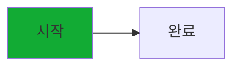
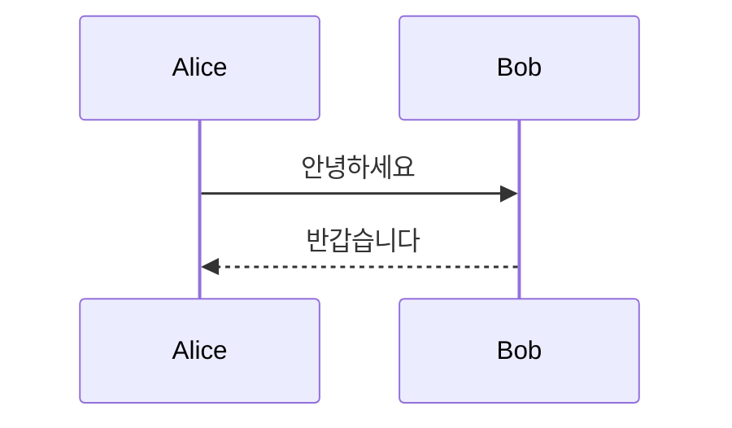
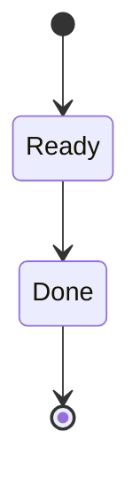
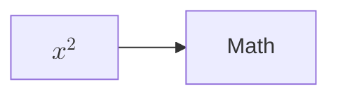

<!-- SPDX-License-Identifier: GPL-3.0-or-later -->

# Mermaid 미리보기



```mermaid
this is not a diagram
```







```rust
let value = "<tag>";
```

<script>document.documentElement.dataset.executed = 'script'</script>

<a id="script-link" href="javascript:document.documentElement.dataset.executed='link'">Unsafe link</a>
<button id="event-button" onclick="document.documentElement.dataset.executed='event'">Unsafe event</button>
