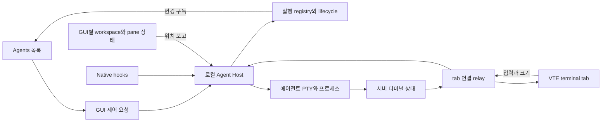
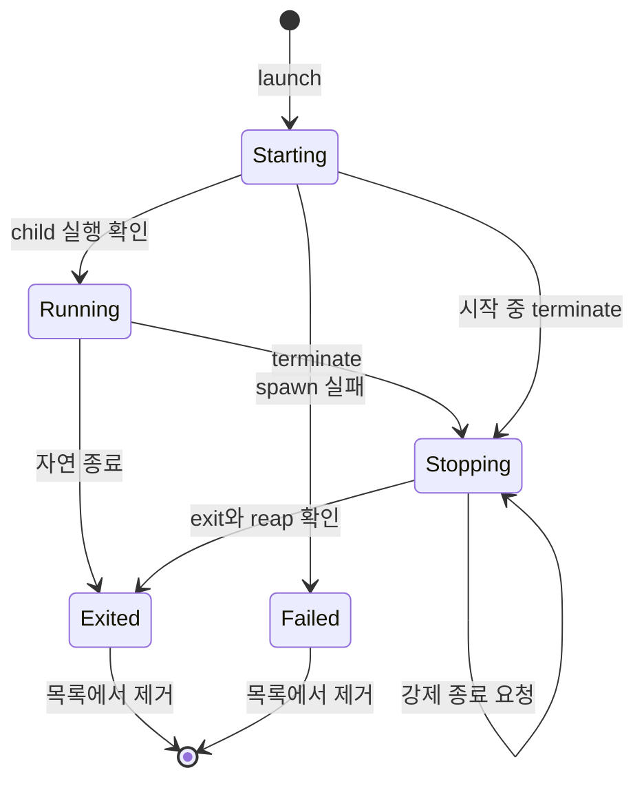

<!-- SPDX-License-Identifier: GPL-3.0-or-later -->

# Flowmux 활성 Agents와 지속 실행 설계

상태: 구현 진행 중. GUI 미연결 수명 정책은 사용자 결정 반영. 갱신일: 2026-11-17.
Flowmux 최초 분석 기준: `502d7b9e56e933fdb234347c554dcd0ff03461ac`. Host 기반 연결과 provider 판정 계획 기준: `32a4fafc`. 이후 명시적 launch·사용자 서비스 시작·관리 연결 gate 변경과 검증 결과는 §11에 별도로 구분한다.
외부 참고 구현 코드 기준: `ee5bfb5041bb3e4a49d591c72308aae3c81ecdde`.
외부 소스는 읽기만 했으며 코드·자산은 가져오지 않았다. 아래 외부 경로는 해당 리비전의 저장소 상대 경로다. 소스와 테스트를 검토했지만 외부 프로그램을 실행하여 검증하지는 않았다.

**현재 검토 결론: 계획 전체는 미완료다.** §11은 단계별 이력이며 이전 단계의 미전환 설명이 최신 상태를 뜻하지는 않는다. 현재 동작은 다음과 같다.

현재 누적 구현은 `4f0bf97e`(Host·GUI 런타임과 단위 검사), 격리 GUI 검사와 CI 연결은 `dcb24e8e`로 기록했다. 이후 작업도 검증한 변경 단위로 커밋한다. 설치·실행 중인 앱 교체는 수행하지 않았다.

| 사용자 동작 | 현재 구현과 제한 |
| --- | --- |
| Agents에서 드래그 | side panel·가로 bar의 별도 핸들로 기존 tab 이동과 managed 실행 재연결 제공. pane 본문·tab strip의 앞/뒤 삽입·같은 pane 재정렬·반복 이동·취소를 격리 GUI에서 검증. 같은 로컬 Host의 두 GUI 사이 핸들 이동도 연결했으며 §11의 protocol v11·v12 검증을 따름 |
| managed Agent tab 닫기 | Host가 같은 프로세스를 유지하고 목록의 Background에서 재연결. `New Agent`, Sessions Resume, Session Flow resume/fork, CLI `agent run` 경로를 연결 |
| managed Agent tab을 창 밖으로 분리 | 정식 GUI process·workspace에 기존 실행의 relay를 명시적으로 인계. 새 창의 준비와 승인 후 원래 tab만 닫으며 위치 조회·입력·Background 재연결 유지. 일반 terminal/editor의 widget 분리 경로는 유지 |
| 일반 terminal에서 실행한 Agent tab 닫기 | 기존 GUI 소유 실행이므로 종료됨. 임의 실행의 PTY 소유권 이전이나 자동 resume은 제공하지 않음 |
| 목록의 위치·열기·종료 | Host가 실제 relay를 검증한 Open/Visible·위치 확인 중 표시와 기존 위치 포커스·재연결, 명시적 중단·종료·강제 종료 메뉴 제공. Background 클릭과 Open in…/Move to…의 목적지 선택기로 로컬 terminal pane·새 workspace 선택 및 다른 GUI의 실행을 이 창으로 명시적 이동. 같은 Host에서 이전 저장 tab을 복원할 때 현재 소유권과 대조해 정리. 전역 저장 binding의 선제 조정·목록 정렬 등은 미완료 |
| managed 현재 위치·명령 | `identify`·Team context와 browser·terminal 명령을 Host의 실제 호출자·현재 연결로 검증. GTK 효과 직전 source를 재확인하고 이동 경합·탭 미연결은 거절. workspace 생성/전환과 `agent open`도 같은 GUI의 GTK source 재검증 경로를 사용. 자기 view 이동·다른 실행 열기에서 호출자 identity를 유지. 초기 화면 ready ACK·Connecting/실패 UI와 실제 relay 확인 후 열기 성공 응답을 추가. 명시적 lease 인계·성공 후 이전 창의 tab·저장 binding 정리에 GUI 목적지·DnD와 최종 GTK admission을 연결. crash/offline 전역 저장 binding 조정과 기타 미지원 명령은 남음 |
| managed 알림 | native hook의 인과 ID와 명시적 `notify`·`notify-complete`·`notify-stream`을 Host에 보관하고 GUI 알림 목록·읽음·삭제를 동기화. 명시적 알림은 실행을 대상으로 하며 `--pane` override는 거절. 알림 열기는 현재 실행 위치를 조회하며 Background는 목적지 선택기를 사용. 재연결 이력의 desktop 재발송을 억제하고 GUI 간 desktop 전달 claim을 단일화 |
| Codex 완료 후 지연 hook | 보관 중인 완료 ID의 root progress/start를 거절하고, 명시적 stop-hook 재시도와 재사용된 child의 새 작업은 유지. 이력 밖·identity 없는 사건의 재검증과 provider 전체 완료 판정은 남음 |
| GUI 미연결 30분 자동 종료 | provider 전체 완료·원자적 유휴 종료를 검증하기 전이므로 비활성. 후보 판정기와 설정 UI만으로 완료 판정하지 않음 |

이 검증에서는 debug 제품을 별도 Xvfb 또는 headless GNOME Wayland compositor·D-Bus·XDG 경로에서 실행했다. Wayland에서도 managed 드래그 24개와 Tab-bound 드래그 4개를 통과했으며, tab·GUI 종료 후 같은 PID의 Background 실행과 새 입력을 확인했다. 설치·사용자 앱 재시작은 하지 않았으므로 실행 중인 사용자 앱에는 변경이 반영되지 않았다. 실제 provider 모델 작업·macOS·전체 §10 수용 테스트 통과를 의미하지 않는다.

**추가 검토에서 재현한 결함과 후속 수정:** 아래 두 항목은 protocol v12 debug 제품의 별도 격리 실행에서 확인했으며 후속 protocol v13 debug 제품에서 수정했다. GUI launch의 relay 승인 대기 문제와 각 수정의 검증은 §11에서 별도로 다룬다.

- managed **탭 자체를 창 밖으로 분리**하면 Host의 `view`가 사라지고 `identify`가 `no_attached_view`로 실패하던 결함을 수정했다. 기존 `present_torn_off_surface`의 미등록 표시 창 대신 정식 GUI process를 열어 기존 lease 인계·GTK admission·원래 tab 정리 경로를 재사용한다. 새 창 준비 중 attachment가 바뀌면 이동을 거절하며 자동 재시도하지 않는다. 수정 전 v13에서도 재현했다(`/tmp/fm-tearoff-before-v13.log`, `/tmp/fm-gui-h3afwsn8`). 수정 후 X11·Wayland의 실제 tab 드래그와 같은 PID·위치 조회·입력·Background 재연결을 검증했다. 근거: [surface_ops.rs](../crates/flowmux/src/ui/window/surface_ops.rs), [agent_host.rs](../crates/flowmux/src/agent_host.rs), §11의 tab 창 분리 검증.
- Host가 계속 살아 있는 동안 **종료 이력까지 합쳐 32회 launch**하면 새 실행을 거절하던 결함은 protocol v13에서 수정했다. v12에서는 하나의 Agent를 유지하고 짧은 작업 31개를 차례로 종료한 뒤 다음 launch에서 `Agent Host instance limit reached`를 재현했다(`/tmp/fm-current-host-cap.log`). 수정 후에는 실행·시작 예약·마지막 화면 전달의 32개 한도와 종료 이력을 분리한다. 종료 결과와 launch ID를 함께 정리하고, 삭제한 요청의 재실행을 막는 시각 경계를 유지한다. 실제 GUI에서 원래 Agent를 유지한 채 짧은 실행 100개와 탭 재연결을 검증했다. 근거: [host.rs](../crates/flowmux-daemon/src/agent_host/host.rs), §11의 protocol v13 검증.

## 1. 권장 결정

**에이전트 실행은 GUI와 독립된 로컬 Agent Host가 소유하고, pane 안의 terminal tab은 그 실행에 연결하는 화면으로 만든다.** 왼쪽 하단 Agents 영역은 모든 workspace에 걸친 실행 목록이 된다. 화면이 없어도 실행은 목록에 남는다.

- Agent tab 닫기, pane/workspace 닫기, GUI 종료는 화면 연결을 해제한다. GUI 연결이 모두 끊겨도 작업 중인 에이전트는 종료하지 않는다. 작업 완료가 확인된 실행만 30분 후 자동 종료하며 목록의 명시적 종료 명령도 제공한다.
- 모든 에이전트와 소유 자식의 종료·회수가 끝나면 Host도 종료한다. 빈 Host를 유지하는 별도 유예 시간은 두지 않는다.
- 목록에서 pane으로 드롭하면 그 pane에 별도의 Agent tab을 연다. 이미 열려 있으면 같은 실행의 화면을 옮긴다. 프로세스를 다시 실행하거나 provider의 resume을 호출하지 않는다.
- 첫 버전은 에이전트 실행 하나당 **조작 가능한 화면 하나**를 허용한다. 여러 GUI를 포함한 동시 입력·서로 다른 크기 충돌을 막는다.
- 실행 생존, 작업 상태, 화면 위치를 구분한다. `작업 중 · 백그라운드`, `입력 대기 · Backend / 오른쪽 pane / Codex tab`처럼 표시한다.
- 기존 Session Flow와 Agent sessions는 대화 기록·계보를 담당한다. 이 기능은 살아 있는 실행을 담당한다. 같은 native session을 다시 시작하는 것과 살아 있는 프로세스에 연결하는 것은 다른 작업이다.

## 2. 참고 구현에서 코드로 확인한 내용

### 실행과 화면의 분리

| 확인 내용 | 코드 근거 | Flowmux에 주는 의미 |
| --- | --- | --- |
| 서버를 별도 프로세스로 띄우고 stdio를 null로 연결하며 플랫폼의 detach 경로를 호출한다 | `src/server/autodetect.rs:194–250`, `spawn_server_daemon`, `build_server_daemon_command` | GUI의 자식 터미널 수명에 실행을 묶지 않아야 한다 |
| 서버가 터미널 모델, PTY, child waiter, I/O actor를 만든다. 프로세스 종료는 별도 이벤트다 | `src/pane.rs:2687–2775`, `spawn_command_builder`; `src/terminal/runtime_registry.rs`, `TerminalRuntimeRegistry` | 화면이 없어도 출력 소비·작업 상태 갱신·종료 감시가 계속되어야 한다 |
| 클라이언트 제거 시 연결·입력 상태·geometry 소유권을 정리한다. 터미널 runtime을 제거하지 않는다 | `src/server/headless.rs:946–1040`, `remove_client` | 연결 끊김을 프로세스 종료로 처리하면 안 된다 |
| 직접 attach는 terminal ID로 기존 runtime을 찾는다. 소유자가 있으면 거절하고 명시적 takeover만 허용한다 | `src/server/headless.rs:1737–1839`, `attach_terminal_client` | 실행 ID와 화면 ID를 분리하고 입력 소유권을 중재해야 한다 |
| attach 때 렌더 baseline을 초기화하고 해당 runtime의 크기를 조정한다 | 같은 함수 `1820–1837`; `src/server/headless/render.rs`, `render_and_stream_with_graphics_limit` | 재연결은 현재 화면 상태 동기화를 포함한다 |
| 클라이언트 출력 큐가 가득 차면 해당 연결의 전체 화면 재전송을 예약한다. 느린 연결이 다른 연결의 전체 재렌더를 강요하지 않는다 | `src/server/headless/render.rs:980–1007` | 느린 UI 때문에 에이전트 실행이나 다른 UI 입력을 막으면 안 된다 |

단순한 stdout 중계가 아니다. 서버 안에 터미널 에뮬레이터가 있고 화면·입력 모드·스크롤 상태를 관리한다. 연결이 없어도 PTY 출력을 계속 처리하기 때문에 다시 연결한 화면에 현재 상태를 제공할 수 있다.

### 에이전트 상태 조정

`src/detect/mod.rs:11–19`의 활동 상태는 `Idle / Working / Blocked / Unknown`이다. 프로세스 식별은 foreground job, 실행 파일과 argv 등을 보고, 화면·OSC는 활동 판정에 사용한다. `full_lifecycle_hook_authority`와 `session_identity_only_integration`을 구분하므로 세션 ID 보고만으로 작업 상태 전체를 권위 있게 판정하지 않는다.

`src/terminal/state.rs:2137–2309`는 관리되는 에이전트의 시작을 `Pending → Active` 또는 `Blocked`로 조정한다. 기대한 provider가 관측됐는지, 준비 지연과 timeout, prompt 준비 여부를 확인한다. 프로세스 종료·다른 provider 관측·시작 timeout이면 관리 이름을 해제한다. **spawn 성공, 대화 식별, 입력 가능 상태는 동일하지 않다.** 이 시작 단계와 `Working` 같은 활동 상태도 별개다.

`src/pane/agent_detection.rs`의 `decide_detection_screen_read`, `decide_detection_transition`은 화면 변경과 상태 근거를 구분한다. 변경 없는 idle 화면을 반복 스캔하지 않으며 화면 신호와 기존 상태를 조정한다. Flowmux는 이 판정기를 복제하지 않고 기존 hook/process/screen 규칙을 유지한다.

### 생존 보장의 경계

| 사건 | 확인한 동작 |
| --- | --- |
| 터미널 클라이언트 detach 또는 연결 drop | 서버와 PTY 실행 유지. `tests/detach_reattach.rs`의 `processes_survive_during_and_after_detach`, `server_persists_after_client_connection_drop`에 검증 코드 존재 |
| 화면 없이 출력 발생 | 계속 축적·처리. `output_accumulated_while_detached_visible_on_reattach`에 검증 코드 존재 |
| 마지막 클라이언트 detach | 마지막 PTY 크기 유지에 대한 `detached_output_preserves_last_attached_pty_size` 검증 코드 존재 |
| pane 자체를 close | `src/app/api/panes.rs:1967–2018`에서 연결 없는 terminal ID/runtime을 정리한다. 클라이언트 detach와 다르다 |
| runtime 명시적 종료 또는 drop | `src/pane.rs:1702–1807`, `2234–2245`: I/O·감시 task 정리와 session 프로세스의 Hangup → Terminate → Kill 수행 |
| 계획된 서버 교체 | `src/server/headless/lifecycle.rs`, `perform_live_handoff`: reader 정지, snapshot과 PTY FD 전달, restored/ready/commit 확인 후 소유권 이전. 실패 시 rollback. Unix 전용 |
| 일반적인 cold restore | `src/persist/restore.rs`, `restore_tab`: 저장된 대화 정보로 native resume을 준비할 수 있다. 살아 있는 PTY의 attach와 다르다 |

따라서 “앱을 껐다 켜도 유지”는 **클라이언트만 종료한 경우**에 명확히 성립한다. 계획된 FD 인계도 임의의 서버 crash나 OS 재부팅 후 동일 프로세스 생존을 뜻하지 않는다. Flowmux는 pane 닫기에도 실행을 유지하도록 제품 계약을 확장하되, 서버 hot handoff까지 첫 버전에 넣지는 않는다.

## 3. 현재 Flowmux와 필요한 변경

다음 표는 최초 분석에서 확인한 구조와 변경 방향이다. 이후 Host 기반 구현의 연결 상태는 이 절의 마지막 표와 §11에서 구분한다.

| 현재 코드 | 확인한 사실 | 필요한 변경 |
| --- | --- | --- |
| [ghostty_pane.rs](../crates/flowmux/src/ui/ghostty_pane.rs), `spawn`, `close_pty` | GUI가 `Pty::spawn_gated`로 자식을 만들고 master의 복제 FD를 VTE에 연결한다. GUI가 수명을 소유한다 | Agent tab은 실제 agent PTY 대신 연결용 relay만 소유 |
| [pty.rs](../crates/flowmux-terminal/src/pty.rs), `Drop`, `close_async` | master close와 SIGHUP, 비동기 reap/강제 종료 경로가 있다 | 실제 agent PTY의 소유자를 Host로 옮김. 일반 terminal의 기존 종료 의미는 보존 |
| [pty_tee.rs](../crates/flowmux-cli/src/pty_tee.rs) | Linux 부모 사망 시 SIGHUP, EOF·signal 종료 처리가 있다 | 기존 tee를 그대로 GUI 아래 두고 “지속 실행”으로 간주하지 않음 |
| [main.rs](../crates/flowmux-daemon/src/main.rs) | 현재 daemon은 IPC handler와 window state claim/persistence 진입점 | 별도 agent-host 모드를 추가하되 workspace 소유권을 claim하지 않음 |
| [lib.rs](../crates/flowmux-core/src/lib.rs), `PaneSurface`, `AgentBarItem`, `collect_agent_bar_model` | agent presence가 surface에 붙고 목록도 workspace의 surfaces에서 수집됨 | 실행 registry에서 목록을 만들고 화면 위치는 attachment로 결합 |
| [agent_runtime.rs](../crates/flowmux-daemon/src/state_store/agent_runtime.rs) | lifecycle ledger와 관측이 SurfaceId·workspace 위치에 결합됨 | 판정 규칙을 공유하고 managed 실행의 ledger key를 InstanceId로 분리 |
| [agent_bar.rs](../crates/flowmux/src/ui/agent_bar.rs) | SurfaceId 기준 안정된 widget 재사용, 클릭으로 기존 위치 열기, 목록 내 순서 드래그 | InstanceId 기준 재사용, 위치 선택·실행 종료·pane drop 추가 |
| [workspace_view.rs](../crates/flowmux/src/ui/workspace_view.rs), [surface_ops.rs](../crates/flowmux/src/ui/window/surface_ops.rs) | tab 이동과 기존 widget 보존 경로, 여러 teardown에서 `close_pty` 호출 | managed tab은 모든 teardown에서 detach, 이동은 연결을 유지 |
| [agent_sessions.rs](../crates/flowmux-state/src/agent_sessions.rs), [sessions.rs](../crates/flowmux/src/ui/window/sessions.rs) | 저장한 native session에 resume 명령을 실행 | managed binding은 Host 조회 우선. 실패 시 자동 resume하여 중복 실행하지 않음 |
| [hook_install.rs](../crates/flowmux-cli/src/hook_install.rs), [hooks.rs](../crates/flowmux-cli/src/hooks.rs), [terminal/lib.rs](../crates/flowmux-terminal/src/lib.rs) | shim이 실제 agent PID를 보존하고 pane/surface와 GUI별 socket을 상속 | managed 실행은 안정된 Host 주소·InstanceId 사용. 기존 provider 환경과 hook trust 보존 |

기존 [Session Flow 설계](agent-session-flow-design.md)의 “앱 종료 후 지속 실행은 범위 밖”은 그 기능의 경계다. 본 제안은 그 밖의 실행 계층을 추가하며 계보 모델을 대체하지 않는다.

### 현재 상태 판정 점검과 이관 조건

**현재 판정기는 UI 상태 표현에 재사용할 수 있지만, 그 결과를 바로 자동 종료 조건으로 사용할 수는 없다.** 아래는 문서 상단의 최초 분석 리비전을 기준으로 확인한 제약이다. 현재 코드에 이 문서의 자동 종료 기능이 이미 구현되어 있다는 의미는 아니다.

| 점검 대상과 코드 근거 | 확인한 제약 | 설계에 반영할 조건 |
| --- | --- | --- |
| [cmd_hooks.rs](../crates/flowmux-cli/src/cmd_hooks.rs)의 Claude Stop, [hook_install.rs](../crates/flowmux-cli/src/hook_install.rs)의 `CLAUDE_EVENTS`, `agent_runtime.rs`의 `TurnStopped` | Claude Stop은 shell·예약 작업이 남아 있어도 응답 종료를 보고한다. 현재 설치 이벤트에는 SubagentStart/SubagentStop이 없고, 비 Codex Stop은 UI를 Idle로 만들 수 있다 | root 응답 완료와 전체 작업 완료를 분리. provider별 child/tool/백그라운드 작업 관측 범위와 누락 여부 확인이 선행되어야 함 |
| `agent_runtime.rs`의 `CodexRootProgressObserved`, `remember_settled_codex_turn`, [hooks.rs](../crates/flowmux-cli/src/hooks.rs)의 `hook_seq` | 완료된 동일 turn의 늦은 progress가 Working을 복구할 수 있다. 완료 ID 보관은 32개로 제한되며 hook seq는 hook 생성 시점의 벽시계 값이다 | 큰 seq를 새 작업의 증거로 사용하지 않음. 완료된 작업의 지연 이벤트, 명시적 재개, 실제 새 작업을 구분하고 이력 밖 사건은 확인 불가로 처리 |
| [core/lib.rs](../crates/flowmux-core/src/lib.rs)의 `public_status`, `AgentStatusEvidence`, `agent_runtime.rs`의 화면 보정 | UI Done은 `Idle && !seen`이다. evidence의 UTC 시각은 표시 근거가 성립한 시각이며, 완료 이후에도 변경된 spinner가 Working을 복구할 수 있다 | seen·표시 상태·근거 출처와 독립된 작업 완료 기록 및 단조 시간 deadline 필요. 화면 변화만으로 완료를 취소하거나 새 완료 시각을 만들지 않음 |
| `agent_runtime.rs`의 surface 기반 ledger와 `forget_cleared_agent_surfaces`, [polling.rs](../crates/flowmux/src/ui/window/polling.rs), [window/agent_bar.rs](../crates/flowmux/src/ui/window/agent_bar.rs), [ipc_handler.rs](../crates/flowmux/src/ipc_handler.rs) | workspace 제거 시 ledger가 사라진다. 프로세스 관측·VTE 화면 관측·Codex Stop의 250ms 후 확정 예약은 GUI에 의존한다 | managed ledger는 InstanceId로 유지. hooks 수신·프로세스 관측·headless 화면 보정·지연 확정을 모두 Host로 이관 |

공개 `StateStore` API를 사용하는 독립 메모리 재현에서 다음 순서를 확인했다. seq 값은 순서를 설명하기 위한 입력값이며 원본 provider 인과 순서를 보증하지 않는다.

```text
TurnStarted(turn-1, seq=10)
→ CodexTurnStopped(turn-1, seq=20) → grace 확정: Idle / Completed
→ CodexRootProgressObserved(turn-1, seq=30): Working / outcome 없음
→ CodexTurnStopped(turn-1, seq=40, stop_hook_active=false): Working 유지
```

따라서 UI Working만 따라 타이머를 취소하면 완료된 실행을 계속 유지할 수 있다. 반대로 같은 turn의 모든 후속 이벤트를 버리면 실제 stop-hook 재시도나 명시적 작업 재개를 놓친다. 작업 identity와 재개 근거를 검증하는 공통 전이 규칙이 필요하다. `ProgressObserved`처럼 작업 식별 정보가 부족한 이벤트도 같은 분류를 거쳐야 한다.

후속 구현은 보관 중인 완료 ID의 root progress/start를 공통 reducer에서 거절하며 명시적 stop-hook 재시도는 허용한다(§11). 이력에서 제거된 ID·식별 정보 없는 progress의 인과 판정과 provider 전체 완료 검증은 여전히 남아 있다. 위 재현은 최초 분석 당시의 결과다.

재사용할 것은 Codex 부모·자식 상관관계, 관측된 child 완료까지 부모 완료를 미루는 규칙, permission/tool/session wait와 해결된 wait 중복 제거, 재시도 구분, 새 진행으로 잠정 Stop을 무효화하는 규칙, 화면 fingerprint와 완료 후 동일 spinner 억제다. **관측된 child가 없다는 사실만으로 실제 하위 작업이 없다고 증명하지는 않는다.** Antigravity의 `fully_idle == false` 방어와 Gemini 등에서 사용하는 600ms 안정된 ready 화면도 유지하되, 필드 누락이나 화면 추정만으로 전체 완료를 확정하지 않는다.

일반 IPC Ping은 현재도 [handler.rs](../crates/flowmux-daemon/src/handler.rs)에서 Pong으로 응답하며 작업 상태를 바꾸지 않는다. 이 계약은 유지한다. 보완 대상은 의미가 불명확한 진행 이벤트와 UI 보정이 종료 판단에 섞이는 경로다.

### Host 기반 구현 이후의 연결 상태

`dfc1f61f`에는 PTY를 유지하는 Host와 회수 후보 정책이 있지만, **실행 생존의 구현과 작업 완료 판정의 구현은 별개**다. 현재 연결 상태를 기준으로 다음 작업을 구분한다.

| 연결 지점 | 확인한 상태 | 다음 구현의 완료 조건 |
| --- | --- | --- |
| [host.rs](../crates/flowmux-daemon/src/agent_host/host.rs)의 `Hello`와 `connection_closed`, [GUI 관리 연결](../crates/flowmux/src/agent_host.rs) | GUI 역할의 handshake/EOF가 정책의 연결 집합을 갱신한다. GUI는 tab과 독립된 상시 연결·재접속 및 설정 변경 전파를 수행함. 후속 변경은 GUI relay의 준비·확정 모두에 관리 연결을 요구함 | 최초 관리 연결은 tab 복원 전에 시도하며 미등록 상태에서는 입력 소유권을 넘기지 않음. 일회성 조회·hook·relay는 GUI 연결을 대신하지 않음. 향후 자동 종료 수락과도 같은 revision 경계에서 직렬화 |
| 같은 파일의 `HostHandler` | 후속 구현에서 InstanceId·epoch·root PID/birth와 native session을 검증하여 lifecycle hook을 공통 reducer로 전달. CLI native hook routing·browser/terminal/workspace context·lifecycle 및 명시적 알림도 연결함 | Gemini·Antigravity·Cline의 화면 의존 상태 판정을 Host에도 연결함. provider 전체 완료 검증·기타 미지원 명령 연결은 남음 |
| 공통 `lifecycle.rs`와 `TerminalActor`의 ledger | 일반 terminal은 SurfaceId, managed 실행은 InstanceId 기반. Host가 managed wait·Codex Stop grace를 소유하여 tab/GUI 제거 후에도 유지함 | 전체 작업 완료 검증과 회수 정책 연결. UI의 idle 추정만으로 자동 종료하지 않음 |
| [retirement.rs](../crates/flowmux-daemon/src/agent_host/retirement.rs)의 `WorkDisposition` | `Working / VerifiedComplete / Unknown`, 최초 완료 시각·revision·단조 시간 deadline을 제공함. 전체 완료 검증 adapter와 실제 자동 종료는 연결 전 | §5의 정규화 결과만 입력. `completion_verified` 호출 전 root·child·tool·wait와 관측 공백 확인. 만료 후에도 provider의 안전한 유휴 종료 수락 필요 |
| `host.rs`의 `TerminalActor` 입력 처리 | PTY 입력 수락과 interrupt는 `observation_uncertain`을 호출한다. 입력 ACK는 provider가 새 작업을 수락했다는 증거가 아님 | 초안 입력·커서 이동·상태 조회와 실제 요청 제출을 구분. provider의 작업 수락 확인 후에만 generation 변경. 작업을 시작하지 않은 입력이면 기존 완료 기준을 재검증해 복구 |
| [workspace_view.rs](../crates/flowmux/src/ui/workspace_view.rs)의 terminal 복원 | managed binding이 있으면 relay만 생성하고 기존 실행에 연결. 초기 snapshot ACK·실제 relay 검증 후 입력과 연결 표시를 활성화. 일반 terminal의 shell·native resume·scrollback 경로는 별도 유지 | Host 실패·epoch 불일치는 연결 오류로 유지. 실제 provider TUI와 macOS 복원 검증은 남음 |

따라서 기존 `AgentStatus`에 상태 하나를 추가하는 것으로 해결하지 않는다. 기존 UI 판정은 보존하면서 **관측과 완료 기록의 소유자를 Host로 옮기고, 그 검증 결과를 회수 정책에 연결**한다. 완료 관측이나 안전한 종료가 지원되지 않는 provider는 보류 이유를 표시하고 실행을 유지한다.

### 공통 판정 로직의 Host 이관 계약

`e51c7798`의 호출 경로를 기준으로, [agent_runtime.rs](../crates/flowmux-daemon/src/state_store/agent_runtime.rs)의 `report_agent_lifecycle_with_visibility`는 local surface 검사·현재 presence 조회·lifecycle ledger 갱신·workspace 상태 적용·알림 식별자 생성을 함께 수행한다. Host에 이 메서드를 그대로 호출하거나 가짜 workspace/surface를 만들어 연결하지 않는다. **이벤트 판정과 ledger 갱신을 기존 경로에서 분리해 일반 terminal과 managed 실행이 같은 규칙을 호출**하도록 한다.

| 현재 결합 지점 | 분리 후 책임과 보존 조건 |
| --- | --- |
| `AgentLifecycleKey = (SurfaceId, provider, native session)` 및 Codex turn key | 일반 terminal은 기존 surface 소유권 유지. managed ledger는 Host epoch·InstanceId에 귀속하고 provider/native session·process identity를 검증. attachment의 surface를 ledger identity로 사용하지 않음 |
| `report_agent_lifecycle_with_visibility`의 identity·sequence 검사와 child/tool/wait 전이 | 공통 전이 로직에 유지. provider별 중복 제거, 종료 session tombstone, child별 순서, permission batch와 해결된 tool ID의 보관 범위를 그대로 보존. 종료 정책용 의미 분류는 §5의 정규화 계약에 따라 추가 |
| `LifecycleCheckpoint`와 `apply_agent_status_report` | 일반 terminal의 보고 거절 시 해당 session만 복구하는 기존 동작 유지. managed 실행의 수락 여부는 Host identity·revision으로 결정하며 GUI/workspace 부재나 UI 변경 없음 때문에 유효한 ledger 갱신을 취소하지 않음. 거절된 사건은 다른 session의 ledger를 변경하지 않음 |
| [ipc_handler.rs](../crates/flowmux/src/ipc_handler.rs)의 Codex Stop grace 예약 | managed 예약은 Host가 소유. callback에 실행 identity·작업 generation·Stop 식별자를 결합하고 최신 revision을 재검사. detach 후에도 실행하되 새 진행·child/wait·identity 변경으로 무효화된 Stop은 완료로 확정하지 않음 |
| `pending_provider_surfaces`, `settle_provider_turn_from_screen`와 GUI process polling | managed 실행은 Host PTY의 headless 화면·소유 process 관측 사용. 기존 fingerprint·안정된 ready 화면 규칙은 UI 보정으로 재사용하며 전체 작업 완료 근거로 승격하지 않음 |
| `forget_cleared_agent_surfaces`와 tab/pane/workspace 정리 | 일반 terminal의 정리 계약 유지. managed 화면 제거는 attachment만 정리하며 ledger·wait·예약된 확정은 보존. 실제 session/process 종료에서만 해당 실행의 수명 기록을 정리 |
| `AgentLifecycleResult`의 workspace·알림 결과 | 공통 판정 결과에서 UI projection·알림 처리를 분리. managed 갱신은 화면 없는 상태에서도 성공하며, 재연결은 기존 Host 상태를 읽음. 재연결을 새 작업이나 새 완료 알림으로 처리하지 않음 |

Host hook ingress도 같은 이관 범위다. 현재 [hooks.rs](../crates/flowmux-cli/src/hooks.rs)의 lifecycle 요청은 surface를 요구하고 GUI socket 전달 경로를 사용하므로, managed 요청에는 실행 identity를 명시하고 Host에서 검증한 뒤 공통 전이에 전달한다. 다른 실행의 사건은 거절하며, 대상 실행은 맞지만 작업 관계가 불명확한 사건은 자동 종료를 보류한다. Host 부재·epoch 불일치·detach를 이유로 다른 GUI socket에 전달하지 않는다. pane 명령은 현재 attachment를 조회하며 화면이 없으면 명확한 오류를 반환한다. 이 경로와 기존 hook 설치·`doctor` 검증이 갖춰지기 전에는 기본 shim을 managed 실행으로 바꾸지 않는다.

### Provider별 상태 판정 적용 계획

`cb076585`의 [설치 이벤트](../crates/flowmux-cli/src/hook_install.rs), [hook 변환](../crates/flowmux-cli/src/cmd_hooks.rs), `agent_runtime.rs`를 기준으로 다음을 구분한다. 아래는 현재 코드의 관측 범위와 보완 계획이며 provider의 실제 동작 검증 결과가 아니다.

| Provider | 현재 코드에서 얻는 근거 | Host 이관 때 유지·보완할 계약 |
| --- | --- | --- |
| Codex | root/child turn identity, child 진행·종료, permission scope, 부모 Stop의 grace 확정과 완료 turn 이력 | 부모·자식의 서로 다른 turn ID와 재사용된 child를 유지. 완료 후 큰 seq의 progress를 새 작업으로 단정하는 경로를 정규화하고, 관측되지 않은 child·비동기 작업 및 Stop veto를 재검증 |
| Claude | prompt/tool 시작·종료, permission·입력 대기, Stop/StopFailure. 설치 이벤트에 SubagentStart/SubagentStop은 없음 | 응답 Stop을 전체 완료로 승격하지 않음. 하위·백그라운드 작업 관측을 보완하고, permission batch는 PostToolBatch까지, 해결된 tool-use ID는 turn/session 경계까지 유지 |
| Gemini / Antigravity | 일반 Stop을 잠정 기록한 뒤 안정된 ready 화면으로 UI 완료 보정. Antigravity의 `fully_idle == false`는 Stop 적용을 막음 | 600ms 화면 안정 조건은 기존 UI 보정으로 유지. `fully_idle` 누락·idle 화면만으로 전체 완료를 확정하지 않고, GUI 없는 headless 관측과 전체 작업 재검증을 연결 |
| Cline | TaskStart/TaskResume/UserPromptSubmit, TaskComplete/TaskCancel/TaskError 및 session 종료 hook | TaskComplete·취소를 작업 종료 후보로 사용하되 미해결 작업·재시도와 관측 범위를 확인. TaskError 통지만으로 실패 작업이 끝났다고 단정하지 않음 |

각 provider의 자동 회수 활성화에는 **GUI 없이 유효한 관측, 전체 작업 완료 재검증, 새 작업 시작과 경합하지 않는 유휴 종료 수락**이 모두 필요하다. 코드에서 이벤트 이름을 찾았거나 UI 완료 검사가 통과한 사실은 이 세 조건의 검증을 대신하지 않는다. 위 표 밖의 provider·버전·hook 미설치 경로도 같은 기준을 적용하며, 지원 근거가 없으면 실행을 보존한다. 현재 Host에 provider hook 전달은 연결했지만 전체 완료 adapter와 안전한 유휴 종료 수락 검증은 남아 있으므로 모든 provider의 실제 자동 회수는 미활성 상태다.

## 4. Agents 목록과 상호작용

왼쪽 하단 기존 Agents 영역을 확장한다. 현재 workspace 필터와 무관한 전체 활성 목록이 기본이다. 기존 가로 Agents bar를 켰다면 같은 registry의 축약 표현을 사용한다. Agent sessions 기록 목록과는 분리한다.

```text
Agents                                      [+ New] [⋯]
[All] [Background] [Needs input]       검색…

◌ Codex · API 수정                        [⋯]
  Working              Background
  ~/dev/api

! Claude · 리뷰                           [⋯]
  Needs input          Open · hidden tab
  Backend / 오른쪽 pane / 리뷰             [이동]

● Codex · 테스트                          [⋯]
  Idle                 Visible
  Frontend / 왼쪽 pane / 테스트             [이동]
```

위는 정적 배치 예시이며 작동하는 UI가 아니다. 애니메이션은 유지한다. 텍스트·아이콘·접근성 이름으로 상태를 함께 전달하고 색상만으로 구분하지 않는다. 행의 drag handle과 메뉴 버튼을 분리해 종료 버튼이나 메뉴 조작이 drag로 해석되지 않게 한다.

### 상태 표시

| 축 | 값과 표시 규칙 |
| --- | --- |
| 실행 | `Starting / Running / Stopping / Exited / Failed`. Host에 연결할 수 없으면 별도 `Connection lost` 오버레이. 이를 Exited로 단정하지 않음 |
| 활동 | 기존 `AgentStatus`, wait reason, turn outcome 재사용. Idle도 프로세스가 살아 있으면 활성 목록에 유지 |
| 표시 위치 | `Background`: 연결된 tab 없음. `Open`: tab은 있으나 비활성 tab/workspace 또는 숨겨진 창. `Visible`: 해당 tab과 workspace가 선택되고 창이 표시됨 |
| 준비 상태 | 프로세스는 Running이어도 provider 준비 중일 수 있음. `Starting agent…`나 입력 대기 원인을 함께 표시 |
| 자동 종료 판단 | 작업 중/완료 확인/확인 불가, 보류 이유와 완료 시각. GUI 연결 중에는 자동 종료하지 않으며 `GUI 연결 해제 후 작업 완료 상태로 30분 유지` 정책을 표시 |

`Visible`은 GUI가 보고한 mapped/선택/minimized 상태다. 다른 앱 창에 가려진 실제 픽셀 가시성까지 판정하지 않는다. 살아 있는 GUI 연결이 끊기면 위치를 즉시 해제하고, 정상 연결인데 보고가 멈추면 `위치 확인 중`으로 표시한다. 마지막 위치를 현재 위치처럼 확정하지 않는다.

종료된 실행은 기존 순서를 흔들지 않도록 `Recently ended`에 남기고 닫을 수 있다. 목록 제거는 native 대화 기록 삭제가 아니다. 정렬은 사용자 순서/생성 순서를 유지하고 작업 상태가 바뀔 때 행을 재정렬하지 않는다.

### 클릭·메뉴·드래그 계약

| 사용자 동작 | 결과 |
| --- | --- |
| 이미 열린 행 클릭 또는 Enter | 기존 workspace·pane·tab으로 이동. 사용자의 명시적 이동이므로 focus 변경 허용 |
| Background 행 클릭 또는 Enter | 위치 선택기: 현재 workspace의 최근 terminal pane을 기본값으로 보여주고 확인하면 새 tab 연결 |
| `Open in…` | 현재/다른 로컬 workspace → pane 선택. 없으면 `새 workspace` 선택 가능. 선택 완료 전에는 실행·layout 변경 없음 |
| 이미 열린 행의 `Open in…` | `Move to…`로 표시. 같은 실행의 기존 화면을 목적지로 이동 |
| 행을 pane 본문에 드롭 | terminal이 있는 해당 pane의 끝에 별도 Agent tab 추가·선택. 기존 tab 내용과 shell 입력 보존 |
| 행을 pane tab strip에 드롭 | 삽입 위치 표시 후 해당 위치에 Agent tab 추가/이동 |
| 같은 pane에 이미 있는 실행을 드롭 | 해당 tab 선택, 필요 시 순서 이동. 중복 tab/프로세스 생성 없음 |
| drag 취소·유효하지 않은 위치·목적지 삭제 | 원래 상태 유지. agent command나 prompt 텍스트가 terminal에 붙여넣어지지 않음 |
| Agent tab의 X 또는 `Hide terminal` | tab 연결 해제. `백그라운드에서 계속 실행 중` 안내. 마지막 pane/tab 처리에는 기존 layout 제약 적용 |
| `Interrupt current turn` | 지원되는 provider interrupt 또는 명시된 Ctrl+C 입력. 종료와 구분하며 결과 확인 전 완료로 표시하지 않음 |
| `Terminate agent…` | 이름과 실행 중 작업 손실 가능성을 표시한 확인 후 해당 실행과 소유 자식만 종료. 모든 연결 화면에 종료 결과 반영 |
| `Force terminate…` | 정상 종료 제한 시간 초과 시 제공. 강제 종료도 실제 child exit/reap 확인까지 Stopping |

Background 실행의 기본 열기 위치가 없어도 실패 후 아무 곳에 열지 않는다. 선택기에서 새 workspace를 고르게 한다. 드래그 없이 메뉴·키보드로 같은 작업이 가능해야 한다. 초기 버전은 동일 로컬 Host의 workspace/pane만 목적지로 허용하며 SSH workspace로 옮겨 원격 실행처럼 보이게 하지 않는다.

## 5. 실행 구조와 데이터 모델



새 서비스 패키지를 늘리기보다 `flowmux-daemon --agent-host` 진입점을 제안한다. 기존 headless handler 모드와 분리하고 agent-host에서는 `claim_window`를 호출하지 않는다. GUI마다 workspace/layout을 소유하는 현재 규칙을 유지한다. `flowmux-terminal`의 PTY, `flowmux-procmon`의 identity 검사, `flowmux-ipc`의 로컬 transport와 `flowmux-state`의 atomic 저장 패턴을 재사용한다.

Host는 사용자·실행 환경별 하나다. 기존 GUI PID socket과 별도의 안정된 agent socket을 경로 helper로 만든다. 생성 lock과 연결 handshake로 두 GUI의 동시 시작을 직렬화한다. GUI 종료와 독립된 session/stdio로 띄우고 GUI가 Host에 parent-death kill을 설정하지 않는다. 작업 중인 실행은 유지하고 GUI 미연결·작업 완료 상태의 실행은 아래 30분 정책으로 종료한다. 모든 실행이 종료·회수되면 Host도 종료한다.

프로세스 분리만으로 플랫폼의 앱 종료 정리를 벗어났다고 간주하지 않는다. Linux의 cgroup과 macOS의 앱 coalition/launchd 수명을 검증하고 필요한 경우 사용자 서비스에서 Host를 시작한다. GUI 강제 종료에도 Host·PTY·실제 에이전트가 생존하는 것을 플랫폼별 출시 조건으로 삼는다. 사용자 서비스가 빈 Host를 무조건 재시작하지 않도록 정상 종료와 명시적 시작을 구분한다.

Linux의 사용자 서비스 관리자를 사용할 수 있으면 GUI와 별도의 transient service에서 Host를 시작하는 경로를 우선 검증한다. 기존 [process_scope.rs](../crates/flowmux/src/process_scope.rs)의 terminal scope 연결은 Host 시작과 구분하며, relay의 scope 종료가 Host에 전파되지 않아야 한다. `setsid`와 stdio 분리만으로는 GUI cgroup에서 벗어나지 않는다. 서비스 관리자 미지원 환경·Flatpak·macOS는 해당 환경의 시작/종료 경계를 따로 검증하고, 실패 시 살아 있는 Host를 종료하거나 중복 생성하지 않고 시작 실패 이유를 반환한다.

### Host 시작과 플랫폼별 소유권

Host 시작은 **명시적 새 실행 요청**에만 허용한다. 기존 실행 열기·저장 tab 복원·GUI 관리 연결·목록 조회는 기존 Host에 연결만 한다. 시작 책임과 재연결 책임을 분리하여, 마지막 에이전트가 끝난 뒤 GUI의 재접속 루프가 빈 Host를 되살리지 않게 한다.

| 경로 | 시작·실패 계약 |
| --- | --- |
| `flowmux agent run -- <argv>` / 향후 GUI `New Agent` | argv·실행 파일·cwd·로컬 목적지를 검증한 뒤 기존 Host handshake. endpoint 부재·connection refused 때만 사용자 서비스 시작 시도 |
| 응답 없는 Host·버전 불일치·권한 오류 | 기존 프로세스·socket·서비스를 교체하지 않고 오류 반환. 새 Host 또는 provider resume으로 우회하지 않음 |
| Linux 사용자 서비스 | `systemd-run --user`의 transient **service**로 시작. GUI/terminal scope와 별도 cgroup에서 Host·agent를 소유. `--service-type=exec`, `Restart=no`, `--collect`, `UMask=0077`, stdin 분리 적용 |
| 동시 launch | socket 경로에 대응하는 동일 unit 이름과 Host lock으로 시작 중복을 제어. 서비스 제출 성공과 별개로 protocol handshake 후에만 launch 전달 |
| 서비스 관리자 부재·시작 timeout | 요청 실패 이유 표시. GUI 아래에서 직접 spawn하는 fallback은 제공하지 않음. 이미 제출된 서비스는 늦게 시작할 수 있으므로 후속 요청은 기존 Host부터 확인 |
| Flatpak·macOS | 현재 명시적 시작 구현의 지원 밖. macOS는 launchd 등 GUI와 독립된 소유권을 검증한 뒤 연결. 그전에는 명시적 시작 오류를 반환하며 생존 보장을 표시하지 않음 |

서비스에는 runtime/config/state 경로 등 필요한 최소 환경만 전달한다. provider 인증 정보·pane/surface ID를 서비스 unit 속성에 넣지 않는다. 실행별 argv·cwd·환경은 기존 `LaunchAgent` 요청으로 전달하며 shell 확장 없이 보존한다. `flowmux-daemon` 탐색은 기존 bundled helper 배치를 재사용하고 배포 패키지에 함께 포함한다.

launch 응답이 유실되면 실행 결과를 확인 불가로 표시하고 request ID로 확인한다. tab 열기만 실패했다면 수락한 실행은 Background로 유지하고 instance ID와 다시 열기 경로를 반환한다. 사용자가 재시도했다는 이유로 같은 명령을 자동 실행하지 않는다. 이 시작 경로는 §5의 완료 판정·자동 회수 활성화와 독립적이다.

### 제안 모델

| 모델 | 필요한 필드와 소유자 |
| --- | --- |
| `AgentInstance` | `instance_id`, `host_epoch`, provider, label, cwd, native `SessionKey?`, process identity, process state, readiness, 기존 activity/wait/outcome, exit result. Host 소유 |
| Process identity | PID만 사용하지 않고 boot ID와 process start identity를 함께 사용. Host가 생성한 child와 소유 자식 경계를 기록 |
| `AgentAttachment` | `attachment_id`, instance ID, GUI connection ID, window/workspace/pane/surface ID, generation, presentation 상태, rows/cols. Host의 runtime 상태 |
| `AgentViewBinding` | surface에 `instance_id`, host scope/epoch, 마지막 label 저장. live 여부·PID·attachment lease는 저장된 값으로 복원하지 않음 |
| Launch context | argv 배열, cwd, 선택한 provider profile/config 경로와 launch 환경. credentials를 registry JSON이나 진단 로그에 저장하지 않음 |
| 종료 판단 상태 | instance별 작업 generation, 완료 근거/시각, 미해결 작업·wait, 관측 신뢰도, 종료 deadline/revision. 기존 lifecycle ledger를 재사용하며 Host가 소유 |
| GUI 연결 상태 | Host에 관리 연결을 등록한 GUI connection 집합과 마지막 연결 해제 시각. tab attachment 및 CLI/hook 연결과 별개 |

InstanceId는 한 번의 실행을 식별한다. 다시 실행하면 새 ID다. Native SessionKey는 대화와 설정 scope를 식별한다. pane/surface는 화면 위치다. 세 ID를 서로 대체하지 않는다. 시작 직후 native ID가 없어도 실행 목록은 표시할 수 있다.

`PaneSurface.kind`는 terminal로 유지하고 optional managed binding을 추가하는 방안을 우선한다. 새 surface 종류로 terminal 기능 전체를 복제하지 않는다. 렌더러가 binding을 보고 local spawn 또는 agent attach를 선택한다. 구버전이 binding을 무시해 일반 shell/resume을 시작하지 않도록 persisted schema/version gate를 함께 변경한다. downgrade 때는 명시적으로 미지원 binding을 안내한다.

저장 schema는 binding 도입으로 v3에서 **v4로 변경했다**. [state/lib.rs](../crates/flowmux-state/src/lib.rs)의 `load_from`에 있는 `root_dir → location` 변환은 **v3 미만에만** 적용한다. 이미 `location`이 있는 v3 파일을 legacy로 재해석하지 않는다. 기존 백업·window ownership·SSH location·tab 순서·일반 terminal scrollback을 보존하고, binding은 로컬 terminal에만 허용한다. tab 이동과 `clone_without_scrollback`도 binding을 보존한다. managed 화면은 Host snapshot을 사용하며 저장된 scrollback이나 title 기반 native session 추정으로 실행을 복원하지 않는다.

### 프로세스와 화면의 상태 전이



Attach/detach 자체는 이 실행 상태를 바꾸지 않는다. `Running + Background`도 정상이다. 마지막 GUI 연결 해제는 별도의 종료 판단을 시작하며 작업 완료와 30분 조건을 충족한 경우에만 `Stopping`으로 전이한다. GUI 재시작은 Host에 다시 연결하고 살아 있는 instance의 화면만 복원한다. Host 연결 실패는 조회 실패로 보여준다. Host epoch가 바뀌거나 instance가 사라졌다면 이전 실행을 `연결 복구 불가`로 남기고, 사용자가 선택한 native resume만 새 instance로 시작한다.

Host crash·로그아웃·OS 재부팅 후 같은 프로세스 생존은 첫 버전 보장이 아니다. 저장된 PID로 임의의 프로세스를 재소유하거나 종료하지 않는다. 앱 업데이트 시 살아 있는 Host를 강제로 교체하지 않으며 프로토콜 호환 여부를 확인한다. 비호환이면 기존 실행은 그대로 두고 연결 불가 이유와 종료 후 업데이트 경로를 안내한다.

### GUI 미연결 시 작업 보존과 30분 종료 정책

**GUI 종료는 작업 취소가 아니다. 진행 중인 작업을 보존하는 것이 자원 회수보다 우선한다.** 자동 종료는 사용자 작업이 끝난 에이전트 프로세스를 정리하는 기능이다. 작업 완료, 에이전트 프로세스 종료, Host 종료는 서로 다른 사건이다.

판정 범위는 해당 Host에 연결된 모든 GUI다. GUI는 tab이 없어도 Agents 관리 연결을 유지한다. 창 최소화·workspace 숨김·Agent tab 닫기는 GUI 연결 해제가 아니다. 마지막 GUI의 정상 disconnect 또는 socket EOF에서 미연결 상태가 시작된다. CLI 조회·hook·relay의 ping은 GUI 연결로 세지 않는다. GUI 응답 지연만으로 완료를 추정하지 않으며, 연결 상태가 불확실하면 자동 종료를 보류한다.

| 조건/사건 | 유지·종료 계약 |
| --- | --- |
| GUI가 하나라도 연결됨 | 모든 자동 종료 deadline 취소. pane에 표시되지 않는 실행도 유지 |
| 마지막 GUI 해제 시 작업 진행 중 | 시간 제한 없이 유지. 출력이 없거나 CPU 사용량이 낮아도 종료하지 않음 |
| 승인·입력·API 재시도 대기, 하위 작업 진행 | 미완료 작업으로 유지. 단순한 입력 가능한 빈 prompt와 구분 |
| 미연결 중 작업 완료 확인 | 작업 전체의 완료 확인 시각부터 30분 뒤 종료 후보 |
| 이미 완료된 실행에서 마지막 GUI 해제 | GUI 연결 해제 시각부터 30분 뒤 종료 후보. 과거 완료 시각 때문에 즉시 종료하지 않음 |
| 처음 시작한 뒤 작업이 한 번도 없음 | 준비 완료 및 작업 없음이 신뢰 가능한 방식으로 확인된 시점을 완료 기준으로 사용 |
| 30분 안에 실제 새 작업 시작 | 이전 deadline 취소. 새 작업 전체가 완료된 뒤 새로 30분 계산 |
| 30분 안에 GUI 재연결 | 관리 handshake에서 먼저 deadline 취소한 뒤 화면 동기화. tab 복원이 끝날 때까지 기다리지 않음 |
| 판정 불가·이벤트 누락·상충 | 자동 종료 보류, 원인 기록. 시간이 지났다는 이유로 완료로 강등하지 않음 |
| 에이전트 자연 종료 | 30분을 기다리지 않고 exit/reap 처리. 모든 실행 정리 후 Host 종료 |

deadline은 `max(last_gui_disconnected_at, verified_completed_at) + 30분`이다. 완료 확인 시각은 첫 유효 확인 때 한 번 기록하고 반복 완료 이벤트로 갱신하지 않는다. Host runtime의 단조 시간으로 계산하며 벽시계 변경으로 앞당기지 않는다. 절전 복귀 후에는 시간 만료만으로 종료하지 않고 연결·작업 상태를 다시 검증한다. 시간 값은 Host epoch를 넘겨 재사용하지 않는다.

30분은 기본값이며 **Options → General → Background agent idle timeout (minutes)**에서 분 단위로 조절한다. 저장 키는 `agent_idle_timeout_minutes`, 허용 범위는 1~10,080분(7일)이다. 기존 설정 파일에 키가 없으면 30분을 적용한다. 0을 즉시 종료나 무기한 유지로 해석하지 않고 최솟값으로 제한한다. 본문의 30분 예시와 수용 테스트는 기본 설정 기준이며 실제 계산에는 설정값을 사용한다. 설정 변경은 최초 완료·마지막 GUI 해제 시각을 유지한 채 deadline을 다시 계산하고 이전 callback을 무효화한다. 줄어든 시간이 이미 경과했어도 안전한 유휴 종료 검사를 생략하지 않는다.

여기서 작업 대기는 **작업을 마치고 새 요청을 기다리는 상태**다. 진행 중인 작업의 승인·입력·API 재시도 대기는 미완료로 유지한다. 자연 종료한 에이전트는 설정 시간을 기다리지 않고 회수한다.

### 실제 작업과 일시적 이벤트 구분

UI의 `Working/Idle` 전이를 종료 타이머에 직접 연결하지 않는다. 기존 `agent_runtime.rs`의 turn/child/wait ledger와 완료 중복 제거를 확장하여 종료 판단에 쓸 근거를 별도로 제공한다. 공통 ledger와 hook 전이는 소유자 ID를 분리했지만 기존 저장·관측 호출부는 surface를 사용하고 일부 provider의 관측은 불완전하므로 그대로 자동 종료에 사용 가능한 것으로 간주하지 않는다.

| 관측 | 종료 판단에 주는 영향 |
| --- | --- |
| provider가 수락한 새 요청/turn, 새 작업 ID의 tool·하위 작업 시작, 상관관계가 검증된 실제 진행 | 새 작업 generation으로 처리하거나 현재 작업을 계속 유지. 기존 종료 후보 무효화 |
| terminal 키 입력·paste·입력 ACK·interrupt | 입력 수락만으로 새 작업이나 완료를 확정하지 않음. 우선 종료를 보류하고 provider의 요청 수락·재개·취소 결과로 재검증. 초안 편집 등 비작업 입력이면 기존 완료 기준 복구 |
| root turn 완료 | root 완료만 기록. 해당 작업에 연결된 child/tool/비동기 작업과 미해결 wait가 없어야 전체 완료 가능 |
| 부모가 완료돼도 하위 에이전트·백그라운드 명령이 진행 중 | 작업 유지. 살아 있는 MCP 서버 자체와 현재 실행 중인 MCP 요청은 구분 |
| heartbeat, 연결 ping, 상태 조회 응답, metadata·제목·spinner·타이머 재도색, terminal query | 생존/표시 근거만 갱신. 작업 generation·완료 시각·deadline을 바꾸지 않음 |
| 완료된 turn의 중복 Stop 또는 늦은 progress/start | instance/session/process identity와 turn/task ID·순서 근거로 이미 종료된 이벤트인지 확인. 중복·과거 사건이면 무시 |
| 새 작업인지 알 수 없는 `Working`/출력 또는 identity 없는 이벤트 | `확인 불가`로 보류하고 adapter에서 재검증. 짧게 발생했다는 이유만으로 잡음 취급하지 않음 |

판정은 이벤트의 **의미·작업 식별자·인과 순서**를 사용한다. 짧은 작업도 실제 작업이면 새 완료 기준을 만든다. 긴 heartbeat도 작업이 아니다. 단순히 “Working이 몇 초 미만이면 무시”하는 debounce는 사용하지 않는다. Host 수신 순번만으로 지연된 provider 이벤트의 발생 순서를 알아낼 수 없으므로 원본 순서 근거가 없으면 보류한다. 완료된 ID의 이력을 압축·제거한 뒤 재도착한 사건도 새 작업으로 단정하지 않는다.

완료 확정에는 다음 조건이 모두 필요하다.

1. 현재 실행 identity와 작업 generation에 대응하는 신뢰 가능한 완료 또는 작업 없음 확인이 있다. 성공·실패·사용자 취소 모두 실제로 종료된 작업이면 해당한다. 재시도 예정 상태는 완료가 아니다.
2. root와 연결된 하위 에이전트, tool 호출, 백그라운드 작업이 끝났고 승인·입력 대기 및 알려진 예약 실행이 남아 있지 않다. 재사용된 child도 식별하며 부모/자식의 서로 다른 turn ID를 하나로 혼동하지 않는다.
3. 관측 공백이나 상충이 없다. hook 미지원·유실, process 검사 실패, 화면상 idle만 관측한 경우는 완료를 증명하지 못한다. 완료 확인 이후에도 관측 경로의 유효성을 확인하며, 전달 실패·단절이 확인되면 기존 완료 기록만으로 종료하지 않는다. provider adapter가 재조회로 해결하지 못하면 유지한다.

미확인 이벤트 때문에 보류할 때 기존 deadline은 이력으로 보존한다. 같은 완료 작업의 잡음임이 확인되면 원래 deadline으로 돌아가며 30분을 다시 주지 않는다. 실제 새 작업이었다면 이전 완료 기준을 버리고 그 작업의 완료 확인부터 다시 계산한다. 보류 중 deadline이 지나도 검증을 통과하기 전에는 종료하지 않는다.

### UI와 독립된 완료 기록 및 이벤트 정규화

종료 판단 상태는 기존 ledger에 연결된 별도 기록으로 관리한다. 새 상태 판정기를 GUI에 하나 더 만들지 않는다.

| 기록 | 갱신 계약 |
| --- | --- |
| 작업 identity와 generation | InstanceId·native session·root/child/task 관계로 식별. 검증된 새 작업 또는 명시적 재개 때만 generation 변경 |
| 작업 판정 | `진행 중 / 완료 확인 / 확인 불가`. UI `AgentStatus`, seen, outcome과 분리하며 미해결 wait·작업 및 보류 이유를 참조 |
| 완료 근거와 `verified_completed_at` | 해당 generation의 전체 완료가 최초 검증된 단조 시각. 중복 Stop·UI Done·근거 출처 변경으로 덮어쓰지 않음 |
| 관측 범위와 공백·상충 | provider adapter가 보장하는 root/child/tool/백그라운드 작업 범위, 누락 또는 재검증 필요 여부. 살아 있는 유휴 MCP 서버와 진행 중 요청을 구분 |
| ledger revision과 deadline 이력 | revision은 Host 내 경합 방지 토큰이며 provider 사건 순서가 아님. 확인 불가 전의 완료 근거·deadline을 보존하여 재검증 결과에 따라 복구 또는 폐기 |

Host는 입력 이벤트를 `실제 새 작업 / 현재 작업 진행 또는 명시적 재개 / 중복·과거 사건 / 유지보수 신호 / 확인 불가`로 정규화한 뒤 공통 ledger에 적용한다. 완료된 turn의 progress는 더 큰 hook seq만으로 재개하지 않는다. 명시적 재개는 stop-hook 재시도와 재사용된 child의 새 작업을 포함하며, 같은 ID를 쓴다는 이유만으로 거절하지 않는다. 실제 재개가 확인되면 이전 완료 기준을 폐기한다. 제한된 완료 이력에서 제거된 ID나 원본 순서를 알 수 없는 사건은 재조회로 해결하기 전까지 확인 불가다.

managed 실행에서는 Host가 이 기록과 UI projection을 함께 갱신한다. tab/pane/workspace 제거는 attachment만 지우며 ledger·미해결 wait·완료 기록·예약된 확정을 지우지 않는다. 일반 terminal의 surface 기반 경로는 유지하되 공유한 전이 규칙을 사용한다. GUI의 2초 프로세스 polling, VTE 화면 보정, IPC handler의 Stop 지연 확정에 의존하는 경로를 Host 관측으로 대체하고, GUI 없이도 같은 입력 순서가 같은 결과를 내는지 검증한다.

### 정규화 결과와 회수 후보 판정기의 연결 계약

현재 추가한 `RetirementPolicy`는 완료 근거를 검증하는 판정기가 아니라 **검증 결과를 받아 회수 시점을 계산하는 모듈**이다. `AgentStatus::Idle`, `Done`, root Stop을 `completion_verified`에 직접 연결하지 않는다. Host의 공통 전이 경로에서 아래 순서를 지켜 호출한다.

1. Host epoch·InstanceId·process start identity를 확인하고 native session과 root/child/task 관계를 검증한다. 다른 실행의 사건은 적용하지 않는다. 해당 실행의 사건이지만 작업 관계나 인과 순서를 판정할 수 없다면 확인 불가로 전환한다.
2. provider 원본 사건을 의미에 따라 정규화한다. `hook_seq`와 Host 수신 revision은 중복 처리·경합 제어에만 사용하며, 그 값이 증가했다는 이유로 새 작업을 만들지 않는다.
3. 기존 child/tool/wait ledger와 별도 완료 기록을 함께 갱신한다. 그 결과만 아래 정책 API로 전달한다. 예약된 Stop grace 확정도 InstanceId·generation·revision을 다시 확인하며 tab이 없어도 Host에서 수행한다.
4. 갱신된 상태에서 다음 deadline 하나를 다시 예약하고 UI projection을 발행한다. 화면 갱신이나 spinner 프레임은 이 경로를 호출하지 않는다.

| 정규화 결과 | 정책 API와 기록 갱신 |
| --- | --- |
| 검증된 새 요청 또는 완료 후 실제 재개 | Host가 새 generation을 부여해 `work_started` 호출. 같은 turn ID의 명시적 재개도 포함하며 이전 완료 기준 폐기 |
| 현재 작업의 진행·child/tool 시작·미해결 승인/입력/재시도 대기 | 현재 작업 ledger 유지. 이 사건만으로 generation을 올리거나 완료 처리하지 않음. 이전 완료와 충돌하면 먼저 `observation_uncertain`으로 종료 차단 |
| root 응답 완료, child/tool/wait 일부만 해결 | 해당 항목만 완료. 전체 관측 범위와 미해결 작업을 검증하기 전에는 `completion_verified` 호출 금지 |
| 전체 작업 완료 또는 최초 준비 후 작업 없음 검증 | 현재 generation으로 `completion_verified` 호출. 중복 검증은 최초 완료 시각 유지 |
| 이미 확인된 중복·과거 사건 또는 maintenance 신호 | 정책 호출 없음. ping·metadata·spinner·terminal query는 작업 generation과 deadline을 변경하지 않음 |
| identity 없는 진행, 이력 밖 작업 ID, 관측 유실·상충 | `observation_uncertain` 호출. 재조회 결과가 이전 완료의 잡음이면 같은 generation의 완료를 재검증해 원래 시각 복구. 실제 재개면 새 generation 적용 |
| GUI 관리 연결 수락·EOF | 서버가 발급한 connection ID로 `gui_connected` / `gui_disconnected` 호출. hook·CLI 조회·relay 연결은 제외 |
| 실제 exit와 소유 자식 정리 완료 | `remove_reaped` 호출. Stop·tab close·relay EOF를 exit로 대체하지 않음 |

현재 UI 판정에 필요한 보정은 유지하되, 그 보정의 `Working → Idle` 왕복을 완료 검증으로 재사용하지 않는다. 정상화할 원본 근거가 없는 provider는 확인 불가 이유를 노출하고 유지한다. 다음 단계의 provider별 검증 결과에는 **관측 가능한 작업 범위, 재조회 방법, 안전한 유휴 종료 지원 여부**를 각각 기록한다. hook 지원이라는 한 가지 값으로 세 조건을 대체하지 않는다.

예: 10:00 완료·GUI 미연결 → 10:30 종료 후보. 10:12 ping과 10:20 같은 turn의 지연 Stop은 10:30을 바꾸지 않는다. 10:20 실제 새 작업 시작 → 10:25 완료라면 10:55로 변경한다. 10:29 GUI 재연결이면 자동 종료를 취소한다. 계속 작업 중이거나 승인 대기라면 10:30에도 유지한다.

### 만료 시 경합과 안전한 종료

deadline callback은 종료 명령 자체가 아니라 재검사 요청이다. Host의 동일 직렬 상태 전이 경로에서 GUI 연결 수, instance/process identity, 작업 generation, ledger revision, 완료 근거, 미해결 작업, deadline을 다시 확인한다. 새 작업이나 GUI 연결이 먼저 수락됐으면 오래된 callback은 무효다. 타이머는 가장 가까운 deadline을 예약하며 화면 프레임이나 주기적 전수 스캔에 묶지 않는다.

검사 직후 provider가 스스로 새 작업을 시작하는 경합까지 hooks만으로 방지할 수는 없다. 따라서 자동 종료를 지원하는 provider adapter에는 **작업 시작과 직렬화되는 `유휴 상태일 때만 종료 수락` 계약**이 필요하다. 작업 없음 확인과 이후 임의 SIGTERM을 안전한 계약으로 간주하지 않는다. provider가 busy를 반환하거나 상태 확인이 실패하면 실행을 유지한다. 이 계약을 제공하지 못하는 provider는 `자동 종료 보류: 안전한 완료/종료 확인 미지원`으로 표시하고 보존하며, provider별 지원 여부를 출시 전에 검증한다.

자동 종료는 cooperative shutdown을 사용하고 시간 초과를 이유로 작업 중인 실행을 강제 kill하지 않는다. 이미 수락된 종료 경계를 지난 뒤 GUI가 연결되면 `종료 중`을 표시하며 살아 있는 것처럼 attach하거나 자동 resume하지 않는다. 그 경계 전 연결은 종료를 취소한다. 명시적 사용자 terminate/force는 별도 계약을 유지한다.

### 마지막 에이전트 종료와 Host 정리

Host는 `Starting/Running/Stopping` 실행, 소유 자식, 수락한 launch가 모두 0일 때 종료한다. direct child exit만 확인하고 손자 프로세스를 남겨두지 않는다. 소유 범위가 확실한 자식만 정리하고 종료 상태를 회수한다. 실패한 정리는 숨기지 않고 Host를 유지해 원인을 노출한다. 단순 `Recently ended` metadata와 GUI 구독은 Host 유지 사유가 아니다.

종료 결과·자동 종료 사유를 원자적으로 저장하고 GUI에 정상 Host 종료를 알린 뒤 stream·자기 소켓을 정리하고 lock을 마지막에 해제한다. 종료와 launch 수락을 직렬화하여 먼저 수락된 launch가 있으면 빈 Host 종료를 취소한다. 종료가 먼저 확정됐으면 새 launch는 `host_stopping`으로 거절하고, 다음 명시적 launch가 lock 해제 뒤 새 Host를 시작한다. 연결 실패만 보고 자동 재시도하여 spawn을 중복 실행하지 않는다.

GUI의 자동 재접속·목록 조회는 정상 종료된 빈 Host를 다시 띄우지 않는다. 새 에이전트 실행 요청만 Host를 필요에 따라 시작한다. 마지막 실행이 처음부터 spawn에 실패한 경우에도 결과 기록 후 빈 Host를 종료한다.

## 6. Attach와 terminal 동기화

GUI 재실행은 **살아 있는 동일 InstanceId·PID/start identity·PTY에 다시 연결**한다. provider의 resume 명령, 새 shell/agent spawn, 과거 prompt 재전송을 실행하지 않는다. 복원 화면은 GUI를 닫았던 순간의 정지 화면이 아니라 그동안 진행된 작업을 포함한 현재 화면이다. cursor·alternate screen·입력 모드·제한된 scrollback도 함께 이어진다. 이전 workspace/pane/tab binding이 유효하면 그 위치를 복원하고, 위치가 사라졌다면 실행은 Agents 목록의 Background로 제공한다.

완료 후 30분 정책으로 이미 종료된 실행은 동일 프로세스로 재연결할 수 없다. 저장된 종료 사유를 보여주고 사용자가 명시적으로 선택한 resume만 새 InstanceId로 시작한다. 이를 지속 실행 재연결로 표시하지 않는다.

### 열기/이동 트랜잭션

GUI의 관리 handshake로 종료 후보를 먼저 취소한 뒤 화면을 준비한다. GUI relay는 `PrepareAttach`에 `require_gui=true`를 전달하며 Host는 준비와 확정 시점 모두에 등록된 GUI가 있는지 확인한다. 판정 범위가 Host 전체이므로 다른 GUI를 포함해 하나라도 연결되어 있으면 전역 자동 회수는 중단된다. 새 Host가 GUI의 재접속 주기보다 먼저 준비될 수 있어 relay는 같은 요청 ID로 Busy 응답만 최대 5초 재시도한다. 관리 연결이 끝내 등록되지 않으면 binding을 연결 오류로 남기며, 준비·확정 실패는 기존 입력 소유권을 빼앗지 않는다. 이 검사는 실제 자동 종료를 수락하는 직렬 경계를 대신하지 않는다.

1. GUI가 instance ID와 대상 workspace/pane, layout generation을 포함해 열기를 요청한다. Host는 실행 생존과 attachment 소유자를 확인한다.
2. 목적지에 연결 중 placeholder tab을 준비한다. 이미 같은 GUI에서 열린 실행이면 기존 tab widget을 이동하는 경로를 먼저 사용한다.
3. 새 연결이 필요한 경우 Host가 짧은 attachment 예약을 발급한다. 이전 연결은 입력 권한을 보유한 채 유지하고, 새 연결에는 snapshot만 제공한다.
4. 목적지 준비와 generation을 재확인한 뒤 Host가 입력/resize 소유권을 원자적으로 새 attachment로 넘긴다. 새 generation의 ACK 이후에만 UI를 연결 완료로 표시한다.
5. 이전 화면을 정리한다. 목적지 실패·timeout·cancel이면 예약을 버리고 기존 연결을 보존한다. commit 후 GUI가 죽으면 lease가 해제되어 실행은 Background로 남는다.

다른 GUI로 이동할 때도 같은 인계 절차를 쓴다. 처음부터 두 창의 입력을 동시에 허용하지 않는다. 반복 클릭/drop은 request ID와 instance의 예약 상태로 합친다. 같은 pane에 열기 요청이 두 번 와도 tab은 하나다. 종료와 attach가 경합하면 종료가 새 attachment를 막고 GUI는 placeholder를 정리한다.

### 화면 복원은 필수 선행 검증

최근 N바이트 출력 재생만으로는 잘린 ANSI/UTF-8, alternate screen, cursor, scroll region, 색상, mouse·bracketed paste 모드를 복원할 수 없다. 저장된 plain text/VTE HTML scrollback도 살아 있는 터미널 상태 snapshot이 아니다.

권장 경로는 **Host의 headless VT 상태 + VTE 연결 relay**다. Host가 실제 PTY의 유일한 reader가 되고, 각 tab은 로컬 relay PTY를 VTE에 연결한다. 실제 PTY master를 GUI와 Host가 동시에 읽게 하지 않는다. relay는 프로그램 출력·입력·resize transport만 수행하며 종료되어도 agent를 kill하지 않는다. 기존 `pty-tee`의 GUI 수명 정책은 관리되는 agent child에 적용하지 않는다.

- Host는 화면이 없을 때도 PTY를 계속 drain하고 VT 상태와 제한된 scrollback을 갱신한다.
- Attach는 `snapshot at sequence S → delta S+1… → ready ACK` 순서다. snapshot과 이후 출력 경계는 원자적으로 잡고, 입력은 ready 이후에 허용한다.
- resize도 출력과 같은 순서에 넣는다. detached 동안 마지막 크기를 유지하고 첫 attach 없는 실행은 명시된 초기 크기를 사용한다.
- 전송 중 sequence gap 또는 느린 연결의 큐 초과는 최신 snapshot 재동기화로 복구한다. 임의로 terminal bytes 일부를 버린 채 연결 완료라고 표시하지 않는다.
- terminal query 응답 주체는 Host 하나다. query를 VTE까지 그대로 전달해 이중 응답하거나, 재연결 snapshot이 과거 OSC 알림·클립보드 쓰기·bell을 재실행하지 않게 한다. snapshot은 표시 상태만 복원한다.
- VTE의 IME·selection·scrollback·키/마우스 인코딩을 유지하되 Host가 가진 입력 모드와 일치시킨다. relay의 local echo/canonical mode가 입력을 다시 처리하지 않도록 raw transport 계약을 둔다.

최초 분석 당시에는 GUI의 `vte4`만 사용했으며, Host 기반 구현에서 `alacritty_terminal` headless 엔진을 추가했다. 간단한 escape 문자열 제거기로 대체하지 않는다. Linux VTE의 일부 왕복 검증은 통과했지만 **provider TUI와 플랫폼별 호환성 검증을 마치기 전에는 지속 실행을 출시하지 않는다.** 남은 검증은 cursor/alternate screen/resize/한글·wide glyph/paste/mouse/queries/scrollback과 지원 provider의 실제 TUI다. 현재 검증 범위는 §11에 기록한다.

## 7. 제어 프로토콜·hook·저장

아래 이름은 제품 계약을 설명하는 제안이다. 현재 Host 제어 프로토콜의 구현 범위는 [agent_host.rs](../crates/flowmux-ipc/src/agent_host.rs)와 §11에 기록하며, 목록 구독·provider hooks·context router가 모두 제공된다는 의미는 아니다.

| 요청 | 계약 |
| --- | --- |
| `ListAgentInstances`, `SubscribeAgentInstances` | snapshot+revision 뒤 변경 이벤트. gap이면 다시 조회. 모든 terminal 출력마다 목록을 전송하지 않음 |
| GUI 관리 handshake/disconnect | GUI connection 등록·해제와 자동 종료 취소/예약을 직렬화. tab attachment 및 일회성 CLI 조회와 구분 |
| `LaunchAgent(request_id, launch_context)` | 중복 request ID 재전송은 같은 결과 반환. spawn 실패와 provider 준비 실패를 구분 |
| `PrepareAttach`, `CommitAttach`, `AbortAttach` | instance와 대상 generation, attachment 예약 및 소유권 인계. 내부 relay의 명시적 replace lease/generation 전달을 제공하며 일반 GUI 복원은 takeover를 요청하지 않음 |
| `DetachAgent(attachment_id, generation)` | 해당 연결만 해제. 오래된 요청은 새 연결을 끊지 않음 |
| `AgentInput(attachment_id, generation, input_seq, bytes)` | 현재 소유자만 입력. ACK는 PTY 입력 수락 의미이며 작업 완료 의미가 아님 |
| `ResizeAgent(attachment_id, generation, rows, cols)` | 소유자만 resize. 같은 크기·이전 generation 요청 무시 |
| `InterruptAgent`, `TerminateAgent`, `ForceTerminateAgent` | 구분된 명령과 capability/진행 결과. 요청 성공을 process exit로 간주하지 않음 |
| `ReportAgentPresentation` | window/workspace/pane/surface와 표시 상태. Host 연결·lease에 종속 |

GUI 제어 경로는 기존 bridge를 사용하지만 대량 terminal data는 별도 bounded stream으로 보낸다. registry event, input/control, terminal data의 큐를 분리한다. 입력은 연결 안에서 sequence로 중복을 제거하되 전송 여부가 불확실한 입력을 재연결 후 자동 재전송하지 않는다. 사용자에게 연결 중단을 알린다.

Managed child에는 `FLOWMUX_AGENT_INSTANCE_ID`와 안정된 Host 주소를 준다. 기존 `FLOWMUX_SOCKET_PATH`는 managed 실행에 한해 Host의 context router를 가리키게 한다. hook은 pane 존재 여부와 무관하게 InstanceId로 상태를 보고한다. 일반 터미널은 지금처럼 GUI socket을 쓴다.

화면 위치는 실행 후 바뀌지만 자식 프로세스가 상속한 pane/surface 환경 변수는 갱신되지 않는다. 따라서 이를 현재 위치의 진실로 사용하지 않는다. managed 경로에서는 InstanceId를 우선해 현재 attachment를 조회한다. 명시적으로 지정한 pane은 그대로 검증하고, 암묵적 pane 작업은 현재 연결이 없으면 `no_attached_view`로 실패한다. 사용자가 보고 있는 다른 workspace를 임의 선택하지 않는다. browser·terminal·team context lookup과 native session의 실제 process ancestry 검사도 이 계약으로 갱신해야 한다.

Host가 hook/process identity와 lifecycle ledger의 권위자가 된다. 기존 상태 전이 규칙을 추출해 공유하고 GUI와 Host가 같은 managed instance의 working/idle을 각각 추정하지 않는다. 지연 hook은 instance/session/generation을 검증한다. 기존 Codex child/permission wait, Claude batch wait 규칙과 turn 완료 ≠ process 종료 불변식을 보존한다.

Provider adapter는 작업 시작/진행/완료, child/tool/wait, maintenance 이벤트의 의미와 원본 ID·순서 근거, 관측 범위/공백을 Host에 전달한다. UI용 추정 상태만 제공하는 adapter는 자동 종료 가능 capability를 선언할 수 없다. registry 조회는 완료 확인 시각·종료 예정 시각·보류 이유·판정 revision을 포함하고 진단은 이벤트 종류/ID와 결정 사유를 남긴다. prompt·tool payload·credentials를 판정 로그에 복제하지 않는다.

Managed surface의 agent presence는 Host 상태를 투영한다. GUI의 기존 process-tree scanner가 relay 아래에서 실제 provider를 찾지 못했다고 presence를 지우면 안 된다. VTE의 `child-exited`도 relay 연결 종료와 실제 agent 종료를 구분한다. Session Flow는 이 projection의 native SessionKey를 사용하고, Background 실행은 실행 중 위치 없음으로 다룬다. 동일 대화가 살아 있으면 resume 버튼은 새 프로세스를 만들기 전에 기존 실행 열기를 제안한다.

Host의 환경을 모든 실행에 공통 상속시키지 않는다. launch 요청에서 현재 shell 또는 선택 프로필의 cwd/PATH/provider 설정을 명시적으로 준비하고 현재 실행의 인증 환경은 메모리에서만 전달한다. GUI별 socket, pane ID 등 오래된 위치 정보는 제거한다. `SSH_AUTH_SOCK`처럼 외부 수명이 있는 자원은 app 종료 후에도 유효하다고 보장할 수 없으며 provider 오류를 그대로 표시한다.

저장 대상은 instance의 안전한 metadata/종료 결과와 GUI의 view binding이다. 실행 중 여부는 Host 조회에서만 나온다. native 대화 기록과 설정은 기존 provider 저장소를 사용한다. runtime socket directory는 사용자 전용 권한, socket은 동일 사용자 접근만 허용하고 peer identity·메시지 길이·argv/cwd·instance 소유권을 검증한다. DnD payload에는 명령·socket 경로·token을 넣지 않는다.

## 8. 성능과 입력 안정성

이 기능은 Agents spinner를 멈추는 방식으로 성능 문제를 우회하지 않는다.

- 목록 widget은 InstanceId로 유지한다. 상태 변경은 label·indicator·위치만 갱신하고 누르는 중인 행을 교체하거나 정렬하지 않는다.
- 애니메이션 프레임은 runtime polling, 전체 workspace snapshot, layout rebuild, terminal history scan을 유발하지 않는다.
- PTY 읽기·VT 처리·프로세스 조회·저장은 GTK main thread 밖에서 수행한다. 목록은 변경 구독으로 갱신하며 반복 출력은 상태가 달라질 때만 투영한다.
- 기존 `Bridge::send_from_ui`와 dispatch의 GTK yield 원칙을 이어간다. 큐가 찼을 때 클릭을 조용히 버리지 않고 처리 중 또는 실패를 표시한다.
- 제어/입력은 대량 출력과 독립적으로 처리한다. 각 순환의 출력량·시간 budget을 제한하고 다른 실행을 공정하게 처리한다. slow viewer는 재동기화 대상으로 만들며 Host의 PTY drain을 멈추지 않는다.
- 메모리 budget은 실행별 VT/scrollback, 연결별 큐, 전체 Host 상한으로 둔다. 상한 초과 시 오래된 scrollback을 줄이거나 새 launch를 거절하며 기존 실행을 조용히 종료하지 않는다.

수용 목표: 동일 장비·동일 시나리오에서 무부하 기준과 비교하여 입력 지연과 프레임 시간을 기록한다. 초기 목표는 60Hz 환경에서 주요 조작 feedback p95 100ms 이하, spinner가 도는 동안 단일 클릭 100회 누락 0회다. 숫자는 현재 측정 결과가 아니라 출시 gate의 초기 목표이며 workload와 함께 기록한다.

## 9. 적용 범위와 구현 순서

1. **Host/VT/relay 수직 검증:** 테스트 command 하나를 Host 소유 PTY로 실행한다. fixture의 직접 Host 시작과 제품의 사용자 서비스 시작을 구분한다. GUI/relay 종료 후 동일 PID·start identity의 카운터가 계속 증가하고, 다시 붙으면 현재 화면과 입력이 복원되어야 한다. Linux에서는 GUI와 다른 service cgroup을 확인하고, macOS에서는 독립 소유권을 검증한다. VT 호환성 gate를 먼저 해결한다.
2. **상태 회귀 고정과 Host 이관:** 먼저 동일 turn의 완료 후 지연 progress/반복 Stop, 명시적 재개, child 재사용·누락을 fixtures로 고정한다. 공통 전이를 추출하고 managed ledger를 InstanceId로 분리한다. Host로 hooks·프로세스·화면 관측과 지연 확정을 옮긴 뒤 GUI 없는 상태 및 workspace 제거 후에도 ledger가 유지되는지 검증한다. 기존 UI·일반 terminal 회귀도 함께 확인한다.
3. **관리되는 시작과 수명 정책:** `New Agent`, 제안 CLI `flowmux agent run -- <argv>`, 기존 명시적 resume/fork의 launch 준비를 Host로 연결한다. launch 환경·native session identity 확인·중복 방지를 검증한다. provider별 전체 작업 관측과 안전한 유휴 종료 capability를 먼저 검증한 다음, 별도 완료 기록에 30분 deadline과 빈 Host 종료를 연결한다. tab 연결 실패는 살아 있는 실행을 목록의 Background로 남긴다. capability 검증 없이 자동 종료를 켜지 않는다.
4. **목록/위치/열기/종료:** 기존 Agents 영역과 bar projection을 registry로 연결한다. UI·CLI가 같은 제어 API를 사용하고 숨겨진 실행도 조회·종료 가능하게 한다.
5. **DnD/이동/재연결:** 기존 tab 이동의 widget 보존 경로를 재사용하고 `application/x-flowmux-agent-instance` payload를 추가한다. 버전·instance ID·Host scope만 허용한다. 파일 drop이나 기존 tab MIME과 혼동하지 않는다. 이 단계에 다른 GUI로의 이동과 restore 경합을 포함한다.
6. **기존 실행과 공존/출시:** wrapper가 감지한 기존 GUI-owned agent는 `Tab-bound`로 표시하고 현재 위치로 이동 가능하게 한다. 임의의 살아 있는 PTY를 소유권 이전한 것처럼 표시하지 않는다. 새 managed launch를 기본 제공하되 기존 쉘 명령을 일괄 가로채는 변경은 별도로 검증한다.

상태 판정 이관의 완료 조건은 세 가지다. 첫째, 기존 이벤트 fixtures에 대한 일반 terminal의 UI 결과가 유지되어야 한다. 둘째, 같은 fixtures를 GUI·surface 없이 managed InstanceId에 적용해 child/wait·완료 기록과 deadline을 검증해야 한다. 셋째, §3의 provider별로 전체 관측과 재조회 방법, 유휴 종료 수락 방식, 실제 검증한 버전·결과를 기록한 뒤 자동 종료를 활성화해야 한다. 앞의 두 단계가 통과해도 세 번째 조건을 만족하지 않으면 그 provider의 자동 종료를 지원한다고 표시하지 않는다.

상태 판정 변경은 다음 순서로 적용하고 각 단계의 검증을 구분한다.

1. 현재 hook·wait·child·역순 사건 fixtures로 일반 terminal의 결과를 고정한 뒤 공통 전이 로직을 분리한다. 최초 분리에는 종료 정책이나 provider launch 변경을 섞지 않는다.
2. InstanceId 기준 Host ingress와 ledger, Stop grace·process/headless 관측을 연결한다. 화면이 없는 실행 및 tab/pane/workspace 삭제 후 사건도 같은 전이로 처리하고 GUI socket 우회를 차단한다.
3. §5의 의미 정규화와 완료 기록을 회수 후보 정책에 연결한다. 잠정 root 완료와 전체 완료를 구분하며, 실제 자동 종료는 provider별 전체 관측·안전한 유휴 종료 검증 전까지 비활성으로 유지한다.
4. hook·context 라우팅 검증 후 GUI의 기본 실행·resume/fork를 Host launch로 연결한다. 격리된 실제 provider에서 GUI 종료·재실행 후 동일 프로세스와 현재 화면·layout 복원을 확인한다.
5. provider별 완료/종료 계약을 검증한 경로부터 설정 시간의 자동 회수를 활성화한다. 작업 중·승인/입력/재시도 대기 보존과 마지막 소유 자식 정리 후 Host 종료를 함께 검증한다.

일반 shell에서 임의로 실행한 모든 프로세스를 자동으로 지속 실행으로 전환하는 것은 초기 범위가 아니다. 사용자가 그 실행도 지속시키려면 처음부터 managed launch를 써야 한다. 기존 세션을 종료하여 전환하거나 자동 resume하지 않는다. `Tab-bound` 실행의 종료는 해당 provider identity에 안전하게 보낼 수 있는 기존 interrupt/종료 경로만 제공하고, 불가능하면 위치로 이동하게 한다. 관리 실행과 같은 detach 보장을 표시하지 않는다.

### 변경이 도달해야 하는 곳

- Core: 실행·attachment 모델, optional surface binding, Agents projection, serde/default/schema migration.
- Daemon/terminal/procmon: Host 진입점, PTY 소유권·reap, VT 상태, 프로세스 identity, lifecycle key 분리, 완료 근거와 deadline, 안전한 종료·launch 경합 처리.
- IPC/CLI/config: 메시지·에러·capabilities, socket helper, relay, launch/context router, hooks·shim 생성과 `doctor` drift 검사.
- GUI: sidebar/agent bar, new/resume/fork launch, terminal 생성/복원, tab/pane/workspace/window close, tab move, DnD, notification 위치 이동, Session Flow의 live binding.
- State: GUI view binding과 Host registry metadata/종료 사유의 저장 책임 분리. runtime 판정·deadline을 cold restore의 생존 근거로 사용하지 않음. 기존 provider 기록과 window claim 정책 보존.
- 배포: daemon/relay가 Linux·macOS 패키지에 포함되는지, Flatpak socket 접근과 host 프로세스 수명, 프로토콜 버전 불일치 처리.
- 테스트·fixtures·문서: 프로토콜/저장 snapshot, 기존 일반 terminal/SSH 회귀, CLI help·capabilities, 사용자용 닫기/종료 의미와 접근성 label.

## 10. 수용 테스트

| 시나리오 | 통과 조건 |
| --- | --- |
| Agent tab 닫기 → 목록 → 다시 열기 | 동일 PID/start identity, 진행 연속, 중복 launch 없음, 현재 TUI 복원 |
| 모든 tab/pane/workspace 닫기, GUI 연결 유지 | managed 실행 유지, 자동 종료 없음. 일반 terminal 동작은 기존과 동일 |
| 마지막 GUI 닫기, 작업 30분 이상 진행 | 시간과 관계없이 동일 실행·하위 작업 생존. 재연결 시 Background 또는 저장된 view에서 현재 TUI 표시 |
| GUI 강제 종료 | Host와 실행 생존. stale 위치 해제. 새 GUI에서 중복 native resume 없음 |
| Linux 제품 launch 후 GUI·relay scope 종료 | Host와 agent가 동일 사용자 service cgroup에 있고 GUI cgroup과 분리됨. 격리된 GUI의 종료 경계에서도 동일 PID/start identity·진행 유지 |
| 목록·저장 tab 복원·잘못된 launch·서비스 시작 실패 | 조회/복원/검증 실패는 Host를 시작하지 않음. 서비스 실패·비호환 Host를 직접 spawn으로 우회하지 않음. 동시 시작은 Host 하나 |
| launch 응답 유실·수락 후 tab 열기 실패 | launch 자동 재전송 없음. 결과 확인 경로 제공. 확인된 실행은 Background에 남고 기존 instance를 열 수 있음 |
| GUI 재시작의 관리 연결·저장 binding 복원 | managed tab 생성 전에 관리 handshake로 종료 후보 무효화. fixture의 명시적 relay 실행 없이 기존 위치에서 동일 instance 연결 |
| 저장된 binding의 Host 조회 실패·epoch 변경 | 연결 실패 상태와 재시도 경로 표시. shell/agent 재생성·native resume·prompt 재전송 없음 |
| 초기 snapshot 지연·실패·timeout·준비 중 tab 닫기 | ready 전 입력·위치 공개·열기 성공 없음. Connecting/오류 표시, 닫기 응답 유지, 동일 실행·binding 보존과 명시적 재연결 뒤 새 입력 확인 |
| binding schema 갱신·tab 이동 | v2/v3의 location·window ownership·tab 순서·일반 scrollback 보존. managed binding 이동/저장 유지, 구버전의 오실행 방지 |
| 미연결 중 작업 완료 | 완료 확인 29분 59초에는 유지, 30분에 안전한 종료 재검사. 실제 exit/reap 후 종료 결과 저장 |
| 이미 완료된 상태에서 GUI 종료 | 연결 해제부터 30분 계산. 과거 완료를 근거로 즉시 종료하지 않음 |
| GUI 없이 승인·입력·재시도 대기 또는 child 실행 | root Stop/idle 화면만으로 종료 예약하지 않음. 전체 작업 완료 후부터 30분 |
| 완료 후 ping·metadata·spinner·중복 Stop 반복 | 최초 완료 시각과 deadline 유지. 짧은 실제 작업은 새 generation과 새 완료 기준 사용 |
| 늦은 start/progress·역순·중복·child 재사용 | 원본 identity/순서로 과거 사건 배제. 근거 없으면 보류, 실제 진행 중 작업 조기 종료 없음 |
| 완료 확정 → 동일 turn의 더 큰 seq progress → 반복 Stop | 지연 사건임이 확인되면 최초 완료와 deadline 유지. 확인 불가이면 보류하며 단순 seq 증가로 새 generation을 만들지 않음 |
| 완료된 동일 turn의 명시적 stop-hook 재시도·실제 재개 | 같은 ID라도 재개 근거를 검증해 작업 유지, 이전 완료 기준 폐기. 새 전체 완료부터 30분 계산 |
| UI Done/seen·evidence 출처·spinner 보정 변경 | UI 표시가 바뀌어도 완료 기록을 직접 갱신하지 않음. 새 작업 근거 없는 화면 충돌은 재검증·보류 |
| 완료 후 초안 편집·커서 이동·paste·interrupt | 입력 ACK만으로 generation 변경·완료 확정 없음. 비작업 입력이면 최초 완료/deadline 복구, 실제 새 작업이면 해당 작업 완료부터 다시 계산 |
| 완료 이력의 32개 한계 초과·identity 없는 progress | 이력 밖 사건을 새 작업 또는 무해한 사건으로 단정하지 않음. 재검증 전 자동 종료 보류 |
| Claude root Stop 뒤 shell·예약·하위 작업 잔존 | 응답 완료만 기록하고 전체 완료 확정하지 않음. 관측 범위가 불완전하면 보존 |
| 같은 lifecycle fixture의 일반 terminal·화면 없는 managed 실행 적용 | 기존 일반 terminal의 UI·알림 계약 유지. managed child/tool/wait 결과는 attachment 유무와 무관하며 GUI 부재 때문에 유효한 전이를 되돌리지 않음 |
| 거절된 hook·늦은 grace callback·다른 session의 동시 갱신 | 잘못된 identity는 거절, 만료된 확정은 무효. 해당 사건과 무관한 session의 ledger 보존. managed hook을 다른 GUI socket에 우회 전달하지 않음 |
| workspace 삭제 후 managed hook·child 완료 도착 | InstanceId ledger와 wait·완료 기록 유지, 기존 실행에 적용. 일반 terminal 정리는 기존 계약 유지 |
| GUI 없이 Stop grace 만료·화면 의존 provider 상태 변화 | Host에서 지연 확정·headless 관측 지속. 화면만으로 전체 작업 완료를 증명하지 않음 |
| 미확인 이벤트 뒤 잡음/새 작업으로 확정 | 잡음이면 원래 deadline 복구, 실제 작업이면 새 완료 기준 적용. 미확인 동안 종료 없음 |
| hook 누락·미지원 provider·process 검사 실패 | 확인 불가와 이유 표시, 자동 종료 보류. 무출력/저CPU/시간 경과만으로 완료 판정하지 않음 |
| 완료 확인 뒤 hook 전달 실패·관측 채널 단절 | 기존 완료 기록과 deadline을 보존하되 자동 종료 보류. 복구 후 같은 완료 작업임을 재검증하면 원래 deadline 복구, 실제 새 작업이면 이전 완료 기준 폐기 |
| 두 GUI 중 하나 종료·마지막 GUI 재연결 | 하나라도 관리 연결이 있으면 자동 종료 없음. 관리 handshake가 tab 복원보다 먼저 종료 예약 취소 |
| 관리 handshake 실패·준비 후 GUI EOF·관리 연결 복구 | GUI relay의 준비/확정을 거절하고 기존 owner·프로세스 유지. 관리 연결 복구 후 같은 실행에 연결. CLI/relay의 handshake만으로 GUI 등록을 대체하지 않음 |
| deadline과 새 작업·GUI 연결 경합 | 먼저 수락된 상태 전이와 revision으로 결정. 오래된 callback 무효, provider가 busy면 종료 거절 |
| 자동 종료 중 응답 지연·새 자율 작업 | idle 종료 계약 검증, 임의 SIGTERM/강제 kill 전환 없음. 계약 미지원은 보존 |
| 마지막 실행 종료·소유 자식 잔존·동시 launch | 자식 회수 전 Host 유지. 모두 정리하면 Host 종료, 수락한 launch 유실·중복 없음 |
| 빈 Host 정상 종료 후 GUI 목록 조회 | Host 재시작 반복 없음. 새 명시적 launch 때만 시작 |
| 벽시계 변경·절전 복귀·Host epoch 변경 | 타이머 조기 종료 없음, 복귀 시 재검증. 이전 epoch의 deadline 재사용 없음 |
| workspace 생성·삭제와 동시에 열기 | layout generation 오류를 처리하고 임의 목적지로 열지 않음 |
| drag/cancel/drop·반복 클릭 | 하나의 실행/화면만 존재. 기존 terminal에 문자열 입력 없음 |
| tab/pane 이동 및 다른 GUI 이동 | 성공 때만 새 위치 표시. 실패 시 기존 화면 유지. 오래된 입력·resize·detach 거절 |
| 한글 IME·paste·마우스·alternate screen·resize | detach/reattach 전후 실제 입력과 화면 상태가 일치. query 응답 중복·OSC 재실행 없음 |
| 대량 출력·느린 relay·숨겨진 workspace | bounded memory, Host drain 지속, 다른 agent/GUI 입력 정상. sequence gap은 snapshot 복구 |
| spinner + 출력 부하 + 100회 native click | 애니메이션 유지, 클릭 누락 0, 지연·프레임 시간 측정값 기록 |
| interrupt/terminate/force·자연 종료 경합 | 정확한 실행과 소유 자식만 대상. exit/reap 후 상태 변경. PID 재사용 오종료 없음 |
| Host 연결 단절·Host crash·재부팅 | 상태 확인 실패와 종료를 구분. 이전 epoch/PID 재소유 및 자동 재실행 없음 |
| 두 GUI 동시 launch/restore | Host 하나, request별 instance 하나, instance별 입력 소유자 하나 |
| 구버전 저장·신버전 managed binding·downgrade | 기존 파일은 읽히며 알 수 없는 binding을 일반 shell/resume으로 실행하지 않음 |
| native resume/fork와 기존 hook/Team context | provider 환경·신뢰 설정 보존, 세션 ID와 계보 연결 정확, 화면 없으면 암묵적 pane 명령은 명확한 오류 |

Runtime 구현 완료 판정에는 unit test와 IPC test뿐 아니라 실제 Flowmux의 격리된 인스턴스에서 위 UI 시나리오 검증이 필요하다. 사용자 작업 중인 앱·에이전트를 닫거나 재시작하지 않는다. macOS GTK 검증은 main thread에서 수행한다.

타이머와 이벤트 순서 단위 테스트는 주입 가능한 시계로 30분 경계를 검증한다. 통합 검증에서는 실제 provider별로 GUI 종료 전후 PID/start identity·PTY·InstanceId의 동일성과 진행 연속성, resume/spawn 호출 없음, 현재 화면 복원, 실제 30분 종료 및 마지막 Host 종료를 확인한다. 테스트용 짧은 timeout만으로 실시간 정책 검증을 대체하지 않는다.

## 11. 남은 검증과 범위 밖

### 구현 진행 기록

후속 코드 리뷰·액션 아이템과 최신 검증은 [runtime 검증 기록](agent-runtime-review.md)에서 관리한다. 화면 의존 provider의 ready 판정은 일반 terminal과 Host가 같은 reducer를 사용한다. 이는 UI 응답 결과 판정이며 전체 provider 완료나 자동 종료 수락은 아니다.

- `AgentInstanceId`를 pane/surface ID와 별개로 추가했다.
- [retirement.rs](../crates/flowmux-daemon/src/agent_host/retirement.rs)에 Host에서 사용할 단조 시간 기반 회수 후보 판정기를 추가했다. GUI 연결 집합, 작업 generation, 최초 완료 시각, 판정 보류/재검증, revision 기반 만료 재검사를 다룬다. 이 모듈은 프로세스를 종료하지 않으며, provider의 전체 완료 검증과 원자적 유휴 종료 수락을 대신하지 않는다.
- 설정 저장·범위 제한 및 Options의 분 단위 입력을 추가했다. 명시적으로 실행한 Host는 시작 시 설정을 읽으며 GUI 관리 연결의 timeout 변경 요청도 받는다. **provider의 전체 완료 검증이 아직 연결되지 않아 자동 종료는 실행하지 않는다.** 기존 에이전트의 종료 동작도 이 설정만으로 바뀌지 않는다.
- `flowmux-daemon --agent-host`를 추가했다. 별도의 socket·epoch·registry를 소유하며 workspace/window state를 claim하지 않는다. Host가 agent PTY의 유일한 reader/writer이며 화면 연결의 EOF는 agent에 종료 신호를 보내지 않는다. launch 요청 ID와 내용 digest로 재시도를 구분하고, 실행 환경은 요청자가 전달한 값을 사용하며 registry·진단 출력에는 저장하지 않는다. PTY 등록이나 process identity 확인 실패 시 실행 gate를 취소하고 child를 회수한 뒤 실패를 보고한다.
- headless terminal 모델에는 `alacritty_terminal`을 사용한다. 원본 escape stream을 재생하는 대신 primary/alternate screen·history·cursor·입력 모드의 렌더 결과를 전송한다. query 응답은 Host에서 한 번 처리하고 clipboard·알림·title escape는 재연결 시 재실행하지 않는다. 느린 화면 연결에는 크기가 제한된 chunk와 sequence 기반 snapshot을 제공한다. 입력 queue가 가득 차도 terminal query 응답을 버리지 않고 PTY 읽기에 backpressure를 적용한다.
- 숨겨진 `flowmuxctl agent-relay` 진입점으로 기존 instance에 명시적으로 연결할 수 있다. 준비·확정·취소·이전 lease 교체를 구분하며 확정 전 기존 입력 소유자를 유지한다. input sequence와 digest로 중복 입력을 방지한다. 화면 읽기와 입력 connection을 분리하고, 수락 전 Busy 재시도 중에도 화면 출력과 signal 처리를 계속한다. 입력은 한 요청씩 처리하며 relay 종료는 detach만 수행한다.
- GUI는 tab과 별개의 관리 연결을 유지하며 Options의 대기 시간 변경을 Host에 전달한다. `flowmux agent open <instance> --pane <pane>`은 실제 registry의 실행을 확인해 managed tab을 열거나 기존 tab을 이동한다. 같은 GUI에서 반복 열기는 기존 binding을 재사용한다. 저장된 InstanceId·epoch와 workspace/pane/tab으로 자동 재연결하며 native resume·일반 shell·저장 scrollback으로 대체하지 않는다. managed tab의 relay 종료는 연결 해제로 처리하고, Agent 종료로 오인하는 일반 terminal 종료 대화상자는 띄우지 않는다.
- 명시적 interrupt/terminate/force 및 자연 종료 관측을 추가했다. Linux에서는 pidfd를 먼저 열고 birth identity를 확인한 뒤 신호를 보내 PID 재사용에 의한 오종료를 막는다. 관측된 소유 자식과 PTY EOF까지 확인하고, 마지막 실행 회수와 최종 화면 전달을 마치면 Host·socket도 정리한다. 실행 없는 초기 Host의 launch 대기는 최대 10초이며 정상 종료 후 상주 재시작하지 않는다.

**`32a4fafc` 이후 변경:** [agent_host.rs](../crates/flowmux-cli/src/agent_host.rs)에 Linux 사용자 서비스 기반 명시적 시작, [agent_run.rs](../crates/flowmux-cli/src/agent_run.rs)에 `agent run`·`agent ls`를 추가했다. 실행 전 목적지 검증, 기존 Host 우선 연결, argv·launch 환경 전달, tab 열기 실패 후 Background 유지, Debian 패키지의 daemon 포함을 다룬다. [live 검사](../scripts/test-agent-host-gui.py)의 `--service-start` 경로에서 제품 CLI 시작, GUI와 별도 service cgroup, GUI 정상 종료·SIGKILL 뒤 동일 agent 실행의 진행과 실제 VTE 재연결을 포함한 **12개 검사 통과**를 확인했다. fixture provider를 사용한 결과이며 실제 provider의 완료 판정과 자동 종료는 계속 미활성 상태다.

이번 변경은 GUI relay에 관리 연결 gate를 추가한다. 관리 연결이 없으면 준비를 거절하고, 준비 후 마지막 GUI가 끊기면 확정을 거절하며 기존 owner를 유지한다. 관리 연결 복구 후 동일 프로세스에 연결하는 Host 회귀 검사가 통과했다. 이 계약을 모르는 Host에 조용히 연결하지 않도록 Host protocol을 **v2**로 올렸다. 구버전 Host는 종료·교체하지 않고 버전 오류를 반환하므로 살아 있는 실행을 새 Host나 resume으로 대체하지 않는다.

**공통 lifecycle 판정 분리:** [lifecycle.rs](../crates/flowmux-daemon/src/state_store/agent_runtime/lifecycle.rs)로 hook identity·순서 검사, child/tool/wait 전이와 Codex Stop grace 판정을 옮겼다. ledger와 session별 checkpoint는 소유자 ID를 매개변수로 받으며 기존 일반 terminal 경로는 `SurfaceId`, 화면 없는 단위 검증은 `AgentInstanceId`를 사용한다. workspace 적용·알림 전달·보고 거절 시 복구는 기존 `StateStore` 호출부에 남겼다. 이 분리 자체는 기존 판정 결과를 보존하며, 완료 후 늦은 progress의 의미 정규화·전체 완료 검증을 추가하지 않는다.

**Host lifecycle ingress:** 후속 변경에서 `Hook` 연결 역할과 `Lifecycle` 요청을 추가했다. Host는 InstanceId·epoch·root PID·process birth를 검사하고 registry의 provider와 native session별로 공유 reducer를 호출한다. Hook 연결은 lifecycle 전달만 허용하며 GUI 관리 연결로 계산하지 않는다. TerminalActor가 ledger·presence와 Codex Stop grace 타이머를 소유하므로 GUI EOF나 tab 이동으로 대기 상태를 지우지 않는다. 늦은 grace는 새 turn이나 종료 중인 root를 완료시키지 않으며, idle 표시는 전체 완료 검증이나 자동 회수 예약에 사용하지 않는다. `List` 응답에는 Host가 소유한 `presence`를 추가했다.

이 ingress 이후 CLI native hook의 Host routing과 세션 경계, GUI의 registry 기반 목록·상태 투영을 아래와 같이 추가했다. 화면 기반 provider의 headless 관측과 managed 알림은 아직 연결하지 않았다. 기본 launch 경로는 전환하지 않았으며 managed routing 실패를 GUI socket 탐색으로 우회하지 않는다.

**사용자 증상 재점검과 기존 탭 드래그:** 기본 GUI·일반 terminal의 agent PTY는 여전히 GUI 소유다. 따라서 그 탭을 닫으면 agent가 종료되며, 계획의 지속 실행 동작이 기본 경로에 구현됐다고 볼 수 없다. Agents 행에는 드래그 시작점이 없었고 하단 Agent bar의 기존 payload도 pane drop과 호환되지 않았다. 두 곳을 기존 tab 이동 경로에 연결했다. Agents 행의 별도 핸들에서 pane 본문·tab strip으로 드롭하면 같은 탭을 이동하고, 본문 가장자리에서도 pane을 분할하지 않는다. 이동 후 현재 위치로 payload를 갱신하며 Escape 취소도 native 입력으로 확인했다. 이는 기존 tab-bound 실행의 이동이며 §5의 InstanceId·Host scope 기반 managed DnD나 백그라운드 목록의 구현 완료를 뜻하지 않는다. [native 검사](../scripts/test-agent-drag-gui.py)에서 pane 본문 이동·반복 이동·Escape 취소 3개 검사와 동일 PID·새 입력 ACK를 확인했다.

**후속 registry 목록·managed 드래그 구현:** GUI 관리 연결이 2초마다 Host의 `(epoch, revision)`을 조회하고 변경 시 Agents side panel과 bar를 갱신한다. Starting/Running/Stopping 행은 `(InstanceId, epoch)`로 재사용한다. 연결이 끊기면 마지막 행을 보존하고 `Host unavailable` 표시와 함께 조작을 비활성화하며, 조회만으로 Host를 시작하지 않는다. 숨겨진 부모 아래에서도 최초 registry 행이 panel/bar를 드러내도록 가시성 판정을 수정했다. 마지막 실행의 회수 시 GUI가 최종 revision을 읽을 기회를 주되 최대 5초 후 빈 Host를 정리한다. Observer 조회는 이 대기를 충족하지 않는다.

managed 행의 핸들은 `application/x-flowmux-agent-instance` MIME과 version·로컬 Host 경로·InstanceId·epoch payload를 보낸다. pane 본문과 tab strip에서 기존 실행 열기 경로를 사용하며 본문 가장자리도 분할하지 않는다. 다른 Host·epoch·SSH 목적지는 거절하고 새 spawn/resume으로 대체하지 않는다. 행 클릭은 같은 GUI의 저장 binding에서 현재 위치를 찾아 포커스하며 다른 pane으로 옮기지 않는다. view가 없으면 현재 pane에 같은 실행을 재연결한다. 이 단계의 relay는 Host에 `view: None`을 보내므로 `In a tab`/`Background`를 로컬 binding으로 보완했다. 실제 위치 보고와 `Open`/`Visible` 구분은 당시 미구현이었으며 후속 v5 단계에서 대체했다.

이 registry·managed DnD 변경의 제품 build, workspace Clippy(`-j 2 --workspace --all-targets -- -D warnings`), format 및 diff 공백 검사가 통과했다. 설치·사용자 앱 재시작은 하지 않아 현재 실행 중인 앱에는 미반영 상태다. 기본 GUI launch·resume/fork 이관과 provider 전체 완료 검증·안전한 자동 회수는 여전히 미완료다.

**GUI launch 이관 준비:** CLI binary에만 있던 실행 준비·Host launch 요청 처리를 [공유 모듈](../crates/flowmux-cli/src/agent_host.rs)의 `prepare_launch`·`launch`로 분리하고 `agent run`을 이 경로로 연결했다. 전달받은 환경의 PATH와 목적지 cwd에서 실행 파일을 찾고 shim symlink·인자·환경의 리터럴 값을 보존한다. 상대 실행 경로와 상대 PATH 항목은 목적지 cwd를 기준으로 해석한다. 빈 실행 파일·없는 디렉터리·NUL 인자·잘못된 환경 키를 실행 전에 거절한다. launch 응답 유실 시 request ID와 조회 안내를 반환하고 자동 재전송하지 않는다. 관련 공유 모듈 **4개**, CLI binary **181개** 검사가 통과했다. 이 분리는 GUI의 기존 셸 입력 방식 resume/fork를 아직 변경하지 않는다. GUI 실행은 같은 함수를 사용하도록 후속 연결이 필요하며, managed context·Session Flow의 Host root identity 연결도 함께 완료해야 한다.

이 공유 경로로 다시 빌드한 제품의 `test-agent-host-gui.py --service-start` **13개 live 검사**가 통과했다. 독립 사용자 service cgroup, 탭 닫기·GUI 정상 종료·SIGKILL 후 동일 실행 유지, native 입력·저장 tab 재연결, spawn 1회, 자연 종료 후 Host 정리를 확인했다. 제품 build·workspace Clippy·format·diff 공백 검사도 통과했으며 사용자 GUI와 Agent는 유지했다. 실제 provider 모델 작업·GUI 기본 launch 이관·30분 자동 회수 검증을 대신하지 않는다.

[managed native 검사](../scripts/test-agent-drag-gui.py)의 `--managed` 경로에서 **7개 검사 통과**: body drop, 다른 pane에서 행 클릭 후 원래 위치 포커스, 반복 tab strip 이동, Escape 취소, tab 닫기 후 Background→드래그 재연결, 클릭 재연결, 가로 bar 드래그. 동일 PID/birth와 새 입력 ACK, spawn 1회를 확인했다. 기존 탭 드래그 **3개**, Host/GUI 생존·복원 **12개**도 격리 Xvfb·D-Bus·XDG에서 통과했다. 최신 daemon library는 **243개 통과·1개 ignored**, 관련 GUI 단위 검사는 **34개 통과**다. native 입력 검사는 motion과 press 사이에 동기화·짧은 간격을 두도록 보정했다. 이 결과를 제품 툴팁 수명 문제의 수정으로 간주하지 않는다.

**CLI native hook의 Host routing과 세션 경계:** `HookTarget`으로 실제 GUI surface와 managed 실행을 구분했다. 관리 환경에서 hook은 가장 가까운 provider 조상 프로세스를 식별하여 InstanceId·epoch·PID·process birth와 함께 Host에 전송한다. 상속한 wrapper PID로 nested provider를 root로 간주하지 않는다. Host는 정확한 launch root만 수락하며 잘못된 관리 환경이나 전달 실패 시 GUI fallback을 하지 않는다. Host launch는 이전 pane/surface/workspace/socket/PID 환경을 제거하고 새 Host 실행 환경을 넣는다. Codex shim은 화면 없는 managed 실행에서도 지원되는 `--no-daemon` 설정을 적용한다. 사용자 hook 설정과 provider 권한은 변경하지 않는다.

Host의 `NativeSession` 요청은 SessionStart·SessionEnd와 세션 교체를 처리한다. 중복 시작은 wait·child ledger를 보존하고, 이전 세션의 늦은 Stop·End·progress와 잘못된 root birth를 거절한다. native 경계를 받은 이후에는 현재 세션에 속한 lifecycle만 수락하므로 종료 기록이 한도를 넘어 제거돼도 임의 세션이 되살아나지 않는다. SessionEnd는 native 상태만 정리하며 agent 프로세스를 종료하지 않는다. 새 계약이 없는 Host와 혼용하지 않도록 protocol은 **v3**다. 구 Host의 실행은 교체·종료하거나 resume으로 대체하지 않고 버전 오류를 반환한다. managed 알림·세션 이름·pane context 명령의 연결과 provider별 전체 완료 판정은 여전히 남아 있다.

[제품 native hook 검사](../scripts/test-agent-native-hooks-gui.py)는 격리된 GUI·Host에서 Claude·Codex·Gemini·OpenCode·Cline·Antigravity fixture를 실제 `agent run`으로 시작한다. 실제 `hooks` CLI를 호출하여 승인 대기·중복 SessionStart, tab/GUI 종료 후 headless 세션 교체, 이전 세션 이벤트·다른 epoch·잘못된 관리 환경·nested provider 거절, SessionEnd 뒤 지연 이벤트와 시작되지 않은 세션 거절, 동일 PID/birth의 새 입력 및 spawn 1회를 확인했다. Antigravity는 `agy` 실행명으로 launch하여 canonical provider 판정도 확인했다. **6개 provider 경로 모두 통과**했으며 fixture 종료·Host 회수도 확인했다. 이 검사는 실제 provider 모델 실행·전체 완료·30분 자동 종료를 검증한 것이 아니다.

이번 단계의 격리 GTK 검사에서는 tab DnD **23개**, Agent bar **6개**, Agents 행 재사용 **1개**가 통과했다. CLI binary **181개**, CLI library **137개·1개 ignored**, daemon library **242개·1개 ignored**, IPC library **85개**도 통과했다. 최종 세션 경계 보강 뒤 Host 검사 **24개**와 위 6개 native hook live 검사를 재실행해 통과했다. protocol v3의 기존 Host/GUI 재연결 live 검사 **12개**와 기존 탭 native 드래그 **3개**도 통과했다. 전체 공유 CI·macOS·실제 provider와 30분 회수 검증은 이번 단계에서 수행하지 않았고, 설치나 사용자 앱 재시작은 하지 않았다.

공유 reducer 분리와 Host ingress의 Linux 검증에서 daemon library **241개·1개 ignored**, IPC library **85개**, CLI library **137개·1개 ignored**가 통과했다. 잘못된 epoch·InstanceId·process birth·session·payload, 권한 제한, GUI 없는 child/wait 보존과 Codex grace, 오래된 Stop 뒤 새 turn을 검사했다. 기존 5개 provider의 GUI native hook 재생도 통과했다. 격리 GUI의 직접 Host 경로는 **12개 live 검사**에서 승인 대기 보존, GUI 없는 완료·다음 turn, 중복 Stop 무효, 동일 PID·화면·한글 입력 복원을 확인했다. lifecycle 전달은 fixture의 직접 RPC이며 제품 hook routing을 검증한 결과는 아니다.

최종 binary로 `--service-start` 경로의 **13개 live 검사**도 통과했다. 실제 `agent run`의 사용자 서비스 시작과 GUI 분리, GUI 정상 종료·SIGKILL 후 실행 유지, layout 복원과 자연 종료 뒤 빈 Host 정리를 포함한다. 제품 binary build, workspace Clippy(`--all-targets -- -D warnings`), format 검사도 통과했다. 추가한 lifecycle 상태는 launch 응답의 메모리 크기를 늘리므로 해당 응답의 agent를 box로 보관하며 JSON 형식은 유지한다.

컴파일과 병행한 첫 live 실행은 기존 512KiB 입력 ACK 대기 중 GUI IPC timeout으로 실패했고, 컴파일을 분리한 재실행은 통과했다. 실패 원인은 확정하지 않았다. 테스트의 control/hook 연결은 입력 부하 단계 뒤 새로 열어 서버의 idle connection 만료와 lifecycle 검사를 분리했다. 이번 단계에서 전체 공유 CI와 macOS 검증은 수행하지 않았다.

**Sessions Resume의 Host 연결:** 기록 패널의 `Resume in new tab`을 공유 Host launch API로 전환했다. 설정된 login shell에서 환경을 초기화한 뒤 provider를 `exec`하여 hook이 보는 root PID/birth가 Host identity와 일치하게 한다. cwd·provider 설정 경로·인자·명시적 YOLO 값은 기존 검증과 리터럴 quoting을 유지한다. 같은 provider/native session/home의 Running instance는 기존 위치를 열거나 Background에서 재연결하며 새 resume을 실행하지 않는다. 같은 패널 generation의 중복 제출을 차단하되, 이는 영구 request-ID 기반 중복 방지 계약을 대신하지 않는다. managed 기록 탐색은 relay 자손 대신 실제 Host root의 PID/birth를 검증한다. launch 응답 불명확 시 자동 재전송하지 않고 조회를 안내하며, 탭 연결 실패 뒤에도 실행을 보존한다.

[Sessions live 검사](../scripts/test-agent-session-resume-gui.py) **6개**, 관련 Sessions 단위 검사 **4개**가 통과했다. 특수문자·한글 경로와 configured shell startup·native argv, managed root의 기록 조회, tab 닫기 후 동일 PID/birth의 진행, Resume 재사용 spawn 1회, GUI 정상 종료/재실행의 저장 view 복원과 새 입력, 자연 종료/Host 회수를 확인했다. 이 fixture는 Host를 직접 시작하며 GUI cold service startup 검증과 구분한다. 이 변경의 제품 build·GUI Clippy·format 검사가 통과했다. 최신 제품에서 managed drag **7개**(`/tmp/fm-gui-z207lhzl`), 기존 drag **3개**(`/tmp/fm-gui-nsaxte_d`), 제품 `agent run --service-start` 생존·복원 **13개**(`/tmp/fm-gui-t0i5jpwj`)도 통과했다. Sessions artifacts는 `/tmp/fm-gui-zr8rm3c_`, 단위 검사는 `/tmp/fm-gui-78owv0m0`다. GUI New Agent와 Session Flow resume/fork는 이 단계에서는 미전환이며, provider 전체 완료·자동 회수·managed context/알림·전역 위치도 남아 있다. 설치와 사용자 앱 재시작은 하지 않았다.

**New Agent 진입점:** Agents header·가로 bar의 `New Agent` 버튼과 항상 접근 가능한 workspace 생성 메뉴의 `New Agent…`를 추가했다. 로컬 terminal pane에서 provider·프로젝트 경로를 고른 뒤 명시적으로 시작하며, 자동 승인은 새 dialog에서 기본 해제다. 기존 Sessions의 YOLO 기본값이나 사용자 provider 신뢰 설정은 바꾸지 않는다. 시작 준비·login shell 초기화·provider exec·Host 요청은 Sessions/CLI의 기존 함수를 사용한다. 취소와 잘못된 디렉터리는 provider를 실행하지 않으며 응답 유실을 자동 재전송하지 않는다. 실행 수락 뒤 목적지 소멸·tab 연결 실패 시 Background로 남긴다. 동일 dialog의 반복 응답은 한 번만 처리하고 열린 dialog는 재사용한다. 기존 일반 terminal 명령을 가로채거나 현재 실행을 강제 전환하지 않는다.

[New Agent live 검사](../scripts/test-agent-session-resume-gui.py)의 `--new-agent` **9개**(`/tmp/fm-gui-wg6dxgdn`)가 격리 Xvfb·D-Bus·XDG에서 통과했다. 메뉴·Agents header의 native 클릭, 취소, 잘못된 경로 거절, 기본 자동 승인 해제, configured shell startup과 특수문자·한글 cwd/config의 리터럴 값, tab 닫기 뒤 동일 PID/birth·진행, Sessions Resume을 통한 같은 native 실행 재연결(spawn 1회), GUI 종료·저장 view 복원·새 입력과 자연 종료/Host 회수를 확인했다. 이 fixture는 Host를 직접 시작하므로 GUI cold service startup이나 실제 모델 작업의 검증은 아니다. 최신 GUI 단위 검사 **14개**(`/tmp/fm-gui-h6toeeaq`: 새 실행 준비 1, Sessions 4, 생성 메뉴·panel 3, bar 6), 제품 build와 workspace Clippy·format·diff 공백 검사가 통과했다. 새 실행 준비 검사는 6개 provider의 safe/명시적 자동 승인 인자와 경로 검증을 포함하며 live provider fixture는 Claude다. Host API를 공통으로 쓰는 GUI 컨트롤러의 tokio handle은 Linux 전용 필드 제한을 제거했으나 macOS build/live 검증은 하지 않았다.

New Agent까지 포함한 최신 제품에서 managed drag **7개**(`/tmp/fm-gui-lm1ivy9_`), 기존 tab-bound drag **3개**(`/tmp/fm-gui-l7ck0kpf`), 기존 Sessions Resume **6개**(`/tmp/fm-gui-hltzw41b`) 회귀 검사도 통과했다. 최종 workspace Clippy(`-j 2 --workspace --all-targets -- -D warnings`), format·diff 공백 검사도 통과했다. 설치·사용자 GUI 재시작·commit·push는 하지 않아 현재 실행 중인 사용자 앱에는 이 변경이 반영되지 않았다.

**Session Flow resume/fork의 Host 연결:** 일반 terminal에 명령을 입력하던 경로를 공유 managed launch로 전환했다. configured login shell·provider exec·검증된 cwd/config/argv와 기본 자동 승인 해제를 유지한다. FlowStore의 operation request ID를 Host launch request ID로 사용하며, 예약 surface ID를 Host binding과 함께 원자적으로 오른쪽 split에 넣어 일반 shell이 먼저 생성되지 않게 한다. managed source의 기록·fork 가능 상태와 새 실행의 identity 관측은 relay가 아닌 Host root PID/birth·native presence를 사용한다. legacy Codex의 native ID 탐색과 기존 source surface·유휴 상태 검사는 유지한다.

managed fork는 Host의 launch admission lock에서 원본 InstanceId·epoch·provider·root birth·native session·Idle/Done을 다시 검사한다. 거절된 요청은 실행을 만들지 않으며 이미 수락한 request의 replay는 원본 상태가 이후 바뀌어도 같은 결과를 반환한다. 이 필드를 무시하는 구 Host와 혼용하지 않도록 protocol은 **v4**다. 기존 Host를 교체·종료하거나 버전 오류를 native resume으로 우회하지 않는다. 수락 후 탭 연결 실패나 launch 응답 불명확은 실행을 다시 만들지 않고 operation을 예약 상태로 유지하며 조회를 안내한다. 명시적 pre-admission 거절만 예약을 해제한다.

Sessions와 Flow의 같은 native 실행 재사용은 provider·native ID·canonical home을 확인하는 공통 경로를 쓴다. resume 직전에 Host를 직접 조회하므로 GUI의 주기적 registry 갱신이 늦어도 이미 실행된 세션을 다시 시작하지 않는다. 기존 로컬 view는 그 workspace에서 포커스하고 Background 실행은 같은 프로세스에 재연결한다. FlowStore의 오래된 GUI 위치보다 Host의 현재 실행 조회를 먼저 확인한다. 이 단계에서 전역 실제 view 위치 보고·stale binding 정리는 별도 후속 작업이었으며 위치 보고는 아래 v5 단계에서 추가했다.

[managed Session Flow live 검사](../scripts/test-agent-session-resume-gui.py)의 `--session-flow` **9개**(`/tmp/fm-gui-ncq6hdzi`)가 격리 Xvfb·D-Bus·XDG에서 통과했다. 숨겨진 Flow의 managed fork 가능 상태, 실제 context menu의 접근성 action을 통한 safe native fork, 예약 split surface·spawn 1회, Claude history 저장 전 Host root identity로 계보 확정, tab 닫기 뒤 Flow node의 동일 실행 재연결·새 입력, 자연 종료된 node의 Host resume·예약 확정, GUI 종료/저장 view 복원 후 동일 PID/birth·새 입력, 전체 자연 종료/Host 회수를 확인했다. Host는 fixture가 직접 시작하며 native identity도 fixture RPC로 보고하므로 cold service 시작·실제 provider 모델 검증을 대신하지 않는다. 최초 검사는 native popup/terminal 접근성 좌표 차이로 실행 action에 도달하지 못했다. fixture가 Sessions panel을 닫고 window 좌표의 native 메뉴 열기·GTK 접근성 action·canvas keyboard controls를 사용하도록 보정한 뒤 통과했다. 이 보정을 제품 입력 처리 수정으로 간주하지 않는다. 이 단계의 daemon library는 **244개 통과·1개 ignored**이며 managed fork admission/replay와 예약 split의 binding 검사를 포함한다.

protocol v4와 최신 Session Flow 제품의 후속 live 회귀 검사도 통과했다. managed drag **7개**(`/tmp/fm-gui-055vfkuk`), 기존 tab-bound drag **3개**(`/tmp/fm-gui-tbkz_ubo`), Sessions Resume **6개**(`/tmp/fm-gui-hdu9mmaw`), New Agent **9개**(`/tmp/fm-gui-u_xxw27e`), 기존 Session Flow 메뉴·숨김 상태 **5개**(`/tmp/fm-gui-tdv33vxa`), 제품 `agent run --service-start` 생존·복원 **13개**(`/tmp/fm-gui-lt6dlhx0`), native hook **6개 provider**(`/tmp/fm-gui-o02c1aoi`)다. 실제 사용자 서비스 cgroup 분리와 GUI 정상 종료·SIGKILL 후 동일 실행·화면·새 입력, spawn 1회, 잘못된 epoch와 Host 부재에서 fallback 없음, 자연 종료·빈 Host 정리를 확인했다. native hook 검사는 실제 `hooks` CLI를 쓰지만 provider는 fixture다. 사용자 앱 PID `1663486`은 보존했으며 설치·재시작·commit·push는 하지 않았다.

최신 코드로 GUI test binary를 다시 빌드한 뒤 격리 GTK에서 Session Flow **6개**와 Sessions **4개**가 통과했다(`/tmp/fm-gui-hecpkcn7`). IPC library **85개**, CLI의 공유 Host 실행 준비·응답 유실·서비스 시작 **4개**, workspace Clippy(`-j 2 --workspace --all-targets -- -D warnings`), format·diff 공백·Python AST·shell 구문 검사도 통과했다. 컴파일과 live GUI 검사는 분리했다. 전체 공유 CI·실제 provider 모델·macOS·30분 회수 검증은 수행하지 않았으며 전체 계획의 완료 조건은 유지한다.

**실제 화면 위치 보고와 Open/Visible (protocol v5):** Host registry에 현재 attachment key와 kernel peer의 relay PID·process birth를 추가했다. GUI는 현재 store의 workspace/pane/surface와 실제 소유 terminal의 relay ancestry를 함께 확인하고, GTK의 mapped·선택 tab/workspace·minimized 상태를 보고한다. 포커스와 다른 앱 창에 가린 실제 픽셀은 Visible 조건에 넣지 않는다. terminal과 relay 사이에는 기존 `pty-tee`가 있으므로 직접 부모뿐 아니라 이 한 단계의 중계도 양쪽에서 검증한다. 첫 live 검사에서 이 구조를 누락해 정상 화면이 위치 미확인으로 남는 실패를 확인한 뒤 보정했다.

위치 보고는 GUI 관리 연결의 전체 snapshot이며, Host가 현재 attachment key와 보고 GUI의 PID·birth/relay ancestry를 검증한다. 다른 GUI·relay·observer의 보고, 중복 instance·nil 위치·한도 초과 snapshot은 원자적으로 거절한다. 오래된 attachment의 보고는 현재 위치를 덮어쓰지 않는다. 이동 뒤 자식 환경의 초기 pane 정보를 재사용하지 않고 현재 store에서 위치를 읽는다. GUI EOF는 그 연결의 위치만 즉시 제거하고 relay EOF·교체는 이전 attachment와 위치를 무효화한다. 보고가 6초 멈추면 위치만 해제하며 실행·입력 연결은 유지한다. 관리 task가 캐시된 위치를 자동 갱신하지 않고 GTK의 새 관측만 heartbeat로 보낸다.

Agents 목록은 Host가 확인한 `Visible`/`Open`, 연결은 있지만 위치 미확인인 `Location pending`, 연결 없는 `Background`를 구분한다. Host 연결 손실은 마지막 위치를 현재 위치로 확정하지 않고 `Host unavailable · Location unknown`으로 표시한다. 저장 binding만으로 Open을 확정하던 로컬 보완 표시는 제거했다. protocol v5와 fixture를 함께 갱신했으며 구 Host를 종료·교체하거나 새 spawn/resume으로 우회하지 않는다. GUI 간 이동 transaction·stale 저장 binding 정리·목적지 선택기 등은 이 단계의 완료에 포함하지 않는다.

protocol v5 제품의 격리 live 회귀 **58개 검사 통과**: managed drag·위치/TTL/GUI EOF **12개**(`/tmp/fm-gui-jasmqwxk`), 기존 tab-bound drag **3개**(`/tmp/fm-gui-t_jz3b9n`), 실제 `agent run --service-start` **13개**(`/tmp/fm-gui-5nmr86qs`), Sessions Resume **6개**(`/tmp/fm-gui-4etgq_h5`), New Agent **9개**(`/tmp/fm-gui-jlu99acd`), managed Session Flow **9개**(`/tmp/fm-gui-b18q4d3z`), native hook fixture **6개 provider**(`/tmp/fm-gui-3l3mx44t`). 각 event log의 pass 수를 확인했다. 다른 프로세스의 GUI 역할 연결이 현재 위치를 덮어쓰지 못하고, 격리 GUI를 잠시 SIGSTOP하면 연결·실행을 보존한 채 위치만 만료되며 SIGCONT 후 새 관측으로 Visible이 복구되는 것을 확인했다. 실제 GUI 종료와 탭 닫기·Background 재연결·새 입력에서도 동일 PID/birth와 spawn 1회를 유지했다. 사용자 GUI PID `1663486`은 보존했으며 설치·재시작·commit·push는 하지 않았다.

이번 위치 보고 단계에서 daemon library **247개 통과·1개 ignored**, IPC library **86개 통과**. `pty-tee` ancestry 보정 뒤 Host 회귀 **16개**를 재실행하여 통과했다. 최신 GUI test binary의 관리 연결 **2개**와 Agents 행 상태·재사용 **1개**도 격리 GTK에서 통과했다(`/tmp/fm-gui-3_avsoo7`). 관리 연결 검사는 GTK의 새 보고 없이 cached snapshot을 heartbeat로 재전송하지 않는 조건을 포함한다. 제품 build·workspace Clippy(`-j 2 --workspace --all-targets -- -D warnings`)·format·diff 공백·Python AST·shell 구문 검사도 통과했다. 컴파일과 live GUI 검사는 분리했다. 전체 공유 CI·macOS/Flatpak·실제 provider 모델 작업·실제 30분 회수는 수행하지 않았으며 자동 회수는 계속 비활성이다. 기존 GUI와 구 Host의 실행을 보존하므로 설치 전부터 실행 중인 사용자 앱에는 변경이 반영되지 않는다.

**명시적 실행 제어 (protocol v6):** sidebar와 Agents bar의 공통 managed 행에 별도 `Agent actions` 메뉴를 추가했다. `Interrupt current turn (Ctrl+C)`는 PTY 입력을 전송하며 provider가 중단하거나 종료할 수 있음을 안내한다. 요청만으로 완료·종료를 표시하지 않는다. `Terminate agent…`와 `Force terminate…`는 provider·실행 이름·프로젝트 경로·InstanceId 및 작업 손실 경고를 표시하는 확인 대화상자를 사용한다. 기본 응답과 Escape는 Cancel이며 tab 닫기와 실행 종료를 구분한다. 요청은 기존 Host에만 전송하며 Host 시작·실행 대체·묵시적 재시도는 하지 않는다.

정상 종료는 소유 프로세스에 SIGTERM을 보내고 실제 exit/reap까지 `Stopping`을 유지한다. 기존의 5초 뒤 자동 SIGKILL은 제거했다. Host가 5초 제한 시간 경과를 관측한 경우에만 강제 종료를 허용하며 GUI는 그 상태를 받아 메뉴를 활성화한다. 재차 정상 종료 요청해도 제한 시간을 연장하지 않는다. 명시적 Force는 SIGKILL을 보내고 실제 root·자식 정리를 기다린다. Stopping을 provider의 이전 Ready 표시로 덮지 않으며 행의 중단·열기·드래그는 막고 메뉴는 유지한다. 모든 종료 요청에 epoch를 필수로 넣어 Host가 오래된 실행 참조를 거절한다. protocol v6 협상을 적용했으며 기존 Host나 사용자 GUI를 종료·교체하지 않는다. fixture 정리 요청과 GUI 관리 연결 mock도 함께 갱신했다.

protocol v6 최종 debug 제품의 격리 live 회귀 **40개 검사 통과**: managed drag·위치/TTL/GUI EOF **12개**(`/tmp/fm-gui-qjvecrcb`), legacy tab drag **3개**(`/tmp/fm-gui-p6_et_q8`), 실제 사용자 서비스 `agent run --service-start` **13개**(`/tmp/fm-gui-jxn_hkl9`), Sessions Resume·실행 제어 **12개**(`/tmp/fm-gui-ommfslaw`). 각 event log의 pass 수를 확인했다. 실행 제어 검사는 tab/GUI 닫기 후 동일 PID·birth와 새 입력, 이름·프로젝트·InstanceId·손실 경고, 확인 취소, 실제 Ctrl+C 수신과 계속 실행, 정상 종료/reap, 제한 시간 전 Force 비활성, 제한 시간 후 자동 kill 없이 Stopping 유지, Force 확인 취소와 확정, root·소유 자식 reap 및 원래 shell 생존을 확인했다. AT-SPI가 MenuButton 바깥 container/툴팁을 대상으로 삼던 초기 fixture 실패는 실제 action을 제공하는 내부 toggle을 지정하여 수정했다. 이 fixture를 Linux 공유 CI에 연결했다.

이번 종료 UI 단계에서 daemon library **248개 통과·1개 ignored**, IPC library **86개 통과**, 격리 GUI 관리 연결 **2개** 및 행 상태/제어 **1개**가 통과했다(`/tmp/fm-gui-r4t8ph_r`). Host 검사는 오래된 epoch·성급한 Force 거절, 원시 PTY의 정확한 Ctrl+C 바이트 수신, 정상 종료 재요청의 멱등성, timeout 뒤 생존과 명시적 force/reap, 다른 managed 실행 보존을 포함한다. 제품 build, workspace Clippy(`-j 2 --workspace --all-targets -- -D warnings`), format·diff 공백·Python AST·shell 구문 검사도 통과했다. 사용자 GUI PID `1663486`은 보존했다. 설치·사용자 앱 재시작·commit·push는 하지 않았다. 전체 공유 CI·macOS/Flatpak·실제 provider 모델 작업·실제 30분 회수는 수행하지 않았으며 자동 회수는 계속 비활성이다. 일반 terminal/shim launch의 managed 전환과 전체 계획의 완료 조건은 남아 있다.

**Tab-bound 공존과 CLI 제어:** §9의 적용 범위를 다시 확인했다. 일반 shell/shim 실행을 모두 managed로 전환하는 것은 초기 요구가 아니며 앞 단계의 남은 작업 설명에서 이를 구분하지 못한 부분을 정정한다. sidebar·Agents bar의 기존 GUI-owned 실행에는 `Tab-bound` badge와 tab/앱 종료 시 중단될 수 있다는 설명을 표시한다. 현재 tab으로 이동·drag하는 기존 경로를 유지한다. managed binding이 있으나 Host registry 조회가 끊긴 화면을 legacy로 다시 분류하지 않는다.

`flowmux agent interrupt INSTANCE_ID`와 `flowmux agent terminate INSTANCE_ID [--force]`를 추가했다. CLI는 기존 Host의 목록에서 실행과 epoch를 확인한 뒤 GUI와 같은 제어 함수를 사용한다. 정확한 InstanceId·epoch에 한 번만 요청하며 Host 시작·재연결 후 자동 재전송은 하지 않는다. 명시적 Host 거절과 응답 유실을 구분하고, 후자는 조회 후 판단하도록 안내한다. CLI의 accepted 응답은 요청 수락이며 종료 확인이 아니다. 사용자 문서의 managed 시작·닫기·종료 의미와 기존 shell 복귀 설명도 현재 구현에 맞춰 갱신했다.

이번 단계의 최종 debug 제품에서 격리 live 검사 **41개 통과**: Tab-bound drag **4개**(`/tmp/fm-gui-rhbfyzvj`), managed drag·위치·TTL·GUI EOF **13개**(`/tmp/fm-gui-k430bfqh`), CLI 제어와 Sessions Resume 생존 **12개**(`/tmp/fm-gui-fosadsvr`), GUI 종료 제어 회귀 **12개**(`/tmp/fm-gui-vchr_vyr`). event log의 pass 수를 확인했다. Tab-bound badge의 노출/managed 행의 비노출, 같은 PID·birth·spawn 1회를 유지하는 tab·GUI 닫기/재연결, Host 부재·없는 instance·성급한 Force 거절, Ctrl+C 뒤 입력, normal reap, Background 실행의 timeout 뒤 Stopping·생존과 명시적 Force의 root·소유 자식 reap, 무관한 원래 shell 보존을 확인했다. CLI fixture를 Linux 공유 CI에 연결했다. provider는 fixture이며 실제 모델 작업 검증이 아니다.

CLI library **141개**, CLI binary **182개**가 통과했다. 새 제어 검사는 응답 유실 시 정확한 instance·epoch·mode를 한 번만 보내고 재접속하지 않음, 명시적 거절과 결과 불명확 구분, Host 부재 시 시작하지 않음을 확인한다. 격리 GTK **4개**(`/tmp/fm-gui-by4iis98`: bar/sidebar badge·기존 navigation, managed binding의 legacy 오분류 방지, managed 행 상태)가 통과했다. 제품 build·GUI test binary build·workspace Clippy(`-j 2 --workspace --all-targets -- -D warnings`)·format·diff 공백·Python AST·shell 구문 검사가 통과했다. 컴파일과 live 검사는 순차 실행했다. 사용자 GUI PID `1663486`과 `/home/junsu/.local/bin/flowmux`는 유지했으며 새 제품은 `target/debug`에만 있다. 설치·사용자 앱 재시작·commit·push를 하지 않아 실행 중인 사용자 앱에는 수정이 반영되지 않았다. 전체 공유 CI·macOS/Flatpak·실제 provider 모델 작업·실제 30분 회수는 미검증이며 자동 회수는 계속 비활성이다. 전체 계획의 완료 조건은 남아 있다.

**managed read-only context 조회:** `ResolveContext` query와 CLI `identify`, Team `context`를 연결했다. Host는 kernel peer PID·birth와 launch root까지의 실제 프로세스 계보, epoch, 선택적 native session ID를 확인한다. 현재 attachment·GUI/relay birth·소유 관계와 위치 보고의 6초 TTL을 검증한 뒤 현재 GUI socket·workspace·pane·surface를 반환한다. 오래된 pane 환경은 사용하지 않으며 연결이 없으면 `no_attached_view`다. 관리 환경이 일부만 있거나 Host가 없거나 잘못된 경우 GUI fallback·Host 시작·자동 재시도를 하지 않는다. additive read query이며 protocol은 v6를 유지한다. 이전 v6 Host가 query를 지원하지 않으면 오류로 끝나며 그 실행을 교체하지 않는다.

이번 제품 build의 격리 live 검사 **29개 통과**: Sessions Resume·managed context **11개**(`/tmp/fm-gui-yfpdp406`), managed native drag·위치 **14개**(`/tmp/fm-gui-4cfcd90v`), Tab-bound drag **4개**(`/tmp/fm-gui-ah8stapd`). event log의 pass 수를 확인했다. fixture provider의 실제 자식이 제품 CLI·Team helper를 실행하여 stale pane 무시·native session 일치/불일치·외부 호출자의 복사한 identity 거절·불완전/잘못된 managed 환경·없는/잘못된 Host를 확인했다. tab 닫기 및 GUI 종료 중 `no_attached_view`, 같은 실행의 재연결/GUI 복원 후 새 surface·GUI socket, 실제 native drag·반복 이동·Background drag 후 현재 pane 조회가 통과했다. PID/birth·spawn 1회·새 입력과 실제 실행 종료/reap을 확인했다. Linux 공유 CI의 Sessions Resume fixture에 context 검증을 연결했다.

관련 격리 Rust 검사 **856개 통과·2개 ignored**: CLI library 140·binary 182, core 181, daemon library 250·binary 2, procmon 15, IPC 86. Host context의 실제 부모/자식·잘못된 birth, 외부 socket peer 거절, 위치 변경·GUI/relay birth 변경·TTL·GUI EOF 무효화도 포함한다. Team 전체 **112개**가 통과했다. 제품 build, workspace Clippy(`-j 2 --workspace --all-targets -- -D warnings`), format·diff 공백·Python AST·shell 구문 검사도 통과했다. 컴파일과 live GTK 검사는 순차 실행했다.

이 단계는 read-only 조회 기반이다. 조회 직후 이동하는 경합에서 browser·terminal **변경 명령**의 효과 시점까지 binding을 검증하는 router와 managed 알림은 미완료다. Team의 조회와 후속 tree 조회 사이 이동도 명확한 실패/재조회가 가능하며 이를 mutation transaction 보장으로 간주하지 않는다. 사용자 GUI PID `1663486`과 설치본은 유지했고 새 제품은 `target/debug`에만 있다. 실제 provider 모델 작업·전체 공유 CI·macOS/Flatpak·실제 30분 자동 회수는 미검증이며 자동 회수는 비활성이다.

**managed browser·terminal 명령 routing:** CLI는 managed 표식이 있으면 GUI socket으로 직접 명령을 보내지 않는다. 같은 Host 연결에서 `ResolveContext` 후 `DispatchContext`로 요청을 전달한다. Host는 요청마다 kernel peer의 실제 PID/birth·실행 계보와 epoch·attachment key·현재 위치·GUI/relay 생존·보고 TTL을 확인한다. 실행별 gate는 명령 응답까지 Prepare/Commit/Abort/Detach와 직렬화하며, 경합은 `request not started`로 거절한다. terminal input/frame·lifecycle·명시적 종료는 이 gate로 막지 않는다. GUI는 효과 없는 preflight 후 scoped bridge를 사용해 실제 GTK 동작 적용 직전에 store의 workspace/pane/surface와 소유 terminal·relay를 다시 확인한다. 오래된 source는 overview/focus 변경 전에 거절한다.

지원 범위는 browser 명령·surface/receipt/task wrapper, terminal 읽기·입력·focus·resize·split·tab 생성/선택/닫기 및 작은 상태 조회다. implicit pane/workspace와 `session-name`은 확인된 source를 사용하고 explicit 대상은 보존한다. managed `workspace current`는 사용자가 보고 있는 다른 workspace 대신 source workspace를 반환한다. 명시한 socket은 Host 또는 현재 GUI와 일치해야 하며, 실제 전송은 계속 Host를 거친다. batch/record의 각 호출도 같은 경로를 사용하며, CLI 호출 중 source가 이동하면 오래된 pane으로 진행하거나 효과를 재시도하지 않는다. query timeout은 wrapper 내부 명령에 따라 유지하고 mutation을 query처럼 취소하지 않는다. Host/GUI 응답 유실은 결과 불명확으로 알리고 재전송하지 않는다.

첫 native drag live 검사에서 managed 명령에 상속된 `CODEX_THREAD_ID`를 자동 대조하여 정상 fixture의 CLI 읽기를 거절하는 실패를 재현했다(`/tmp/fm-gui-b44kjl_v`). 일반 managed 명령은 실제 프로세스 계보를 기준으로 처리하도록 수정했다. native session ID 대조는 `identify --session`처럼 명시적으로 요청한 조회에 유지한다. 이후 같은 inherited marker가 있는 실제 자식의 반복 drag·CLI 읽기가 통과했다. fixture 정리도 이미 종료한 Host가 원래 검사 오류를 가리지 않게 수정했다.

제한: 긴 browser 작업은 응답까지 attachment transfer를 보류한다. managed 알림·workspace 생성/전환·Agent view attach 등 지원 밖의 요청은 명시적으로 거절한다. GUI 간 이동 transaction·provider 전체 완료·자동 회수를 구현한 것은 아니다. 임의 shell/shim 실행은 계속 Tab-bound다.

최종 debug 제품의 격리 live 검사 **31개 통과**: managed native drag·source guard·위치 **15개**(`/tmp/fm-gui-6nvqhy8e`), Sessions Resume·managed CLI context **12개**(`/tmp/fm-gui-32nybcmt`), Tab-bound drag **4개**(`/tmp/fm-gui-zf7jdjxe`). 각 event log의 pass 수를 확인했다. 실제 provider 자식이 stale pane·상속 native session 환경에서 CLI 읽기·`session-name`, 명시적 GUI socket과 잘못된 socket 거절, 다른 workspace가 보일 때 source workspace 조회, implicit browser open·surface/receipt를 포함한 실제 문서 변경·batch·tab 생성을 확인했다. GTK stale source 거절은 browser pane이 생성되지 않음을 확인했다. 탭/GUI 종료 중 browser open 거절과 레이아웃 보존, 동일 PID/birth·spawn 1회·재연결 후 새 입력도 통과했다. provider는 fixture이며 실제 모델 작업 검증이 아니다.

관련 Rust 검사 **859개 통과·2개 ignored**(CLI library 140·binary 183, core 181, daemon library 250·binary 2, procmon 15, IPC 88), Team **112개**가 통과했다. 격리 GUI 환경의 IPC handler **71개**·bridge **4개**도 통과했다(`/tmp/fm-gui-xw7xszhh`). Host gate의 attach 변경 거절·frame 처리 유지, 오래된 source 거절, 실제 효과 앞의 재검증, 응답 유실 시 단일 전송과 wrapper의 query/mutation timeout 구분을 포함한다. 최종 제품 build, workspace Clippy(`-j 2 --workspace --all-targets -- -D warnings`), format·diff 공백·Python AST·shell 구문 검사가 통과했다. 컴파일과 live GTK 검사는 순차 실행했다. 사용자 GUI PID `1663486`과 설치본은 보존했고 제품은 `target/debug`에만 있다. 설치·사용자 앱 재시작·commit·push는 하지 않았다. 전체 공유 CI·macOS/Flatpak·실제 provider 모델 작업·실제 30분 자동 회수는 미검증이며 자동 회수는 비활성이다. 전체 계획은 미완료다.

**목적지 선택기:** Background 행 클릭은 즉시 tab을 만들지 않고 목적지를 확인한다. 이미 열린 행 클릭은 기존 위치를 포커스하며, 별도 `Open in… / Move to…` 메뉴로 같은 창의 다른 로컬 workspace·terminal pane 또는 `New workspace`를 선택한다. 현재 workspace의 최근 terminal pane을 기본 선택하고 브라우저 전용 pane·SSH workspace는 제외한다. 새 workspace는 실행의 프로젝트 경로를 사용한다. 확인 전 layout·실행 변경은 없으며 취소는 그대로 유지한다. 확인 시 Host의 같은 InstanceId·epoch·attachment와 현재 목적지를 재검증하고, 닫힌 목적지에서 다른 pane으로 대체하지 않는다. 새 workspace에 연결 실패 시 이번에 만든 workspace만 정리한다. 기존 tab 이동·연결 코드를 재사용하며 provider 재실행·resume은 호출하지 않는다. 선택기의 dropdown에는 명시적 접근성 label relation을 연결했다. GUI 간 소유권 이전은 이 선택기의 구현 범위에 포함되지 않는다.

목적지 선택기 최종 제품의 격리 live 검사 **36개 통과**: managed native drag·목적지 선택 **20개**(`/tmp/fm-gui-et6uqwxm`), Tab-bound drag **4개**(`/tmp/fm-gui-3hm_7j0o`), Sessions Resume·managed CLI context **12개**(`/tmp/fm-gui-be0ni7wq`). 각 event log의 pass 수와 프로세스 종료 코드를 확인했다. Background 확인·취소, 브라우저 pane 포커스 중 최근 terminal 기본값, 다른 workspace의 기존 shell·Agent tab 보존, 새 workspace 선택 취소와 확정, 선택 중 목적지 pane 삭제 시 거절, 반복 이동 후 새 입력·spawn 1회·동일 PID/birth와 GUI 종료 생존을 확인했다. 길어진 선택기 검사가 fixture 조회 연결의 유휴 만료를 드러내어, fixture의 read-only 목록 관측은 매번 새 연결을 사용하도록 수정했다. 제품의 유휴 정책이나 변경 명령 재시도 규칙은 바꾸지 않았다.

격리 GUI 환경의 목적지 필터·행 메뉴/상태·백그라운드 pane의 zoom/overview 보존 검사 **3개 통과**(`/tmp/fm-gui-98ku_wbj`). 최종 제품·GUI test binary build, workspace Clippy(`-j 2 --workspace --all-targets -- -D warnings`), format·diff 공백·Python AST 검사가 통과했다. fixture를 확장한 기존 managed drag 검사는 Linux 공유 CI에 연결되어 있다. 사용자 GUI PID `1663486`과 설치본은 유지했고 수정 제품은 `target/debug`에만 있다. 설치·사용자 앱 재시작·commit·push는 하지 않았다. 전체 계획은 계속 미완료이며 실제 provider 모델 작업·macOS/Flatpak·전체 공유 CI·30분 자동 회수는 미검증이다.

**Tab strip 위치 지정:** managed drop은 대상 SurfaceId와 앞/뒤 위치를 GTK 명령까지 전달한다. Handler는 현재 binding의 실제 source를 사용하고, 일반 tab과 같은 source-removal index 계산 및 기존 widget 이동 경로를 재사용한다. 연결이 끊긴 widget의 재연결 뒤 현재 strip 위치를 다시 읽어 오래된 index를 쓰지 않는다. 따라서 같은 pane의 재정렬·다른 pane으로의 삽입·Background 재연결에서 표시한 위치를 적용하며, 자기 tab에 놓으면 순서를 유지한다. 대상 tab이 사라졌으면 새 binding·tab을 만들기 전에 거절한다. 일반 열기·목적지 선택기의 기본 포커스 동작은 유지한다. workspace 행의 기존 tab parser는 managed InstanceId payload를 지원하지 않으므로, 해당 행은 managed MIME을 수락 단계에서 거절한다. 따라서 pane으로 향하는 대각선 드래그가 workspace 행을 지나도 workspace를 바꾸지 않는다. 일반 tab·Tab-bound 행의 workspace 드래그는 유지한다.

Tab strip 최종 제품의 격리 live 검사 **40개 통과**: managed drag·목적지 선택 **24개**(`/tmp/fm-gui-wx1kmhl7`), Tab-bound drag **4개**(`/tmp/fm-gui-ujkb2h7n`), Sessions Resume·managed CLI context **12개**(`/tmp/fm-gui-kgd9kdfw`). 각 event log의 pass 수와 전체 실행의 성공 종료 코드를 확인했다. 같은 pane의 source 좌/우 양방향 앞/뒤 재정렬, 다른 pane의 앞/뒤 삽입, 자기 tab 드롭, relay만 종료한 기존 view의 같은 SurfaceId 재연결·삽입, Background 실행의 target 앞 재연결을 확인했다. store 순서뿐 아니라 AT-SPI가 관측한 화면상 tab 위치도 대조했다. 기존 대각선 native 입력 경로에서 workspace 전환으로 실패했던 `/tmp/fm-gui-g_nzffvw`의 경우를 managed MIME 거절 후 같은 경로로 검증했으며 최종 fixture는 우회 경로를 사용하지 않는다. 새 입력 ACK·동일 PID/birth·provider spawn 1회와 tab/GUI 종료 생존, 목적지 선택기의 확인·취소·삭제 경계도 통과했다. 사용자 GUI PID `1663486`·설치본은 유지했으며 제품은 `target/debug`에만 있다. 설치·사용자 앱 재시작·commit·push는 하지 않았다. 실제 모델 작업·macOS/Flatpak·전체 공유 CI·30분 자동 회수는 미검증이며 전체 계획은 미완료다.

Tab strip 단계의 격리 GUI 관련 검사 **6개 통과**(`/tmp/fm-gui-ksregryc`): source-removal index, workspace 행의 managed MIME 거절·일반/legacy tab 수락, 대상 tab 삭제 시 binding·layout 무변경, 목적지 필터·행 메뉴/상태·background pane zoom/overview 보존. 제품·GUI test binary build와 workspace Clippy(`-j 2 --workspace --all-targets -- -D warnings`), format·diff 공백·Python AST 검사도 통과했다.

**보관된 Codex 완료 turn의 지연 root 이벤트와 명시적 재시도:** 공통 reducer가 완료 이력에 있는 turn의 root progress/start를 sequence·wait ledger 변경 전에 거절한다. 더 큰 hook timestamp가 완료 outcome을 지우거나 새 turn의 승인 대기를 해제하지 않으며, 새 turn의 Stop도 지연 이벤트의 sequence에 막히지 않는다. `stop_hook_active`가 명시된 재시도는 같은 ID를 현재 root로 다시 활성화하되 기존 완료 이력을 보존한다. 이후 실제 progress로 잠정 Stop이 취소되거나 재사용된 child 작업이 시작돼도, 다음 Stop/interrupt와 child 완료 뒤의 grace 확정은 허용하면서 완료 알림은 중복 발행하지 않는다. 반복 확정 후에는 화면 idle 경계도 새로 관측한다.

수정 전 daemon 회귀 검사에서 지연 root 이벤트와 재시도 완료 중복 **2개 실패**를 확인했다. 수정 전 실제 GUI에서도 완료된 Background 실행이 native `running` hook 하나로 Working이 되는 것을 재현했다(`/tmp/fm-gui-ri0j42bf`). 수정 후 daemon library **252개 통과·1개 ignored**, 제품 build·workspace Clippy(`-j 2 --workspace --all-targets -- -D warnings`)·format·diff 공백·Python AST 검사가 통과했다. 최종 제품의 격리 native-hook live 검사 **8개 통과**(`/tmp/fm-gui-zyydp8ww`): 여섯 provider의 실제 제품 CLI hook·세션 경계·tab/GUI 종료 생존·재연결 새 입력, Codex의 완료 Background 행을 AT-SPI로 확인한 뒤 지연 progress/start/Stop에도 동일 presence와 표시 유지, GUI 없는 명시적 stop-hook 재시도·child 재사용·전체 관측된 child 종료 뒤의 확정을 검증했다. 기존 PID/birth·한 번의 spawn도 유지했다.

같은 최종 제품의 managed native drag·목적지 선택 live 회귀 **24개 통과**(`/tmp/fm-gui-fvy4ce71`). tab strip 앞/뒤 삽입·재정렬·self-drop·relay 재연결, tab 닫기 후 Background drag 재연결, 목적지 취소·삭제·새 workspace, 가로 Agents bar 및 GUI 종료 뒤 동일 프로세스 생존을 다시 확인했다. native-hook 검사와 합계 **32개**이며 각 event log의 pass 수와 실행 성공 종료 코드를 확인했다.

이 단계는 보관된 완료 ID **32개**의 알려진 root 이벤트를 정리한다. 이력 밖 ID·identity 없는 progress·원본 인과 순서가 불명확한 사건을 검증된 새 작업으로 분류하는 adapter는 구현하지 않았다. 이런 UI 보고는 Host에서 계속 `observation_uncertain`으로 처리하며, 전체 완료·원자적 유휴 종료가 검증되기 전 자동 회수는 계속 비활성이다. 사용자 GUI PID `1663486`·설치본은 유지했고 변경 제품은 `target/debug`에만 있다. 설치·사용자 앱 재시작·commit·push는 하지 않았으며 계획 전체는 미완료다.

**Host lifecycle 알림 (protocol v7):** 일반 terminal과 Host가 공통 reducer의 wait/completion 식별자·claim을 사용한다. native hook CLI의 인접 알림 payload를 lifecycle 요청에 함께 전달하고, 수락된 전이가 선택한 인과 ID에만 효과를 기록한다. 보관 중인 인과 scope의 같은 wait·완료 반복이나 삭제 후 지연 hook이 알림을 되살리지 않는다. GUI·tab 유무와 별개로 Host가 입력 요청·응답 완료 알림과 읽음 상태를 보관한다. 명시적 managed CLI `notify`의 routing은 이번 단계에 포함하지 않았다.

Host log는 최대 **50개·직렬화 128 KiB**이며 읽은 항목부터 제거한다. title/body는 UTF-8 경계를 지켜 제한하고 JSON escape 뒤의 크기도 계산한다. GUI의 일반 알림은 기존 50개 한도를 유지하며, Host 이력과 별도로 제한해 로컬 eviction·재동기화가 desktop 효과를 다시 만들지 않게 한다. 읽음·삭제·desktop claim은 kernel peer PID/birth가 살아 있는 GUI 관리 연결과 일치해야 한다. hook이나 단독 observer는 이를 변경하지 못한다. desktop 효과는 Host의 단일 claim 뒤 전달하며, 전송 실패·응답 유실 때 재시도하지 않는다. 이는 중복 방지 계약이며 장애 중 반드시 전달된다는 보장은 아니다. 구 Host와 새 GUI/CLI를 조용히 혼용하지 않도록 protocol을 v7로 올렸고 실행 중 Host를 교체하지 않는다.

GUI는 Host 이력을 알림 목록에 가져오고 읽음·삭제를 반영한다. 최초 연결·재연결의 이력은 desktop으로 재발송하지 않는다. 현재 GUI의 검증된 view를 따라 pane·tab·workspace와 이름을 갱신하며, 알림 열기는 살아 있는 InstanceId를 다시 조회한다. Background 실행은 기존 목적지 선택기를 쓰고 취소하면 실행·layout을 보존한다. 열린 실행은 이동한 현재 화면을 열며 Code Review를 닫고 prompt로 스크롤해 키보드 입력을 받는다. 읽음·삭제 응답이 불명확하면 재전송하지 않고 Host 상태로 다시 동기화하며 오류를 표시한다.

이 단계의 daemon library **253개 통과·1개 ignored**, 격리 GTK 알림 관련 검사 **56개 통과**(`/tmp/fm-gui-x9x7g3uv`). 전자는 headless causal 효과·보관 한도·외부 observer/hook 거절·등록된 GUI 두 연결의 단일 desktop claim을 포함하며, 서로 다른 실제 GUI 프로세스의 경합 검증을 대신하지 않는다. 제품·GUI test binary build, workspace Clippy(`-j 2 --workspace --all-targets -- -D warnings`)도 통과했다.

최종 제품의 native-hook 격리 live 검사 **21개 통과**(`/tmp/fm-gui-pc6jpmf4`): 여섯 provider의 실제 제품 hook CLI로 tab 닫기 뒤 Host·알림 목록·private desktop service에 입력 요청을 한 번 기록하고, GUI 없는 동안 추가한 알림을 재실행 GUI에서 desktop 재발송 없이 복원했다. 알림 선택기의 취소·재연결, pane 이동 뒤 현재 위치 추적, Code Review를 벗어난 뒤 실제 X 키보드 입력과 동일 실행의 ACK, Host 읽음·삭제 반영과 반복 hook의 삭제 복구 방지를 확인했다. Codex의 지연 완료 이벤트·명시적 retry가 완료 알림 ID 집합을 늘리지 않는 것도 확인했다. 모든 provider의 PID/birth·spawn 1회·재연결 새 입력을 유지했다. 기존 일반 알림 live 검사 **10개 통과**(`/tmp/fm-gui-23spl8id`): 필터·목록·읽음·삭제·키보드와 실제 mouse 이동·Code Review 복귀·기존 tab 보존을 재확인했다. 두 live 실행의 pass event 수와 성공 종료 코드를 확인했다.

같은 최종 제품의 managed drag 회귀 **24개 통과**(`/tmp/fm-gui-c92rwnpv`), Tab-bound drag 회귀 **4개 통과**(`/tmp/fm-gui-utqajare`). native 입력으로 pane 이동·tab strip 앞/뒤 재정렬·취소·목적지 선택을 확인했고, managed tab·GUI 종료 뒤 같은 PID/birth·spawn 1회를 유지하는 Background 재연결과 새 입력도 재확인했다. 네 live 실행 합계는 **59개 통과**이며 각 event log와 성공 종료 코드를 확인했다. 모든 fixture의 추적 process·provider PID는 종료됐고 사용자 GUI PID `1663486`은 유지됐다. format·diff 공백·Python AST 검사도 통과했다. 설치본의 크기·수정 시각은 기존 값 그대로이며 수정 제품은 `target/debug`에만 있다. 설치·사용자 앱 재시작·commit·push는 하지 않았다.

첫 확장 fixture의 실패는 대화상자 종료 대기, Xvfb의 native window focus와 GTK focus-enter 시점, 좁은 pane의 ACK 줄바꿈이었다. 실제 대화상자 사라짐을 기다리고 private window에 입력 focus를 준 뒤 GTK 효과를 관측하도록 보정했으며, ACK의 화면 줄바꿈만 정규화했다. Host 관측은 유휴 만료된 연결을 재사용하지 않고 요청별 새 연결을 사용한다. 제품의 유휴 정책·변경 명령 자동 재전송은 추가하지 않았다. 실제 provider/model 작업·장시간 부하·macOS/Flatpak·전체 공유 CI·30분 자동 회수는 미검증이며, 전체 계획은 계속 미완료다.

**명시적 managed 알림 (protocol v8):** CLI `notify`·`notify-complete`·`notify-stream`은 view 조회 대신 Host의 실행 identity로 알림을 보관한다. Host는 lifecycle context 조회와 같은 kernel peer PID/birth·실제 root ancestry 검사를 사용하며 잘못된 instance/epoch·외부 프로세스의 복사한 환경을 거절한다. `--pane` override는 허용하지 않고 실행의 현재 view를 따라 연다. 상속한 pane/surface/native-session 환경은 목적지를 바꾸지 않는다. 명시적 `--socket`은 Host 또는 현재 검증된 GUI여야 하며 GUI 없는 실행은 Host만 지정할 수 있다. Host가 없거나 protocol이 다르면 service 시작·GUI 탐색·실행 교체 없이 실패한다.

명시적 알림은 기존 Host 보관 한도·GUI 읽음/삭제·desktop claim을 재사용한다. 각 전송은 새로운 알림이며 응답 유실/3초 제한 초과 시 자동 재전송하지 않는다. `notify-stream`은 알림마다 새 인증 연결을 만들므로 오래 조용했던 stream의 만료된 연결을 재사용하지 않는다. 명시적 완료 알림의 문구·level은 lifecycle 전이나 전체 완료 근거로 사용하지 않는다. protocol v8은 실행 중 구 Host를 교체하지 않고 버전 오류를 반환한다.

이 단계의 IPC library **89개 통과**, daemon library **254개 통과·1개 ignored**, CLI package 검사 전체 통과(library **140개·1개 ignored**, binary **183개**, integration **37개**). IPC는 원래 연결이 끊긴 뒤 새 인증 연결로 한 번만 전송하고 응답 유실을 재시도하지 않는 경우를 포함한다. daemon은 실제 socket 외부 caller·잘못된 epoch/birth·Hook 역할을 거절하고 GUI 없는 명시적 완료 알림이 presence·process 상태를 바꾸지 않음을 확인했다. 제품 build·workspace Clippy(`-j 2 --workspace --all-targets -- -D warnings`)·format 검사도 통과했다.

native-hook 및 명시적 알림의 격리 live 검사 **24개 통과**(`/tmp/fm-gui-ov62up7f`). 여섯 fixture provider의 기존 lifecycle·tab/GUI 생존·알림 복원 회귀와 함께 실제 managed 자식의 세 알림 명령을 확인했다. 잘못된 instance/epoch/socket·명시적 pane·실행 밖 caller의 복사한 환경은 효과 없이 거절했다. GUI 없는 세 알림의 보관과 복원, IPC idle timeout보다 긴 **32초** 무입력 뒤 `notify-stream`의 전송·stdout 보존, lifecycle 불변, 현재 GUI socket을 명시한 알림의 실제 위치 열기와 같은 PID/birth·spawn 1회·새 입력을 검증했다.

managed context·Sessions Resume 격리 live 검사 **12개 통과**(`/tmp/fm-gui-djdwgkj6`). 이전 fixture의 `notify` 미지원 기대가 새 지원 동작과 충돌해 실패한 `/tmp/fm-gui-zl15sdnq`를 확인했고, 명시적 알림 성공과 여전히 미지원인 workspace 전환 거절·현재 workspace 보존으로 갱신했다. native hook을 포함한 모든 통과 실행은 성공 종료 코드를 확인했으며 최초 실패 fixture의 추적 process·provider도 모두 정리됐다.

최종 제품의 managed drag 회귀 **24개 통과**(`/tmp/fm-gui-tfuuy3rn`). native pane 이동·tab strip 순서·목적지 선택과 취소·tab/GUI 종료 후 같은 실행의 생존 및 새 입력을 재확인했다. 이번 단계 live 합계 **60개 통과**이며 세 통과 fixture의 event 수·성공 종료 코드·추적 process와 provider 정리를 확인했다. 변경 fixture의 Python AST·diff 공백 검사도 통과했다. Linux 공유 CI는 확장한 native-hook/context fixture를 그대로 사용한다. 사용자 GUI PID `1663486`·설치본의 기존 크기와 수정 시각을 유지했으며 제품은 `target/debug`에만 있다. 설치·사용자 앱 재시작·commit·push는 하지 않았다. 전체 계획은 미완료이며 실제 provider/model 작업·장시간 부하·GUI 간 실제 process 경합·macOS/Flatpak·전체 공유 CI·30분 자동 회수는 미검증이다.

### Managed workspace 생성·전환

`workspace new`·`workspace focus ID`도 기존 Host의 `DispatchContext`를 사용한다. 실제 호출자·현재 attachment·GUI socket을 검증하고, GUI 효과 직전 source를 다시 확인한다. 별도 GUI를 찾거나 실패한 명령을 재전송하지 않는다. 탭이 없는 Background 또는 GUI 미연결 실행은 `no_attached_view`로 거절한다. `workspace current`는 workspace 전환 뒤에도 실행이 붙어 있는 source workspace를 반환한다.

GUI의 workspace 생성은 모델 생성부터 화면 구성까지 ordered GTK lane에서 처리한다. 기존 IPC handler에서 먼저 모델을 만들던 경로를 제거해 source 변경으로 거절된 요청의 workspace가 일시적으로 생기거나 저장되지 않도록 했다. 기존 workspace materialization을 재사용하고 오류 시 새 모델을 회수하며, 성공 후 Git 정보의 best-effort enrichment도 유지한다. `--background`는 현재 workspace를 유지하고 기본 생성은 새 workspace를 활성화한다. `--name`·`--team`과 호출자 cwd에서 해석한 `--root`를 보존한다. 명시적 focus는 같은 GUI의 지정 workspace만 활성화하며 Agent를 이동하거나 다시 실행하지 않는다.

이 단계의 IPC library **89개 통과**, daemon library **254개 통과·1개 ignored**. GUI IPC **71개**와 격리 GTK **3개**를 합해 **74개 통과**(`/tmp/fm-gui-6qjy2x06`). 모델 생성의 GTK 효과 시점 연기·응답 대기·채널 손실/오류와 초기 admission 및 효과 직전 source 거절을 검사했다. GTK에서는 실제 background 생성의 Team·root·화면/포커스 보존, foreground 활성화, 오래된 source의 생성·전환 거절과 기존 background pane의 zoom·overview 보존을 확인했다. 첫 GTK fixture(`/tmp/fm-gui-g0b9bxxu`)는 `--name`이 이후에도 자동 이름으로 남는다는 잘못된 기대에서 실패했다. 기존 cwd 기반 자동 label 동작에 맞춰 검사를 수정했으며 제품 이름 정책은 바꾸지 않았다.

managed context·Sessions Resume 격리 live 검사 **14개 통과**(`/tmp/fm-gui-qwpfddg6`). 실제 provider 자식의 명령으로 다른 workspace가 보일 때 `--background --team` 생성, 실제 새 terminal의 cwd·workspace ID·입력/출력과 화면 보존, 지정 workspace focus, 기본 foreground 생성과 생략한 root의 호출자 cwd 해석, source workspace 불변과 없는 target의 무효과 `not_found`를 확인했다. 탭 및 GUI 없는 동안 두 명령을 거절하고, GUI 복원 뒤 같은 PID/birth·spawn 1회와 새 입력을 유지했다. 최초 live fixture(`/tmp/fm-gui-safj0xh0`)의 오류 문구 비교를 실제 JSON `not_found` 코드 검사로 고쳤고 최종 fixture는 성공 종료했다. 두 실패 fixture를 포함한 추적 process와 provider는 모두 정리됐다.

최종 제품의 managed drag 회귀 **24개 통과**(`/tmp/fm-gui-dbr4mw7e`). 실제 mouse의 pane 이동·tab strip 앞/뒤 순서·취소·목적지 선택과 tab/GUI 종료 뒤 같은 실행의 생존·새 입력을 재확인했다. context와 managed drag의 stdout PASS 수 및 event log 수가 각각 14·24로 일치하며 두 실행의 성공 종료 코드와 process 정리를 확인했다.

같은 제품의 일반 Tab-bound drag 회귀 **4개 통과**(`/tmp/fm-gui-6_jsyacy`). 이번 단계 live 합계는 **42개 통과**이며 세 통과 fixture의 PASS 수·event 수·성공 종료 코드와, 실패 fixture 및 GTK fixture를 포함한 추적 process/provider 정리를 확인했다. 제품 build·GUI test binary build·workspace Clippy(`-j 2 --workspace --all-targets -- -D warnings`)·format·diff 공백·Python AST 검사도 통과했다. Linux 공유 CI는 확장한 context fixture를 그대로 실행한다. 사용자 GUI PID `1663486`·설치본의 기존 크기·수정 시각을 유지했고 변경 제품은 `target/debug`에만 있다. 설치·사용자 앱 재시작·commit·push는 하지 않았다. 전체 계획은 미완료이며 실제 provider/model 작업·장시간 부하·GUI 간 실제 process 경합·macOS/Flatpak·전체 공유 CI·30분 자동 회수는 이번 단계에서도 검증하지 않았다.

**Managed `agent open` routing:** attached managed 실행의 CLI `agent open INSTANCE_ID`를 기존 Host `DispatchContext`와 GTK source 재검증 경로에 연결했다. 생략한 pane은 현재 검증된 source이며 `--pane`은 같은 GUI의 지정 목적지를 유지한다. 자기 실행은 live widget·SurfaceId를 재사용해 이동하고, 다른 실행을 열어도 호출자의 identity를 바꾸지 않는다. source attachment gate와 대상 실행의 기존 attach gate를 유지하며 새 잠금·자동 재시도·GUI fallback은 추가하지 않았다. Background 호출자는 명시적 pane이 있어도 `no_attached_view`로 거절한다. 응답은 tab 생성/이동 결과이며 terminal 연결 완료 ACK를 뜻하지 않는다. headless 호출자의 명시적 대상 재연결과 GUI 간 소유권 이전은 이번 범위가 아니다.

수정 전 실제 managed 자식의 self-open이 `operation does not support managed context`로 실패하는 것을 재현했다(`/tmp/fm-gui-ut9ivz80`). IPC library **89개**, CLI library **140개·1개 ignored**와 binary **183개**, daemon library **254개·1개 ignored**와 binary **2개**, 격리 GUI IPC·GTK 검사 **74개**가 통과했다(합계 **742개·2개 ignored**, subprocess 재실행은 중복 계산하지 않음). CLI의 암묵적/명시적 목적지, Host의 source gate 경합·오래된 위치 거절, GTK 효과 직전 source 변경에 따른 view 생성/모델/포커스 보존을 포함한다. GTK artifacts는 `/tmp/fm-gui-zmhkkqp4`다.

확장한 managed context·Sessions Resume 격리 live 검사 **18개 통과**(`/tmp/fm-gui-bx37j2_9`). 실제 provider 자식으로 stale 상속 환경의 self-open·같은 SurfaceId 중복 방지, 다른 workspace로 왕복 이동·새 입력·PID/birth·spawn 1회 보존, 다른 Background 실행의 암묵적/명시적 목적지 연결·중복 방지·tab 종료 뒤 같은 PID/birth의 재연결·새 입력을 검증했다. 없는 실행·pane 요청의 layout 무변경, source tab/GUI 부재 때 명시적 target도 거절, GUI 복원 뒤 동일 실행의 새 입력도 확인했다. 최초 확장 fixture(`/tmp/fm-gui-9r3n_p3n`)는 없는 실행의 기존 API 오류를 `not_found`로 잘못 기대했다. 실제 `invalid_argument`에 맞춰 검사만 수정했으며 없는 pane은 `not_found`를 유지한다.

같은 제품의 managed native drag **24개 통과**(`/tmp/fm-gui-cvoc1k6z`)와 일반 Tab-bound drag **4개 통과**(`/tmp/fm-gui-3lzskhv0`). pane·tab strip 앞/뒤 이동·재정렬·self-drop·취소·relay 재연결, tab 종료 후 Background 연결과 GUI 종료 생존을 재확인했다. 이번 단계 live 합계 **46개**의 stdout PASS 수·event log 수·성공 종료 코드를 확인했다. 실패 재현·초기 확장·GTK·세 live fixture의 추적 process와 provider는 모두 정리됐다. 제품/GUI test binary build·workspace Clippy(`-j 2 --workspace --all-targets -- -D warnings`)·format·diff 공백·Python AST 검사가 통과했다. 사용자 GUI PID `1663486`·설치본의 크기와 수정 시각을 유지했다. 변경 제품은 `target/debug`에만 있으며 설치·사용자 앱 재시작·commit·push는 하지 않았다. 전체 계획은 미완료이고 자동 회수는 계속 비활성이다. 실제 provider/model 작업·장시간 부하·GUI 간 실제 소유권 경합·macOS/Flatpak·전체 공유 CI·실제 30분 회수는 미검증이다.

### Initial snapshot ready ACK와 연결 상태 (protocol v9)

기존 `agent open`은 tab 생성·이동 직후 성공을 반환했으며 relay의 초기 화면 전달 완료를 확인하지 않았다. protocol v9은 실제 소유 relay가 snapshot의 모든 chunk를 자신의 PTY에 쓴 뒤 `ViewReady`를 보내도록 한다. Host는 현재 connection·instance·epoch·lease generation과 발행한 snapshot sequence 범위를 검증하고 ready 전 입력·위치 보고·managed context를 거절한다. 거절한 입력의 sequence는 소비하지 않으며, 같은 유효 ACK는 멱등 처리한다. ACK 응답 유실·3초 제한 초과 때 자동 재전송하거나 실행을 교체하지 않는다. 실행 중 구 Host를 새 protocol로 바꾸지도 않는다.

managed terminal은 ready 전 입력을 비활성화하고 **Connecting to Agent…**를 표시한다. GUI는 현재 binding·terminal generation·실제 relay PID/birth와 ready를 확인한 뒤 입력을 열고 `agent open` 성공을 반환한다. 준비 대기는 GTK 명령 dispatch를 막지 않아 tab 닫기·취소에 응답하며, 목적지 변경·연결 실패·10초 제한 초과는 오류로 반환한다. 실패/timeout 상태와 binding을 남기고 같은 실행을 보존한다. 실패한 relay는 Agents에서 명시적으로 다시 열고, timeout은 해당 tab을 닫은 뒤 다시 연다. 이 ACK는 relay PTY에 snapshot을 썼다는 보장이며 VTE가 모든 byte를 파싱·렌더링했다는 보장은 아니다. GUI 간 소유권 이전 transaction·rollback을 대신하지 않는다.

관련 core package 검사 **722개 통과·4개 ignored**, 격리 GTK/IPCs **78개 통과**로 합계 **800개 통과·4개 ignored**다(subprocess 재실행은 중복 계산하지 않음). Host 검사는 ready 전 입력·위치·context 거절, 외부 caller·잘못된 sequence/epoch/generation 거절, ACK 멱등성과 detach/replacement 뒤 폐기를 포함한다. GTK 검사는 Connecting·실패·ready 표시와 기존 source guard를 확인했다(`/tmp/fm-gui-0rjplnt1`). 제품·GUI test binary build, workspace Clippy(`-j 2 --workspace --all-targets -- -D warnings`)가 통과했다.

같은 제품의 격리 Host live 검사 **12개 통과**(`/tmp/fm-gui-dlai__6k`), managed native drag **24개 통과**(`/tmp/fm-gui-d5fe1ekv`), 일반 Tab-bound drag **4개 통과**(`/tmp/fm-gui-e3v4mbr5`). 실제 pane·tab strip 앞/뒤 이동·재정렬·취소·목적지 선택, tab 종료 뒤 Background 연결·새 입력과 같은 PID/birth·spawn 1회, GUI 정상 종료 및 격리 GUI SIGKILL 뒤 같은 실행의 생존을 재확인했다. managed context·Sessions Resume **18개**(`/tmp/fm-gui-_wjzjo3n`), New Agent **9개**(`/tmp/fm-gui-yk4dgdh5`), Session Flow resume/fork **9개**(`/tmp/fm-gui-oie3cmde`)도 통과했다. 여섯 live 실행 합계 **76개**의 stdout PASS 수·event log 수·성공 종료 코드와 추적 process/provider 정리를 확인했다.

[ready live fixture](../scripts/test-agent-ready-gui.py)는 실제 relay의 stdout 복제 FD 쓰기를 LD_PRELOAD로 지연·실패시키며 **6개 통과**했다(`/tmp/fm-gui-5qey5gwr`). 초기 snapshot 쓰기 전 open 대기·위치 비공개·Connecting 표시, 준비 중 tab 닫기의 응답성과 동일 실행 생존, 10초 timeout의 오류·binding 보존, 실제 write 실패의 표시와 실행 보존, 명시적 reopen의 같은 SurfaceId/PID/birth·ready ACK·새 입력, GUI 정상 종료 뒤 동일 실행을 검증했다. 앞의 여섯 회귀 실행과 합계 **82개 live 검사 통과**다. ready fixture의 event 수·성공 종료 코드·process 정리도 확인했고 Linux 공유 CI에 fixture를 연결했다. 초기 fixture의 pty-tee 오인·복제 FD 누락·가짜 EAGAIN의 edge-triggered 재무장 실패는 계측을 보정했으며 제품 I/O 재시도 정책은 바꾸지 않았다.

실행 중 사용자 앱의 drag 미지원은 최신 debug 제품의 결과와 구분한다. 설치본에는 `Tab-bound`·managed drag payload·Connecting UI 문자열이 없고 debug 제품에는 있다. 사용자 GUI PID `1663486`과 설치본의 기존 크기·수정 시각을 유지했으며 변경 제품은 `target/debug`에만 있다. 설치·사용자 앱 재시작·commit·push는 하지 않았다. format·diff 공백·변경 Python AST·Bash 구문 검사도 통과했다. 전체 계획은 미완료이고 자동 회수는 계속 비활성이다. 실제 provider/model 작업·장시간 부하·GUI 간 실제 소유권 경합·macOS/Flatpak·전체 공유 CI·실제 30분 회수는 이번 단계에서 검증하지 않았다.

### Snapshot 준비 중 기존 입력 소유권 보존 (protocol v10)

§6의 Host 인계 경계를 추가로 보완했다. 기존 `replace` 요청은 `CommitAttach` 직후 원래 입력 소유자를 폐기해, 새 relay의 snapshot 쓰기가 실패하면 기존 화면도 입력할 수 없었다. 확장한 회귀 검사에서 원래 연결의 입력이 `stale attachment`로 거절되는 것을 수정 전 재현했다(`/tmp/fm-transfer-before.log`).

명시적 replacement의 `CommitAttach`는 snapshot 전송과 목적지 크기를 준비하되 원래 입력 소유권·geometry·GUI 위치를 유지한다. 새 relay의 유효한 `ViewReady`에서 이전 lease·GUI 관리 연결·실행 수명을 다시 확인한 뒤 소유권과 크기를 함께 전환한다. 새 크기에 따른 화면 갱신은 기존 출력 stream을 따른다. 준비 중 목적지 resize도 원래 PTY를 바꾸지 않는다. abort·목적지 EOF·10초 예약 만료는 기존 화면을 보존하며, source detach·종료 경합·잘못된 ACK는 인계를 거절한다. 인계 후 이전 입력·resize·detach는 새 연결에 영향을 주지 못한다. `ViewReady`도 기존 attachment gate를 사용해 진행 중 managed GUI 작업과 소유권 전환을 직렬화한다.

이 변경은 Host의 기존 explicit replace API를 보완한다. GUI 간 목적지 선택·layout generation 재검증·이전 widget 정리와 전역 저장 binding 조정은 계속 미완료다. 이를 다른 GUI로의 이동 기능 완료로 간주하지 않는다. 일반 최초 연결은 기존 ready ACK 경로를 유지하며 자동 회수도 계속 비활성이다.

이 단계의 관련 core 검사 **723개 통과·4개 ignored**다(subprocess 재실행은 중복 계산하지 않음). 마지막 Prepare 재시도의 `replace` 일치 검증을 추가한 뒤 daemon library **256개 통과·1개 ignored**를 다시 확인했다. 기존 소유권의 준비 중 입력·geometry·위치 보존, 목적지 resize의 지연 적용, abort·잘못된 ACK·source detach·종료 경합·GUI 관리 연결 손실과 복구, ready 이후 이전 입력·resize·detach 거절, managed context gate와 ready의 직렬화를 검사했다. 최종 제품 build와 workspace Clippy(`-j 2 --workspace --all-targets -- -D warnings`)도 통과했다. 검사 로그는 `/tmp/fm-transfer-core-tests.log`, `/tmp/fm-transfer-final-daemon-tests.log`, `/tmp/fm-transfer-build.log`, `/tmp/fm-transfer-clippy.log`다.

최종 protocol v10 제품의 격리 live 검사 **63개 통과**를 확인했다. Host **15개**(`/tmp/fm-gui-vb62vjty`) 중 추가한 3개는 실제 GUI의 현재 lease를 명시적으로 replace해 준비·commit·resize한 뒤 abort·목적지 EOF·10초 예약 만료를 발생시킨다. 각 경우 원래 GUI 위치·입력·PTY 크기와 같은 PID/birth·spawn 1회를 보존했다. ready 지연·실패·timeout·취소·재연결 **6개**(`/tmp/fm-gui-ghu_fvjb`), managed native drag **24개**(`/tmp/fm-gui-ktwi9o65`), managed context·Sessions Resume **18개**(`/tmp/fm-gui-k_zlct7e`)도 통과했다. 실제 mouse의 pane·tab strip 이동과 재정렬·취소·workspace 목적지 선택, tab 종료 뒤 Background 재연결 및 GUI 정상 종료·격리 GUI SIGKILL 뒤 동일 실행의 생존·새 입력을 재확인했다. 네 실행 모두 stdout PASS 수·event log 수가 일치하고 성공 종료했다. 개별 stdout 로그는 `/tmp/fm-transfer-{host,ready,managed-drag,context}-live.log`다.

format·diff 공백·네 live fixture의 Python AST·Linux 검사 script의 Bash 구문 검사도 통과했다. 네 fixture의 추적 process·기록된 provider PID와 격리 runtime 환경의 잔여 process가 없음을 확인했다. 이 결과는 새 debug 제품의 검증이며 사용 중인 설치본이 갱신됐다는 뜻이 아니다. 사용자 GUI PID `1663486`과 설치본의 기존 크기·수정 시각을 유지했으며 설치·사용자 앱 재시작·commit·push는 하지 않았다. 전체 계획은 미완료다. GUI 간 실제 소유권 경합·전역 binding 조정, 실제 provider/model 작업·장시간 부하, macOS/Flatpak, 전체 공유 CI와 실제 30분 자동 회수는 이번 단계에서 검증하지 않았다.

### 실제 relay의 명시적 인계 경로

Host의 explicit replace API에 실제 relay를 연결했다. 이전 제품의 내부 `agent-relay`는 항상 `replace: None`을 사용했고 인계 인자를 거절했다. 내부 `--replace-lease`·`--replace-generation` 쌍으로 source identity를 명시할 때만 `PrepareAttach.replace`를 구성한다. 누락된 쌍·0 generation·잘못된 UUID는 CLI parsing에서 거절한다. 명시적 인계의 Busy 오류는 자동 재시도하지 않으며 실행·연결을 임의로 교체하지 않는다. 일반 GUI 복원은 기존 인자와 연결 동작을 유지하고 자동 takeover를 요청하지 않는다. protocol은 v10을 유지한다.

[ready fixture](../scripts/test-agent-ready-gui.py)의 `--replacement` 모드는 두 개의 실제 Flowmux 창과 VTE에서 명시적 relay를 실행한다. 새 relay의 실제 snapshot 쓰기 실패·SIGKILL 취소·10초 예약 만료 때 원래 VTE의 매번 다른 입력 ACK·GUI 위치·동일 PID/birth 보존을 확인했다. snapshot ACK 성공 뒤 두 번째 창 relay의 입력·상위 generation·동일 실행, 오래된 lease의 재인계 거절, 새 relay 종료 뒤 동일 실행의 Background 생존까지 **6개 통과**했다(`/tmp/fm-gui-c42lvdr8`, `/tmp/fm-relay-replacement-live.log`). 기존 ready 연결·취소·timeout·오류·재연결 회귀도 **6개 통과**했다(`/tmp/fm-gui-av2wvh6c`, `/tmp/fm-relay-replacement-ready-regression.log`). 두 실행은 성공 종료했으며 stdout PASS와 event log 수가 각각 일치한다. Linux 공유 CI에 replacement mode도 연결했다.

CLI library **140개 통과·1개 ignored**, binary **184개 통과**와 package integration 검사, 제품 CLI build·workspace Clippy(`-j 2 --workspace --all-targets -- -D warnings`)·format 검사를 통과했다. 로그는 `/tmp/fm-relay-replacement-cli-tests.log`, `/tmp/fm-relay-replacement-build.log`, `/tmp/fm-relay-replacement-clippy.log`다.

이 단계는 GUI 간 이동에 필요한 실제 relay 경로다. 목적지 선택기·DnD는 아직 이 인자를 사용하지 않으며, GUI 목적지 layout generation의 최종 admission과 전역 저장 binding 조정은 남아 있다. 해당 GUI 조정을 마치기 전에는 내부 relay 인계를 사용자용 창 사이 이동 기능으로 간주하지 않는다. 사용자 설치본과 실행 중 GUI는 갱신하지 않았다. 전체 계획과 자동 회수·실제 provider 장시간 실행·macOS/Flatpak·공유 CI 전체 검증은 계속 미완료다.

### 확정된 인계 후 이전 화면과 저장 binding 정리

실제 두 창 인계 fixture를 확장하자, ACK 성공 후에도 원래 GUI에 tab과 저장 binding이 남는 것을 재현했다(`/tmp/fm-relay-source-cleanup-before.log`, `/tmp/fm-gui-dz_wu_m7`). 각 managed 화면은 실제로 ready를 확인한 lease를 기억한다. Host가 같은 instance·epoch의 더 높은 ready generation을 보고한 경우에만 이전 화면의 정리를 요청한다. GTK dispatch는 어떤 화면 효과보다 먼저 현재 terminal·pane·관측 lease와 Host snapshot을 다시 확인한다. 연결되지 않은 화면·준비 중인 후보·이전 generation·다른 실행·Host 부재·이미 대체된 terminal의 요청은 화면을 변경하지 않는다.

확정된 인계의 정리는 기존 tab 제거·model binding 제거·저장 경로를 사용한다. 원래 workspace의 마지막 tab을 일반 닫기로 처리하면 확인창을 기다리며 정리가 멈추는 것도 실제로 재현했다(`/tmp/fm-relay-source-cleanup-last-tab-before.log`, `/tmp/fm-gui-aehhy4rz`). 이 managed 화면은 이미 입력 소유권이 이전됐으므로 인계 정리에 한해 추가 확인 없이 빈 workspace까지 정리한다. 일반 tab·workspace 닫기의 확인 절차는 유지한다. stale 정리 요청은 zoom·overview 변경보다 먼저 거절하며 해당 GTK 회귀 검사도 추가했다.

최종 GTK/IPCs **80개 통과**(`/tmp/fm-gui-k2ugusy3`, `/tmp/fm-relay-source-cleanup-final-gui-units.log`). 제품·GUI test binary build와 workspace Clippy(`-j 2 --workspace --all-targets -- -D warnings`)가 통과했다. 로그는 `/tmp/fm-relay-source-cleanup-final-build.log`, `/tmp/fm-relay-source-cleanup-final-gui-build.log`, `/tmp/fm-relay-source-cleanup-final-clippy.log`다.

최종 replacement live 검사 **8개 통과**(`/tmp/fm-gui-ufiiqw6g`, `/tmp/fm-relay-source-cleanup-replacement-live.log`). 실패·취소·예약 만료에는 매번 새로운 원래 VTE 입력 ACK·동일 PID/birth·위치를 유지했고, 성공 때 원래 창의 마지막 tab·저장 binding 제거와 GUI 정상 종료·재열기 후 moved view를 복원하거나 뺏지 않는 동작을 확인했다. 새 relay 입력·stale lease 거절·relay 종료 후 Background 생존도 확인했다. 기존 ready fixture **6개 통과**(`/tmp/fm-gui-o73gdhrz`, `/tmp/fm-relay-source-cleanup-ready-live.log`)로 snapshot 지연 중 tab 닫기의 응답성과 실패·timeout·재연결·GUI 종료 후 동일 실행을 재확인했다.

같은 제품의 managed native drag **24개 통과**(`/tmp/fm-gui-cb6456_k`, `/tmp/fm-relay-source-cleanup-managed-drag-live.log`), 일반 Tab-bound drag **4개 통과**(`/tmp/fm-gui-niu1iuex`, `/tmp/fm-relay-source-cleanup-tab-bound-drag-live.log`). pane 본문·tab strip 앞/뒤 삽입·재정렬·self-drop·취소, Background 재연결·목적지 선택·새 workspace 이동과 GUI 종료 뒤 같은 실행을 재확인했다. 네 최종 live fixture 합계 **42개**는 stdout PASS 수·event log 수가 일치하고 모두 성공 종료했다. 실패 재현을 포함한 12개 격리 root의 추적 PID 92개가 모두 사라졌고, 해당 XDG runtime을 쓰는 남은 process도 없음을 확인했다. 보조 process의 지연 종료는 후속 scan으로 확인했으며 별도의 kill은 하지 않았다. format·diff 공백·Python AST·Bash 구문 검사도 통과했다. 사용자 GUI PID `1663486`와 설치본의 크기·수정 시각을 유지했으며 설치·사용자 앱 재시작·commit·push는 하지 않았다.

중간 확장 fixture는 8개 PASS 후 재실행한 GUI가 mapping되기 전에 닫기 요청을 보내 exit 1이었으므로 성공 합계에 넣지 않았다(`/tmp/fm-gui-licdhaf9`). 최종 fixture는 해당 PID의 X11 창이 실제 IsViewable임을 기다린 뒤 닫으며 정상 종료까지 검증했다. GTK zoom 회귀 검사도 창 표시·배치와 전환 완료를 기다린 뒤 stale 요청의 무효 동작을 확인한다.

원래 GUI가 변경을 저장하기 전에 crash하거나 offline인 경우의 오래된 binding, 목적지의 최종 layout admission·rollback, 전역 저장 소유권 조정은 이 정리로 해결되지 않는다. GUI 목적지 선택기·DnD의 창 사이 인계 연결도 계속 남아 있다. 전체 계획은 미완료이며 사용자 설치본과 실행 중 GUI는 갱신하지 않았다.

### GUI 목적지의 명시적 인계와 최종 승인 (protocol v11)

앞 단계에서 남긴 GUI 연결을 추가했다. 같은 로컬 Host의 실행을 다른 창의 `Move to…` 목적지 선택기·Agents 핸들 drop·명시적 `agent_view_open`으로 옮길 때만 현재 ready lease와 일회성 목적지 token을 relay에 넘긴다. token은 terminal 생성에 귀속하며 저장하지 않는다. 일반 저장 binding 복원은 이 인계를 요청하지 않는다. 오래된 local binding이 있다는 이유만으로 기존 tab을 성공으로 취급하지 않고 Host가 실제로 확인한 현재 위치를 사용한다.

새 relay는 snapshot 쓰기를 마친 뒤 자기 GUI에 승인을 요청한다. GUI는 kernel peer PID/birth, 실제 terminal의 relay 소유 관계, token·기존 lease·새 generation, 현재 pane/workspace·surface binding과 10초 연결 제한을 확인한다. GTK dispatch에서 이를 통과한 경우에만 Host의 `GuiViewReady`를 호출한다. Host는 GUI 역할과 살아 있는 GUI/relay의 소유 관계·예약 lease·snapshot sequence를 다시 검증한다. 이 예약에 대한 relay 단독 `ViewReady`는 거절한다. Host 응답은 2초로 제한하며 불명확한 결과를 자동 재시도하지 않는다. 성공 뒤 이전 tab과 저장 binding의 정리는 앞 단계의 경로를 사용한다.

최종 Host 검사 **37개**, CLI relay 인자 검사 **1개**, 격리 GTK/IPCs **81개**가 통과했다. 잘못된 GUI 역할·소유 관계·relay PID/birth·lease·snapshot sequence, 목적지 token·pane·generation·연결 제한 시간의 거절과 기존 화면/model 보존을 검증했다. 관련 로그는 `/tmp/fm-gui-admission-{host-tests,cli-tests,final-units}.log`이며 GTK root는 `/tmp/fm-gui-am1h5pwn`이다. 최종 제품과 GUI test binary build, workspace Clippy(`-j 2 --workspace --all-targets -- -D warnings`)도 통과했다(`/tmp/fm-gui-admission-final-{build,gui-build,clippy}.log`). 첫 Clippy에서 지적한 불필요한 unwrap을 match로 정리한 뒤 최종 검사를 통과했다.

최종 제품의 격리 live 검사 합계 **50개**가 통과했다. 실제 제품의 두 GUI 이동 **8개**(`/tmp/fm-gui-i2kqcj7v`), 명시적 relay 인계·이전 창의 마지막 tab·저장 binding 정리·재열기 **8개**(`/tmp/fm-gui-flcd8yu3`), 초기 ready·취소·실패·timeout·재연결 **6개**(`/tmp/fm-gui-p_ljzi27`), managed native drag **24개**(`/tmp/fm-gui-zfg_kuga`), 일반 Tab-bound drag **4개**(`/tmp/fm-gui-feaaclgq`)다. 두 GUI 검사는 snapshot 쓰기를 막은 동안 목적지 닫기·출력 실패·timeout이 원래 VTE의 새 입력 ACK·위치·동일 PID/birth를 유지하는지 확인한다. 성공 시 목적지 선택기와 실제 mouse의 창 사이 Agents 핸들 drop·Escape 취소, 새 VTE 입력, 이전 tab 제거와 목적지 tab 닫기 뒤 Background 생존도 확인했다. 다섯 fixture 모두 exit 0이고 stdout PASS 수와 event log 수가 일치했다. 로그는 `/tmp/fm-gui-admission-{gui-move,replacement,ready,managed-drag,tab-bound-drag}-live.log`다. 새 fixture를 Linux 공유 검사 script에 연결했으나 공유 CI 전체를 실행한 결과는 아니다.

초기 실행을 포함한 7개 격리 root의 추적 PID 53개가 모두 사라졌고 해당 XDG runtime을 쓰는 남은 process도 없었다. Rust format·diff 공백·Python AST·Bash 구문 검사도 통과했다. 사용자 GUI PID `1663486`과 설치본의 기존 크기·수정 시각을 유지했다. 설치·사용자 앱 재시작·commit·push는 하지 않았다. 설치본에는 새 핸들·Connecting·Tab-bound 표시 문자열이 없고 debug 제품에는 있으므로 실행 중 사용자 앱이 이 결과를 이미 반영한 상태라고 간주하지 않는다.

전역 저장 소유권 조정, GUI crash/offline의 오래된 binding과 commit 응답 유실까지 포함한 완전한 rollback은 이 단계의 완료 범위가 아니다. 실제 provider/model 장시간 실행·macOS/Flatpak·공유 CI 전체와 30분 자동 회수도 검증하지 않았다. 구 protocol Host를 교체하지 않으며 전체 계획은 계속 미완료다.

### 저장 전 비정상 종료에 대한 추가 대조 (수정 전)

격리 GUI에서 인계 직전 source workspace의 저장 binding을 보관한 뒤, 다른 창으로 인계하고 격리 source만 SIGKILL했다. 현재 창의 저장 내용을 유지하면서 `state.lock` 아래 source의 오래된 workspace를 복원해 저장 전 비정상 종료 상태를 재현했다. 새 GUI의 일반 복원은 현재 ready 소유권·새 VTE 입력·동일 PID/birth를 유지했다. 그러나 오래된 tab은 자동 정리되지 않았고 terminal에는 `GUI management or attachment remained unavailable` timeout이 남았다. **현재 소유권을 빼앗지 않는 것은 확인됐지만, 전역 저장 binding 조정의 수용 조건을 통과한 것은 아니다.** 이 경로의 자동 정리는 아직 구현하지 않았다.

Agents의 명시적 열기로 복원 GUI의 다른 workspace에 이동하면 같은 SurfaceId·PID/birth로 연결되고 새 VTE 입력을 처리했다. 해당 tab을 닫은 뒤에도 동일 실행이 Background에 남았다. 추가 검사 **3개 통과·미구현 동작 1개 확인**, fixture exit 0이며 기록은 `/tmp/fm-agent-restore-audit.py`, `/tmp/fm-agent-restore-audit.log`, `/tmp/fm-gui-meovwq3n`이다. 기존 50개 live 검사와 119개 Host/CLI/GTK 검사 결과도 stdout/event 기록으로 대조했다. 제품 코드는 추가 변경하지 않았으며 사용자 GUI와 설치본은 유지했다. 실제 provider/model·전체 CI·플랫폼별 검증의 남은 범위는 앞 절과 같다.

### 오래된 저장 화면의 복원 조정 (protocol v12)

Host가 마지막으로 ready를 확정한 `SurfaceId`와 attachment key를 실행에 유지한다. 현재 화면이 Background로 전환돼도 이 소유 기록은 지우지 않는다. 일반 복원 relay는 자기 surface를 보내며, 마지막 소유 surface와 다르면 attach를 거절한다. Agents의 명시적 열기·이동은 기존 목적지 승인 경로로 새 surface를 허용한다. GUI는 Host가 확인한 다른 소유 surface에 속하는 오래된 tab과 저장 binding을 제거한다. 정리 직전 실행·epoch·소유 기록·terminal generation·현재 model binding을 다시 확인하고, 준비 중인 명시적 열기는 보존한다. Host 부재나 오래된 요청만으로 tab을 삭제하지 않는다.

[복원 live fixture](../scripts/test-agent-binding-restore-gui.py)는 현재 소유 화면이 연결된 경우와 Background인 경우를 각각 검증했다. source를 SIGKILL하고 오래된 저장 workspace를 복원해도 이전 tab과 binding만 제거되고 일반 terminal tab은 남는다. 명시적 열기의 새 화면 입력, 현재 소유 GUI의 실제 SIGKILL 뒤 같은 SurfaceId 자동 재연결, tab 닫기 뒤 Background 생존도 확인했다. 두 실행은 각각 **4개 통과**, exit 0이며 같은 PID/birth와 provider spawn 1회를 보존했다. 로그는 `/tmp/fm-binding-{restore,background-restore}-live.log`, root는 `/tmp/fm-gui-sgvxsiav`, `/tmp/fm-gui-nweoeohs`다. 두 모드를 Linux 공유 검사에 연결했다.

이는 같은 살아 있는 Host에 복원 GUI가 연결될 때의 조정이다. offline GUI의 디스크를 미리 일괄 수정하거나 Host crash·OS 재부팅 뒤 같은 실행을 복구하는 기능은 아니다. protocol v12는 구 Host를 자동 교체하지 않는다. 사용자 설치본과 실행 중 GUI는 갱신하지 않았다.

최종 protocol v12 제품의 격리 live 검사는 **73개 통과**했다. 복원 두 모드 **8개**, Host 생존·연결·입력 부하 **15개**, 제품의 두 GUI 이동 **8개**, 실제 relay 인계 **8개**, ready·실패·timeout **6개**, managed native drag **24개**, Tab-bound native drag **4개**다. 각 실행은 exit 0이며 stdout PASS와 event log 수가 일치한다. 로그는 `/tmp/fm-binding-{restore,background-restore,gui-move,final-host,replacement,ready,final-managed-drag,final-tab-bound-drag}-live.log`다. 추적 PID와 기록된 provider PID 합계 50개가 종료됐고, 여덟 격리 runtime을 사용하는 잔여 process도 없었다. 사용자 GUI PID `1663486`과 설치본의 크기·수정 시각은 유지했다.

최종 GTK/IPCs **82개**, Host **25개**, CLI relay 인자 **1개**가 통과했다. 제품·GUI test binary build, workspace Clippy(`-j 2 --workspace --all-targets -- -D warnings`), format·diff 공백·Python AST·Bash 구문 검사도 통과했다. 로그는 `/tmp/fm-binding-final-{gui-units,host-tests,cli-tests,build,gui-build,clippy}.log`다. Clippy에서 발견한 테스트의 RefCell borrow를 await 전에 해제했다.

중간 실패는 최종 통과 합계에 넣지 않았다. Host fixture는 초기 frame 크기 비교에서 한 번 실패했고 최종 실행에서는 통과했지만 최초 실패 원인은 확정하지 않았다. 거절 검증 두 곳이 protocol v12의 surface ID를 누락해 의도한 Host 거절까지 도달하지 못한 문제는 환경을 명시하도록 수정했다. managed drag fixture는 tab 생성만 확인한 뒤 Connecting 중 입력을 보내 timeout이 발생했다. 기존 Host 위치 확인 helper로 새 surface의 연결 완료를 기다린 뒤 새 입력 ACK를 검증하도록 수정하고 24개 전체를 다시 통과했다. 전체 공유 CI·실제 provider/model 작업·macOS/Flatpak·30분 자동 회수는 이 결과의 완료 범위가 아니다.

### Host의 동기화 출력 만료와 OSC 저장 상한

화면 갱신 시작(`CSI ? 2026 h`) 뒤 종료 시퀀스가 오지 않는 경우, 기존 Host는 ANSI 파서의 150ms 만료 시각을 처리하지 않았다. 수정 전 격리 제품에서 한글 출력을 한 번 보낸 뒤 추가 출력을 멈추자 실제 VTE 화면이 30초 대기 후에도 바뀌지 않았다(`/tmp/fm-sync-before-live.log`, `/tmp/fm-gui-lmi8f64o`). Host actor에 해당 deadline의 독립 타이머를 연결하고 PTY EOF에서도 최종 frame을 만들기 전에 남은 동기화 출력을 처리한다. 이 처리에서 발생한 terminal query 응답도 기존 단일 PTY 입력 경로를 사용한다. GUI 연결·frame 요청·새 provider 출력이 없어도 deadline을 처리한다.

사용 중인 ANSI 파서는 std 빌드에서 OSC의 내부 Vec를 제한하지 않는다. 기존 알림 parser와 같은 **64KiB payload 상한**으로 완성된 OSC만 VT 엔진에 전달하며, 초과하면 전체 payload를 버리고 terminator 또는 다음 escape에서 복구한다. 일부 잘린 hyperlink나 query를 적용하지 않는다. chunk 경계·중첩 escape·ESC 상태에서 무시되는 control byte도 검사한다. 정상 hyperlink·색상 query와 synchronized 출력은 유지한다. 이는 terminal 전체·Host 전체 메모리 budget의 완료가 아니며, 동기화 batch가 해제될 때 결합 문자 저장 상한은 추가 구현이 필요하다.

새 코드의 daemon library **263개 통과·1개 ignored**(`/tmp/fm-sync-daemon-tests.log`). 단위 검사에는 추가 출력 없는 실제 Host의 만료, 자연 종료 후 최종 frame, query 응답 1회·후속 출력, OSC 초과 후 복구·부분 hyperlink 거부·ignored escape byte의 상한 우회 방지가 포함된다. 제품 build도 통과했다(`/tmp/fm-sync-build.log`).

같은 제품의 격리 Host/VTE live **17개**, managed native drag **24개**, 일반 Tab-bound drag **4개**, 합계 **45개 통과**. 각 stdout PASS와 event log 수가 일치하고 실행도 exit 0이다. 추가 출력 없는 동기화 화면의 한글 표시, 256KiB 미종결 OSC 뒤 출력·입력 복구, tab·GUI 종료·SIGKILL 후 같은 실행의 재연결, native drag의 tab strip 삽입·재정렬·취소·Background 재연결을 포함한다. 로그는 `/tmp/fm-sync-{after,managed-drag,tab-bound-drag}-live.log`, 격리 root는 각각 `/tmp/fm-gui-m1fy8_87`, `/tmp/fm-gui-ehznqlzj`, `/tmp/fm-gui-05byrm1t`다. 실패 재현 root를 포함한 네 실행의 추적 process·provider PID가 모두 종료됐고 사용자 GUI PID `1663486`은 유지됐다.

공유 CI 첫 실행은 제품 검사 전 runner의 오래된 기대 목록에서 멈췄다(`/tmp/fm-sync-shared-ci.log`, runner **23개 중 두 suite 기대 실패·1개 skipped**). 앞선 구현이 Linux gate에 추가한 다섯 검사 script와 열세 phase가 기대값에 누락돼 있었다. gate를 줄이지 않고 기대 script 목록과 regression **41개**·extended **43개** phase 수를 갱신했다. 수정한 runner는 재실행에서 통과했다. workspace Clippy(`-j 2 --workspace --all-targets -- -D warnings`)도 통과했다(`/tmp/fm-sync-clippy.log`). 사용자 설치본과 실행 중 GUI는 갱신하지 않았다.

후속 공유 CI(`/tmp/fm-sync-shared-ci-final.log`)는 workspace 단계에서 exit 101이었다. GUI의 Options widget 해제·terminal content 상태·cwd/title 검사 세 개가 실패했고, 마지막에는 `gdk_monitor_get_geometry` critical로 GUI 검사 프로세스가 SIGTRAP 종료했다. 따라서 GUI 전체 통과 수를 확정하지 않는다. 나머지 workspace target은 계속 실행됐지만 이후 live gate는 시작되지 않았다.

terminal 검사 두 개는 폴링을 직접 호출하면 **10개 통과·2개 실패**로 단독 재현된다(`/tmp/fm-runtime-poll-repro.log`). PID 없는 합성 Agent를 실제 process poll이 제거하고, 합성 cwd 사건만 주입한 뒤 실제 shell cwd poll이 이를 되돌리는 fixture 경합이었다. 살아 있는 PID와 실제 VTE OSC 7 상태를 사용하도록 수정하고, 실패를 재현한 직접 폴링 순서는 유지했다. cwd/title 검사는 테스트용 직접 PTY와 조용한 child를 사용해 중계기의 초기 cwd 출력·shell 시작 title이 합성 사건에 끼어들지 않게 했다.

Options 해제 검사는 최종 모든 weak reference 해제 조건을 유지하면서 GTK의 지연 해제를 최대 1초 관측하고 잔존 widget을 출력한다. 첫 비동기 전환에 남아 있던 동기 `MainContext::iteration`은 중첩 executor의 `EnterError`·SIGABRT를 일으켰다(`/tmp/fm-runtime-ci-fixed.log`). 해당 루프를 비동기 대기로 교체한 뒤 Options **18개**, terminal 회귀 **12개**가 통과했다(`/tmp/fm-runtime-{options,terminal}-fixed.log`). 마지막 변경을 포함한 workspace Clippy도 통과했다(`/tmp/fm-runtime-verified-clippy.log`). 후속 공유 CI(`/tmp/fm-runtime-ci-verified.log`)는 workspace 검사·build와 앞선 GUI suite들을 통과했지만 `managed-session-flow`에서 `Ready · Visible` 대기 timeout으로 **exit 1**이었다. 이후 phase는 실행되지 않았으며 전체 gate 성공이 아니다.

이 실패는 격리 재실행에서도 재현됐다(`/tmp/fm-current-session-flow-repro.log`, `/tmp/fm-current-session-flow-diagnostic.log`). Host 실행은 살아 있지만 GUI는 `Ready · Background`와 연결 실패를 표시했다. GUI의 순차 명령 처리기가 launch의 화면 준비를 기다리는 동안 relay 승인 명령 `CommitAgentViewReady`도 같은 대기열 뒤에서 기다리는 교착이었다. [bridge/mod.rs](../crates/flowmux/src/bridge/mod.rs)에서 이 승인을 기존 control 대기열로 보내도록 수정했다. token·PID/birth·layout generation 검증은 유지한다. 가득 찬 mutation 대기열을 우회하는 bridge 검사 **4개**, 오래된 승인 및 복원 정리의 격리 GTK 검사 **2개**, 제품 build·format 검사가 통과했다.

수정한 debug GUI의 실제 Sessions·Session Flow 검사 **9개**(`/tmp/fm-relay-admission-session-flow-live.log`, `/tmp/fm-gui-xlm1iqv0`)와 New Agent 검사 **9개**(`/tmp/fm-relay-admission-new-agent-live.log`, `/tmp/fm-gui-xkg60zze`)가 모두 exit 0으로 통과했다. Host 실행·화면 연결, 중복 spawn 없는 Background 재연결, fork·종료 이력 resume, tab·GUI 종료 뒤 동일 PID/birth와 새 입력을 확인했다. 이 표적 재검증을 전체 공유 CI 성공으로 대체하지 않는다.

같은 수정 GUI의 X11 managed drag **24개**(`/tmp/fm-relay-admission-drag-live.log`, `/tmp/fm-gui-q30x8e_9`)와 실제 두 GUI 사이 이동 **8개**(`/tmp/fm-relay-admission-replacement-live.log`, `/tmp/fm-gui-muzk_ucf`)도 exit 0으로 통과했다. 앞의 launch 두 경로와 합계 **50개**이며 stdout PASS와 event log 수가 각각 일치한다. 창 사이 native 핸들 드래그·Escape 취소, 목적지 닫기·쓰기 실패·timeout의 원래 화면 보존, 최종 승인 후 이전 tab 제거와 같은 PID의 새 입력을 포함한다.

relay 승인 수정 후 Wayland managed drag도 다시 실행하여 **24개** 통과했다(`/tmp/fm-relay-admission-wayland-live.log`, `/tmp/fm-gui-idhffv_k`). 동일한 private compositor·native 입력 adapter를 사용했으며 아래 최초 Wayland 검증과 구분한다. 수정 후 live 합계는 **74개**이고 다섯 실행 모두 exit 0·stdout/event PASS 수 일치를 확인했다. 추적 PID 24개 및 각 runtime 환경에 잔여 process가 없으며 사용자 GUI PID `1663486`과 설치본의 크기·수정 시각을 유지했다. 검증 GUI SHA-256은 `4b8dd6b06b0ebd055b7c298f1829a54e31bf5b3f0458107a832435a32c2e091e`다. 수정 후 전체 공유 CI는 재실행하지 않았다.

최종 workspace Clippy(`--all-targets -- -D warnings`)·format·diff 공백 검사는 통과했다(`/tmp/fm-relay-admission-clippy.log`, `/tmp/fm-relay-admission-final-format.log`). 제품 수정은 debug 빌드에만 있으며 설치·사용자 앱 재시작·commit·push는 수행하지 않았다. 앞서 재현한 탭 창 분리의 Host 위치 유실과 종료 이력의 32개 한도, provider 전체 완료 및 30분 자동 회수 등 미완료 항목은 그대로 남는다.

**종료 이력과 실행 한도 분리(protocol v13):** 위 relay 승인 단계 이후 32회 누적 launch 제한을 수정했다. 최대 32개는 실행·시작 예약·전달 중인 마지막 화면의 자원 한도다. 정리 가능한 종료 결과는 새 launch 시 최대 64개로 줄이며, 결과와 fingerprint/ID를 함께 제거하여 registry와 launch map은 각각 최대 96개다. 가장 오래된 종료 요청의 UUIDv7 시각을 제거 경계로 보관한다. 알려진 요청은 먼저 fingerprint를 확인해 같은 instance를 반환하고, 경계 이하의 알려지지 않은 요청은 명시적으로 거절하므로 제거한 요청이 다시 실행되지 않는다. 새 요청의 60초 넘는 미래 시각도 거절한다. 시계가 뒤로 이동하거나 오래 지연된 새 요청이 경계에 걸리면 실행을 만들지 않고 오류를 반환하며 자동 재전송하지 않는다.

공유 launch 준비와 Session Flow operation이 같은 UUIDv7 요청 ID를 사용하며 Python live fixture도 갱신했다. 프로토콜을 v13으로 올려 구 Host와의 조용한 혼용을 거절하고 실행 중 구 Host를 교체하지 않는다. 완료된 실행의 마지막 화면은 relay가 받는 동안 보존하고, detach 또는 해당 relay EOF에서 연결과 frame을 해제한다. 종료 직전 EOF와 경합해 이미 사라진 연결의 frame을 다시 보관하지 않도록 최종 registry 잠금 안에서도 연결을 확인한다.

관련 library 검사 **494개 통과·2개 ignored**(CLI 140·daemon 265·IPC 89), 제품 build·format 검사가 통과했다(`/tmp/fm-launch-bound-library-tests.log`, `/tmp/fm-launch-bound-build.log`, `/tmp/fm-launch-bound-format.log`). 새 Host 검사는 누적 실행의 진행·이력 상한·삭제된 요청의 거절·유지된 종료/실행 요청의 멱등성, 시작 예약을 포함한 32개 한도·잘못된/미래 ID 거절을 다룬다. 마지막 frame 검사에는 실제 relay EOF 이후 회수를 추가했다. 초기 새 검사 실패는 이력 정리로 줄어든 항목 수를 고정 비교한 단언과, 32개를 순차 spawn하는 중 만료된 30초 fixture에서 발생했다. 단언을 정리 후 시점에 두고 한도 검사를 실행 중 1개·시작 예약 31개로 바꾼 뒤 Host **28개**가 통과했다(`/tmp/fm-launch-bound-host-tests-verified.log`).

v13 debug 제품의 별도 Xvfb·D-Bus·XDG live 검사는 **24개 통과**다. 실행 한도 **6개**(`/tmp/fm-launch-bound-capacity-live.log`, `/tmp/fm-gui-xmd077hr`)는 실제 VTE에 연결한 Agent를 유지하면서 짧은 프로세스 100개를 차례로 종료하고 registry 상한·새 입력·PID/birth 보존, 삭제된 요청 거절과 보관된 결과/원래 실행 재사용, tab 닫기·Background 재연결 및 자연 종료 뒤 빈 Host/socket 회수를 확인했다. 임시 재현기는 `/tmp/fm-launch-bound-live.py`다. Sessions·Session Flow **9개**(`/tmp/fm-launch-bound-flow-live.log`, `/tmp/fm-gui-aoahqsy3`)와 New Agent **9개**(`/tmp/fm-launch-bound-new-agent-live.log`, `/tmp/fm-gui-4myocvsg`)도 통과했다. 세 실행 모두 exit 0이고 stdout/event PASS 수가 일치한다. 추적 PID 14개와 각 runtime 환경에 잔여 process가 없으며 사용자 GUI PID `1663486`과 설치본 크기·수정 시각은 유지했다.

최종 EOF 경합 확인을 포함한 Host 검사 **28개**도 재실행해 통과했다(`/tmp/fm-launch-bound-final-host-tests.log`). workspace Clippy(`--all-targets -- -D warnings`)·format·diff 공백 검사가 통과했다(`/tmp/fm-launch-bound-clippy.log`, `/tmp/fm-launch-bound-format.log`). 검증한 GUI/CLI/Host SHA-256은 각각 `d5fa2d5ab2e3afefadfa006c40919084048783853707a0c9b0d8895ffc7126b4`, `afd84e8c49816879bc731d7e47b5f2329cfcc917ef0586d3061b1098dad167a5`, `ec87a50ce666592380eec673f1847d3310eda2ab21f4b5b3e7b5c488ab31649e`다. 설치·사용자 앱 재시작·commit·push는 하지 않았다. 전체 공유 CI는 이 수정 뒤 재실행하지 않았으며, 탭 창 분리·실제 provider/model·macOS/Flatpak·전체 완료 판정과 30분 자동 회수 등 전체 계획의 미완료 항목은 남는다.

### managed tab 창 분리의 정식 GUI 인계

위 v13 실행 한도 수정 이후에도 managed tab 자체를 창 밖으로 드래그하면 미등록 표시 창에 widget만 옮겨 Host의 현재 위치를 잃었다. 수정 전 v13 제품에서도 `view = null`과 descendant `identify`의 `no_attached_view`를 재현했다(`/tmp/fm-tearoff-before-v13.log`, `/tmp/fm-gui-h3afwsn8`). managed tab은 별도 GUI process의 정상 workspace에 같은 실행을 명시적으로 열고, 기존 lease 인계·GTK ready 승인 뒤 원래 tab만 정리하도록 변경했다. 일반 terminal/editor의 분리 경로는 유지한다.

새 GUI 시작은 원래 창의 순차 명령 처리를 막지 않는 GLib 작업에서 진행한다. per-PID socket이 준비되면 기존 IPC로 목적지를 만들고, 원래 ready attachment key를 `AgentViewOpen.expected_attachment`로 전달한다. Host 조회와 최종 admission에서 변경된 소유권을 거절하며 자동 재전송하지 않는다. 새 창 연결에는 25초 상한을 두고 조기 종료를 오류로 표시한다. startup 실패 시 원래 tab·실행은 보존한다. 실패한 목적지 창은 진단을 위해 남을 수 있으며 timeout 후 결과를 추정하지 않는다. Linux는 GDK startup token을 새 창에 전달하며 Wayland의 실제 keyboard 입력도 확인했다.

최종 debug 제품의 격리 native GUI 검사는 **48개 통과**, 다섯 실행 모두 exit 0이다. X11 tab 창 분리 **9개**(`/tmp/fm-tearoff-last-tab-x11-live.log`, `/tmp/fm-gui-47bszw7h`), Wayland **10개**(`/tmp/fm-tearoff-last-tab-wayland-live.log`, `/tmp/fm-gui-_8i920bn`), 기존 managed Agents 드래그 **24개**(`/tmp/fm-tearoff-regression-managed-drag.log`, `/tmp/fm-gui-uo5h8zwm`), 새 GUI 조기 종료 **1개**(`/tmp/fm-tearoff-startup-failure-live.log`, `/tmp/fm-gui-z9qgum4c`), 일반 Tab-bound 드래그 **4개**(`/tmp/fm-tearoff-regression-tab-bound-drag.log`, `/tmp/fm-gui-4n1444nt`)다. tab 분리 검사는 새 GUI 위치·같은 PID/birth·provider spawn 1회·descendant 명령·새 입력, 오래된 attachment의 이동 거절, 목적지 tab/창 닫기 후 Background·재연결, 마지막 tab 분리로 source workspace가 제거되는 경우를 포함한다. stdout PASS와 event log 수가 일치하고 기록된 process PID 21개와 다섯 private runtime의 잔여 process가 없었다. Wayland는 기존 private compositor의 native 입력 adapter를 사용했다. startup 실패 검사는 실행 중인 격리 GUI의 executable 경로를 exit 19 fixture로 교체하여 원래 lease·tree·새 입력 보존과 오류 표시를 확인했다.

library 검사 **495개 통과·2개 ignored**(CLI 140·daemon 265·IPC 90), CI runner **22개 통과·1개 skipped**, 제품 build·workspace Clippy(`--all-targets -- -D warnings`)·format·diff 공백·Python 구문 검사가 통과했다. 로그는 `/tmp/fm-tearoff-library-tests.log`, `/tmp/fm-tearoff-ci-runner-tests.log`, `/tmp/fm-tearoff-final-{build,clippy}.log`다. 새 wire 검사는 이전 `AgentViewOpen` JSON의 호환성과 expected attachment의 roundtrip을 확인한다. Linux 공유 gate에 `managed-agent-tearoff`를 추가하고 runner의 regression/extended phase 기대 수를 42/44로 갱신했다.

검증 GUI/CLI/Host SHA-256은 각각 `c0fa6145a4208663759a8d73db67686fbde81edc16d66295fdfae48ced7bc780`, `d135acf838212c7e9d274e5c3a8d8587b4ec64b7a2f6e710aac1c0944e850352`, `7e43606ff3ada065b884d6f9377b4b558e6ace5acf199a678908a14aab7b7669`다. 사용자 GUI PID `1663486`과 설치본은 유지했다. 앞 단계의 tab 창 분리 미해결 설명은 이 수정으로 대체하며, 실제 provider/model·macOS/Flatpak·전체 완료 판정과 30분 자동 회수 등 전체 계획은 여전히 미완료다.

이후 현재 코드로 Linux 공유 CI를 재실행했으나 **exit 101**이었다(`/tmp/fm-tearoff-shared-ci.log`, `/tmp/fm-tearoff-shared-ci-result.json`). 사전 runner·도구 검사와 GUI harness는 통과했지만 workspace 단계의 `program_title_persists_until_agent_exit_without_cwd_change`가 Agent 재시작 후 workspace 이름을 `Claude Code` 대신 `flowmux-program-title-poll`로 관측해 실패했다. 같은 GUI test process는 뒤이어 `gdk_monitor_get_geometry` critical의 SIGTRAP으로 종료했다. 앞 단계에서도 나타났던 실패이며 이번에 원인 수정이나 전체 GUI 통과 수를 확정하지 않는다. `--no-fail-fast`의 나머지 workspace target 실행 뒤 gate가 종료됐으므로 후속 live phase는 실행되지 않았다. 따라서 위 48개 표적 live 검사는 전체 공유 CI 성공을 뜻하지 않는다. CI private runtime과 소유 process의 정리도 확인했다.

공유 CI가 debug 실행 파일을 다시 빌드했으므로, 위 SHA-256은 48개 표적 검사의 실행 시점을 가리킨다. CI 이후 남은 GUI/CLI/Host의 SHA-256은 각각 `a2ab38c2d9b433eddb264ec6fc8c0bcd0270d9b1b818b370b7c457da98037ce4`, `7d750e9b024c9aa2546df8dd0f9fc35300485f26093acd255cdc614c84933895`, `417c1485ea9017acf5f7245a76ce620a9e60d61f1f5d802038e8c213cd0d7692`다. 이 실행 파일로 X11 tab 창 분리 **9개를 재실행해 통과**했다(`/tmp/fm-tearoff-post-ci-x11-live.log`, `/tmp/fm-gui-nsspnxyh`, exit 0). stdout/event PASS 수 일치와 private runtime의 잔여 process 부재도 확인했다. 사용자 GUI·설치본은 변경하지 않았다.

### 공유 CI의 fixture 후속 확인

위 제목 검사는 실제 `/bin/cat`을 실행하면서 PID 없는 Claude presence를 주입했다. 실제 child 시작을 기다린 뒤 재시작 제목 처리 직후 `poll_agent_processes`를 호출하면 같은 workspace 이름 assertion 실패를 재현했다(`/tmp/fm-runtime-title-after-repro.log`, exit 101). Agent가 없는 실제 process tree를 보고 가짜 presence와 제목을 정리하는 정상 제품 동작이 fixture와 충돌했다. fixture의 생존 중에는 기존 다른 GUI 검사처럼 살아 있는 test process PID를 지정하고, 두 번의 모의 종료 직전에 PID를 해제한 뒤 기존 process reconciliation 경로를 유지했다. 실제 VTE OSC 파싱·동일 제목 재시작·tab/window/workspace/side panel 복원 assertion은 유지하며, 재시작 제목 뒤 실제 process poll도 추가했다. 이 순서를 포함한 표적 검사는 **1개 통과**(`/tmp/fm-runtime-title-fixture.log`), workspace Clippy(`--all-targets -- -D warnings`)·format·diff 공백 검사도 통과했다. 제품 종료 판정은 변경하지 않았다.

GTK critical의 호출 경로를 얻기 위해 수정 전 GUI test binary를 격리 GDB에서 두 번 실행했다. Cairo·1600×1000에서는 **959개 통과·4개 ignored**(`/tmp/fm-runtime-gdb-units.log`), 공유 CI와 같은 기본 renderer·1280×1024에서는 **957개 통과·2개 실패·4개 ignored**(`/tmp/fm-runtime-gdb-ci-renderer-units.log`)였다. 두 번째 실행은 제목 대기와 `closing_focused_pane_via_alt_w_in_nested_split_focuses_sibling`의 대화상자 종료 대기 timeout으로 실패했다. 두 실행 모두 `gdk_monitor_get_geometry` critical은 재현되지 않았으므로 그 원인은 확정하거나 수정했다고 주장하지 않는다. GDB 진단 결과를 공유 CI 성공으로 대체하지 않으며, 진단용 runtime의 잔여 process가 없음을 확인했다.

제목 fixture 수정 뒤 공유 CI에서는 GUI **959개 통과·4개 ignored**였고 GTK critical도 발생하지 않았다. 그러나 daemon library의 `explicit_stop_checks_epoch_and_waits_for_user_force_after_grace`가 비교 대상 실행을 `Running` 대신 `Exited`로 관측했다. daemon library는 **264개 통과·1개 실패·1개 ignored**, 전체 gate는 **exit 101**이었다(`/tmp/fm-runtime-fixture-shared-ci.log`, `/tmp/fm-runtime-fixture-shared-ci-{result,workspace-result}.json`). 후속 live phase는 실행되지 않았다. 이 비교 대상은 `sleep 30`으로 고정 수명이 있었으므로, 다른 실행의 종료 검사 중 자체 만료하지 않도록 기존 입력 대기 loop fixture로 바꿨다. 신호 대상·epoch·강제 종료 grace·다른 실행의 PID/start identity assertion과 fixture의 process-group 정리는 그대로 유지한다. 이 변경도 제품 종료 정책 변경은 아니다.

비교 대상의 고정 수명을 제거한 뒤 Host 검사 **28개가 모두 통과**했다(`/tmp/fm-runtime-host-fixture-tests.log`). 강제 종료 grace와 다른 실행의 PID/start identity 검사는 유지했다. 최종 workspace Clippy(`--all-targets -- -D warnings`)·format·diff 공백 검사도 통과했다(`/tmp/fm-runtime-final-clippy.log`).

두 fixture 수정 후 Linux 공유 CI는 다시 **exit 101**이었다(`/tmp/fm-runtime-final-shared-ci.log`, `/tmp/fm-runtime-final-shared-ci-{result,workspace-result}.json`). 제목 회귀와 explicit stop 검사는 통과했고 daemon library도 **265개 통과·1개 ignored**였지만, GUI test process에서 `gdk_monitor_get_geometry` critical과 SIGTRAP이 재발했다. GUI의 최종 결과 행이 없으므로 전체 통과 수를 확정하지 않는다. workspace 단계는 395.010초에 실패했으며 후속 live phase는 실행되지 않았다. CI private root `/tmp/fm-ci.flcHzQ`와 그 환경을 상속한 process가 남지 않았음을 확인했다.

별도 1280×1024 X11 GUI test 실행에서 SIGTRAP 순간의 native stack을 수집해 같은 critical을 재현했다(`/tmp/fm-runtime-traptrace-{units,symbols}.log`). 호출자는 `surface_tab_releases_widget_and_callbacks`의 첫 하위 메뉴 `emit_clicked`였다. fixture의 고정 100ms 대기를 parent 메뉴의 실제 map·allocation 조건으로 바꾸고, submenu 재열기도 unmap 완료를 기다리도록 수정했다. 메뉴 반복 toggle·이동 callback·widget/callback 해제 assertion은 유지한다. 이 fixture의 표적 검사는 **1개 통과**했다(`/tmp/fm-runtime-tab-menu-fixed.log`). 표적 통과만으로 전체 GUI 경합이 해결됐다고 확정하지 않으며 공유 CI에서 재확인한다.

메뉴 fixture 수정 뒤 공유 CI의 GUI 검사는 **959개 통과·4개 ignored**였으며 같은 critical은 발생하지 않았다. 제목·메뉴 회귀와 explicit stop 검사가 통과했고, workspace 전체 단계도 **exit 0**(363.078초)이었다(`/tmp/fm-runtime-popup-shared-ci.log`). workspace Clippy(`--all-targets -- -D warnings`)·format·diff 공백 검사도 통과했다(`/tmp/fm-runtime-popup-clippy.log`). 이 결과는 workspace 단계의 성공이며 후속 live phase를 포함한 gate 전체의 성공과 구분한다.

같은 공유 gate는 19개 phase 통과 뒤 `agent-host`의 잘못된 epoch 오류 표시 검사에서 **exit 1**로 종료했다(56.412초, `/tmp/fm-runtime-popup-shared-ci-agent-host-result.json`). 이후 ready·replacement·drag·tear-off phase는 이 gate에서 실행되지 않았다. 실패 로그의 마지막 `pane not found`는 GUI 초기화 중 응답이었다. 실제 `/tmp/fm-gui-0asw7sxp/events.jsonl`에는 이후 읽을 수 있는 화면 응답이 286개 있고 저장 pane·binding도 유지됐다. 화면에는 relay 오류의 긴 Rust backtrace 끝부분만 남았으며, 검사한 `Agent Host` 문구는 화면 밖으로 밀려 있었다. 따라서 이 실패를 pane 삭제나 실행 손실로 판정하지 않는다.

동일 debug 실행 파일의 독립 재검사와 CI locale·fatal-critical 설정 재검사는 각각 **17개 통과·exit 0**이었다(`/tmp/fm-runtime-epoch-repro.log`, `/tmp/fm-runtime-epoch-ci-env.log`). 두 실행은 GUI 정상 종료·SIGKILL 이후 같은 PID/생성 시각·spawn 1회·새 입력, 잘못된 epoch에서 shell fallback/중복 실행 거절, 올바른 epoch 복구, 자연 종료 후 빈 Host 회수, Host 부재 복원을 포함한다. CI의 `RUST_BACKTRACE=1`까지 포함한 재현과 후속 검사에서는 terminal viewport 문구 대신 해당 GUI process의 실제 보이는 연결 실패 안내를 접근성으로 확인한다. PID·binding·shell sentinel·spawn 횟수·자연 종료 assertion은 유지한다. 전체 gate 통과나 설치본 반영을 의미하지 않는다.

`RUST_BACKTRACE=1`을 추가한 수정 전 fixture는 같은 오류 표시 timeout을 재현했다(`/tmp/fm-runtime-epoch-backtrace-repro.log`, **14개 통과 뒤 exit 1**). 접근성 검사는 다른 창의 안내를 성공으로 오인하지 않도록 해당 격리 GUI PID로 제한한다. 수정 후 같은 환경의 live 검사는 **17개 통과·exit 0**이었다(`/tmp/fm-runtime-epoch-overlay-fixed.log`). 긴 stderr 내용과 무관하게 실제 표시된 실패 안내, 올바른 epoch 복구와 새 입력, 자연 종료·Host 부재의 no-fallback 계약을 확인했다. 전체 gate는 이 fixture 수정 뒤 다시 실행하지 않았다. 이전 gate와 이번 네 실행의 private runtime 30개에 잔여 process가 없으며 사용자 GUI PID `1663486`과 설치본 크기·수정 시각은 유지했다.

### 앞 단계의 추가 Wayland 핸들 드래그 검증

아래 기록은 tab 창 분리 수정 전의 추가 검증이다. 별도 headless GNOME compositor·D-Bus·XDG runtime에서 당시 debug 제품을 실행하고 compositor의 native pointer/keyboard 입력을 사용했다. 기존 drag fixture에 임시 Wayland 입력 adapter를 적용하여 managed **24개**(`/tmp/fm-wayland-managed-drag-native.log`, `/tmp/fm-gui-ycmk80m7`)·Tab-bound **4개**(`/tmp/fm-wayland-tab-bound-drag.log`, `/tmp/fm-gui-wvgml93f`)가 exit 0으로 통과했다. pane 본문 이동, 탭 앞/뒤 삽입과 재정렬, 반복 이동·취소, relay 단절 재연결, tab 닫기 후 동일 PID/birth·spawn 1회의 Background 재연결과 새 입력, 목적지 취소·삭제 경합·새 workspace, bar 이동, GUI 정상 종료 후 실행 생존을 포함한다. stdout PASS와 event log 수가 일치하며 두 실행의 추적 PID 11개가 종료됐다. 실제 provider 작업이나 전체 계획의 완료를 뜻하지 않는다.

Wayland에서 접근성 `do_action`만으로 메뉴를 재열 때 popup이 표시되지 않아 최초 managed 검사는 **19개 통과 뒤 중단**됐다. 실제 마우스로 메뉴를 열고 키보드로 첫 항목을 실행하는 경로는 취소 후 **4회 연속 통과**했다(`/tmp/fm-wayland-menu-native-managed.log`). 실제 클릭으로 메뉴를 연 뒤 항목을 접근성으로 실행하는 별도 4회 반복도 통과했다(`/tmp/fm-wayland-menu-native-click.log`). 최종 24개 실행은 메뉴 열기에 native 입력을 사용했다. 따라서 이 중간 자동화 실패를 실제 클릭의 제품 결함으로 확정하지 않는다. 전체 메뉴의 popup 좌표나 접근성 경로 호환성을 검증한 것도 아니다. 실패 재현·반복 probe·최종 실행을 포함한 10개 private runtime에 잔여 process가 없으며 사용자 GUI PID `1663486`과 설치본 크기·수정 시각은 유지됐다.

| 다음 구현 단계 | 완료 조건과 현재 제한 |
| --- | --- |
| 명시적 Host 시작·GUI 관리 연결 | 상시 GUI 관리 연결·옵션 변경 전파·관리 연결 gate를 추가. Linux CLI의 독립 service 시작과 GUI 종료 경계 live 검사 통과. GUI `New Agent` 연결과 기존 Host 대상 live 검사 통과. GUI cold service startup·플랫폼별 시작·자동 종료 수락과 handshake 경합 검증은 남음 |
| provider 관측과 완료 adapter | 공통 reducer·Host InstanceId ledger·native hook routing·세션 경계와 read-only `identify`·Team context는 연결. browser·terminal·workspace 생성/전환 명령의 Host routing·GTK source 재검증, 보관된 Codex 완료 ID의 지연 root 이벤트 거절과 명시적 재시도 중 완료 중복 제거, Host lifecycle·명시적 알림 보관·GUI 동기화를 추가. managed `agent open`도 현재 source를 검증해 같은 GUI의 열기·이동 경로를 사용. provider 전체 완료·이력 밖/identity 없는 사건의 재검증·기타 미지원 명령과 알림의 임의 pane override는 남음. 설치 shim의 기본 실행을 managed로 전환하지 않음 |
| GUI launch·저장 binding·재연결 | 명시적 기존 instance 열기와 저장 binding의 자동 layout 재연결, CLI `agent run`을 추가. Sessions Resume을 Host로 전환하고 같은 native 실행의 재사용·생존을 검증. New Agent와 Session Flow resume/fork의 Host 연결·생존 검증도 추가. 초기 화면 ready ACK·Connecting/실패 UI·실제 relay 확인 뒤 열기 성공 응답과 같은 Host의 오래된 복원 tab 조정을 추가. offline 디스크 binding의 선제 조정은 추가 구현 필요 |
| Agents 목록·열기·이동·종료 | registry 기반 백그라운드 목록·상태·연결 손실 표시, managed InstanceId drop, 기존 위치 포커스·재연결과 Tab-bound 표시·탭 이동 제공. Host의 실제 relay 검증·전역 위치 보고·Open/Visible 구분과 중단·정상 종료·제한 시간 후 강제 종료 UI/CLI, 로컬 terminal pane·새 workspace 목적지 선택기를 추가. tab strip 앞/뒤 삽입·같은 pane 재정렬에 GUI 간 명시적 인계·최종 GTK 승인을 연결. 같은 Host의 crash 후 복원 tab 조정은 추가. offline 디스크 binding의 선제 조정과 응답 유실 rollback, 사용자 정렬 모드와 Recently ended는 남음 |
| 안전한 자동 회수 | 전체 완료 및 provider의 원자적 idle 종료 수락 후 설정 시간 적용. 현재 후보 판정기만 있으며 실제 30분 자동 종료는 검증 전 |
| 성능·프로세스 경계·플랫폼 | OSC parser payload 상한과 synchronized-update deadline·EOF 처리를 추가. 프로세스 관측의 중복 전체 스캔 제거, terminal·Host 전체 메모리 budget, hyperlink 누적·동기화 buffer 해제 시 결합 문자 상한, 독립 session으로 빠르게 분리되는 자식의 추적, macOS 종료 신호·containment 검증 필요. Linux의 pidfd 미지원 환경에서 안전한 대체 경로 없이 PID 신호로 후퇴하지 않음 |

New Agent·Sessions Resume·Session Flow resume/fork는 managed launch를 사용한다. §9에 따라 일반 shell 명령과 shim이 감지한 기존 GUI-owned 실행은 Tab-bound로 공존하며, 임의 PTY 자동 인수나 shell 명령의 일괄 전환은 초기 완료 조건이 아니다. 이 기반 구현은 전체 목표의 완료가 아니며 출시 조건은 §10의 실제 격리 실행 검증이다.

기반 구현 검증: config library **104개 통과**, daemon library **221개 통과·1개 ignored**(회수 후보 정책 7개 포함), Xvfb의 Options dialog **18개 통과**. GUI/CLI debug binary build와 Rust format 검사도 통과했다. Linux의 별도 Xvfb·D-Bus·XDG 경로로 띄운 실제 Flowmux에서 기본값 30분·범위 1~10,080분, 45분 변경의 저장, 설정 창 재열기와 GUI 정상 종료·재실행 후 45분 복원을 확인했다. 사용자 앱·에이전트는 유지했다. 이 결과는 설정 UI와 후보 판정기의 검증이며, 실제 에이전트의 30분 자동 종료나 GUI 종료 생존의 검증이 아니다.

상태 판정 점검의 기준 검증으로 `cargo test -p flowmux-daemon --lib state_store::tests`를 실행해 **187개 통과, 실패 0개, 필터 제외 28개**를 확인했고 daemon library build도 통과했다. 독립 메모리 `StateStore` 재현에서는 §3의 동일 turn 지연 progress 문제와 workspace 제거 후 presence 및 해당 surface의 이벤트 적용 대상이 사라지는 것을 확인했다. 이는 기존 코드의 동작 확인이며, 제안한 Host 수명 정책의 통과 결과가 아니다. 재현 도구는 임시 경로에서 실행했고 사용자 GUI·에이전트에는 연결하지 않았다.

독립 Host 기반의 Linux live 검증은 [test-agent-host-gui.py](../scripts/test-agent-host-gui.py)에 기록했다. 별도의 Xvfb·D-Bus·XDG 경로에서 가짜 agent를 한 번 실행하고 다음을 확인했다. 한글 입력 검사는 매번 다른 확인값을 사용하여 재연결 snapshot의 과거 ACK를 성공으로 오인하지 않는다.

- 실제 Flowmux/VTE의 alternate screen·한글 화면 및 새 입력 왕복.
- `agent open`의 중복 tab 방지, tab 닫기·재열기 및 pane 이동 후 동일 실행·새 입력 유지. relay만 종료한 뒤 다른 pane에서 다시 열어도 끊어진 widget을 재사용하지 않고 같은 실행에 재연결.
- 512KiB 입력 backpressure 중 현재 화면 갱신 및 대기 입력 보존.
- GUI 정상 종료·SIGKILL 중 작업 진행과 동일 PID·생성 시각 유지. relay 종료·재연결 이후에도 한 번의 window 닫기 요청으로 정상 종료하며 일반 terminal은 GUI와 함께 종료.
- GUI가 모두 종료된 동안 실제 GUI relay의 attach 거절과 기존 프로세스 보존. 관리 연결을 다시 등록한 GUI는 같은 실행에 재연결.
- GUI 재실행 시 별도의 attach 명령 없이 같은 workspace/pane/tab과 InstanceId로 자동 재연결. agent spawn 횟수는 한 번.
- 잘못된 epoch와 Host 부재를 화면에 오류로 표시하고 binding 유지. 저장된 shell override·자동 native resume·새 Host 시작으로 대체하지 않음.
- agent 자연 종료 후 reap·빈 Host 종료·socket 제거.

사용자 GUI와 실행 중인 agent는 유지했다. 위의 최초 검증에서 Host 시작과 agent launch는 fixture가 명시적으로 수행했으며, GUI 관리 연결·tab 생성과 저장 binding 복원은 제품 경로를 사용했다. 이후 `--service-start` 검증에서는 제품 `agent run`으로 시작하고 Host·agent가 같은 service cgroup, GUI는 다른 cgroup임을 확인했다. `agent ls`와 잘못된 launch는 Host를 시작하지 않았다. 두 경로 모두 실제 provider 작업·실제 30분 자동 종료·macOS 생존 검증을 대신하지 않는다. 앞선 단위 검증은 core **181개**, state **91개**, daemon library **235개·1개 ignored**, CLI binary **178개**와 library **135개·1개 ignored**, GUI 관리 연결 **2개**가 통과했다.

사용자 서비스·관리 연결 gate 변경 후 검증에서는 CLI binary **179개**, CLI library **137개·1개 ignored**, daemon library **236개·1개 ignored**, IPC library **85개**, terminal library **30개**, GUI 관리 연결 **2개**가 통과했다. CLI 확장 과정에서 재현된 작은 thread stack의 parser overflow는 relay 인자 builder 분리와 SSH 별칭의 전체 CLI 재파싱 제거로 수정했다. 추가 stack 크기 설정 없이 CLI 전체 검사가 통과했으며 기존 SSH 인자·검증 규칙은 유지했다. 제품 binary build, workspace Clippy(`--all-targets -- -D warnings`), format 검사도 통과했다. 이 단계에서 공유 CI 전체를 재실행한 것은 아니다.

Host 기반 변경의 workspace build, Clippy(`--all-targets -- -D warnings`), format 검사는 통과했다. 관리 연결·저장 tab 복원 변경 단계에서 실행한 Linux 공유 CI의 GUI 단위 검사 결과는 **940개 통과·2개 실패·4개 ignored**다. 실패한 `program_title_persists_until_agent_exit_without_cwd_change`와 `terminal_cwd_change_updates_tab_and_window_title_and_ignores_shell_ps1_echo`는 일반 terminal의 제목 갱신 검사이며, 별도의 Xvfb·D-Bus·XDG 경로에서 두 검사를 함께 재실행하면 **2개 모두 통과**했다. 전체 실행에서 실패한 원인은 확정하지 않았으며 CI 성공으로 기록하지 않는다. workspace 단계 이후 GUI suite 전체는 실행되지 않았다.

후속 relay 종료 수정에서는 GUI build·Clippy·format 및 위 live 검사 **10개**가 통과했다. relay 신호 종료를 Agent 종료로 오인하여 일반 종료 대화상자를 띄우던 문제도 수정했다. 해당 회귀 검사와 기존 일반 terminal·별도 창의 종료 처리 검사, 위 제목 검사 두 개를 같은 격리 환경에서 실행해 **12개 모두 통과**했다. 최종 수정 뒤 공유 CI 전체는 재실행하지 않았다.

이전 기반 구현 검증에서는 Diff Review의 `diff_review_native_smoke`가 composer 스크롤 가시성 timeout으로 실패했고, Host 기반 변경 전 `83acccdc`에서도 같은 실패를 재현했다. 이번 공유 CI에서는 해당 검사가 통과했다. 앞서 발견한 Host 입력 queue 부하 검사의 타이밍 의존은 gate로 제거했다. 512KiB live 검사와 끊어진 relay의 pane 이동 검사는 각각 수정 전 실패를 재현했고, 수정 후에는 현재 화면과 새로운 입력 ACK로 복구를 확인했다.

설계 검토 단계에서는 외부 프로그램 실행·실제 UI 성능 측정을 수행하지 않았다. 기반 구현의 terminal projection은 일부 Unicode·style·query·history 동작과 Linux VTE 왕복을 확인한 단계이며, provider TUI 전체 및 palette/theme·IME·mouse·resize 호환성은 추가 검증이 필요하다. 플랫폼별 GUI 종료 생존, provider별 전체 작업 관측 및 안전한 유휴 종료 계약도 출시 전 확인한다. 이 검증 없이 모든 provider의 자동 종료와 작업 보존을 동시에 보장한다고 주장하지 않는다. 근거가 부족하면 실행 보존을 우선한다.

초기 범위에서 제외: 같은 실행의 다중 조작 화면, 원격 Agent Host, 서버 crash를 견디는 실행별 keeper, 실행 중 Host hot upgrade, OS 재부팅 후 동일 프로세스 유지, 임의의 기존 PTY 자동 인수. 로컬 managed 실행의 GUI 종료 생존·독립 목록·tab 연결·이동·명시적 종료와 검증된 adapter의 완료 후 30분 자동 종료·빈 Host 종료가 첫 출시 범위다.
