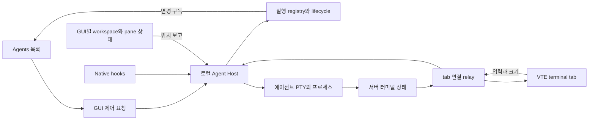
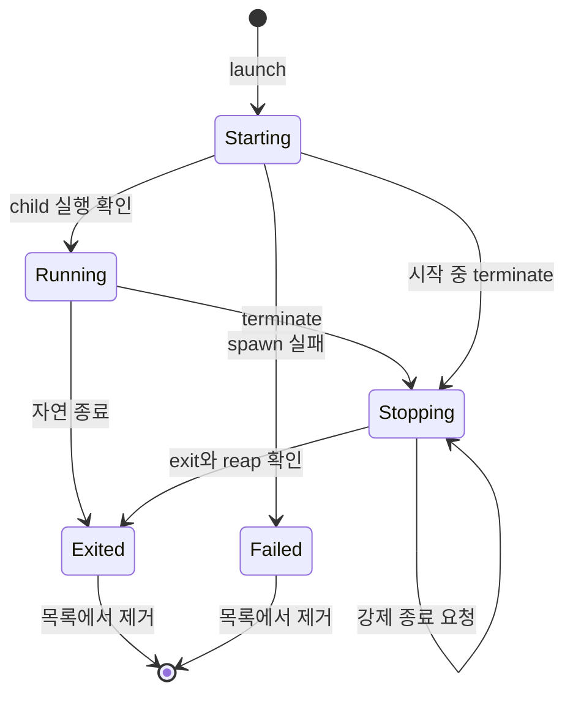

<!-- SPDX-License-Identifier: GPL-3.0-or-later -->

# Flowmux 활성 Agents와 지속 실행 설계

상태: 구현 전 설계. GUI 미연결 수명 정책은 사용자 결정 반영. 작성·갱신일: 2026-11-16.
Flowmux 코드 기준: `502d7b9e56e933fdb234347c554dcd0ff03461ac`.
외부 참고 구현 코드 기준: `ee5bfb5041bb3e4a49d591c72308aae3c81ecdde`.
외부 소스는 읽기만 했으며 코드·자산은 가져오지 않았다. 아래 외부 경로는 해당 리비전의 저장소 상대 경로다. 소스와 테스트를 검토했지만 외부 프로그램을 실행하여 검증하지는 않았다.

## 1. 권장 결정

**에이전트 실행은 GUI와 독립된 로컬 Agent Host가 소유하고, pane 안의 terminal tab은 그 실행에 연결하는 화면으로 만든다.** 왼쪽 하단 Agents 영역은 모든 workspace에 걸친 실행 목록이 된다. 화면이 없어도 실행은 목록에 남는다.

- Agent tab 닫기, pane/workspace 닫기, GUI 종료는 화면 연결을 해제한다. GUI 연결이 모두 끊겨도 작업 중인 에이전트는 종료하지 않는다. 작업 완료가 확인된 실행만 30분 후 자동 종료하며 목록의 명시적 종료 명령도 제공한다.
- 모든 에이전트와 소유 자식의 종료·회수가 끝나면 Host도 종료한다. 빈 Host를 유지하는 별도 유예 시간은 두지 않는다.
- 목록에서 pane으로 드롭하면 그 pane에 별도의 Agent tab을 연다. 이미 열려 있으면 같은 실행의 화면을 옮긴다. 프로세스를 다시 실행하거나 provider의 resume을 호출하지 않는다.
- 첫 버전은 에이전트 실행 하나당 **조작 가능한 화면 하나**를 허용한다. 여러 GUI를 포함한 동시 입력·서로 다른 크기 충돌을 막는다.
- 실행 생존, 작업 상태, 화면 위치를 구분한다. `작업 중 · 백그라운드`, `입력 대기 · Backend / 오른쪽 pane / Codex tab`처럼 표시한다.
- 기존 Session Flow와 Agent sessions는 대화 기록·계보를 담당한다. 이 기능은 살아 있는 실행을 담당한다. 같은 native session을 다시 시작하는 것과 살아 있는 프로세스에 연결하는 것은 다른 작업이다.

## 2. 참고 구현에서 코드로 확인한 내용

### 실행과 화면의 분리

| 확인 내용 | 코드 근거 | Flowmux에 주는 의미 |
| --- | --- | --- |
| 서버를 별도 프로세스로 띄우고 stdio를 null로 연결하며 플랫폼의 detach 경로를 호출한다 | `src/server/autodetect.rs:194–250`, `spawn_server_daemon`, `build_server_daemon_command` | GUI의 자식 터미널 수명에 실행을 묶지 않아야 한다 |
| 서버가 터미널 모델, PTY, child waiter, I/O actor를 만든다. 프로세스 종료는 별도 이벤트다 | `src/pane.rs:2687–2775`, `spawn_command_builder`; `src/terminal/runtime_registry.rs`, `TerminalRuntimeRegistry` | 화면이 없어도 출력 소비·작업 상태 갱신·종료 감시가 계속되어야 한다 |
| 클라이언트 제거 시 연결·입력 상태·geometry 소유권을 정리한다. 터미널 runtime을 제거하지 않는다 | `src/server/headless.rs:946–1040`, `remove_client` | 연결 끊김을 프로세스 종료로 처리하면 안 된다 |
| 직접 attach는 terminal ID로 기존 runtime을 찾는다. 소유자가 있으면 거절하고 명시적 takeover만 허용한다 | `src/server/headless.rs:1737–1839`, `attach_terminal_client` | 실행 ID와 화면 ID를 분리하고 입력 소유권을 중재해야 한다 |
| attach 때 렌더 baseline을 초기화하고 해당 runtime의 크기를 조정한다 | 같은 함수 `1820–1837`; `src/server/headless/render.rs`, `render_and_stream_with_graphics_limit` | 재연결은 현재 화면 상태 동기화를 포함한다 |
| 클라이언트 출력 큐가 가득 차면 해당 연결의 전체 화면 재전송을 예약한다. 느린 연결이 다른 연결의 전체 재렌더를 강요하지 않는다 | `src/server/headless/render.rs:980–1007` | 느린 UI 때문에 에이전트 실행이나 다른 UI 입력을 막으면 안 된다 |

단순한 stdout 중계가 아니다. 서버 안에 터미널 에뮬레이터가 있고 화면·입력 모드·스크롤 상태를 관리한다. 연결이 없어도 PTY 출력을 계속 처리하기 때문에 다시 연결한 화면에 현재 상태를 제공할 수 있다.

### 에이전트 상태 조정

`src/detect/mod.rs:11–19`의 활동 상태는 `Idle / Working / Blocked / Unknown`이다. 프로세스 식별은 foreground job, 실행 파일과 argv 등을 보고, 화면·OSC는 활동 판정에 사용한다. `full_lifecycle_hook_authority`와 `session_identity_only_integration`을 구분하므로 세션 ID 보고만으로 작업 상태 전체를 권위 있게 판정하지 않는다.

`src/terminal/state.rs:2137–2309`는 관리되는 에이전트의 시작을 `Pending → Active` 또는 `Blocked`로 조정한다. 기대한 provider가 관측됐는지, 준비 지연과 timeout, prompt 준비 여부를 확인한다. 프로세스 종료·다른 provider 관측·시작 timeout이면 관리 이름을 해제한다. **spawn 성공, 대화 식별, 입력 가능 상태는 동일하지 않다.** 이 시작 단계와 `Working` 같은 활동 상태도 별개다.

`src/pane/agent_detection.rs`의 `decide_detection_screen_read`, `decide_detection_transition`은 화면 변경과 상태 근거를 구분한다. 변경 없는 idle 화면을 반복 스캔하지 않으며 화면 신호와 기존 상태를 조정한다. Flowmux는 이 판정기를 복제하지 않고 기존 hook/process/screen 규칙을 유지한다.

### 생존 보장의 경계

| 사건 | 확인한 동작 |
| --- | --- |
| 터미널 클라이언트 detach 또는 연결 drop | 서버와 PTY 실행 유지. `tests/detach_reattach.rs`의 `processes_survive_during_and_after_detach`, `server_persists_after_client_connection_drop`에 검증 코드 존재 |
| 화면 없이 출력 발생 | 계속 축적·처리. `output_accumulated_while_detached_visible_on_reattach`에 검증 코드 존재 |
| 마지막 클라이언트 detach | 마지막 PTY 크기 유지에 대한 `detached_output_preserves_last_attached_pty_size` 검증 코드 존재 |
| pane 자체를 close | `src/app/api/panes.rs:1967–2018`에서 연결 없는 terminal ID/runtime을 정리한다. 클라이언트 detach와 다르다 |
| runtime 명시적 종료 또는 drop | `src/pane.rs:1702–1807`, `2234–2245`: I/O·감시 task 정리와 session 프로세스의 Hangup → Terminate → Kill 수행 |
| 계획된 서버 교체 | `src/server/headless/lifecycle.rs`, `perform_live_handoff`: reader 정지, snapshot과 PTY FD 전달, restored/ready/commit 확인 후 소유권 이전. 실패 시 rollback. Unix 전용 |
| 일반적인 cold restore | `src/persist/restore.rs`, `restore_tab`: 저장된 대화 정보로 native resume을 준비할 수 있다. 살아 있는 PTY의 attach와 다르다 |

따라서 “앱을 껐다 켜도 유지”는 **클라이언트만 종료한 경우**에 명확히 성립한다. 계획된 FD 인계도 임의의 서버 crash나 OS 재부팅 후 동일 프로세스 생존을 뜻하지 않는다. Flowmux는 pane 닫기에도 실행을 유지하도록 제품 계약을 확장하되, 서버 hot handoff까지 첫 버전에 넣지는 않는다.

## 3. 현재 Flowmux와 필요한 변경

| 현재 코드 | 확인한 사실 | 필요한 변경 |
| --- | --- | --- |
| [ghostty_pane.rs](../crates/flowmux/src/ui/ghostty_pane.rs), `spawn`, `close_pty` | GUI가 `Pty::spawn_gated`로 자식을 만들고 master의 복제 FD를 VTE에 연결한다. GUI가 수명을 소유한다 | Agent tab은 실제 agent PTY 대신 연결용 relay만 소유 |
| [pty.rs](../crates/flowmux-terminal/src/pty.rs), `Drop`, `close_async` | master close와 SIGHUP, 비동기 reap/강제 종료 경로가 있다 | 실제 agent PTY의 소유자를 Host로 옮김. 일반 terminal의 기존 종료 의미는 보존 |
| [pty_tee.rs](../crates/flowmux-cli/src/pty_tee.rs) | Linux 부모 사망 시 SIGHUP, EOF·signal 종료 처리가 있다 | 기존 tee를 그대로 GUI 아래 두고 “지속 실행”으로 간주하지 않음 |
| [main.rs](../crates/flowmux-daemon/src/main.rs) | 현재 daemon은 IPC handler와 window state claim/persistence 진입점 | 별도 agent-host 모드를 추가하되 workspace 소유권을 claim하지 않음 |
| [lib.rs](../crates/flowmux-core/src/lib.rs), `PaneSurface`, `AgentBarItem`, `collect_agent_bar_model` | agent presence가 surface에 붙고 목록도 workspace의 surfaces에서 수집됨 | 실행 registry에서 목록을 만들고 화면 위치는 attachment로 결합 |
| [agent_runtime.rs](../crates/flowmux-daemon/src/state_store/agent_runtime.rs) | lifecycle ledger와 관측이 SurfaceId·workspace 위치에 결합됨 | 판정 규칙을 공유하고 managed 실행의 ledger key를 InstanceId로 분리 |
| [agent_bar.rs](../crates/flowmux/src/ui/agent_bar.rs) | SurfaceId 기준 안정된 widget 재사용, 클릭으로 기존 위치 열기, 목록 내 순서 드래그 | InstanceId 기준 재사용, 위치 선택·실행 종료·pane drop 추가 |
| [workspace_view.rs](../crates/flowmux/src/ui/workspace_view.rs), [surface_ops.rs](../crates/flowmux/src/ui/window/surface_ops.rs) | tab 이동과 기존 widget 보존 경로, 여러 teardown에서 `close_pty` 호출 | managed tab은 모든 teardown에서 detach, 이동은 연결을 유지 |
| [agent_sessions.rs](../crates/flowmux-state/src/agent_sessions.rs), [sessions.rs](../crates/flowmux/src/ui/window/sessions.rs) | 저장한 native session에 resume 명령을 실행 | managed binding은 Host 조회 우선. 실패 시 자동 resume하여 중복 실행하지 않음 |
| [hook_install.rs](../crates/flowmux-cli/src/hook_install.rs), [hooks.rs](../crates/flowmux-cli/src/hooks.rs), [terminal/lib.rs](../crates/flowmux-terminal/src/lib.rs) | shim이 실제 agent PID를 보존하고 pane/surface와 GUI별 socket을 상속 | managed 실행은 안정된 Host 주소·InstanceId 사용. 기존 provider 환경과 hook trust 보존 |

기존 [Session Flow 설계](agent-session-flow-design.md)의 “앱 종료 후 지속 실행은 범위 밖”은 그 기능의 경계다. 본 제안은 그 밖의 실행 계층을 추가하며 계보 모델을 대체하지 않는다.

## 4. Agents 목록과 상호작용

왼쪽 하단 기존 Agents 영역을 확장한다. 현재 workspace 필터와 무관한 전체 활성 목록이 기본이다. 기존 가로 Agents bar를 켰다면 같은 registry의 축약 표현을 사용한다. Agent sessions 기록 목록과는 분리한다.

```text
Agents                                      [+ New] [⋯]
[All] [Background] [Needs input]       검색…

◌ Codex · API 수정                        [⋯]
  Working              Background
  ~/dev/api

! Claude · 리뷰                           [⋯]
  Needs input          Open · hidden tab
  Backend / 오른쪽 pane / 리뷰             [이동]

● Codex · 테스트                          [⋯]
  Idle                 Visible
  Frontend / 왼쪽 pane / 테스트             [이동]
```

위는 정적 배치 예시이며 작동하는 UI가 아니다. 애니메이션은 유지한다. 텍스트·아이콘·접근성 이름으로 상태를 함께 전달하고 색상만으로 구분하지 않는다. 행의 drag handle과 메뉴 버튼을 분리해 종료 버튼이나 메뉴 조작이 drag로 해석되지 않게 한다.

### 상태 표시

| 축 | 값과 표시 규칙 |
| --- | --- |
| 실행 | `Starting / Running / Stopping / Exited / Failed`. Host에 연결할 수 없으면 별도 `Connection lost` 오버레이. 이를 Exited로 단정하지 않음 |
| 활동 | 기존 `AgentStatus`, wait reason, turn outcome 재사용. Idle도 프로세스가 살아 있으면 활성 목록에 유지 |
| 표시 위치 | `Background`: 연결된 tab 없음. `Open`: tab은 있으나 비활성 tab/workspace 또는 숨겨진 창. `Visible`: 해당 tab과 workspace가 선택되고 창이 표시됨 |
| 준비 상태 | 프로세스는 Running이어도 provider 준비 중일 수 있음. `Starting agent…`나 입력 대기 원인을 함께 표시 |
| 자동 종료 판단 | 작업 중/완료 확인/확인 불가, 보류 이유와 완료 시각. GUI 연결 중에는 자동 종료하지 않으며 `GUI 연결 해제 후 작업 완료 상태로 30분 유지` 정책을 표시 |

`Visible`은 GUI가 보고한 mapped/선택/minimized 상태다. 다른 앱 창에 가려진 실제 픽셀 가시성까지 판정하지 않는다. 살아 있는 GUI 연결이 끊기면 위치를 즉시 해제하고, 정상 연결인데 보고가 멈추면 `위치 확인 중`으로 표시한다. 마지막 위치를 현재 위치처럼 확정하지 않는다.

종료된 실행은 기존 순서를 흔들지 않도록 `Recently ended`에 남기고 닫을 수 있다. 목록 제거는 native 대화 기록 삭제가 아니다. 정렬은 사용자 순서/생성 순서를 유지하고 작업 상태가 바뀔 때 행을 재정렬하지 않는다.

### 클릭·메뉴·드래그 계약

| 사용자 동작 | 결과 |
| --- | --- |
| 이미 열린 행 클릭 또는 Enter | 기존 workspace·pane·tab으로 이동. 사용자의 명시적 이동이므로 focus 변경 허용 |
| Background 행 클릭 또는 Enter | 위치 선택기: 현재 workspace의 최근 terminal pane을 기본값으로 보여주고 확인하면 새 tab 연결 |
| `Open in…` | 현재/다른 로컬 workspace → pane 선택. 없으면 `새 workspace` 선택 가능. 선택 완료 전에는 실행·layout 변경 없음 |
| 이미 열린 행의 `Open in…` | `Move to…`로 표시. 같은 실행의 기존 화면을 목적지로 이동 |
| 행을 pane 본문에 드롭 | terminal이 있는 해당 pane의 끝에 별도 Agent tab 추가·선택. 기존 tab 내용과 shell 입력 보존 |
| 행을 pane tab strip에 드롭 | 삽입 위치 표시 후 해당 위치에 Agent tab 추가/이동 |
| 같은 pane에 이미 있는 실행을 드롭 | 해당 tab 선택, 필요 시 순서 이동. 중복 tab/프로세스 생성 없음 |
| drag 취소·유효하지 않은 위치·목적지 삭제 | 원래 상태 유지. agent command나 prompt 텍스트가 terminal에 붙여넣어지지 않음 |
| Agent tab의 X 또는 `Hide terminal` | tab 연결 해제. `백그라운드에서 계속 실행 중` 안내. 마지막 pane/tab 처리에는 기존 layout 제약 적용 |
| `Interrupt current turn` | 지원되는 provider interrupt 또는 명시된 Ctrl+C 입력. 종료와 구분하며 결과 확인 전 완료로 표시하지 않음 |
| `Terminate agent…` | 이름과 실행 중 작업 손실 가능성을 표시한 확인 후 해당 실행과 소유 자식만 종료. 모든 연결 화면에 종료 결과 반영 |
| `Force terminate…` | 정상 종료 제한 시간 초과 시 제공. 강제 종료도 실제 child exit/reap 확인까지 Stopping |

Background 실행의 기본 열기 위치가 없어도 실패 후 아무 곳에 열지 않는다. 선택기에서 새 workspace를 고르게 한다. 드래그 없이 메뉴·키보드로 같은 작업이 가능해야 한다. 초기 버전은 동일 로컬 Host의 workspace/pane만 목적지로 허용하며 SSH workspace로 옮겨 원격 실행처럼 보이게 하지 않는다.

## 5. 실행 구조와 데이터 모델



새 서비스 패키지를 늘리기보다 `flowmux-daemon --agent-host` 진입점을 제안한다. 기존 headless handler 모드와 분리하고 agent-host에서는 `claim_window`를 호출하지 않는다. GUI마다 workspace/layout을 소유하는 현재 규칙을 유지한다. `flowmux-terminal`의 PTY, `flowmux-procmon`의 identity 검사, `flowmux-ipc`의 로컬 transport와 `flowmux-state`의 atomic 저장 패턴을 재사용한다.

Host는 사용자·실행 환경별 하나다. 기존 GUI PID socket과 별도의 안정된 agent socket을 경로 helper로 만든다. 생성 lock과 연결 handshake로 두 GUI의 동시 시작을 직렬화한다. GUI 종료와 독립된 session/stdio로 띄우고 GUI가 Host에 parent-death kill을 설정하지 않는다. 작업 중인 실행은 유지하고 GUI 미연결·작업 완료 상태의 실행은 아래 30분 정책으로 종료한다. 모든 실행이 종료·회수되면 Host도 종료한다.

프로세스 분리만으로 플랫폼의 앱 종료 정리를 벗어났다고 간주하지 않는다. Linux의 cgroup과 macOS의 앱 coalition/launchd 수명을 검증하고 필요한 경우 사용자 서비스에서 Host를 시작한다. GUI 강제 종료에도 Host·PTY·실제 에이전트가 생존하는 것을 플랫폼별 출시 조건으로 삼는다. 사용자 서비스가 빈 Host를 무조건 재시작하지 않도록 정상 종료와 명시적 시작을 구분한다.

### 제안 모델

| 모델 | 필요한 필드와 소유자 |
| --- | --- |
| `AgentInstance` | `instance_id`, `host_epoch`, provider, label, cwd, native `SessionKey?`, process identity, process state, readiness, 기존 activity/wait/outcome, exit result. Host 소유 |
| Process identity | PID만 사용하지 않고 boot ID와 process start identity를 함께 사용. Host가 생성한 child와 소유 자식 경계를 기록 |
| `AgentAttachment` | `attachment_id`, instance ID, GUI connection ID, window/workspace/pane/surface ID, generation, presentation 상태, rows/cols. Host의 runtime 상태 |
| `AgentViewBinding` | surface에 `instance_id`, host scope/epoch, 마지막 label 저장. live 여부·PID·attachment lease는 저장된 값으로 복원하지 않음 |
| Launch context | argv 배열, cwd, 선택한 provider profile/config 경로와 launch 환경. credentials를 registry JSON이나 진단 로그에 저장하지 않음 |
| 종료 판단 상태 | instance별 작업 generation, 완료 근거/시각, 미해결 작업·wait, 관측 신뢰도, 종료 deadline/revision. 기존 lifecycle ledger를 재사용하며 Host가 소유 |
| GUI 연결 상태 | Host에 관리 연결을 등록한 GUI connection 집합과 마지막 연결 해제 시각. tab attachment 및 CLI/hook 연결과 별개 |

InstanceId는 한 번의 실행을 식별한다. 다시 실행하면 새 ID다. Native SessionKey는 대화와 설정 scope를 식별한다. pane/surface는 화면 위치다. 세 ID를 서로 대체하지 않는다. 시작 직후 native ID가 없어도 실행 목록은 표시할 수 있다.

`PaneSurface.kind`는 terminal로 유지하고 optional managed binding을 추가하는 방안을 우선한다. 새 surface 종류로 terminal 기능 전체를 복제하지 않는다. 렌더러가 binding을 보고 local spawn 또는 agent attach를 선택한다. 구버전이 binding을 무시해 일반 shell/resume을 시작하지 않도록 persisted schema/version gate를 함께 변경한다. downgrade 때는 명시적으로 미지원 binding을 안내한다.

### 프로세스와 화면의 상태 전이



Attach/detach 자체는 이 실행 상태를 바꾸지 않는다. `Running + Background`도 정상이다. 마지막 GUI 연결 해제는 별도의 종료 판단을 시작하며 작업 완료와 30분 조건을 충족한 경우에만 `Stopping`으로 전이한다. GUI 재시작은 Host에 다시 연결하고 살아 있는 instance의 화면만 복원한다. Host 연결 실패는 조회 실패로 보여준다. Host epoch가 바뀌거나 instance가 사라졌다면 이전 실행을 `연결 복구 불가`로 남기고, 사용자가 선택한 native resume만 새 instance로 시작한다.

Host crash·로그아웃·OS 재부팅 후 같은 프로세스 생존은 첫 버전 보장이 아니다. 저장된 PID로 임의의 프로세스를 재소유하거나 종료하지 않는다. 앱 업데이트 시 살아 있는 Host를 강제로 교체하지 않으며 프로토콜 호환 여부를 확인한다. 비호환이면 기존 실행은 그대로 두고 연결 불가 이유와 종료 후 업데이트 경로를 안내한다.

### GUI 미연결 시 작업 보존과 30분 종료 정책

**GUI 종료는 작업 취소가 아니다. 진행 중인 작업을 보존하는 것이 자원 회수보다 우선한다.** 자동 종료는 사용자 작업이 끝난 에이전트 프로세스를 정리하는 기능이다. 작업 완료, 에이전트 프로세스 종료, Host 종료는 서로 다른 사건이다.

판정 범위는 해당 Host에 연결된 모든 GUI다. GUI는 tab이 없어도 Agents 관리 연결을 유지한다. 창 최소화·workspace 숨김·Agent tab 닫기는 GUI 연결 해제가 아니다. 마지막 GUI의 정상 disconnect 또는 socket EOF에서 미연결 상태가 시작된다. CLI 조회·hook·relay의 ping은 GUI 연결로 세지 않는다. GUI 응답 지연만으로 완료를 추정하지 않으며, 연결 상태가 불확실하면 자동 종료를 보류한다.

| 조건/사건 | 유지·종료 계약 |
| --- | --- |
| GUI가 하나라도 연결됨 | 모든 자동 종료 deadline 취소. pane에 표시되지 않는 실행도 유지 |
| 마지막 GUI 해제 시 작업 진행 중 | 시간 제한 없이 유지. 출력이 없거나 CPU 사용량이 낮아도 종료하지 않음 |
| 승인·입력·API 재시도 대기, 하위 작업 진행 | 미완료 작업으로 유지. 단순한 입력 가능한 빈 prompt와 구분 |
| 미연결 중 작업 완료 확인 | 작업 전체의 완료 확인 시각부터 30분 뒤 종료 후보 |
| 이미 완료된 실행에서 마지막 GUI 해제 | GUI 연결 해제 시각부터 30분 뒤 종료 후보. 과거 완료 시각 때문에 즉시 종료하지 않음 |
| 처음 시작한 뒤 작업이 한 번도 없음 | 준비 완료 및 작업 없음이 신뢰 가능한 방식으로 확인된 시점을 완료 기준으로 사용 |
| 30분 안에 실제 새 작업 시작 | 이전 deadline 취소. 새 작업 전체가 완료된 뒤 새로 30분 계산 |
| 30분 안에 GUI 재연결 | 관리 handshake에서 먼저 deadline 취소한 뒤 화면 동기화. tab 복원이 끝날 때까지 기다리지 않음 |
| 판정 불가·이벤트 누락·상충 | 자동 종료 보류, 원인 기록. 시간이 지났다는 이유로 완료로 강등하지 않음 |
| 에이전트 자연 종료 | 30분을 기다리지 않고 exit/reap 처리. 모든 실행 정리 후 Host 종료 |

deadline은 `max(last_gui_disconnected_at, verified_completed_at) + 30분`이다. 완료 확인 시각은 첫 유효 확인 때 한 번 기록하고 반복 완료 이벤트로 갱신하지 않는다. Host runtime의 단조 시간으로 계산하며 벽시계 변경으로 앞당기지 않는다. 절전 복귀 후에는 시간 만료만으로 종료하지 않고 연결·작업 상태를 다시 검증한다. 시간 값은 Host epoch를 넘겨 재사용하지 않는다.

### 실제 작업과 일시적 이벤트 구분

UI의 `Working/Idle` 전이를 종료 타이머에 직접 연결하지 않는다. 기존 `agent_runtime.rs`의 turn/child/wait ledger와 완료 중복 제거를 확장하여 종료 판단에 쓸 근거를 별도로 제공한다. 현재 ledger는 surface에 결합되어 있고 일부 provider의 관측은 불완전하므로 그대로 자동 종료에 사용 가능한 것으로 간주하지 않는다.

| 관측 | 종료 판단에 주는 영향 |
| --- | --- |
| provider가 수락한 새 요청/turn, 새 작업 ID의 tool·하위 작업 시작, 상관관계가 검증된 실제 진행 | 새 작업 generation으로 처리하거나 현재 작업을 계속 유지. 기존 종료 후보 무효화 |
| root turn 완료 | root 완료만 기록. 해당 작업에 연결된 child/tool/비동기 작업과 미해결 wait가 없어야 전체 완료 가능 |
| 부모가 완료돼도 하위 에이전트·백그라운드 명령이 진행 중 | 작업 유지. 살아 있는 MCP 서버 자체와 현재 실행 중인 MCP 요청은 구분 |
| heartbeat, 연결 ping, 상태 조회 응답, metadata·제목·spinner·타이머 재도색, terminal query | 생존/표시 근거만 갱신. 작업 generation·완료 시각·deadline을 바꾸지 않음 |
| 완료된 turn의 중복 Stop 또는 늦은 progress/start | instance/session/process identity와 turn/task ID·순서 근거로 이미 종료된 이벤트인지 확인. 중복·과거 사건이면 무시 |
| 새 작업인지 알 수 없는 `Working`/출력 또는 identity 없는 이벤트 | `확인 불가`로 보류하고 adapter에서 재검증. 짧게 발생했다는 이유만으로 잡음 취급하지 않음 |

판정은 이벤트의 **의미·작업 식별자·인과 순서**를 사용한다. 짧은 작업도 실제 작업이면 새 완료 기준을 만든다. 긴 heartbeat도 작업이 아니다. 단순히 “Working이 몇 초 미만이면 무시”하는 debounce는 사용하지 않는다. Host 수신 순번만으로 지연된 provider 이벤트의 발생 순서를 알아낼 수 없으므로 원본 순서 근거가 없으면 보류한다. 완료된 ID의 이력을 압축·제거한 뒤 재도착한 사건도 새 작업으로 단정하지 않는다.

완료 확정에는 다음 조건이 모두 필요하다.

1. 현재 실행 identity와 작업 generation에 대응하는 신뢰 가능한 완료 또는 작업 없음 확인이 있다. 성공·실패·사용자 취소 모두 실제로 종료된 작업이면 해당한다. 재시도 예정 상태는 완료가 아니다.
2. root와 연결된 하위 에이전트, tool 호출, 백그라운드 작업이 끝났고 승인·입력 대기 및 알려진 예약 실행이 남아 있지 않다. 재사용된 child도 식별하며 부모/자식의 서로 다른 turn ID를 하나로 혼동하지 않는다.
3. 관측 공백이나 상충이 없다. hook 미지원·유실, process 검사 실패, 화면상 idle만 관측한 경우는 완료를 증명하지 못한다. provider adapter가 재조회로 해결하지 못하면 유지한다.

미확인 이벤트 때문에 보류할 때 기존 deadline은 이력으로 보존한다. 같은 완료 작업의 잡음임이 확인되면 원래 deadline으로 돌아가며 30분을 다시 주지 않는다. 실제 새 작업이었다면 이전 완료 기준을 버리고 그 작업의 완료 확인부터 다시 계산한다. 보류 중 deadline이 지나도 검증을 통과하기 전에는 종료하지 않는다.

예: 10:00 완료·GUI 미연결 → 10:30 종료 후보. 10:12 ping과 10:20 같은 turn의 지연 Stop은 10:30을 바꾸지 않는다. 10:20 실제 새 작업 시작 → 10:25 완료라면 10:55로 변경한다. 10:29 GUI 재연결이면 자동 종료를 취소한다. 계속 작업 중이거나 승인 대기라면 10:30에도 유지한다.

### 만료 시 경합과 안전한 종료

deadline callback은 종료 명령 자체가 아니라 재검사 요청이다. Host의 동일 직렬 상태 전이 경로에서 GUI 연결 수, instance/process identity, 작업 generation, ledger revision, 완료 근거, 미해결 작업, deadline을 다시 확인한다. 새 작업이나 GUI 연결이 먼저 수락됐으면 오래된 callback은 무효다. 타이머는 가장 가까운 deadline을 예약하며 화면 프레임이나 주기적 전수 스캔에 묶지 않는다.

검사 직후 provider가 스스로 새 작업을 시작하는 경합까지 hooks만으로 방지할 수는 없다. 따라서 자동 종료를 지원하는 provider adapter에는 **작업 시작과 직렬화되는 `유휴 상태일 때만 종료 수락` 계약**이 필요하다. 작업 없음 확인과 이후 임의 SIGTERM을 안전한 계약으로 간주하지 않는다. provider가 busy를 반환하거나 상태 확인이 실패하면 실행을 유지한다. 이 계약을 제공하지 못하는 provider는 `자동 종료 보류: 안전한 완료/종료 확인 미지원`으로 표시하고 보존하며, provider별 지원 여부를 출시 전에 검증한다.

자동 종료는 cooperative shutdown을 사용하고 시간 초과를 이유로 작업 중인 실행을 강제 kill하지 않는다. 이미 수락된 종료 경계를 지난 뒤 GUI가 연결되면 `종료 중`을 표시하며 살아 있는 것처럼 attach하거나 자동 resume하지 않는다. 그 경계 전 연결은 종료를 취소한다. 명시적 사용자 terminate/force는 별도 계약을 유지한다.

### 마지막 에이전트 종료와 Host 정리

Host는 `Starting/Running/Stopping` 실행, 소유 자식, 수락한 launch가 모두 0일 때 종료한다. direct child exit만 확인하고 손자 프로세스를 남겨두지 않는다. 소유 범위가 확실한 자식만 정리하고 종료 상태를 회수한다. 실패한 정리는 숨기지 않고 Host를 유지해 원인을 노출한다. 단순 `Recently ended` metadata와 GUI 구독은 Host 유지 사유가 아니다.

종료 결과·자동 종료 사유를 원자적으로 저장하고 GUI에 정상 Host 종료를 알린 뒤 stream·자기 소켓을 정리하고 lock을 마지막에 해제한다. 종료와 launch 수락을 직렬화하여 먼저 수락된 launch가 있으면 빈 Host 종료를 취소한다. 종료가 먼저 확정됐으면 새 launch는 `host_stopping`으로 거절하고, 다음 명시적 launch가 lock 해제 뒤 새 Host를 시작한다. 연결 실패만 보고 자동 재시도하여 spawn을 중복 실행하지 않는다.

GUI의 자동 재접속·목록 조회는 정상 종료된 빈 Host를 다시 띄우지 않는다. 새 에이전트 실행 요청만 Host를 필요에 따라 시작한다. 마지막 실행이 처음부터 spawn에 실패한 경우에도 결과 기록 후 빈 Host를 종료한다.

## 6. Attach와 terminal 동기화

GUI 재실행은 **살아 있는 동일 InstanceId·PID/start identity·PTY에 다시 연결**한다. provider의 resume 명령, 새 shell/agent spawn, 과거 prompt 재전송을 실행하지 않는다. 복원 화면은 GUI를 닫았던 순간의 정지 화면이 아니라 그동안 진행된 작업을 포함한 현재 화면이다. cursor·alternate screen·입력 모드·제한된 scrollback도 함께 이어진다. 이전 workspace/pane/tab binding이 유효하면 그 위치를 복원하고, 위치가 사라졌다면 실행은 Agents 목록의 Background로 제공한다.

완료 후 30분 정책으로 이미 종료된 실행은 동일 프로세스로 재연결할 수 없다. 저장된 종료 사유를 보여주고 사용자가 명시적으로 선택한 resume만 새 InstanceId로 시작한다. 이를 지속 실행 재연결로 표시하지 않는다.

### 열기/이동 트랜잭션

1. GUI가 instance ID와 대상 workspace/pane, layout generation을 포함해 열기를 요청한다. Host는 실행 생존과 attachment 소유자를 확인한다.
2. 목적지에 연결 중 placeholder tab을 준비한다. 이미 같은 GUI에서 열린 실행이면 기존 tab widget을 이동하는 경로를 먼저 사용한다.
3. 새 연결이 필요한 경우 Host가 짧은 attachment 예약을 발급한다. 이전 연결은 입력 권한을 보유한 채 유지하고, 새 연결에는 snapshot만 제공한다.
4. 목적지 준비와 generation을 재확인한 뒤 Host가 입력/resize 소유권을 원자적으로 새 attachment로 넘긴다. 새 generation의 ACK 이후에만 UI를 연결 완료로 표시한다.
5. 이전 화면을 정리한다. 목적지 실패·timeout·cancel이면 예약을 버리고 기존 연결을 보존한다. commit 후 GUI가 죽으면 lease가 해제되어 실행은 Background로 남는다.

다른 GUI로 이동할 때도 같은 인계 절차를 쓴다. 처음부터 두 창의 입력을 동시에 허용하지 않는다. 반복 클릭/drop은 request ID와 instance의 예약 상태로 합친다. 같은 pane에 열기 요청이 두 번 와도 tab은 하나다. 종료와 attach가 경합하면 종료가 새 attachment를 막고 GUI는 placeholder를 정리한다.

### 화면 복원은 필수 선행 검증

최근 N바이트 출력 재생만으로는 잘린 ANSI/UTF-8, alternate screen, cursor, scroll region, 색상, mouse·bracketed paste 모드를 복원할 수 없다. 저장된 plain text/VTE HTML scrollback도 살아 있는 터미널 상태 snapshot이 아니다.

권장 경로는 **Host의 headless VT 상태 + VTE 연결 relay**다. Host가 실제 PTY의 유일한 reader가 되고, 각 tab은 로컬 relay PTY를 VTE에 연결한다. 실제 PTY master를 GUI와 Host가 동시에 읽게 하지 않는다. relay는 프로그램 출력·입력·resize transport만 수행하며 종료되어도 agent를 kill하지 않는다. 기존 `pty-tee`의 GUI 수명 정책은 관리되는 agent child에 적용하지 않는다.

- Host는 화면이 없을 때도 PTY를 계속 drain하고 VT 상태와 제한된 scrollback을 갱신한다.
- Attach는 `snapshot at sequence S → delta S+1… → ready ACK` 순서다. snapshot과 이후 출력 경계는 원자적으로 잡고, 입력은 ready 이후에 허용한다.
- resize도 출력과 같은 순서에 넣는다. detached 동안 마지막 크기를 유지하고 첫 attach 없는 실행은 명시된 초기 크기를 사용한다.
- 전송 중 sequence gap 또는 느린 연결의 큐 초과는 최신 snapshot 재동기화로 복구한다. 임의로 terminal bytes 일부를 버린 채 연결 완료라고 표시하지 않는다.
- terminal query 응답 주체는 Host 하나다. query를 VTE까지 그대로 전달해 이중 응답하거나, 재연결 snapshot이 과거 OSC 알림·클립보드 쓰기·bell을 재실행하지 않게 한다. snapshot은 표시 상태만 복원한다.
- VTE의 IME·selection·scrollback·키/마우스 인코딩을 유지하되 Host가 가진 입력 모드와 일치시킨다. relay의 local echo/canonical mode가 입력을 다시 처리하지 않도록 raw transport 계약을 둔다.

현재 workspace에는 headless VT 상태 엔진이 확인되지 않았고 GUI의 `vte4`만 사용한다. 간단한 escape 문자열 제거기를 새로 만들어 대체하지 않는다. 구현 1단계에서 유지보수되는 VT 라이브러리의 snapshot/mode 지원을 검증하고 선택한다. **엔진 선정과 VTE 호환성은 아직 미확정이며 이 검증을 통과하기 전에는 지속 실행을 출시하지 않는다.** 필요한 검증은 cursor/alternate screen/resize/한글·wide glyph/paste/mouse/queries/scrollback과 지원 provider의 실제 TUI다.

## 7. 제어 프로토콜·hook·저장

아래 이름은 제안이며 현재 제공되는 CLI/API가 아니다.

| 요청 | 계약 |
| --- | --- |
| `ListAgentInstances`, `SubscribeAgentInstances` | snapshot+revision 뒤 변경 이벤트. gap이면 다시 조회. 모든 terminal 출력마다 목록을 전송하지 않음 |
| GUI 관리 handshake/disconnect | GUI connection 등록·해제와 자동 종료 취소/예약을 직렬화. tab attachment 및 일회성 CLI 조회와 구분 |
| `LaunchAgent(request_id, launch_context)` | 중복 request ID 재전송은 같은 결과 반환. spawn 실패와 provider 준비 실패를 구분 |
| `PrepareAttach`, `CommitAttach`, `AbortAttach` | instance와 대상 generation, attachment 예약 및 소유권 인계 |
| `DetachAgent(attachment_id, generation)` | 해당 연결만 해제. 오래된 요청은 새 연결을 끊지 않음 |
| `AgentInput(attachment_id, generation, input_seq, bytes)` | 현재 소유자만 입력. ACK는 PTY 입력 수락 의미이며 작업 완료 의미가 아님 |
| `ResizeAgent(attachment_id, generation, rows, cols)` | 소유자만 resize. 같은 크기·이전 generation 요청 무시 |
| `InterruptAgent`, `TerminateAgent`, `ForceTerminateAgent` | 구분된 명령과 capability/진행 결과. 요청 성공을 process exit로 간주하지 않음 |
| `ReportAgentPresentation` | window/workspace/pane/surface와 표시 상태. Host 연결·lease에 종속 |

GUI 제어 경로는 기존 bridge를 사용하지만 대량 terminal data는 별도 bounded stream으로 보낸다. registry event, input/control, terminal data의 큐를 분리한다. 입력은 연결 안에서 sequence로 중복을 제거하되 전송 여부가 불확실한 입력을 재연결 후 자동 재전송하지 않는다. 사용자에게 연결 중단을 알린다.

Managed child에는 `FLOWMUX_AGENT_INSTANCE_ID`와 안정된 Host 주소를 준다. 기존 `FLOWMUX_SOCKET_PATH`는 managed 실행에 한해 Host의 context router를 가리키게 한다. hook은 pane 존재 여부와 무관하게 InstanceId로 상태를 보고한다. 일반 터미널은 지금처럼 GUI socket을 쓴다.

화면 위치는 실행 후 바뀌지만 자식 프로세스가 상속한 pane/surface 환경 변수는 갱신되지 않는다. 따라서 이를 현재 위치의 진실로 사용하지 않는다. managed 경로에서는 InstanceId를 우선해 현재 attachment를 조회한다. 명시적으로 지정한 pane은 그대로 검증하고, 암묵적 pane 작업은 현재 연결이 없으면 `no_attached_view`로 실패한다. 사용자가 보고 있는 다른 workspace를 임의 선택하지 않는다. browser·terminal·team context lookup과 native session의 실제 process ancestry 검사도 이 계약으로 갱신해야 한다.

Host가 hook/process identity와 lifecycle ledger의 권위자가 된다. 기존 상태 전이 규칙을 추출해 공유하고 GUI와 Host가 같은 managed instance의 working/idle을 각각 추정하지 않는다. 지연 hook은 instance/session/generation을 검증한다. 기존 Codex child/permission wait, Claude batch wait 규칙과 turn 완료 ≠ process 종료 불변식을 보존한다.

Provider adapter는 작업 시작/진행/완료, child/tool/wait, maintenance 이벤트의 의미와 원본 ID·순서 근거, 관측 범위/공백을 Host에 전달한다. UI용 추정 상태만 제공하는 adapter는 자동 종료 가능 capability를 선언할 수 없다. registry 조회는 완료 확인 시각·종료 예정 시각·보류 이유·판정 revision을 포함하고 진단은 이벤트 종류/ID와 결정 사유를 남긴다. prompt·tool payload·credentials를 판정 로그에 복제하지 않는다.

Managed surface의 agent presence는 Host 상태를 투영한다. GUI의 기존 process-tree scanner가 relay 아래에서 실제 provider를 찾지 못했다고 presence를 지우면 안 된다. VTE의 `child-exited`도 relay 연결 종료와 실제 agent 종료를 구분한다. Session Flow는 이 projection의 native SessionKey를 사용하고, Background 실행은 실행 중 위치 없음으로 다룬다. 동일 대화가 살아 있으면 resume 버튼은 새 프로세스를 만들기 전에 기존 실행 열기를 제안한다.

Host의 환경을 모든 실행에 공통 상속시키지 않는다. launch 요청에서 현재 shell 또는 선택 프로필의 cwd/PATH/provider 설정을 명시적으로 준비하고 현재 실행의 인증 환경은 메모리에서만 전달한다. GUI별 socket, pane ID 등 오래된 위치 정보는 제거한다. `SSH_AUTH_SOCK`처럼 외부 수명이 있는 자원은 app 종료 후에도 유효하다고 보장할 수 없으며 provider 오류를 그대로 표시한다.

저장 대상은 instance의 안전한 metadata/종료 결과와 GUI의 view binding이다. 실행 중 여부는 Host 조회에서만 나온다. native 대화 기록과 설정은 기존 provider 저장소를 사용한다. runtime socket directory는 사용자 전용 권한, socket은 동일 사용자 접근만 허용하고 peer identity·메시지 길이·argv/cwd·instance 소유권을 검증한다. DnD payload에는 명령·socket 경로·token을 넣지 않는다.

## 8. 성능과 입력 안정성

이 기능은 Agents spinner를 멈추는 방식으로 성능 문제를 우회하지 않는다.

- 목록 widget은 InstanceId로 유지한다. 상태 변경은 label·indicator·위치만 갱신하고 누르는 중인 행을 교체하거나 정렬하지 않는다.
- 애니메이션 프레임은 runtime polling, 전체 workspace snapshot, layout rebuild, terminal history scan을 유발하지 않는다.
- PTY 읽기·VT 처리·프로세스 조회·저장은 GTK main thread 밖에서 수행한다. 목록은 변경 구독으로 갱신하며 반복 출력은 상태가 달라질 때만 투영한다.
- 기존 `Bridge::send_from_ui`와 dispatch의 GTK yield 원칙을 이어간다. 큐가 찼을 때 클릭을 조용히 버리지 않고 처리 중 또는 실패를 표시한다.
- 제어/입력은 대량 출력과 독립적으로 처리한다. 각 순환의 출력량·시간 budget을 제한하고 다른 실행을 공정하게 처리한다. slow viewer는 재동기화 대상으로 만들며 Host의 PTY drain을 멈추지 않는다.
- 메모리 budget은 실행별 VT/scrollback, 연결별 큐, 전체 Host 상한으로 둔다. 상한 초과 시 오래된 scrollback을 줄이거나 새 launch를 거절하며 기존 실행을 조용히 종료하지 않는다.

수용 목표: 동일 장비·동일 시나리오에서 무부하 기준과 비교하여 입력 지연과 프레임 시간을 기록한다. 초기 목표는 60Hz 환경에서 주요 조작 feedback p95 100ms 이하, spinner가 도는 동안 단일 클릭 100회 누락 0회다. 숫자는 현재 측정 결과가 아니라 출시 gate의 초기 목표이며 workload와 함께 기록한다.

## 9. 적용 범위와 구현 순서

1. **Host/VT/relay 수직 검증:** 테스트 command 하나를 Host 소유 PTY로 실행한다. GUI/relay 종료 후 동일 PID·start identity의 카운터가 계속 증가하고, 다시 붙으면 현재 화면과 입력이 복원되어야 한다. Linux와 macOS에서 격리된 실행으로 확인한다. VT 호환성 gate를 먼저 해결한다.
2. **관리되는 시작과 수명 정책:** `New Agent`, 제안 CLI `flowmux agent run -- <argv>`, 기존 명시적 resume/fork의 launch 준비를 Host로 연결한다. launch 환경·native session identity 확인·중복 방지, 작업 완료 근거와 잡음 구분, GUI 미연결 30분 정책, 안전한 유휴 종료 계약과 빈 Host 종료를 함께 검증한다. tab 연결 실패는 살아 있는 실행을 목록의 Background로 남긴다. provider별 관측·종료 capability 검증 없이 자동 종료를 켜지 않는다.
3. **목록/위치/열기/종료:** 기존 Agents 영역과 bar projection을 registry로 연결한다. UI·CLI가 같은 제어 API를 사용하고 숨겨진 실행도 조회·종료 가능하게 한다.
4. **DnD/이동/재연결:** 기존 tab 이동의 widget 보존 경로를 재사용하고 `application/x-flowmux-agent-instance` payload를 추가한다. 버전·instance ID·Host scope만 허용한다. 파일 drop이나 기존 tab MIME과 혼동하지 않는다. 이 단계에 다른 GUI로의 이동과 restore 경합을 포함한다.
5. **기존 실행과 공존/출시:** wrapper가 감지한 기존 GUI-owned agent는 `Tab-bound`로 표시하고 현재 위치로 이동 가능하게 한다. 임의의 살아 있는 PTY를 소유권 이전한 것처럼 표시하지 않는다. 새 managed launch를 기본 제공하되 기존 쉘 명령을 일괄 가로채는 변경은 별도로 검증한다.

일반 shell에서 임의로 실행한 모든 프로세스를 자동으로 지속 실행으로 전환하는 것은 초기 범위가 아니다. 사용자가 그 실행도 지속시키려면 처음부터 managed launch를 써야 한다. 기존 세션을 종료하여 전환하거나 자동 resume하지 않는다. `Tab-bound` 실행의 종료는 해당 provider identity에 안전하게 보낼 수 있는 기존 interrupt/종료 경로만 제공하고, 불가능하면 위치로 이동하게 한다. 관리 실행과 같은 detach 보장을 표시하지 않는다.

### 변경이 도달해야 하는 곳

- Core: 실행·attachment 모델, optional surface binding, Agents projection, serde/default/schema migration.
- Daemon/terminal/procmon: Host 진입점, PTY 소유권·reap, VT 상태, 프로세스 identity, lifecycle key 분리, 완료 근거와 deadline, 안전한 종료·launch 경합 처리.
- IPC/CLI/config: 메시지·에러·capabilities, socket helper, relay, launch/context router, hooks·shim 생성과 `doctor` drift 검사.
- GUI: sidebar/agent bar, new/resume/fork launch, terminal 생성/복원, tab/pane/workspace/window close, tab move, DnD, notification 위치 이동, Session Flow의 live binding.
- State: GUI view binding과 Host registry metadata/종료 사유의 저장 책임 분리. runtime 판정·deadline을 cold restore의 생존 근거로 사용하지 않음. 기존 provider 기록과 window claim 정책 보존.
- 배포: daemon/relay가 Linux·macOS 패키지에 포함되는지, Flatpak socket 접근과 host 프로세스 수명, 프로토콜 버전 불일치 처리.
- 테스트·fixtures·문서: 프로토콜/저장 snapshot, 기존 일반 terminal/SSH 회귀, CLI help·capabilities, 사용자용 닫기/종료 의미와 접근성 label.

## 10. 수용 테스트

| 시나리오 | 통과 조건 |
| --- | --- |
| Agent tab 닫기 → 목록 → 다시 열기 | 동일 PID/start identity, 진행 연속, 중복 launch 없음, 현재 TUI 복원 |
| 모든 tab/pane/workspace 닫기, GUI 연결 유지 | managed 실행 유지, 자동 종료 없음. 일반 terminal 동작은 기존과 동일 |
| 마지막 GUI 닫기, 작업 30분 이상 진행 | 시간과 관계없이 동일 실행·하위 작업 생존. 재연결 시 Background 또는 저장된 view에서 현재 TUI 표시 |
| GUI 강제 종료 | Host와 실행 생존. stale 위치 해제. 새 GUI에서 중복 native resume 없음 |
| 미연결 중 작업 완료 | 완료 확인 29분 59초에는 유지, 30분에 안전한 종료 재검사. 실제 exit/reap 후 종료 결과 저장 |
| 이미 완료된 상태에서 GUI 종료 | 연결 해제부터 30분 계산. 과거 완료를 근거로 즉시 종료하지 않음 |
| GUI 없이 승인·입력·재시도 대기 또는 child 실행 | root Stop/idle 화면만으로 종료 예약하지 않음. 전체 작업 완료 후부터 30분 |
| 완료 후 ping·metadata·spinner·중복 Stop 반복 | 최초 완료 시각과 deadline 유지. 짧은 실제 작업은 새 generation과 새 완료 기준 사용 |
| 늦은 start/progress·역순·중복·child 재사용 | 원본 identity/순서로 과거 사건 배제. 근거 없으면 보류, 실제 진행 중 작업 조기 종료 없음 |
| 미확인 이벤트 뒤 잡음/새 작업으로 확정 | 잡음이면 원래 deadline 복구, 실제 작업이면 새 완료 기준 적용. 미확인 동안 종료 없음 |
| hook 누락·미지원 provider·process 검사 실패 | 확인 불가와 이유 표시, 자동 종료 보류. 무출력/저CPU/시간 경과만으로 완료 판정하지 않음 |
| 두 GUI 중 하나 종료·마지막 GUI 재연결 | 하나라도 관리 연결이 있으면 자동 종료 없음. 관리 handshake가 tab 복원보다 먼저 종료 예약 취소 |
| deadline과 새 작업·GUI 연결 경합 | 먼저 수락된 상태 전이와 revision으로 결정. 오래된 callback 무효, provider가 busy면 종료 거절 |
| 자동 종료 중 응답 지연·새 자율 작업 | idle 종료 계약 검증, 임의 SIGTERM/강제 kill 전환 없음. 계약 미지원은 보존 |
| 마지막 실행 종료·소유 자식 잔존·동시 launch | 자식 회수 전 Host 유지. 모두 정리하면 Host 종료, 수락한 launch 유실·중복 없음 |
| 빈 Host 정상 종료 후 GUI 목록 조회 | Host 재시작 반복 없음. 새 명시적 launch 때만 시작 |
| 벽시계 변경·절전 복귀·Host epoch 변경 | 타이머 조기 종료 없음, 복귀 시 재검증. 이전 epoch의 deadline 재사용 없음 |
| workspace 생성·삭제와 동시에 열기 | layout generation 오류를 처리하고 임의 목적지로 열지 않음 |
| drag/cancel/drop·반복 클릭 | 하나의 실행/화면만 존재. 기존 terminal에 문자열 입력 없음 |
| tab/pane 이동 및 다른 GUI 이동 | 성공 때만 새 위치 표시. 실패 시 기존 화면 유지. 오래된 입력·resize·detach 거절 |
| 한글 IME·paste·마우스·alternate screen·resize | detach/reattach 전후 실제 입력과 화면 상태가 일치. query 응답 중복·OSC 재실행 없음 |
| 대량 출력·느린 relay·숨겨진 workspace | bounded memory, Host drain 지속, 다른 agent/GUI 입력 정상. sequence gap은 snapshot 복구 |
| spinner + 출력 부하 + 100회 native click | 애니메이션 유지, 클릭 누락 0, 지연·프레임 시간 측정값 기록 |
| interrupt/terminate/force·자연 종료 경합 | 정확한 실행과 소유 자식만 대상. exit/reap 후 상태 변경. PID 재사용 오종료 없음 |
| Host 연결 단절·Host crash·재부팅 | 상태 확인 실패와 종료를 구분. 이전 epoch/PID 재소유 및 자동 재실행 없음 |
| 두 GUI 동시 launch/restore | Host 하나, request별 instance 하나, instance별 입력 소유자 하나 |
| 구버전 저장·신버전 managed binding·downgrade | 기존 파일은 읽히며 알 수 없는 binding을 일반 shell/resume으로 실행하지 않음 |
| native resume/fork와 기존 hook/Team context | provider 환경·신뢰 설정 보존, 세션 ID와 계보 연결 정확, 화면 없으면 암묵적 pane 명령은 명확한 오류 |

Runtime 구현 완료 판정에는 unit test와 IPC test뿐 아니라 실제 Flowmux의 격리된 인스턴스에서 위 UI 시나리오 검증이 필요하다. 사용자 작업 중인 앱·에이전트를 닫거나 재시작하지 않는다. macOS GTK 검증은 main thread에서 수행한다.

타이머와 이벤트 순서 단위 테스트는 주입 가능한 시계로 30분 경계를 검증한다. 통합 검증에서는 실제 provider별로 GUI 종료 전후 PID/start identity·PTY·InstanceId의 동일성과 진행 연속성, resume/spawn 호출 없음, 현재 화면 복원, 실제 30분 종료 및 마지막 Host 종료를 확인한다. 테스트용 짧은 timeout만으로 실시간 정책 검증을 대체하지 않는다.

## 11. 남은 검증과 범위 밖

이번 결과물은 코드 근거와 구현 계약을 정리한 설계다. 런타임 수정·외부 프로그램 실행·실제 UI 성능 측정은 수행하지 않았다. 미확정 항목은 headless VT 엔진과 VTE 호환성, 플랫폼별 GUI 종료 생존, provider별 전체 작업 관측 및 안전한 유휴 종료 계약이다. 이 검증 없이 모든 provider의 30분 자동 종료와 작업 보존을 동시에 보장한다고 주장하지 않는다. 근거가 부족하면 실행 보존을 우선한다.

초기 범위에서 제외: 같은 실행의 다중 조작 화면, 원격 Agent Host, 서버 crash를 견디는 실행별 keeper, 실행 중 Host hot upgrade, OS 재부팅 후 동일 프로세스 유지, 임의의 기존 PTY 자동 인수. 로컬 managed 실행의 GUI 종료 생존·독립 목록·tab 연결·이동·명시적 종료와 검증된 adapter의 완료 후 30분 자동 종료·빈 Host 종료가 첫 출시 범위다.
