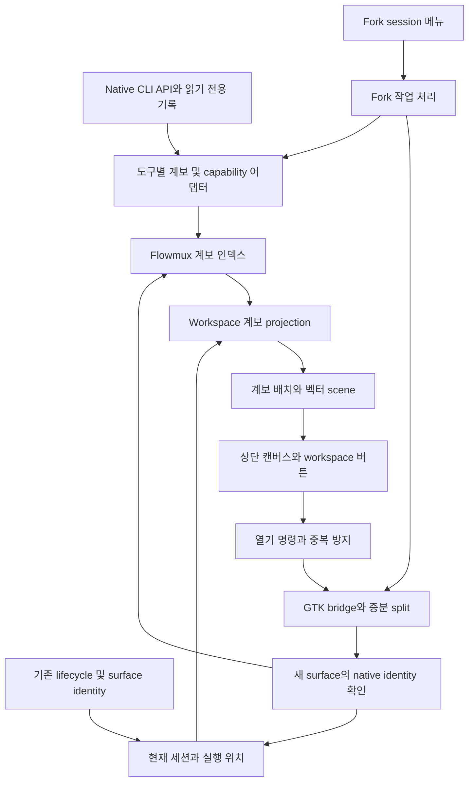
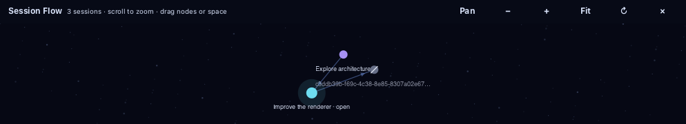

<!-- SPDX-License-Identifier: GPL-3.0-or-later -->

# Flowmux Session Flow 설계

상태: 설계 확정, `feat/session-flow`에 구현 및 자동 회귀·coverage 검증 완료. 수동 실기와 도구별 검증 경계는 마지막 절과 검증 문서에 명시한다. 작성일: 2026-10-31. 코드 검토 기준: `01c3d3b96d9bea1f2a8d7eeeb7705c257f9f8fd7`.

에이전트 화면의 **Fork session**은 그 pane을 좌우로 분할하고 오른쪽에 새 분기 세션을 연다. Workspace의 **Session Flow**는 현재 열린 세션들이 속한 전체 fork 계보를 상단 약 1/3의 캔버스에 표시한다. 다른 원본에서 분기된 세션을 resume하면 별도의 그래프가 추가된다. 노드를 선택하면 아래 pane 영역에서 해당 세션을 열고, 재개할 수 없는 노드는 관계만 표시한다.

참조: [인터랙션 목업](design-assets/agent-session-flow-mockup.html), [테스트와 검증 계획](agent-session-flow-validation.md), [현재 세션 기능](agent-sessions.md). 목업은 예시 데이터로 구성한 UI 기준이며 실제 에이전트 연동, 상태 복구, 접근성, 성능을 증명하지 않는다.

## 확정할 제품 동작

| 요구 ID | 동작과 수용 조건 |
| --- | --- |
| R01 | 에이전트 화면 우클릭 메뉴에 `Fork session`을 제공한다. 식별된 세션과 검증된 도구 기능이 있을 때만 활성화한다. |
| R02 | 우클릭한 pane만 좌우 50:50으로 분할한다. 원본은 왼쪽, 자식은 오른쪽이며 새 세션에 포커스를 둔다. 다른 pane과 원본 입력은 보존한다. |
| R03 | 첫 fork의 자식 ID가 확인되면 원본과 자식의 관계를 저장한다. 자식에서의 재fork도 이어진다. |
| R04 | Workspace의 어떤 terminal tab이라도 fork 계보에 속하면 workspace 아이템 오른쪽에 흐름 버튼을 표시한다. 비활성 tab도 포함한다. |
| R05 | 흐름 버튼은 상단 패널을 토글한다. 처음 열 때 약 1/3을 사용하고 기존 pane들은 아래로 내려온다. 첫 fork만으로 패널을 자동으로 열지는 않는다. |
| R06 | Resume으로 들어온 세션의 조상, 형제, 자손까지 알려진 전체 계보를 표시한다. 이 workspace에서 생성되지 않은 관계도 포함한다. |
| R07 | 서로 다른 계보는 별도 그래프 덩어리로 표시하고, 같은 계보의 여러 열린 세션은 그래프 하나로 합친다. |
| R08 | 긴 그래프와 여러 그래프를 한 캔버스에서 휠 확대·축소, 드래그 팬, 이동 모드, 전체 맞춤으로 탐색한다. |
| R09 | 재개 가능한 닫힌 노드는 마지막으로 포커스한 아래 pane의 오른쪽 split에서 resume한다. 이미 이 workspace에 열린 노드는 기존 pane·tab으로 이동한다. |
| R10 | 재개 불가 노드는 보존하되 열기 선택을 비활성화하고 이유를 표시한다. 팬 동작과 관계 탐색은 가능하다. |
| R11 | 패널 토글, 줌·팬, 그래프 갱신은 실행 중인 PTY·에이전트·브라우저·에디터를 재생성하지 않는다. |
| R12 | Fork/resume 성공은 실제 native 세션 ID와 새 surface의 연결을 확인해야 한다. 단순 프로세스 spawn이나 명령 전송은 성공이 아니다. |
| R13 | 탭에서 다른 세션으로 전환되면 새 identity를 기준으로 workspace 그래프를 갱신한다. 지연된 이전 결과는 적용하지 않는다. |
| R14 | 관계·작업 복구 정보는 재시작 후 보존한다. 살아 있는 프로세스 여부와 재개 가능 여부는 재검사한다. |

## 설계 원칙

1. **Native 세션이 대화의 소유자다.** Flowmux는 관계와 실행 위치를 관리하며 다른 도구의 transcript나 DB를 직접 수정하지 않는다.
2. **세션, 실행, 화면을 구분한다.** 하나의 세션은 실행이 없어도 존재한다. Pane/tab ID를 영구 세션 ID로 사용하지 않는다.
3. **Workspace는 계보의 소유자가 아니라 현재 보기의 기준이다.** 관계는 workspace 이동·닫기·resume 이후에도 유지한다.
4. **관계에는 근거가 필요하다.** Native parent/fork metadata 또는 Flowmux가 수행하고 확인한 fork만 확정 관계로 저장한다. 시간·제목·프롬프트 유사도로 연결하지 않는다.
5. **Fork와 subagent를 구분한다.** Native `parent_id`라는 이름만 보고 fork로 판단하지 않는다. Provider별 의미를 확인한다.
6. **원본과 기존 작업을 보존한다.** 새 명령은 새 terminal surface에서 실행한다. 기존 에이전트에 `/resume`이나 Enter를 자동 입력하지 않는다.
7. **화면 조작과 실행을 분리한다.** 드래그, 확대, 전체 맞춤, 포커스 이동은 fork나 resume을 실행하지 않는다.
8. **불확실성은 상태로 표현한다.** `확인 중`, `관계 일부만 확인`, `재개 불가`, `연결 확인 필요`를 구분한다. 미확인을 성공이나 실패로 단정하지 않는다.
9. **작업 완료와 응답 완료를 구분한다.** 기존 lifecycle 상태를 재사용하며 그래프 선택으로 승인 대기를 해제하지 않는다.
10. **기존 경로를 좁게 확장한다.** 우클릭 callback, 증분 split, 세션 환경 복원, GTK bridge를 재사용한다. 새로운 에이전트 실행 플랫폼은 만들지 않는다.

## 범위와 기본 선택

- 로컬 CLI 여섯 종류를 기능별 capability로 다룬다. 모든 도구의 fork를 동일하게 지원한다고 가정하지 않는다.
- MVP의 관계는 동일 도구 내 native conversation fork다. 도구 간 맥락 전달, 대화 병합, subagent 실행 제어는 별도 기능이다.
- Fork는 대화 분기다. 기본적으로 원본 cwd를 사용하며 Git branch/worktree나 미커밋 파일을 복제하지 않는다. 메뉴 도움말에 같은 폴더를 사용함을 표시한다.
- Resume은 저장 세션의 cwd와 프로필을 사용한다. 클릭 시점에 포커스된 다른 도구의 프로필을 빌리지 않는다.
- 앱이 꺼져도 작업이 계속 실행되는 기능은 범위 밖이다. 재시작 후 기록 재개와 지속 실행을 혼동하지 않는다.
- 원격 세션은 인증된 원격 조회·재개 경로가 구현되기 전까지 설명과 비활성 노드를 제공한다.
- Pane이 최소 너비보다 작아지는 split은 실행 전에 막고 `분할 공간 부족`을 안내한다. 자동으로 기존 pane을 닫거나 tab 생성으로 바꾸지 않는다.

## 현재 코드의 재사용 지점

아래 표는 기준 커밋의 코드 구조다. 새 파일명과 API는 뒤의 구현안에서 별도로 제안한다.

| 현재 파일 | 확인한 동작 | 확장 방향 |
| --- | --- | --- |
| [session_history.rs](../crates/flowmux-state/src/session_history.rs) | 여섯 도구의 기록과 resume 명령, 홈·설정 경로 구분. `HistorySession`에는 계보 필드 없음 | 목록 표시를 유지하며 계보 metadata 조회를 별도 추가 |
| [session_history/sqlite.rs](../crates/flowmux-state/src/session_history/sqlite.rs) | Native DB 읽기 전용. 일부 목록에서 child/archived 항목 제외 | 기존 목록 필터를 풀기보다 계보 전용 조회 추가 |
| [agent_sessions.rs](../crates/flowmux-state/src/agent_sessions.rs) | Surface와 세션 매핑을 잠금·atomic JSON으로 저장. 자동 복원 대상은 현재 네 도구 | 기존 파일 형식 보존. 계보와 실행 잠금을 별도 저장 |
| [window/sessions.rs](../crates/flowmux/src/ui/window/sessions.rs) | 세션별 환경 확인, generation 재검사, 새 tab에서 resume. 중복 검사는 현재 focused surface 중심 | 공통 launch 준비와 새 split 배치를 분리하고 중복 검사 범위 확장 |
| [ghostty_pane.rs](../crates/flowmux/src/ui/ghostty_pane.rs) | 우클릭 메뉴와 직접 callback, pane·surface 문맥 | Fork callback과 비활성 이유 추가 |
| [workspace_view.rs](../crates/flowmux/src/ui/workspace_view.rs) | `split_pane_incremental`이 기존 pane widget을 보존 | 오른쪽 split 배치에 사용. 상단 패널 도입 시 root 장착 슬롯 회귀 확인 |
| [sidebar.rs](../crates/flowmux/src/ui/sidebar.rs) | Workspace 아이템과 클릭 처리 | 계보 존재 projection과 작은 토글 버튼 추가 |
| [window/mod.rs](../crates/flowmux/src/ui/window/mod.rs) | Workspace stack, agent bar, file/worktree/session panel 조합 | 기존 pane stack 위에 세션 흐름 host 삽입 |
| [agent_runtime.rs](../crates/flowmux-daemon/src/state_store/agent_runtime.rs) | Hook/process identity, 순서·세션 검증과 lifecycle 처리 | 상태를 읽어 투영. 별도 상태 추정 엔진을 만들지 않음 |

기존 Agent sessions의 `Resume in new tab` 동작은 유지한다. 그래프에서 열기는 `split_right` 배치를 요청한다. 공통 launch 준비만 공유하고 메뉴별 배치 계약은 보존한다.

## 구조

기록 읽기·DB·provider 호출·layout 계산은 GTK main thread 밖에서 수행한다. GTK widget 변경과 좌표 기반 입력은 main thread에서 처리한다. 비동기 결과에는 요청 ID와 대상 generation을 포함한다.

## 데이터 모델

아래 표는 설계 계약이다. 현재 로컬 구현은 `SessionKey(provider, canonical home, native ID)`, `Lineage`, `SessionRecord`, `LiveSession`, `Operation`, `SavedView`로 구성한다. Remote namespace와 세분화된 operation 단계는 후속 범위다. 기존 public CLI 계약은 변경하지 않는다.

| 객체 | 필수 정보와 의미 |
| --- | --- |
| `SessionKey` | provider, host identity, profile/store namespace, native conversation ID. Codex thread ID와 상위 session-tree ID처럼 서로 다른 ID는 별도 필드로 보존 |
| `SessionRecord` | key, 제목, cwd, 저장 위치 locator, metadata revision, 기록 존재 여부, 마지막 관측 시각 |
| `ForkEdge` | parent key, child key, 선택적 native turn/message 경계, 근거 종류·버전·locator, 확인 시각 |
| `LiveBinding` | key, GUI instance/socket, workspace, pane, surface, surface generation, process identity. 런타임 조회 결과이며 재시작 시 재검증 |
| `OpenCapability` | `focus_existing`, `resume`, `unavailable`, `checking` 및 이유. 실제 실행 상태와 별도 |
| `ForkCapability` | 원본 지정, 완료 지점 고정, 새 ID 관측, 안전한 호출이 가능한지와 버전. Boolean 하나로 뭉개지 않음 |
| `OperationRecord` | request ID, fork/resume 종류, 원본·대상, namespace, owner identity, 단계, 확인된 child ID, 마지막 결과 |
| `WorkspaceFlowView` | workspace별 패널 열림, 높이 비율, camera x/y/scale, 선택 노드. 프로세스 생존 사실은 저장하지 않음 |

프로필 namespace는 도구별 유효한 history/config 저장소와 계정·서버 구분을 반영한다. 토큰이나 credential 원문을 넣지 않는다. 같은 native ID라도 host나 profile이 다르면 다른 세션이다. cwd는 실행 환경이며 세션 identity를 대신하지 않는다.

Fork edge는 자식당 하나의 확정 원본을 갖는 forest를 목표로 한다. 순환, 자기 참조, 충돌하는 부모가 발견되면 해당 edge를 격리하고 불완전 관계로 표시한다. 원본 ID만 알려지고 기록이 없으면 그 ID의 비활성 placeholder를 유지한다. 원본 자체가 미확인이면 가짜 원본 ID를 만들지 않는다.

### 저장 방안

Flowmux 소유의 `session-flow.sqlite`를 기존 XDG data 경로 helper 아래에 추가하는 안을 채택한다. `flowmux-state`의 기존 `rusqlite` 의존성을 재사용한다. Native DB와 기존 `agent-sessions/<agent>.json`은 수정하지 않는다.

- Session, edge, operation과 schema version을 같은 DB에서 transaction으로 처리한다. 관계와 작업 완료 기록이 따로 유실되지 않게 한다.
- 여러 GUI instance의 fork/resume 잠금은 DB transaction과 owner/process identity로 조정한다. GTK thread에서 DB 잠금을 기다리지 않는다.
- `request_id`는 unique다. Native metadata 반복 수집은 key/revision 기반 upsert로 처리한다.
- 실행 중인 동일 세션의 resume 예약과 동일 원본의 fork 예약을 제한한다. 잠금 만료 시간만으로 작업이 실행되지 않았다고 판단하지 않는다.
- 비정상 종료 후에는 작업 소유자, 새 세션 ID, surface와 provider 결과를 재조회해 reconcile한다. 미확인 작업을 자동 재실행하지 않는다.
- Transaction 크기와 busy timeout을 제한하고 실패를 반환한다. 저장 실패를 숨기고 메모리에서만 성공 처리하지 않는다.
- 새 schema를 이해하지 못하는 구버전은 계보 기능을 비활성화한다. 기존 terminal/session 기능은 정상 동작해야 한다.
- 전체 transcript는 복제하지 않는다. 계보, 최소 metadata, 작업 상태만 저장한다. 삭제된 기록의 관계 보존과 보관 정책은 사용자에게 설명 가능해야 한다.

`WorkspaceFlowView`는 관계 DB의 별도 `views` 테이블에 workspace UUID별 UI 설정으로 저장한다. 기존 workspace 복원 schema는 변경하지 않는다. 이 테이블은 계보 조회·edge 생성에 참여하지 않는다. 관계 DB와 UI 위치 저장을 하나의 transaction으로 묶을 필요는 없다. UI 위치를 잃어도 관계나 실행 결과는 바뀌지 않아야 한다.

## 세션 계보와 Workspace에서 표시할 범위

Workspace `W`의 모든 살아 있는 terminal surface에서 확인한 세션을 `S(W)`로 둔다. 현재 보이는 tab만이 아니라 비활성 tab도 포함한다.

1. `S(W)`의 native 세션 key를 해석한다.
2. 각 세션의 알려진 조상을 조회하고 원본 또는 확인 가능한 경계까지 올라간다.
3. 그 계보의 자손을 조회해 형제 분기와 다른 가지도 포함한다.
4. 확정 fork edge로 연결된 component를 계산한다. 두 anchor가 같은 component이면 하나로 합친다.
5. 서로 다른 component는 겹치지 않는 별도 덩어리로 배치한다. 단독 세션이며 fork 관계도 없으면 흐름 그래프에서는 제외한다.

계보와 edge, 노드의 기본 배치는 SessionKey에만 속한다. Workspace ID를 그래프 저장 key나 관계의 부모로 사용하지 않는다. 같은 계보의 세션을 서로 다른 workspace에서 열면 동일한 관계와 기본 배치를 공유하며 선택된 노드와 camera만 다르다.

즉 화면에 투영하는 `G(W) = S(W)에 닿는 fork component들의 합집합`이다. Workspace 밖의 과거 원본·형제·자식도 component 구성원으로 보인다. 전체 컴퓨터의 무관한 세션을 모두 표시하지는 않는다.

예: `A0 → A1 → A3`, `A0 → A2`와 `B0 → … → B20`이 있고 W에서 A1과 B7을 resume하면 A 전체와 B 전체가 보인다. A3도 열면 A 그래프는 중복되지 않는다. C1을 resume하고 C 계보가 있으면 세 번째 그래프가 추가된다.

Provider가 자식 열거를 제공하지 않으면 해당 namespace의 경량 metadata 인덱스로 역방향 관계를 구성한다. Transcript의 제한된 앞·뒤 부분만 읽어 전체 계보가 확인됐다고 주장하지 않는다. 부분 조회는 `확인한 120개 · 더 불러오는 중`처럼 범위를 표시한다. Parent ID가 subagent 관계인지 fork 관계인지 어댑터에서 판별해야 한다.

같은 surface에서 세션이 교체되면 이전 anchor를 제거하고 새 anchor를 넣는다. 이전 계보의 다른 anchor가 없으면 그 그래프는 현재 workspace 보기에서 빠지지만 저장 기록은 남는다. 다른 workspace로 이동한 세션도 동일한 규칙을 적용한다. 관계 갱신 때문에 사용자의 camera를 자동으로 전체 맞춤하지 않는다.

## UI와 입력 계약

### Workspace 버튼과 상단 패널

- 확정 fork edge가 있는 component에 속한 세션이 있으면 작은 흐름 버튼을 표시한다. 계보 조회 중에는 상태를 구분하며 기록 없음으로 확정하지 않는다.
- 클릭한 workspace를 대상으로 패널을 연다. 현재 focused workspace의 데이터를 잘못 표시하지 않는다.
- 최초 높이는 작업 영역의 약 1/3이다. 기존 pane이 사용할 최소 높이를 보장하며 높이 조절과 열림 상태를 workspace별로 기억한다.
- Graph host는 terminal pane tree의 별도 형제 영역이다. Terminal pane 목록에 가짜 pane으로 등록하지 않는다.
- File/worktree/session side panel의 열림·너비는 유지한다. Graph 패널은 중앙 workspace pane stack 위에 삽입하고 agent bar와 기존 footer 배치를 보존한다.
- 패널을 닫으면 camera와 선택을 저장하고 아래 pane에 포커스를 돌려준다. Widget hide/show와 크기 변경만 수행한다.

### 그래프와 camera

Native GTK `DrawingArea`의 Cairo/Pango 벡터 scene과 노드별 hit 영역을 기본 구현으로 선택한다. 목업의 HTML/SVG 구현을 그대로 런타임으로 옮기지 않는다. 새 WebView나 그래프 서비스를 도입하지 않고도 이미지처럼 렌더링된 그래프를 확대·이동할 수 있다.

- 우주를 연상시키는 짙은 남색 배경, 정적인 별 점, 명확한 노드와 연결선을 사용한다. 배경은 저대비로 두고 선택과 불가 상태는 글자·테두리로 함께 구분한다.
- [Obsidian Graph view](https://help.obsidian.md/plugins/graph)의 center/repel/link force와 link distance 개념을 참고한다. 노드 드래그는 해당 노드를 이동하고 인접 노드는 연결 힘에 따라 반응한다. 빈 공간 또는 이동 모드 드래그는 camera를 이동한다.
- Seed는 세션 key와 관계로 결정한다. 같은 계보는 workspace가 달라도 동일한 기본 배치이며, drag로 바뀐 배치도 같은 계보 view 사이에서 공유한다.
- Force simulation에는 감쇠, 최대 속도, 유한 좌표 검사, 수렴 기준을 두고 안정되거나 패널이 숨겨지면 frame tick을 멈춘다. 애니메이션 감소 설정에서는 즉시 안정 배치를 사용한다.
- 부모→자식 방향은 연결선의 작은 방향 표식과 선택 상세로 읽을 수 있게 한다. 물리 배치가 계보 관계를 바꾸지는 않는다.
- Component 사이에는 공간과 원본 이름을 둔다. 관계가 없는 덩어리를 선으로 연결하지 않는다.
- Force 계산은 구조 변경 또는 노드 drag 때만 다시 활성화한다. 상태·선택·줌·팬은 배치를 초기화하지 않는다.
- World 좌표와 화면 좌표를 분리한다: `screen = scale × world + translation`.
- 휠 확대는 커서 아래 world 좌표를 고정한다. 줌 범위는 초기 제안 20–300%이며 실제 가독성 검증 후 조정한다.
- 빈 공간 드래그는 팬이다. 노드 위 드래그는 이동 임계값 5 logical px를 넘으면 노드 이동으로 처리하고 세션을 열지 않는다. 비활성 노드는 열 수 없지만 배치 이동은 가능하다.
- `이동` 모드는 노드 위 클릭·드래그에서도 resume을 실행하지 않는다. Space+드래그와 가운데 버튼 드래그를 보조 입력으로 제공한다.
- Pointer capture 해제, Escape, focus loss, pointer cancel은 드래그를 종료한다. 종료 후 다음 클릭에 이전 drag 상태가 남지 않는다.
- `전체 맞춤`은 모든 현재 component의 bounds를 사용한다. 자동 갱신에서는 camera를 유지하고 최초 열기나 명시적 버튼에서만 맞춘다.
- 축소 시 긴 제목·상세 상태를 줄이는 semantic zoom을 사용한다. 선택 불가 표식은 모든 배율에서 유지한다. 실제 클릭 가능한 영역은 렌더링 위치와 일치해야 한다.
- 화면 좌표에서 제목 영역의 충돌을 검사해 위·아래 배치를 시도하고, 공간이 없는 일반 제목은 숨긴다. 선택한 제목과 열린 세션을 먼저 배치한다. 선택 제목은 밀집 노드보다 우선할 수 있지만 다른 제목과 겹치지 않는다. 노드·연결·클릭 영역은 그대로 유지하며 전체 상세는 tooltip으로 확인한다.
- 키보드로 그래프를 탐색하고 Enter로 열 수 있어야 한다. 화면에 보이는 노드의 접근성 widget/overlay와 이름·불가 이유를 제공한다.
- Node 제목은 plain text로 렌더링하고 길이를 제한한다. Provider 문자열을 markup이나 실행 명령으로 해석하지 않는다.

### 노드 열기

| 노드 상태 | 클릭 동작 |
| --- | --- |
| 현재 workspace에서 열림 | 기존 pane·정확한 tab을 활성화. 추가 resume 없음 |
| 다른 로컬 workspace/창에서 실행 중 | 확인된 기존 실행 위치로 이동. 현재 workspace에 중복 writer를 생성하지 않음 |
| 실행 없음, 기록·cwd·프로필·도구가 유효 | 아래 영역의 마지막 focused pane 오른쪽에 split을 만들고 resume |
| 이미 열기 처리 중 | 진행 표시와 재클릭 억제 |
| 기록 삭제, 도구 미지원, 원격 미연결, 환경 누락 | 비활성 노드와 이유 표시. 분할·프로세스 생성 없음 |
| 실행 소유권이나 재개 가능 여부 확인 중 | 일시 비활성. 확인 뒤 갱신 |

열기 capability는 오래된 UI 결과를 신뢰하지 않고 실행 직전에 재검사한다. 다른 창의 실행 여부를 확인할 수 없으면 `실행 위치 확인 필요`로 막는다. Pane 공간이 없거나 대상 pane이 사라지면 실패 이유를 표시한다. 다른 pane을 임의로 대체하지 않는다.

Flowmux 외부에서 실행 중인 같은 세션도 provider가 제공하는 live/lock 정보와 process identity로 확인한다. Flowmux binding이 없다는 이유만으로 실행이 없다고 단정하지 않는다. 외부 실행 또는 writer 충돌이 관측되었지만 소유권을 확인할 수 없거나 연결 기능이 없으면 자동 중복 resume 대신 확인 필요 상태를 제공한다. Provider가 외부 실행 판별을 제공하지 않는 경우 그 제한을 지원 표에 기록하고, 검증된 단일 writer 실행 경로만 활성화한다.

## Fork와 resume 작업 처리

### Fork

1. 우클릭 시 `workspace/pane/surface/generation/session_key`를 캡처한다. 메뉴 활성화는 capability와 안전한 완료 경계 확보 가능 여부를 반영한다.
2. 클릭 시 같은 대상인지 재검사하고 작업 예약과 request ID를 저장한다. 원본이 실행 중인데 일관된 fork 경계를 제공하지 못하면 완료 후 사용하도록 안내한다.
3. 오른쪽 임시 pane/surface를 증분 생성하고 `분기 준비 중`으로 표시한다. 원본의 입력 버퍼·프로세스·설정은 건드리지 않는다.
4. Adapter가 검증된 방식으로 native fork를 호출한다. 필요하면 저장과 새 TUI 연결을 나누되 같은 작업으로 추적한다.
5. 응답 또는 상관관계가 보장되는 lifecycle 이벤트에서 child ID를 얻는다. 단순히 가장 최근 파일이나 비슷한 제목을 선택하지 않는다.
6. Child ID가 원본과 다르고 요청한 namespace·fork 경계에 맞는지 확인한다. Edge와 작업의 native-created 상태를 transaction으로 저장한다.
7. 새 surface가 그 child ID로 실행 중임을 확인한 뒤 열린 상태로 확정하고 새 pane에 포커스를 둔다. Workspace 흐름 버튼을 갱신한다.

승인·sandbox·hook trust를 우회하는 플래그를 추가하지 않는다. 도구가 현재 세션을 교체하는 slash command만 제공하고 비파괴 분기를 증명할 수 없으면 해당 one-click fork를 활성화하지 않는다.

### Resume

1. 그래프에서 가져온 native key로 최신 기록·namespace·cwd와 전역 로컬 실행 binding을 확인한다.
2. 이미 열린 세션이면 이동한다. 그렇지 않으면 세션별 작업 예약을 획득한다.
3. 아래쪽 대상 pane의 generation과 split 가능 크기를 재검사한다.
4. 기록의 환경을 사용해 새 split에서 native resume 명령을 실행한다. 원본 pane에 명령을 쓰지 않는다.
5. 예상 ID와 실제 세션 identity를 비교한 뒤 binding을 확정한다. Provider가 새 세션으로 fallback하면 resume 성공으로 처리하지 않는다.
6. 새 anchor의 전체 계보를 조회하고 component를 합친다. 같은 계보의 중복 그래프는 만들지 않는다.

### 실패와 재시작

제안 상태: `prepared → dispatched → native_created/identified → attached → completed`. 별도 결과는 `failed_before_dispatch`, `outcome_unknown`, `created_not_attached`, `persistence_failed`다.

- Dispatch 전 실패: 이번 작업이 만든 비어 있는 pane만 정리한다. 사용자 입력이나 다른 surface가 들어왔으면 닫지 않는다.
- Dispatch 후 timeout: 자동 재실행하지 않는다. 새 세션 존재와 작업 결과를 재조회한다.
- Native fork 성공 후 UI 실패: child ID와 관계를 보존하고 `세션 생성됨 · 열기 실패`를 표시한다. 다시 열기는 resume이며 재fork하지 않는다.
- Provider 실행 후 저장 실패: 성공 완료로 표시하지 않는다. request/child ID를 UI에 유지하고 재조정으로 복구한다. 기록 없이 외부 side effect를 되돌렸다고 주장하지 않는다.
- 앱 종료 후: 저장 operation을 재조정하고 live binding은 새로 확인한다. Timeout이나 PID 번호만으로 잠금을 훔치지 않는다.

## Provider별 착수 조건

공식 기능은 조사일의 문서 기준이며 설치 버전별 실제 검증은 별도다. 아래 링크는 지원 후보의 근거다.

| 도구 | 확인한 후보 경로 | 구현을 활성화하기 위한 추가 증명 |
| --- | --- | --- |
| [Claude Code](https://code.claude.com/docs/en/cli-reference) | `--resume`과 `--fork-session` | 원본 보존, child ID 상관관계, 외부 fork metadata 판별, 새 pane 연결 |
| [Codex](https://learn.chatgpt.com/docs/app-server) | CLI fork, App Server `thread/fork`, `forkedFromId`, 완료 턴 경계 | 설치 버전의 protocol negotiation, thread/tree ID 구분, 기존 실행과 중복 writer 방지 |
| [OpenCode](https://opencode.ai/docs/server/) | Session fork API와 child 조회 | API 버전, message 경계 의미, child와 subagent 구분, TUI 연결 |
| [Gemini](https://geminicli.com/docs/cli/tutorials/session-management/) | 체크포인트 기반 대화 분기와 resume | 체크포인트가 독립 세션이 되는 조건, 관계 수집과 원본 보존, 프로젝트 경로 의존성 |
| [agy](https://antigravity.google/docs/cli/conversations/) | 대화형 fork와 conversation 재개 | 현재 터미널 교체를 피하는 호출 경로, 새 ID 확인, 계보 조회 |
| [Cline](https://docs.cline.bot/cli/cli-reference) | 세션 ID 재개와 background hub | Native fork 계약은 미확인. `parent_session_id`를 fork로 오해하지 않고 기능별 비활성 유지 |

Adapter는 `discover`, `read_relations`, `check_open`, `prepare_resume`, `prepare_fork`, `observe_result`라는 개념적 책임을 갖는다. 실제 인터페이스는 공통 provider enum과 좁은 함수부터 시작한다. 플러그인 프레임워크나 공통 transcript 변환기는 만들지 않는다.

## 구현 단계

구현은 `feat/session-flow` 별도 브랜치에서 수행한다. 각 단위는 검증 후 개별 커밋하며 author와 committer는 `JunsuChoi <jsuya.choi@samsung.com>`으로 설정한다. 현재 실행 중인 Flowmux와 에이전트를 닫거나 재시작하지 않는다. Native 검증은 별도 instance에서만 수행한다.

각 단계는 독립 리뷰 가능한 변경 단위다. 기존 테스트를 통과한 뒤 다음 단계로 진행한다.

| 단계 | 주요 변경 위치 | 완료 조건 |
| --- | --- | --- |
| P0 Provider 실험 | 기존 session_history와 별도 검증 fixture | 실제 버전별 fork/resume/관계/ID 관측 지원 표. 미확인 동작은 비활성 결정 |
| P1 관계 모델과 저장 | `flowmux-core`, `flowmux-state`의 새 session-flow 모듈 | Namespace 충돌, edge 중복·순환·삭제, transaction·재시작 복구 테스트 통과 |
| P2 Workspace projection | `flowmux-daemon` 및 GUI controller | 여러 계보·재resume·tab 이동·late 결과를 올바르게 반영 |
| P3 공통 열기 처리 | `window/sessions.rs`, bridge, 증분 split | 기존 new-tab resume 보존, 그래프 split resume, 동일 세션 중복 실행 방지 |
| P4 우클릭 fork | ghostty pane callbacks, provider adapter, operation 처리 | 원본 보존과 child identity 확인, 실패·timeout 재시도 중복 없음 |
| P5 우주 배경 캔버스 | 새 `ui/session_flow.rs`, controller, sidebar, window 조합 | 패널 1/3 토글, 다중 component, force 노드 이동, 줌·팬·비활성 선택, native 접근성 |
| P6 출시 검증 | 기존 Linux/macOS 공통 gate와 새 scenario harness | 실제 도구 증거, GUI 회귀, 성능, 최종 CI 및 잔여 제한 기록 |

P0에서 먼저 Claude·Codex·OpenCode의 후보를 검증한다. 나머지 도구는 검증된 조회·resume만 사용할 수 있고, 준비되지 않은 fork를 버튼 활성화로 약속하지 않는다. 여섯 도구 모두 동일 수준을 목표로 하는 경우 각 adapter의 계약 검증까지 완료해야 전체 지원으로 발표한다.

## 성능과 안정성 목표

다음 수치는 검증 전 예산이며 측정 결과가 아니다. 테스트 머신, 빌드, 배율과 함께 판정한다.

- 1,000개 노드·20개 계보에서 warm projection과 최초 scene 준비 p95 500 ms 이내를 초기 목표로 둔다.
- 줌·팬 도중 main-thread frame p95 33 ms 이내, 사용자 입력 응답 100 ms 이내를 목표로 한다.
- 10,000개 노드 및 깊이 1,000 chain을 별도 압력 시험한다. 탐색은 iterative로 구현하고 viewport culling과 증분 로딩을 사용한다.
- Discovery는 cancellable, paged 작업으로 수행한다. 큰 인덱스를 완전히 읽는 동안 GTK나 전체 UI를 막지 않는다.
- 상단을 1/3로 유지한다. 노드가 늘었다고 패널 높이를 자동 증가시키거나 새 pane 수만큼 그래프를 복제하지 않는다.
- 상태 갱신은 작은 dirty 영역을 다시 그린다. 구조 변화가 없으면 layout과 terminal widget은 재생성하지 않는다.
- 일부 조회가 남으면 전체로 표시하지 않는다. 수량과 누락 이유를 명시하고 이어서 읽을 수 있어야 한다.

## 출시와 되돌리기

현재 구현은 도구별 capability와 native identity 확인으로 동작을 제한한다. 별도의 전역 기능 설정은 추가하지 않았다. Workspace 버튼은 알려진 fork 계보가 있는 세션에만 나타나며, 패널을 열었다는 이유로 fork나 resume을 실행하지 않는다.

패널을 닫으면 캔버스 애니메이션을 중단한다. 이미 열린 terminal과 진행 중인 에이전트를 종료하지 않는다. 생성된 native 세션, worktree, 원본 기록을 삭제하지 않는다. 계보 저장소는 읽기 가능한 형태로 보존하며 기존 세션 기능으로 계속 작업할 수 있어야 한다.

완료 판정과 증거 형식은 [검증 계획](agent-session-flow-validation.md)을 따른다. 설계 계약과 실제 구현·검증 범위는 아래 표 및 검증 기록으로 구분한다.

## 현재 구현과 검증 경계

- Schema 3의 `views`는 workspace별 camera·선택·열림·높이만, `live_sessions`는 실행 위치와 process birth marker만 저장한다. 계보는 session/edge에만 속한다.
- Native discovery는 잘못된 parent metadata, 순환, 충돌 부모를 연결하지 않고 정상 계보를 보존한다. 유효 관계 검증과 publication은 같은 writer transaction에서 이루어지며 기존 확정 부모를 덮어쓰지 않는다. `Incomplete history`와 누락 관계 수, tooltip의 이유(최대 8개)를 표시하고 정상 refresh 후 해제한다. Native history 파일과 기존 strict import의 전체 rollback 계약은 유지한다.
- Resume 예약과 실행 binding 공개는 DB transaction으로 보호한다. 지연된 갱신은 읽었던 binding snapshot과 현재 값이 다르면 덮어쓰지 않는다. PID가 재사용된 binding은 실행 소유권으로 인정하지 않는다.
- Codex 0.166.0에서 첫 요청 전의 TUI 시작 hook이 지연되는 것을 확인했다. 이 경우 해당 pane의 프로세스 자손 중 **Codex가 쓰기 모드로 연 native rollout 파일**을 확인한다. Native ID, 저장소, process birth marker가 일치하고 후보가 하나일 때만 식별한다. 최근 파일·제목·유사도는 사용하지 않는다. macOS는 시간·출력 크기가 제한된 `lsof`, Linux는 `/proc/<pid>/fd`와 `fdinfo`를 worker에서 조회한다.
- OpenCode 1.17.18은 재개 직후 서버 lifecycle event를 보내지 않을 수 있다. 별도 TUI plugin이 현재 `route.current`와 실제 session 존재를 확인하고 native status API 응답으로 초기 상태를 전달한다. 선택 변경·더 최신 status event·plugin 종료 뒤 늦게 도착한 응답은 버린다. 초기 관측은 완료 알림을 만들지 않는다. `flowmux hooks setup --agent opencode`가 기존 server plugin과 `tui.json`의 TUI plugin을 함께 설치하며 다른 plugin·설정 값은 보존한다. 새 OpenCode 프로세스부터 로드되며 기존 사용자 세션을 재시작하지 않는다. `OPENCODE_TUI_CONFIG`도 fork/resume 환경에 보존한다. 다른 버전의 TUI API 호환성은 별도 검증한다.
- Codex fork의 parent는 `forked_from_id`를 추가 확인한다. Hook의 `source: fork` 필터도 포함한다. 기존 lifecycle 추정 엔진과 사용자 hook trust 설정은 변경하지 않는다.
- Canvas는 별 배경, 방향 연결선, 반발·연결 힘·감쇠, 휠·트랙패드 제스처 확대, 빈 공간·Space·가운데 버튼 팬, 노드 이동·전체 맞춤·Pan 모드·키보드 선택을 제공한다. 재개 불가 노드는 축소 상태에도 사선 표식을 유지한다. 숨긴 panel과 보이지 않는 계보는 물리 계산에서 제외하고, workspace 전환 시 진행 중인 드래그를 취소한다.
- 확인된 pending 작업은 저장된 surface/native ID와 native parent 증거로 재조정한다. 증거가 없는 작업은 자동 재실행하지 않고 예약을 유지한다. 미확인 결과를 사용자가 정리하는 전용 UI는 아직 없다.

| 도구 | 현재 연결 경로 | 실제 확인한 범위 | 남은 제한 |
| --- | --- | --- | --- |
| Codex 0.166.0 | CLI fork/resume, native parent 읽기 | 실제 Flowmux에서 오른쪽 fork → 다른 child ID → child 닫기 → 같은 ID resume → workspace 간 기존 tab 포커스 → child 재fork의 3세대 관계 확인. 원본 widget/PID 유지 | Flowmux 밖 writer와 원격 실행을 전역 잠금으로 통제하지 않음 |
| Claude Code 2.1.314 | `--resume ID --fork-session`, `--resume ID` | 실제 CLI에서 child ID 분리, 이전 대화 표식 상속, 같은 child ID로 resume | 실제 GTK 메뉴 callback·새 ID·첫 입력 전 그래프·기존 pane 포커스·종료 후 비활성 검증 통과. OS 포인터 전체 경로와 외부 fork parent metadata는 미확인 |
| OpenCode 1.17.18 | TUI 선택 세션 관측, `--session ID --fork`, `--session ID` | 실제 GTK 메뉴→오른쪽 fork→새 ID·메시지 상속→graph focus→child 닫기→동일 ID resume→child 재fork의 3세대 관계 통과. 분기 후 기록 독립성과 원본 PID/widget 유지 | OS 포인터·모델 응답은 별도 미검증. Native fork의 `parent_id`는 NULL이어서 외부 계보 근거로 쓰지 않음 |
| Gemini·agy·Cline | 기존 history/resume 재사용 | Parser·명령 및 기존 회귀 테스트 대상 | 비파괴 외부 fork 미확인으로 Fork session 비활성. 실제 provider별 그래프 resume 검증은 별도 |

**과거 계보 조회의 한계:** Codex의 명시적 native fork metadata와 Flowmux가 직접 확인하여 기록한 관계를 표시한다. 도구가 원본 ID를 보관하지 않은 외부 fork는 자동 복원할 수 없다. 임의의 부모를 연결하지 않으며, 여섯 도구의 모든 과거 fork를 같은 수준으로 복원한다고 발표하지 않는다.

**별도 검증·후속 범위:** VoiceOver/AT-SPI 수동 검증, 더 큰 그래프·더 긴 기간의 지속 사용과 실제 화면 frame p95 측정, 원격 세션, 미확인 작업의 수동 정리 UI, Flowmux 밖 writer의 원자적 배제. 위 성능 목표는 측정 결과와 구분한다. 실제 Codex의 17노드·3terminal을 유지한 30분/159회 전환 시험은 통과했으며 offscreen render와 snapshot 준비 대기를 별도로 기록했다. 실제 표시 frame 지연 측정은 아니다.

테스트와 실제 provider 증거는 [검증 기록](agent-session-flow-validation.md#실행-기록)에 모은다. 사용자 Flowmux PID `72789`는 종료·재시작하지 않았다.

실제 GTK fixture 캡처(3개 테스트 세션이며 실제 provider 실행 화면과 구분):

Claude의 첫 입력 전 fork: Claude Code 2.1.314는 fork된 TUI와 SessionStart ID를 먼저 만들고 대화 파일은 나중에 기록할 수 있다. Flowmux가 예약한 surface에서 provider와 새 ID를 확인한 실행 중 fork는 파일이 없어도 연결을 확정한다. 가상의 대화 파일이나 resume 가능 기록은 만들지 않는다. 해당 노드는 실행 중에는 기존 pane으로 이동하며, native history가 없는 채 실행이 끝나면 연결을 유지한 비활성 노드가 된다. Native history가 나타나면 기존 import로 제목·resume 가능 여부를 갱신한다. 이 예외는 Claude의 현재 실행 중 fork에만 적용하며, Codex의 명시적 parent 검증과 모든 resume의 native history 확인은 유지한다.
