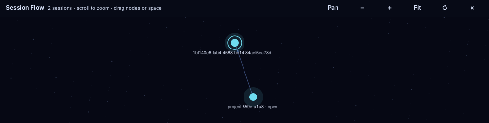
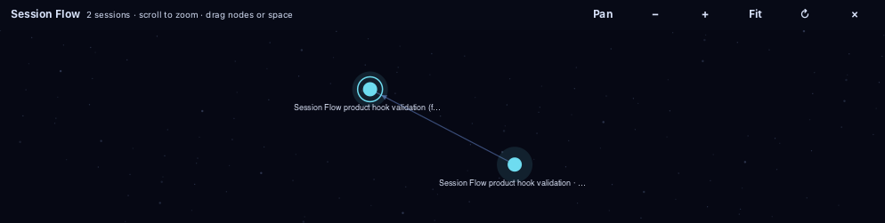

<!-- SPDX-License-Identifier: GPL-3.0-or-later -->

# Flowmux Session Flow 테스트와 검증 계획

상태: 최신 제품 `54a44d89`는 Codex의 지연된 시작 hook을 보완한 프로세스 기반 ID를 재시작용 surface 기록에도 저장한다. 저장 직전 값 비교로 더 최신 hook·다른 도구 기록을 보존한다. 관계 publication을 실패시킨 실제 Codex fork 뒤 격리 GUI SIGKILL→재시작→동일 ID 복구, 정상 3세대 fork, 기본 native 회귀, 상태 저장소 시험 및 clippy를 로컬 통과했다. 이 수정의 새 CI는 아직 미완료이며 이전 제품 `4cff2a5d`의 Test·Sanitizers·coverage 성공과 구분한다. 화면 잠금으로 메뉴 좌표 클릭·hardware drag·접근성·잠금 해제 상태의 성능 수용은 미확인이다. 아래 항목은 수용 조건이며 전체 통과 목록이 아니다. 작성일: 2026-10-31. 요구사항은 [설계 문서](agent-session-flow-design.md)의 R01–R14를 기준으로 한다.

이전 기준 제품 커밋 `9116d3bb`의 [Test 41119193884](https://github.com/flowmux-ai/flowmux/actions/runs/41119193884)와 [Sanitizers 41119199156](https://github.com/flowmux-ai/flowmux/actions/runs/41119199156)는 모두 전체 성공했다. macOS 46개 phase, Linux coverage 기준, editor/headless 회귀를 통과했다. 이후 `4d5929f8`까지 제품 실행 코드 변경은 없으며 추가된 opt-in 3세대 fork 시험은 실제 Codex로 별도 통과했다. 이전 `7cc0c176`의 Test는 macOS IPC 포화 시험에서 실패했고 Sanitizers는 성공했다. `ecc97ae2`의 Test workflow 전체 성공과 최신 변경의 검증 완료는 구분한다.

검증은 모델의 정확성, 실제 provider 계약, native GUI 동작, 기존 기능 회귀, 재시작·실패 복구, 최종 CI를 각각 증명한다. Fixture와 목업 성공으로 실제 fork/resume 성공을 대체하지 않는다.

## 공통 시험 데이터

재현 가능한 fixture를 만들고 동일 key·event sequence를 단위 테스트와 GUI harness에서 공유한다. 실제 provider 검증에는 별도의 작은 저장소와 비민감 대화를 사용한다.

| Fixture | 구성 |
| --- | --- |
| F1 | Claude A0→A1→A3, A0→A2. A2는 기록 삭제, 관계는 남음. Workspace W에 A1만 열림 |
| F2 | Codex B0→B1→…→B20. W에는 B7만 열림. B20은 원격 연결 없음 |
| F3 | Gemini C0→C1→C2. 최초 W에는 없음. 이후 C1을 resume |
| F4 | 다른 프로필에 같은 native ID, 다른 host에 같은 ID, 서로 무관한 같은 제목의 세션 |
| F5 | 누락된 parent, 잘린 metadata, subagent 관계, 순환, 자기 참조, 두 부모 충돌 |
| F6 | 1,000/10,000 노드, 20 component, 깊이 1,000 chain, 긴 한국어·영어·RTL·emoji 제목 |
| F7 | 분할된 terminal, 비활성 tab, 실행 중 agent, 입력 중 draft, browser, unsaved editor, file/worktree/session panels |

F1+F2의 W에는 2개 component, 25개 session 노드가 보여야 한다. A3을 추가로 열어도 2개/25개를 유지한다. C1을 resume하면 3개/28개가 된다. 재개 불가 A2와 B20도 노드 수에 포함되지만 실행 대상이 되지 않는다.

## 모델과 저장 테스트

| ID | 요구 | 입력 또는 실패 주입 | 관찰할 결과 |
| --- | --- | --- | --- |
| D01 | R03 R06 R07 | F1+F2의 A1/B7을 anchor로 조회 | 조상·형제·자손 전체 포함, 정확히 2개/25개 |
| D02 | R07 | A3도 열린 상태로 추가 | 같은 component 중복 0, graph edge 중복 0 |
| D03 | R06 R07 R13 | C1 resume, A1→C1 session 교체 | 새 계보 추가; 다른 A anchor가 없을 때만 A component 제거 |
| D04 | R04 R13 | A1을 inactive tab에 두고 활성 tab은 shell | 흐름 버튼 유지. Inactive tab 제거 후 anchor 재계산 |
| D05 | R06 R10 | A0 기록 삭제 또는 parent metadata만 존재 | placeholder 유지, 연결 보존, 재개 비활성 |
| D06 | R03 R06 | F4의 같은 native ID | host/profile별 별개 key; 잘못된 병합 없음 |
| D07 | R03 | Native parent가 subagent를 의미 | fork edge 생성 안 함; 별도 정보 또는 미지원 처리 |
| D08 | R06 | F5의 cycle/self-edge/부모 충돌 | 무한 탐색·오염 전파 없음; 충돌 이유와 partial 상태 |
| D09 | R03 R14 | 동일 fork event·metadata 반복 | idempotent upsert; edge·operation 수 불변 |
| D10 | R14 | transaction commit 전 종료, commit 후 종료 | 부모·자식 관계와 operation이 반쪽 저장되지 않음 |
| D11 | R12 R14 | 새 native ID 확인 후 저장 오류 | 성공 완료 없음, 재조정 가능, 재fork 없음 |
| D12 | R13 | workspace/surface generation 변경 후 이전 조회 응답 | 늦은 응답의 UI·launch 효과 0 |
| D13 | R14 | 미래 schema, 손상 DB, read-only 경로 | 기능 오류 설명; 기존 terminal/session 기능 정상 |
| D14 | R06 | 대량 기록 일부 page만 로드 | partial·개수 표시; 전체 완료 허위 표시 없음 |

실제 native 저장소를 수정하는 단위 테스트는 금지한다. 임시 디렉터리의 읽기 전용 JSONL/SQLite fixture로 파서와 revision 변경을 검증한다.

## Fork와 resume 동작 테스트

| ID | 요구 | 시나리오 | 관찰할 결과 |
| --- | --- | --- | --- |
| O01 | R01 | shell/browser/editor 또는 fork 미지원 버전 우클릭 | Fork 비활성 또는 에이전트 메뉴 없음; 실행 0 |
| O02 | R01 R13 | 메뉴를 연 뒤 tab/session 교체 후 클릭 | 원래 target mismatch 거절; 새 focused 세션에 실행 안 함 |
| O03 | R02 R03 R12 | A1에서 fork | 원본 A1 유지, 다른 ID 자식, 오른쪽 split, edge 1개, child focus |
| O04 | R02 R11 | F7의 중첩 split에서 fork | 클릭한 leaf만 분할; 다른 widget/PTY/process identity 유지 |
| O05 | R03 | 자식에서 다시 fork | 실제 부모가 자식으로 기록, root에 잘못 붙지 않음 |
| O06 | R09 | 닫힌 A0를 graph에서 선택 | 마지막 아래 pane 오른쪽에 resume; fork edge 추가 없음 |
| O07 | R09 | 이미 열린 A1을 여러 번 선택 | 기존 surface focus; 프로세스·pane 증가 0 |
| O08 | R09 R12 | 다른 workspace/창에서 같은 key 실행 | 기존 실행 위치 확인·이동; 중복 writer 0 |
| O09 | R09 R12 | 두 창에서 동시에 같은 세션 resume | 한 launch만 허용; 다른 요청은 기존 실행 또는 진행 상태로 연결 |
| O10 | R12 | 동일 원본 fork 빠른 반복, timeout 후 재클릭 | 진행 중 중복 호출 0; outcome unknown을 자동 재실행하지 않음 |
| O11 | R12 | native fork 성공, GTK attach 실패 | child/edge 보존; 재시도는 resume; 추가 child 0 |
| O12 | R02 R12 | dispatch 전 spawn 실패·pane 생성 실패 | 원본 보존; 작업 소유의 빈 임시 pane만 정리 |
| O13 | R12 | 정리 직전 사용자가 임시 pane에 입력·새 tab 추가 | 사용자 작업이 생긴 pane을 자동으로 닫지 않음 |
| O14 | R09 R10 | cwd 삭제, binary 미설치, profile 불일치 | preflight 거절, 불가 이유, 잘못된 default profile 실행 0 |
| O15 | R12 | resume 명령이 새로운 native session으로 fallback | ID mismatch로 실패 표시, resume 성공 주장 없음 |
| O16 | R01 R12 | 진행 중 턴을 안전하게 snapshot할 수 없는 provider | fork 비활성; 원본 interrupt·rewrite 없음 |
| O17 | R09 | spawn 직전 선택 대상 pane 닫기·이동 | stale target 거절; 다른 pane으로 조용히 재지정 안 함 |
| O18 | R02 R09 | split 최소 크기 미달 | 명령 실행 전 안내; 자동 tab fallback·기존 pane 닫기 없음 |
| O19 | R12 R14 | 오래된 PID 재사용, owner 사망, owner 조회 불가 | process start identity 검증; 불명확 시 중복 launch 없음 |
| O20 | R09 R12 | session title/path의 따옴표·개행·제어문자 | 표시 escape/길이 제한; shell injection·추가 Enter 없음 |
| O21 | R09 R12 | Flowmux 밖 동일 세션 실행 흔적·writer 충돌이 있으나 소유권 불명확 | Flowmux binding 부재를 실행 없음으로 오해하지 않음; 소유권 확인 전 자동 중복 resume 없음 |

Operation tests는 결과가 확정되는 단계와 외부 side effect 발생 단계를 구분한다. 테스트 double의 fake child ID는 orchestration 테스트 증거이며 실제 provider 계약 증거가 아니다.

## Native UI와 입력 테스트

| ID | 요구 | 조작 | 관찰할 결과 |
| --- | --- | --- | --- |
| U01 | R04 R05 | 기록 없는 W에서 첫 fork, 흐름 버튼 클릭 | 성공 후 버튼 생성, 자동 panel open 없음, 클릭 후 상단 약 1/3 |
| U02 | R05 R11 | panel 열기·닫기 50회 | 아래 pane 분할·PID·draft·scroll·side panel 유지 |
| U03 | R05 | workspace A/B에서 서로 다른 panel 높이·camera | workspace별 상태 복원, 다른 workspace 데이터 유입 없음 |
| U04 | R08 | 커서 위치 여러 곳에서 wheel in/out | 커서 아래 world 좌표 유지, 배율 clamp, 그래프 밖 휠 동작 보존 |
| U05 | R08 R09 | 빈 공간·노드 위 5px 이상 drag | 빈 공간은 pan, 노드는 force 배치 이동; resume/fork 0 |
| U06 | R08 R09 | 이동 모드에서 노드 클릭·drag | pane 변화 0; 선택 모드 복귀 후 click만 open |
| U07 | R08 | drag 중 pointer cancel, 창 focus loss, Escape | capture 해제; 다음 클릭·휠 정상, stuck drag 없음 |
| U08 | R08 | 20–300% 배율, Retina/일반 scale에서 노드 클릭 | 보이는 노드와 hit target 일치, 옆 노드 오작동 없음 |
| U09 | R08 | 긴 chain과 여러 component에서 전체 맞춤 | 전체 bounds 포함, component 간 겹침 없음 |
| U10 | R10 | disabled A2/B20 mouse·Enter·Space | split/launch 0, 이유와 비활성 접근성 상태 유지 |
| U11 | R09 | graph node pointer click와 keyboard Enter | 닫힌 노드는 split resume, 열린 노드는 정확한 tab focus |
| U12 | R11 R13 | pan 중 새로운 fork/status/identity event | camera 유지, drag 상태 보존, 구조 변화만 layout 갱신 |
| U13 | R08 R10 | 축소·테마 변경·큰 글꼴·긴 제목 | 의미 구분·불가 표식 유지, markup 실행 없음, 텍스트 중첩 최소화 |
| U14 | R08 | trackpad pinch/scroll, mouse wheel, 가운데 버튼 | OS별 입력 의미 일치, 과도한 점프·앱 전체 확대 없음 |
| U15 | R04 R05 | 비활성 workspace 아이템의 흐름 버튼 클릭 | 해당 workspace의 그래프와 pane을 일관되게 표시 |
| U16 | R11 | file/worktree/session panel, browser media, unsaved editor와 동시 사용 | 각 패널 상태·미저장 내용·브라우저 상태 보존 |

키보드 탐색의 접근성 이름에는 세션 제목, 도구, 열린 위치 또는 재개 불가 이유를 포함한다. 자동화된 hit-test만으로 접근성 검증을 대체하지 않고 macOS VoiceOver와 Linux의 사용 가능한 접근성 도구로 주요 동작을 확인한다.

## Force 그래프와 공유 계보 검증

| ID | 요구 | 시나리오 | 관찰할 결과 |
| --- | --- | --- | --- |
| G01 | R06 R07 | 서로 다른 workspace에서 같은 계보의 다른 세션을 열기 | 동일한 node/edge/기본 배치, 서로 다른 선택·camera |
| G02 | R08 | 노드를 drag하고 놓기 | 인접 노드가 제한된 힘으로 반응, 수렴 후 tick 중단, 좌표 유한 |
| G03 | R08 R11 | 패널 숨김·애니메이션 감소·빈 그래프 | 불필요한 frame tick 없음, 기존 terminal 입력 정상 |
| G04 | R08 | 우주 배경과 밝은/어두운 테마, disabled·selected 노드 | 배경 대비와 상태 가독성, 색상 외 표식 보존 |
| G05 | R06 R07 | 한 workspace에서 노드 이동 후 같은 계보의 다른 workspace 열기 | 세션 배치는 공유, 포커스와 camera는 독립 |

## 실제 provider 검증

각 adapter는 다음 기록을 남긴다. 지원되지 않은 기능은 `unsupported`, 실행하지 않은 검증은 `not_run`으로 남긴다. 둘을 실패나 성공으로 합치지 않는다.

| 필드 | 기록 내용 |
| --- | --- |
| 환경 | OS, architecture, provider binary 경로·버전, profile/store namespace, 저장소 경로 |
| Capability | discover / read lineage / resume / native fork / child ID correlation / open live session |
| 관계 증거 | 원본 ID, child ID, fork 경계, provider 응답 또는 읽기 전용 metadata 근거 |
| 실행 증거 | 요청 ID, 새 pane/surface ID, 실제 process identity, 최종 observed session ID |
| 보존 증거 | 원본이 독립적으로 계속 사용 가능, 이전 draft 유지, 임의 파일 변경 없음 |
| UI 증거 | 그래프의 위치·관계·활성화 상태, 정확한 split, 노드 열기 후 화면 |
| 결과 | passed / failed / blocked / unsupported / not_run, 원인과 로그 경로 |

필수 실제 시나리오:

1. 기존 대화 A를 준비하고 marker가 있는 작은 대화 맥락을 만든다.
2. Flowmux 메뉴에서 fork B를 만들고 서로 다른 native ID인지 확인한다.
3. B가 이전 맥락을 이어받았는지 확인한다. A와 B에 각각 새 대화를 추가해 독립 저장을 확인한다.
4. B에서 C를 분기하고 provider 기록과 그래프 A→B→C가 일치하는지 확인한다.
5. B를 종료하고 그래프에서 resume해 **B의 같은 ID**로 열리는지 확인한다.
6. Provider 자체 기능으로 Flowmux 밖에서 만든 별도 D 계보의 자식을 resume한다. 조상·형제·자식 수집과 독립 component 표시를 확인한다.
7. Native 기록 일부 삭제 또는 테스트용 remote 연결 해제를 적용하고 비활성 노드와 연결 보존을 확인한다.
8. 이전 workspace에서 이미 실행 중인 B를 다른 workspace에서 선택하고 중복 실행이 없는지 확인한다.

Claude·Codex·OpenCode의 one-click fork는 이 시나리오를 통과해야 활성화한다. Gemini·agy는 독립 분기와 비파괴 호출 경로까지 증명된 경우에만 동일하게 활성화한다. Cline은 native fork 계약이 확인되기 전까지 resume/관계 조회를 개별 검증하며 fork를 지원으로 표시하지 않는다.

Agent의 실제 호출은 로그인·권한·사용량을 필요로 할 수 있다. 실패한 인증이나 없는 binary는 정확한 blocker로 남기며 fixture 결과로 통과시키지 않는다. 검증 중 기존 사용자 에이전트에 메시지를 보내거나 입력을 주입하지 않는다.

## 플랫폼별 격리와 회귀

- 사용자 실행 앱과 agent를 종료하거나 재시작하지 않는다. 별도 Flowmux instance, 별도 state/data/config와 테스트용 profile을 사용한다.
- macOS는 짧은 `/tmp` runtime 경로와 GTK/AppKit main-thread harness를 사용한다. 일반 `cargo test --workspace`만으로 native GUI 통과를 선언하지 않는다.
- Linux는 공통 gate의 지원된 GUI 환경에서 native 입력을 검증한다. X11/Wayland를 구분해 결과에 기록한다.
- 로컬 GUI에서 보이는 상태뿐 아니라 domain pane tree, surface identity, provider ID를 함께 대조한다.
- 기능 비활성 상태에서도 기존 우클릭 Copy/Paste/Split/Close, session new-tab resume, tab 이동, sidebar 선택, 알림의 exact-surface 이동을 검증한다.
- 지원되는 모든 기존 resume 도구에서 홈·설정 override, 로그인 shell PATH, 공백이 있는 cwd, 다른 프로젝트 resume을 회귀 시험한다.

기존 실행 명령:

```sh
cargo fmt --all -- --check
cargo check --workspace
cargo clippy --workspace --all-targets -- -D warnings
bash scripts/test-ci.sh linux
bash scripts/test-ci.sh macos
```

두 OS gate는 각 OS에서 실행한다. 초기에는 변경된 headless crate의 관련 테스트만 먼저 실행하고, native 수정 후 해당 main-thread harness와 공통 gate를 실행한다. 이 문서를 작성하면서 위 구현 테스트를 실행했다는 의미는 아니다.

새 GUI harness를 공통 gate에 추가하면 `scripts/test-ci-runner.py`의 phase/mock/count도 함께 갱신한다. [Test](../.github/workflows/test.yml), [Sanitizers](../.github/workflows/sanitizers.yml), [License audit](../.github/workflows/license-audit.yml)의 최종 remote 결론을 확인한다. 코드·의존성이 바뀌지 않은 문서 작업에 제품 전체 빌드를 요구하지 않는다.

## 성능 측정

측정 전에 OS·CPU·메모리·화면 scale·빌드 모드·데이터 크기를 고정한다. Cold discovery와 warm projection/render를 따로 기록한다. 평균만 기록하지 않고 p50/p95와 최대 정지 시간을 남긴다.

| 시험 | 방법 | 초기 목표 |
| --- | --- | --- |
| Warm projection | F6 1,000노드·20 component, 최소 30회 | 최초 scene 준비 p95 ≤500 ms |
| Pan/zoom | 10초 연속 입력을 5회, 1,000노드 | frame p95 ≤33 ms, 입력 응답 ≤100 ms |
| 장기 사용 | 30분, panel toggle 100회, workspace 전환 100회 | crash·stuck input·노드/handler 지속 증가 없음 |
| 큰 그래프 | 10,000노드와 깊이 1,000 | stack overflow 없음, cancellable discovery, viewport culling 동작 |
| Concurrent UI | 상태 event와 metadata page 로딩 중 입력 | GTK에서 blocking 파일 I/O·DB 대기 없음 |

위 수치는 목표이며 현재 측정 결과가 아니다. 큰 그래프에서 목표를 못 맞추면 데이터가 빠진 것을 숨기지 않고 partial 상태와 후속 작업을 남긴다. 메모리 측정은 warm-up 후 retained object/handler 수와 RSS 추이를 함께 본다. 짧은 성공 run으로 장기 누수 없음이라고 결론내리지 않는다.

## 증거와 완료 판정

새 검증 결과는 `output/session-flow-validation/<run-id>/` 아래에 manifest, 로그, 최종 화면, provider 관계 증거를 묶는 방식을 제안한다. Manifest에는 코드 commit, build 정보, OS/provider 버전, test ID, 기대·실제 결과, artifact 경로와 blocker를 기록한다. 개인 대화·인증 토큰은 기록하지 않는다.

제안 marker는 `SESSION_FLOW_FOREST_OK`, `SESSION_FLOW_SPLIT_RESUME_OK`, `SESSION_FLOW_NATIVE_FORK_OK`, `SESSION_FLOW_CAMERA_OK`다. Harness 구현 전에는 기존 명령이나 이미 얻은 결과처럼 사용하지 않는다.

릴리스 체크:

- R01–R14마다 적어도 하나의 모델/GUI 테스트와 필요한 실제 도구 증거가 연결되어 있다.
- D/O/U 매트릭스의 적용 가능한 필수 항목이 통과했다. Unsupported 기능은 UI에서도 비활성이다.
- Native fork와 resume은 예상 ID·분기 관계·최종 pane을 확인했다.
- 원본·기존 세션·미저장 작업 보존과 실패·timeout·재시작 복구를 통과했다.
- Linux/macOS native gate와 최종 remote CI가 성공했다. 미수행 OS나 adapter를 전체 지원에 포함하지 않는다.
- 기능을 끈 뒤 기존 세션이 계속 동작하고, 구버전에서도 기존 세션 저장소를 읽을 수 있다.
- 목업, fixture, local test, real provider, native GUI, remote CI 결과를 구분해 출시 기록에 남겼다.

HTML 목업은 초기 상호작용 설계 자료다. 아래 실행 기록은 구현 이후 확보한 증거이며, 전체 매트릭스의 통과 여부와 구분한다.

## 요구사항별 현재 증거와 남은 확인

이 표는 완료 감사용이다. 소스의 조건문 존재, 단위 테스트, GTK event 경로, 실제 provider 실행은 서로 다른 증거다. CI 전체 성공도 아래 미확인 실기 항목까지 통과했다는 뜻은 아니다.

| 요구 | 현재 확인된 증거 | 추가 확인 또는 적용 한계 |
| --- | --- | --- |
| R01 | Native 메뉴 활성/비활성·stale menu 거절; 실제 Codex·Claude·OpenCode 메뉴 callback → fork. Claude·OpenCode는 CUA secondary click → 키보드 선택도 확인 | 메뉴 pointer 선택은 기존 Split Right에서도 실행되지 않아 미통과; 하드웨어 마우스 메뉴 선택은 별도 확인 |
| R02 | 실제 Codex·Claude·OpenCode 오른쪽 split과 원본 widget/PID 보존; daemon의 source/surface 검증 및 증분 split | 모든 혼합 pane 조합의 실제 provider fork를 실행한 것은 아님 |
| R03 | 세 provider의 실제 새 child ID·edge 확인; Codex·OpenCode는 resume한 child 재fork로 3세대 연결 검증. OpenCode 분기 후 기록 독립성 확인 | 명시적 native parent 검증은 Codex 기준; OpenCode native parent_id는 NULL. Claude 첫 입력 전 기록 지연은 별도 계약 적용 |
| R04 | 모든 terminal surface를 anchor로 읽는 구현과 native projection fixture | CUA에서 shell 탭을 활성화해도 흐름 버튼·20개 그래프 유지 확인; node pointer로 원래 비활성 surface 복귀 확인 |
| R05 | Native fixture의 mapped panel 높이 비율 0.20–0.48, 토글·원본 보존; sidebar dispatch 연결 | CUA native sidebar pointer 클릭과 실제 상단 panel 추가 확인; 사람의 하드웨어 조작은 미확인 |
| R06 | 어느 family anchor에서도 동일한 전체 projection; 실제 두 workspace의 동일 node/edge 집합 | 명시적 native parent 또는 직접 기록한 관계만 복원 가능 |
| R07 | 독립 family 분리·중복 제거, 1만 노드 모델 시험, 다중 family native fixture | 모든 provider의 외부 fork 계보를 복원하는 기능은 아님 |
| R08 | 모델 camera/force 수렴·공유 배치, native gesture의 zoom/pan/drag/cancel, cosmic fixture 캡처; CUA wheel·Fit·확대 버튼, 20개 실제 세션 제목 확인 | CUA drag는 별도 입력 측정에서도 이동 중 buttons=0이어서 held-button 동작 증거로 사용할 수 없음. 실제 마우스·trackpad drag, VoiceOver/AT-SPI·화면 frame 지연 미확인 |
| R09 | 실제 graph event → split resume, 반복 선택 중복 없음, 다른 workspace의 정확한 기존 tab으로 이동; CUA native pointer로 실제 같은 ID resume 및 재선택 중복 없음 추가 확인 | 서로 다른 GUI 프로세스 2개의 동시 조작은 state/IPC 수준 증거이며 전체 native E2E 미확인 |
| R10 | Native disabled node 입력이 launch를 만들지 않음; 실제 비활성 Codex 기록을 임시 이동한 뒤 CUA pointer 클릭도 operation·pane 증가 없음; 기록 복원 완료 | 수동 접근성 검증 미확인 |
| R11 | Native 토글·gesture 동안 widget/PID 보존; 실제 Codex 30분·159회 workspace/panel 전환 통과; macOS 공통 gate 46개 phase 통과 | 17노드 지속 시험은 대규모 UI 성능이나 더 긴 기간의 누수 부재 증거가 아님 |
| R12 | Codex·OpenCode 실제 ID 확인 후 publication 및 같은 ID resume. Claude 실제 새 ID와 첫 입력 전 live focus·종료 후 기록 없는 노드 비활성 검증; stale source·writer/PID 재사용 검증 | provider별 버전 범위는 아래 기록 참조; 외부 writer 원자적 배제 없음 |
| R13 | 메뉴 생성 후 session 교체 거절, 지연 binding 갱신이 새 writer를 덮지 않음 | 실행 중 임의의 외부 CLI 세션 전환을 모든 provider에서 검증하지는 않음 |
| R14 | 저장소 reopen·migration·실패 transaction·saved surface/native parent 복구 시험; OpenCode 완료 fork 후 GUI crash 복구; Codex child 생성 후 publication 실패 상태에서 GUI SIGKILL → 새 프로세스의 동일 ID·surface 복원과 관계/작업 재조정, 중복 native writer 없음 확인. 이후 CUA 실제 복구 화면·sidebar 토글·자식 focus·wheel/Fit 추가 확인 | 다른 provider의 publication 중단 복구와 미확인 작업 수동 정리 UI는 미완료. CUA 조작은 사람의 물리 입력·접근성 검증을 대체하지 않음 |

주요 소스: [모델과 모델 시험](../crates/flowmux-core/src/session_flow.rs), [저장·복구와 시험](../crates/flowmux-state/src/session_flow.rs), [canvas와 입력 시험](../crates/flowmux/src/ui/session_flow.rs), [native orchestration과 실제 Codex harness](../crates/flowmux/src/ui/window/session_flow.rs). 실제 실행 결과와 commit별 CI 범위는 아래 기록을 따른다. 이 표의 미확인 항목을 기존 baseline 성공으로 대체하지 않는다.

## 실행 기록

2026-10-31 기록. 아래 결과는 위 전체 D/O/U/G 매트릭스를 모두 통과했다는 의미가 아니다.

| 범위 | 결과 | 증거 |
| --- | --- | --- |
| Core 모델 | 178 passed; 1만 노드·20개 계보, 긴 chain, projection, cycle/namespace, geometry | `/tmp/flowmux-session-flow-domain-tests.log` |
| State | 81 passed 및 integration 1+2+13개 통과; transaction, 동시 writer, PID 재사용, stale refresh, native 증거 기반 복구, 잘못된 관계 격리 | `/tmp/flowmux-session-flow-partial-state-full.log` |
| Daemon | 211 passed, 기존 ignored 1개; source/surface 검증과 증분 split | `/tmp/flowmux-session-flow-headless.log` |
| 정적 검사 | workspace check, all-target clippy `-D warnings`, format, diff check 통과 | `/tmp/flowmux-session-flow-check.log`, `/tmp/flowmux-session-flow-menu-key-clippy.log` |
| Hook·capability·해제 | Codex installer 25 passed/기존 ignored 1개; stderr help/실패 응답 및 제한된 PATH, fork callback registry 해제 테스트 통과 | `/tmp/flowmux-session-flow-hook-tests.log`, `/tmp/flowmux-session-flow-capability-final.log`, `/tmp/flowmux-session-flow-weak-registry.log` |
| GTK canvas·배치 | `MACOS_SESSION_FLOW_LAYOUT_OK`, `MACOS_NATIVE_SMOKE_OK`; widget/PID 보존, wheel 좌표, drag/Pan/비활성 노드, 50회 toggle, widget 해제, workspace 전환 중 drag 취소 | `/tmp/flowmux-session-flow-stale-menu.log` |
| 실제 Codex 0.166.0 | `MACOS_SESSION_FLOW_CODEX_REAL_OK`; 첫 요청 자동 전송 없이 identity 식별, 메뉴 fork, graph click resume/중복 방지, workspace 이동 후 공유 계보·기존 tab 포커스 | `/tmp/flowmux-session-flow-real-shared-workspaces.log` |
| 실제 Claude Code 2.1.314 | source `8683a908-3515-4cc9-a35a-1da44cf7a563` → child `21fcba07-00f6-4ea1-9749-24b6cbde520d`; `FLOW_NATIVE_731` 상속; resume 같은 child ID | `/tmp/flowmux-session-flow-claude-evidence.json` |
| 실제 OpenCode 1.17.18 | source `ses_e720557a7ffehEpgE0O7ocPC90` → child `ses_e7202b093ffeGhjCBP9bu4Du0H`; 원본 메시지 복제. 모델 호출은 401로 blocked | `/tmp/fm-flow-providers-h_ja_8_6/opencode*.log`, 격리된 SQLite |
| 라이선스 생성 | 고정된 cargo-about 0.9.2로 재생성 후 committed notices와 차이 없음 | `/tmp/flowmux-session-flow-licenses.log` |
| 원격 macOS gate | `9116d3bb`의 46개 phase 모두 passed; IPC 포화 hook 전송, PTY 압력 시험, Session Flow native smoke, 기존 browser/editor/WebDriver 회귀 포함 | Test `41119193884`, job `124281231198`; [phase JSON](design-assets/session-flow-macos-gate-9116d3bb.json) |
| 로컬 macOS gate | 화면 잠금(`CGSSessionScreenIsLocked=Yes`) 상태에서 browser-control의 stable pointer 및 editor-keyboard의 window active 대기 실패. 기존 설치 버전에서도 browser 실패 재현. 별도 실행한 remaining 14개 중 13개, tail 21개 중 17개 통과. 실패 목록은 아래 참고; 전체 통과 아님 | `/tmp/flowmux-session-flow-macos-gate.log`, `/tmp/flowmux-session-flow-browser-baseline.log`, `/tmp/flowmux-session-flow-macos-remaining.log`, `/tmp/flowmux-session-flow-macos-tail.log` |
| Linux coverage·원격 CI | `9116d3bb` Test·Sanitizers 전체 success: lines 86.93%, regions 86.86%, functions 85.86%. 변경 없는 dependency/license 집합의 License audit도 success | Test `41119193884`, Sanitizers `41119199156`, License `41108559323`; [coverage JSON](design-assets/session-flow-coverage-9116d3bb.json) |

Native GUI는 별도 `/tmp/fm-native-*` XDG/runtime 및 테스트 소켓을 사용했다. Codex는 임시 history/config profile을 사용했다. Claude는 임시 프로젝트의 새 session ID와 기존 로그인을 사용했으며, `--setting-sources ''`, 빈 MCP 설정, 도구 비활성으로 기존 사용자 hook·도구 실행을 제외했다. 사용자 세션에 입력을 보내거나 사용자 앱을 종료하지 않았다.

Writer 조정은 Flowmux가 관측한 실행에 대한 보장이다. 다른 앱의 실행을 원자적으로 잠그는 기능은 아니다. 인증 실패, 미지원 외부 fork, 수동 접근성·장기 성능 미수행은 `passed`로 바꾸지 않는다.


최신 코드의 로컬 회귀 보강(`6fd9157b`): fork callback은 weak registry를 사용해 pane tree 해제를 방해하지 않는다. Provider PATH에 시스템 명령이 없더라도 capability probe는 `/usr/bin/env`로 실행된다. Linux가 발견한 두 실패를 수정한 뒤 해당 로컬 테스트와 전체 all-target clippy를 통과했다. 기존 Linux 실패 run은 수정 후 통과 증거로 대체하지 않는다.

화면 잠금 상태에서 남은 재실행 항목:

- `browser-control`: 안정적인 pointer target 대기 실패; 기존 설치 버전도 동일.
- `editor-keyboard`: native keyboard window active 대기 timeout.
- `markdown`: PNG renderer timeout; native Markdown smoke 자체는 통과.
- `webdriver-native`: pointer fixture 표시 실패.
- `webdriver`: automation window가 native focus를 얻지 못함.
- `browser-chrome`: 입력 후 예상 DOM field focus가 비어 있음.

잠금 해제 후 `bash scripts/test-ci.sh macos`로 전체 gate를 다시 실행한다. 이 실패들이 모두 잠금만으로 발생했다는 결론은 재실행 전까지 확정하지 않는다. 사용자 앱 PID `72789`는 실행 중임을 확인했으며 종료·재시작하지 않았다.

추가 입력 검증: `/tmp/flowmux-session-flow-pan-input-final.log`에서 native harness의 `MACOS_SESSION_FLOW_LAYOUT_OK`와 `MACOS_NATIVE_SMOKE_OK`를 확인했다. GTK gesture/key signal을 통한 Space·가운데 버튼 팬, 누적 pinch 배율과 커서 기준점, Escape 이후 늦은 drag-end의 열기 억제를 검사했다. 실제 하드웨어 트랙패드/키보드 검증을 대신하는 증거는 아니다. 캡처는 `docs/design-assets/agent-session-flow-native.png`이며 실제 provider 데이터가 아닌 fixture다. All-target clippy는 `/tmp/flowmux-session-flow-input-clippy.log`에 기록했다.

실제 메뉴 경로 검증: `/tmp/flowmux-session-flow-context-menu.log`에서 native terminal의 secondary-click gesture가 구성한 `Fork session` 버튼의 미지원 상태 비활성을 확인했다. `/tmp/flowmux-session-flow-real-menu.log`에서는 동일 버튼의 활성 상태 및 clicked callback → bridge → fork → split → child 종료 → 같은 ID resume을 통과했다. source `01a18ddc-a51f-7472-ab63-045abb779243`, child `01a18e15-da1a-7362-b196-a1276bd3fdda`. 모델 요청을 자동 입력하지 않았으며 원본 widget/PID가 유지됐다. 이 검사는 GTK gesture/button signal 경로이며 물리 마우스 입력 검증과는 구분한다.

메뉴 대상 보존 회귀: `/tmp/flowmux-session-flow-stale-menu.log`의 native fixture는 메뉴를 연 후 같은 surface의 session ID와 catalog binding을 교체한다. 원래 key를 유지한 메뉴가 `Source session changed`로 거절되고 pane 및 pending operation이 증가하지 않음을 확인했다. UI status의 일시적 변경은 notify 이벤트로 관측하여 이후 refresh에 덮여도 검증을 잃지 않는다. `/tmp/flowmux-session-flow-real-menu-key.log`에서는 정상 메뉴 fork/resume도 다시 통과했다(child `01a18e19-e39a-73f0-a62b-d8cfd06553f6`). Callback 해제 테스트와 all-target clippy도 통과했다.


모델 성능 측정(2026-10-31 KST): Apple M4 Pro, 64 GiB, macOS 27.0.1, Rust 1.99.0 release 빌드에서 1,000노드·20계보를 준비했다. 2회 warm-up 후 30회 측정했으며 기존 사용자 앱을 유지한 환경이다.

| 측정 범위 | p50 | p95 | 최대 |
| --- | ---: | ---: | ---: |
| 계보 projection + 초기 layout | 2.30 ms | 2.35 ms | 2.41 ms |
| 물리 계산 한 단계(9,000개 표본) | 3.14 ms | 3.33 ms | 3.57 ms |
| 300단계 계산 합계(frame 대기 없음) | 944.59 ms | 956.60 ms | 957.63 ms |

이는 모델 계산 비용이며 실제 UI frame p95, 입력 지연, provider discovery, 30분 soak의 통과 증거가 아니다. 결과는 [원본 JSON](design-assets/session-flow-model-benchmark.json)에, 재현 코드는 [benchmark example](../crates/flowmux-core/examples/session_flow_benchmark.rs)에 있다.

```sh
cargo run -p flowmux-core --release --example session_flow_benchmark --locked
```

최신 Sanitizers `41108555435`는 success다. Linux GUI ASan 실행에서 907 passed, 기존 ignored 4개를 확인했고, 이전에 실패했던 registry 해제와 stderr/PATH capability 테스트도 통과했다. Headless ASan/LSan 및 별도 ThorVG ASan/UBSan/LSan 작업도 success다. 원본 로그: `/tmp/flowmux-session-flow-sanitizers-final.log`. 라이선스 검사 `41108559323`도 success다.


macOS CI `41108551043`의 browser-control은 통과했다. 이후 CLI의 `pty_tee_keeps_input_and_resize_live_under_output_backpressure`에서 입력과 resize는 통과했으나 마지막 출력 1,024바이트가 부족했다(1,047,552 / 1,048,576). 원본 로그: `/tmp/flowmux-session-flow-macos-ci-final.log`. 따라서 이 run의 macOS 전체 gate는 실패이며 이후 native phase의 통과를 의미하지 않는다.

원인 분리 시험은 Flowmux 없이 Python `pty.fork()`로 동일한 1MiB 비차단 출력을 만들고, master를 4KiB씩 읽으며 0.5ms 간격을 두었다. 자식이 마지막 write 직후 종료하면 10회 중 1회 CI와 같은 1,024바이트 누락이 재현됐다. 종료 전에 blocking mode와 `termios.tcdrain(1)`을 적용한 10회는 모두 1,048,576바이트를 받았다. 이 결과를 근거로 `ecc97ae2`는 테스트 producer만 배출 완료 후 종료하도록 수정했다. 제품 PTY 코드는 수정하지 않았다. 전체 길이와 모든 byte의 값을 각각 검사하므로 무손실 조건은 유지하며, 실패 시 거대한 byte 배열 대신 짧은 진단을 출력한다.

수정 후 PTY integration 24개 통과 및 해당 압력 시험 20회 연속 통과. 로그: `/tmp/flowmux-session-flow-pty-drain-final.log`, `/tmp/flowmux-session-flow-pty-drain-repeat.log`. `cargo fmt --all -- --check`, `git diff --check`도 통과했다. 최종 Test `41112091385`는 `ecc97ae2`를 검증하며 진행 중이다. 기존 Linux 작업은 별도로 결과를 보존하기 위해 취소하지 않았다.


그래프 열기 경로 보강: `/tmp/flowmux-session-flow-real-graph-click.log`에서 `MACOS_SESSION_FLOW_CODEX_REAL_OK`와 `MACOS_NATIVE_SMOKE_OK`를 확인했고 프로세스는 exit 0으로 종료했다. Source `01a18ddc-a51f-7472-ab63-045abb779243`, child `01a18e35-5c15-75b0-a70f-46981228b50f`. 실제 우클릭 메뉴 fork 후 child pane을 닫고, 표시된 graph node의 GTK drag-begin/end(이동 없음) → `FlowAction::Open` → bridge dispatch → 오른쪽 split resume을 확인했다. 다시 원본 pane으로 포커스를 옮긴 뒤 열린 child node를 클릭하면 기존 child pane으로 포커스가 돌아오고 pane 수는 2개를 유지했다. Native ID와 관계 수, 원본 PID/widget도 유지됐다.

이 시험은 history worker 완료 플래그만 기다리지 않고 graph에 해당 node가 렌더링 가능한 상태로 들어온 뒤 클릭한다. 물리 입력 검증은 아니며 실제 provider와 GTK event/dispatch 경로의 결합 검증이다. 신규 코드는 `test + macOS + native-smoke` 조건의 검증 helper와 opt-in provider harness에만 적용되며 제품 실행 코드는 바뀌지 않았다.

해당 native harness의 `cargo clippy -p flowmux --test macos_native --features native-smoke --locked -- -D warnings`도 통과했다. 로그: `/tmp/flowmux-session-flow-graph-click-clippy.log`.


Linux job `124244615365` (`a1ceb185`, Test `41108551043`)는 success로 완료됐다. Workspace 테스트와 모든 후속 live GUI/SSH 검사를 포함한 coverage phase가 1,542.546초에 통과했으며 JSON, HTML, threshold 단계도 통과했다. GUI 단위 테스트는 907 passed / 기존 ignored 4개이고 `canvas_controls_preserve_panes_and_never_launch_during_navigation`도 통과했다. `BROWSER_CONTROL_OK`와 `IDLE_STABILITY_OK`를 확인했다. 원본 job 로그: `/tmp/flowmux-session-flow-linux-final-a1.log`. GitHub artifact `linux-test-evidence` (`13004441704`)의 JSON과 HTML도 내려받아 확인했다.

| Linux 측정 범위 | Lines | Regions | Functions |
| --- | ---: | ---: | ---: |
| 전체 저장소 | 86.91% | 86.84% | 85.83% |
| 요구 기준 | 79% | 78% | 78% |
| Session Flow core | 97.97% | 98.85% | 100.00% |
| Session Flow state | 97.79% | 93.68% | 97.30% |
| Native process identity | 81.03% | 84.35% | 87.50% |
| Canvas | 81.77% | 82.84% | 75.38% |
| Window orchestration | 38.89% | 37.88% | 29.76% |

전체 기준은 통과했으나 window orchestration의 Linux 계측 범위는 낮다. 별도 macOS native/provider 시험은 Linux coverage에 합산되지 않는다. 위 수치에는 빌드된 테스트 코드도 포함되며 branch coverage는 수집하지 않았다. 전체 수치로 개별 실행 경로의 검증 완료를 주장하지 않는다. 집계 원본과 식별자는 [coverage JSON](design-assets/session-flow-coverage-a1ceb185.json)에 보존했다. 해당 workflow 전체는 macOS PTY fixture 실패로 failure이며 Linux job 성공과 구분한다. 수정된 fixture를 포함한 Test `41112091385`는 계속 실행 중이다.


실제 workspace 간 계보 공유: `/tmp/flowmux-session-flow-real-shared-workspaces.log`에서 `MACOS_SESSION_FLOW_SHARED_WORKSPACES_OK`, `MACOS_SESSION_FLOW_CODEX_REAL_OK`, `MACOS_NATIVE_SMOKE_OK` 및 exit 0을 확인했다. Source `01a18ddc-a51f-7472-ab63-045abb779243`, child `01a18e3e-5b0b-7b72-9f34-80983092c327`. Fork와 graph click resume 후 실제 자식 terminal surface를 두 번째 workspace로 옮겼다. 원래 workspace의 graph node 클릭이 새 workspace의 기존 자식 pane으로 이동했고, 두 workspace의 canvas scene이 같은 session/edge 집합을 표시 대상으로 유지하는지 확인했다. Terminal 수는 증가하지 않았고, 자식 PID 및 원본 PID/widget이 유지됐다. Workspace별 camera 저장·복구는 별도 state/canvas 시험 증거이며 이 시나리오를 물리 입력·양쪽 화면 캡처 검증으로 표현하지 않는다.

해당 opt-in native harness의 clippy(`-D warnings`)도 통과했다: `/tmp/flowmux-session-flow-shared-workspaces-clippy.log`. 새 변경은 test-only helper와 provider harness이며 제품 실행 코드는 바뀌지 않았다. 사용자 앱 PID `72789`는 계속 실행 중이다.


정확한 tab 전환 검증: `/tmp/flowmux-session-flow-real-exact-tab.log`의 native 시험은 workspace와 pane뿐 아니라 대상 pane의 active surface가 실제 Codex child surface와 일치할 때까지 기다린다. 대상 pane에는 기존 shell tab도 있으므로 pane 포커스만으로 통과하지 않는다. Child `01a18e40-f64a-7130-bcf4-90b5d9d16728`에서 shared-workspace/real-Codex/native-smoke marker와 exit 0을 확인했다.


수정 후 macOS job `124256538732` (`ecc97ae2`, Test `41112091385`)는 success다. 공통 gate의 46개 phase가 모두 passed / exit 0임을 job 로그와 다운로드한 `macos-test-evidence` artifact (`13004149126`)의 개별 JSON에서 확인했다. 원본 로그: `/tmp/flowmux-session-flow-macos-ecc97ae2.log`. 압력 시험 `pty_tee_keeps_input_and_resize_live_under_output_backpressure` 및 Session Flow의 `MACOS_SESSION_FLOW_LAYOUT_OK` / `MACOS_NATIVE_SMOKE_OK`도 통과했다.

원격 runner에서 browser-control, editor-keyboard, markdown, webdriver-native, webdriver, browser-chrome이 모두 통과했다. 이는 최신 제품 코드의 해당 회귀 gate 성공 증거이며 잠긴 로컬 화면에서 물리 입력을 검증했다는 의미는 아니다. Native state/복원, hook·session 경로, notification, editor recovery, palette pointer release, Office stability, browser deadline phase도 통과했다. 전체 목록과 실행 식별자는 [macOS gate JSON](design-assets/session-flow-macos-gate-ecc97ae2.json)에 보존했다.

이 CI commit 이후의 코드 차이는 opt-in macOS provider harness 및 test-only graph helper 보강이다. 해당 부분은 실제 Codex로 로컬 native smoke와 clippy를 따로 통과했다. 제품 실행 코드는 `ecc97ae2`와 동일하다. 현재 Test 실행의 Linux job `124256539183`은 계속 실행 중이므로 workflow 전체 성공은 아직 확정하지 않는다.


완료 감사 중 발견한 metadata 격리 오류: 유효한 Codex 계보와 잘못된 `forked_from_id`가 함께 있으면 한 세션의 parse error가 전체 import를 중단했다. `/tmp/flowmux-session-flow-partial-before.log`에서 새 회귀 시험이 실제 실패하는 것을 확인한 뒤 수정했다. Native discovery는 잘못된 관계를 보고하고 정상 기록·계보를 유지한다. 순환·충돌 부모도 writer transaction 안에서 걸러 기존 확정 edge를 덮어쓰지 않는다. 기존 strict batch import는 여전히 오류 시 전체 rollback한다.

수정 후 state 81개와 integration 1+2+13개가 통과했다(`/tmp/flowmux-session-flow-partial-state-full.log`). 잘못된 parent, 충돌 부모, 자기 참조·순환, 독립 family 보존, 반복 import의 idempotence, native 파일 무수정을 검사했다. Native harness에서는 정상 graph를 유지하며 `Incomplete history`와 tooltip을 표시하고 다음 정상 갱신에서 둘 다 제거함을 확인했다(`/tmp/flowmux-session-flow-partial-native.log`, `MACOS_SESSION_FLOW_LAYOUT_OK`, `MACOS_NATIVE_SMOKE_OK`, exit 0). Workspace all-target clippy에 `flowmux/native-smoke`를 포함해 `-D warnings`로 통과했다(`/tmp/flowmux-session-flow-partial-clippy.log`). 이 제품 코드 보완은 기존 CI 이후의 변경이므로 기존 통과 결과를 새 변경의 최종 CI로 주장하지 않는다.


부분 계보 보완 이후 실제 Codex 회귀도 통과했다(`/tmp/flowmux-session-flow-partial-real-codex.log`, exit 0). Source `01a18ddc-a51f-7472-ab63-045abb779243`, child `01a18e4e-88e7-7ae0-a75d-fefca0788c42`; 실제 메뉴 fork, graph click resume, 중복 방지, workspace 간 공유 계보와 정확한 active tab 전환, 원본/자식 PID 보존 marker를 확인했다.


기준 실행 종료 기록: `ecc97ae2`의 Test `41112091385`는 workflow 전체 success다. Linux job `124256539183`은 coverage phase 1,648.592초 및 JSON/HTML/threshold 단계 모두 passed였으며 GUI 907 passed / 기존 ignored 4개와 수정된 PTY 압력 시험 통과를 확인했다. Lines 86.92%, regions 86.85%, functions 85.85%로 기준을 충족했다. Linux artifact `13005333927`, 원본 로그 `/tmp/flowmux-session-flow-linux-ecc97ae2.log`. 앞선 실행 당시의 진행 중 표기는 역사 기록이며 현재 최종 검증 대상은 상단의 `7cc0c176`이다.


지속 사용 검증 harness: 실제 provider용 native 시험에 `FLOWMUX_SESSION_FLOW_SOAK_SECONDS`(1–1800)를 추가했다. 지정된 임시 Codex profile에서만 실행하며, 일반 native suite의 300초 제한은 유지하고 이 opt-in 경로만 요청된 지속 시간만큼 deadline을 늘린다. 약 10초마다 두 workspace를 전환하고 패널을 닫았다 열며, 같은 계보·정확한 active surface·terminal 수·원본과 자식 PID를 검사한다. 각 회차의 RSS, snapshot 준비 대기, offscreen snapshot/render 호출 시간을 따로 기록한다. 물리 입력이나 디스플레이 frame 지연 측정이 아니다.

첫 지속 시험은 52초 부근에서 고정 20ms 대기 후 snapshot이 없어 실패했다(`/tmp/flowmux-session-flow-soak-1800.log`). 준비된 snapshot을 최대 5초까지 조건으로 기다리도록 바꾼 90초/9회 시험은 통과했고, 해당 시점의 준비 대기는 약 376ms였다(`/tmp/flowmux-session-flow-soak-readiness.log`). 90초 결과를 30분 결과로 대체하지 않는다. Native harness clippy도 통과했다(`/tmp/flowmux-session-flow-soak-final-clippy.log`). 새 코드는 opt-in 시험에만 적용하며 제품 실행 코드는 `7cc0c176`에서 바뀌지 않았다.


최신 macOS CI의 IPC 포화 실패: 일반 연결 64개가 모두 응답한 뒤 추가 `Client::connect`의 `peer_cred()`가 `ENOTCONN`으로 실패했다(`/tmp/flowmux-session-flow-macos-7cc0c176.log`). 기존 단일 worker 시험을 두 worker의 동시 accept와 100회 연결로 강화하자 첫 연결에서 같은 오류를 재현했다(`/tmp/flowmux-ipc-saturation-race-before.log`). 포화 서버가 일반 stream을 닫은 뒤 macOS에서 peer credentials를 읽는 경쟁 조건이다.

클라이언트는 이 특정 연결 종료 오류에서만 별도 control endpoint의 동일 사용자 credentials를 검증한다. 일반 요청은 기존 거절된 stream에 남아 실패하며, hook·상태 요청만 기존 control 경로를 사용한다. 전송한 요청을 재시도하거나 mutation을 control로 우회하지 않는다. 수정 후 IPC 단위 80개 및 integration 5+4개가 통과했다(`/tmp/flowmux-ipc-saturation-final.log`). 강화된 시험은 100회 포화 상태 조회, mutation 거절, 이후 상태 조회 성공을 검사한다. IPC all-target clippy와 formatting도 통과했다(`/tmp/flowmux-ipc-saturation-clippy.log`). 실제 native 전체 gate의 재검증은 아직 필요하다. 진행 중인 30분 시험 binary는 이 IPC 수정 전 빌드이므로 그 범위를 별도로 기록한다.


최신 macOS 최종 gate: `9116d3bb`의 job `124281231198`은 success이며 artifact `13009385966`의 46개 phase JSON이 모두 passed / exit 0이다. IPC 포화 뒤 hook 2건의 응답 및 `MACOS_SESSION_FLOW_LAYOUT_OK`, `MACOS_NATIVE_SMOKE_OK`를 원본 로그 `/tmp/flowmux-session-flow-macos-9116d3bb.log`에서 확인했다. [최신 macOS phase JSON](design-assets/session-flow-macos-gate-9116d3bb.json)에 보존했다. 최신 Sanitizers workflow `41119199156`와 두 job도 success이고 GUI ASan은 907 passed / 기존 ignored 4개다(`/tmp/flowmux-session-flow-sanitizers-9116d3bb.log`).

`7cc0c176` Linux job `124271947702`도 success로 종료됐다. Coverage phase 1,719.523초와 JSON/HTML/threshold가 통과했고 lines 86.89%, regions 86.80%, functions 85.84%다. 해당 workflow 전체는 앞서 기록한 macOS IPC 오류로 failure다. IPC 수정이 포함된 `9116d3bb`의 Linux 결과와 혼동하지 않는다. 원본 로그 `/tmp/flowmux-session-flow-linux-7cc0c176.log`, artifact `13008498176`.

30분 지속 시험 완료: `/tmp/flowmux-session-flow-soak-final-1800.log`의 프로세스 exit 0과 `MACOS_SESSION_FLOW_SOAK_OK seconds=1800 iterations=159`, real-Codex/native-smoke marker를 확인했다. Probe는 `5e49af23`, 제품 코드는 `7cc0c176` 빌드다. Source `01a18ddc-a51f-7472-ab63-045abb779243`, child `01a18e5e-4e9e-73a1-bac8-ff16675e74e9`. 159회 모두 17노드·3terminal, 정확한 active surface·동일 계보·원본/자식 PID 검사를 통과했다. [전체 표본과 요약 JSON](design-assets/session-flow-native-soak-5e49af23.json)에 로그 hash와 범위를 기록했다.

| 30분 시험 측정 | p50 | p95 | 최대 |
| --- | ---: | ---: | ---: |
| Offscreen snapshot/render 호출 | 2.90 ms | 4.14 ms | 15.46 ms |
| Snapshot 준비 대기 | 160.64 ms | 404.58 ms | 429.78 ms |

RSS는 초기 최대 602,896 KiB, 시작 60초 이후 247,280–248,016 KiB, 종료 247,904 KiB였다. 관측값이며 메모리 누수가 없다는 보편적 결론은 아니다. 물리 입력·실제 화면 frame 지연·1,000노드 UI 성능을 측정한 것이 아니다. 진행 중 headless 빌드/검사가 같은 호스트에서 실행됐다. 이 바이너리에는 이후 IPC 수정이 포함되지 않았으며 해당 변경은 별도 최신 native/CI로 검증한다.

3세대 실제 Codex 검증: 최신 제품 코드와 추가 opt-in harness의 `/tmp/flowmux-session-flow-real-refork-final.log`는 exit 0이며 shared-workspace/refork/real-Codex/native-smoke marker를 모두 남겼다. Source `01a18ddc-a51f-7472-ab63-045abb779243` → child `01a18e7a-2962-7462-aa52-5beb822f94e9` → grandchild `01a18e7a-422b-7360-a3a2-c52e772bf11a`. Resume한 child를 다른 workspace에서 우클릭 메뉴 callback으로 다시 fork했다. 새 edge가 child에 연결되고 root에 직접 연결되지 않음, root와 grandchild의 전체 family projection 일치, 기존 source/child PID 유지, terminal 1개만 증가함을 확인했다. 물리 클릭 증거는 아니며 실제 provider와 GTK event/bridge 경로의 결합 검증이다. Native harness clippy와 formatting도 통과했다(`/tmp/flowmux-session-flow-refork-clippy.log`).


최종 Linux·workflow 종료: `9116d3bb`의 Linux job `124281231441`과 Test `41119193884`는 모두 success다. GUI 907 passed / 기존 ignored 4개, IPC 포화 100회 회귀 시험을 확인했다. Coverage phase 1,611.284초, JSON 78.235초, HTML 81.910초, threshold 94.165초 모두 passed다. Artifact `13008864151`의 LLVM JSON과 원본 로그 `/tmp/flowmux-session-flow-linux-9116d3bb.log`를 확인했으며 [최종 coverage JSON](design-assets/session-flow-coverage-9116d3bb.json)에 원본 hash와 집계를 보존했다.

| 최종 Linux 계측 | Lines | Regions | Functions |
| --- | ---: | ---: | ---: |
| 전체 저장소 | 86.93% | 86.86% | 85.86% |
| 요구 기준 | 79% | 78% | 78% |
| Session Flow core | 97.97% | 98.85% | 100.00% |
| Session Flow state | 98.06% | 94.45% | 97.47% |
| Native process identity | 81.03% | 84.35% | 87.50% |
| Canvas | 81.77% | 82.84% | 75.38% |
| Window orchestration | 38.96% | 38.29% | 29.41% |
| IPC client | 96.68% | 94.00% | 95.45% |

Window orchestration의 낮은 Linux 계측 범위를 전체 coverage로 숨기지 않는다. 별도 macOS fixture·실제 Codex 3세대 fork/resume 및 30분 지속 시험은 별도 증거이며 위 수치에 합산하지 않는다. Branch coverage와 물리 입력·접근성 수동 검증은 수행하지 않았다.

최종 소스·문서 점검: 분리된 `feat/session-flow`에서 `4d5929f8`까지 31개 커밋의 author/committer가 모두 지정된 `JunsuChoi <jsuya.choi@samsung.com>`인지 확인했고 co-author trailer와 외부 URL이 없음을 확인했다. 원격과 로컬 HEAD가 일치했고 문서의 로컬 링크 32개 및 검증 JSON도 유효했다. 이 기록 이후의 문서·증거 커밋은 제품 코드 변경이 아니다. 사용자 앱 PID `72789`는 계속 실행 중이며 종료·재시작하지 않았다.

남은 검증 경계: 로컬 `CGSSessionScreenIsLocked=Yes`를 재확인했다. 물리 마우스/trackpad/키보드 및 VoiceOver/AT-SPI 확인은 수행하지 못했다. 실제 Claude GUI, OpenCode의 인증 성공 상태를 포함한 전체 GUI 경로, 두 독립 GUI 프로세스의 실기 전환, provider crash/restart 전체 시나리오를 통과했다고 주장하지 않는다. 위 요구사항별 표의 미확인 항목과 도구별 지원 제한은 유지한다.


## 잠금 해제 후 native 입력 재검증과 제목 충돌 수정

2026-10-31, 사용자 앱 PID `72789`를 유지한 상태에서 별도 bundle/state/runtime으로 검증했다. 아래 입력은 CUA가 OS에 전달한 native 입력이며 사람의 실제 마우스·trackpad나 GTK signal emit 시험과 구분한다. 상세 identity와 count는 [native 입력 기록](design-assets/session-flow-native-input-9116d3bb.json)에 남겼다.

- 제품 `9116d3bb`, 격리 앱 PID `65831`: 우클릭으로 메뉴를 열고 Down/Return으로 Fork session을 선택했다. 원본 `01a18ddc-a51f-7472-ab63-045abb779243`의 PID `66048`을 유지하고 child `01a18f8f-c2c5-7e51-9b8e-85330f228756`을 오른쪽 split으로 열었다. Operation은 complete, 노드 19→20, edge 18→19였다.
- Sidebar 버튼 클릭 후 상단 약 1/3에 그래프가 나타났다. Wheel 확대와 Fit 복원을 확인했다. 그래프 pointer 클릭은 `01a18e7a-422b-7360-a3a2-c52e772bf11a`를 같은 ID로 resume했다. 재선택 후 operation 2개·edge 19개·live binding 3개 및 각각의 process birth identity가 그대로였다.
- 메뉴의 pointer 선택은 Fork와 기존 Split Right 모두 popup만 닫고 실행되지 않았다. 200ms 누름에서도 같았다. Native drag도 카메라 이동을 관측하지 못했다. 입력 도구와 GTK/AppKit 중 어느 쪽의 문제인지 확정하지 않았으며 이 경로를 통과로 기록하지 않는다. AX snapshot은 window/menu bar만 노출하고 GTK 내용은 노출하지 않아 접근성 성공 증거가 없다.
- 실제 20개 세션의 Fit 화면에서 제목이 중첩됐다. `06425a31`은 Pango 제목 영역을 위·아래에 배치하고, 이미 배치된 제목이나 노드를 가리는 일반 제목을 생략한다. 선택 제목을 우선하며 노드·edge·hit target·저장된 배치를 바꾸지 않는다.
- 긴 한글·RTL·emoji 제목 20개에 대해 제목 간 충돌 없음, 선택 우선, graph/position/hit 유지, 분산된 노드의 제목 복원, 화면 밖 생략을 native 공통 canvas 시험에 추가했다. `/tmp/flowmux-session-flow-label-test.log`의 `MACOS_SESSION_FLOW_LAYOUT_OK` 및 `MACOS_NATIVE_SMOKE_OK`, clippy `-D warnings`, GUI build가 통과했다.
- 새 격리 앱 PID `72353`, `/tmp/fmslabel-rx4d2ri_`에서 같은 실제 계보 20개를 다시 열었다. Fit 화면 제목 중첩 제거, 열린 세션의 pointer 선택과 우선 제목 표시, 확대 버튼을 화면으로 확인했다. 두 앱은 서로 다른 테스트 세션을 열었으며 사용자 앱은 종료·재시작하지 않았다. 이 수정의 전체 CI 결론은 별도로 기록한다.

- `06425a31`에서 비활성 native 기록 하나를 임시 이동해 회색 금지 표식과 연결 유지, native pointer 클릭의 불가 사유 표시, operation 0·live 1·edge 19 유지까지 확인했다. 기록을 원위치로 복원하고 노드가 다시 활성화되는 화면을 확인했다.
- 같은 pane에 shell 탭을 추가해 Codex 탭을 비활성으로 만들었다. Sidebar 흐름 버튼과 20개 그래프가 유지됐고 native node 클릭으로 정확한 원래 surface `4bb21dc9-aaf2-4915-a2f9-7cb6ef8e420e`가 활성화됐다. Pane 1개·tab 2개·operation 0 및 Codex process birth identity가 유지됐다. [후속 native 검증 기록](design-assets/session-flow-native-input-06425a31.json).

후속 CI: [Test 41155692283](https://github.com/flowmux-ai/flowmux/actions/runs/41155692283), [Sanitizers 41155694852](https://github.com/flowmux-ai/flowmux/actions/runs/41155694852), 모두 제품 `06425a31` 대상이며 후속 workspace 수정으로 대체하기 위해 취소했다. 성공으로 기록하지 않는다.


## Workspace 생성 직후 그래프 불일치 수정

`06425a31`의 실제 GUI에서 CLI로 새 workspace를 만들면 pane과 sidebar는 새 workspace를 표시하지만 `workspace current`는 이전 ID를 반환했다. Session Flow가 저장소의 active ID를 읽어 이전 계보가 새 pane 위에 남았다. `WorkspaceCreated`/`NewWorkspace`는 widget만 만들고 공통 `activate_workspace` 경로를 호출하지 않았으며, 기존 activation도 flow 갱신을 명시적으로 수행하지 않았다.

`4ab3e76e`는 두 생성 경로에서 공통 activation을 호출하고 activation 완료 전에 Session Flow를 갱신한다. 제품 변경은 3줄이다. Native 회귀 시험은 수정 전 active ID 불일치로 실패했고 수정 후 CLI/UI 생성, 이전 그래프 숨김, 원래 workspace 복귀, source PID/widget 보존을 통과했다. 기존 CLI caller path, pane zoom/reorder, clippy 및 build도 통과했다.

격리 앱 PID `82242`의 실제 Codex 계보 20개에서 새 workspace 생성→이전 그래프 숨김→native sidebar 클릭 복귀→원래 그래프 표시를 확인했다. `workspace current`와 화면이 일치하고 기존 source PID `82257`의 birth identity도 유지됐다. [재현과 수정 검증 기록](design-assets/session-flow-workspace-4ab3e76e.json).

최신 전체 gate는 [Test 41156185258](https://github.com/flowmux-ai/flowmux/actions/runs/41156185258)와 [Sanitizers 41156187678](https://github.com/flowmux-ai/flowmux/actions/runs/41156187678), 제품 `4ab3e76e` 기준이며 진행 중이다.


## Claude 첫 입력 전 fork의 지연 저장 처리

제품 `4ab3e76e`의 격리 앱에서 실제 Claude Code 2.1.314 세션을 우클릭하고 키보드로 Fork session을 실행했다. 원본 PID `82598`을 유지한 채 새 ID `5bfb9a8a-cbfc-4729-b2ee-1ea6d3b99fdd`와 오른쪽 pane이 생기고 이전 대화가 표시됐다. 그러나 첫 입력 전 child의 native JSONL이 없어서 operation이 pending에 남고 계보가 만들어지지 않았다. Native hook ID와 live binding은 이미 존재했다. [관측·수정 기록](design-assets/session-flow-claude-deferred-2b80463a.json).

`2b80463a`는 예약한 live surface에서 확인된 Claude fork ID로 edge와 완료 상태를 기록한다. 가상의 history record는 만들지 않으므로 파일이 없는 세션을 닫은 뒤 resume 가능한 것으로 표시하지 않는다. 같은 원본 ID·다른 target surface는 거절하며, Claude resume와 Codex/OpenCode fork는 native history 조건을 유지한다. Codex의 명시적 parent 검증도 유지한다.

회귀 시험은 수정 전 `Native session record is not yet available`로 실패했고 수정 후 세션 경로 시험 8개가 통과했다. Native Session Flow, clippy `-D warnings`, GUI build도 통과했다. 로그는 `/tmp/flowmux-session-flow-claude-deferred-{before,after,native,clippy,build}.log`다. 새 빌드의 격리 앱 PID `95986`을 준비했지만 화면이 다시 잠겼다(`CGSSessionScreenIsLocked=Yes`, CUA `cgWindowNotFound`). 따라서 수정 후 실제 Claude 그래프 표시·pointer focus는 아직 통과로 기록하지 않는다.

제품 `2b80463a`의 최신 [Test 41156800646](https://github.com/flowmux-ai/flowmux/actions/runs/41156800646), [Sanitizers 41156803235](https://github.com/flowmux-ai/flowmux/actions/runs/41156803235)는 진행 중이다. 이전 `4ab3e76e` 실행도 최종 결과를 따로 확인한다. 사용자 앱 PID `72789`는 종료·재시작하지 않았다.

화면 잠금 해제 후 PID `95986`의 실제 Claude source `21fcba07-00f6-4ea1-9749-24b6cbde520d`가 Ready인 화면을 확인했다. CUA의 screenshot과 Escape는 동작하지만 pointer 호출은 `noWindowsAvailable`로 거절됐다. App 재선택, 창 Raise, CUA runtime reset에서도 동일했다. 제품 오류로 단정하지 않으며, 이 앱에서는 fork 입력 자체가 전달되지 않아 operation 0·edge 0이다. 이전 앱에서 재현한 Claude 지연 저장 오류와 수정 후 화면 검증의 도구 차단을 구분한다.


## 실제 Claude native GTK 통합 검증

`acb01be7`은 제품 코드를 바꾸지 않는 opt-in native harness다. 명시한 `/tmp` 테스트 대화만 사용하고 기존 Claude hook 설정을 수정하지 않는다. 일반 CI에서는 provider를 실행하지 않는다. 이전 격리 앱의 테스트 source만 `/exit`로 종료해 중복 실행을 피했으며 사용자 앱과 새 포인터 검증 앱은 유지했다. 새 모델 프롬프트는 보내지 않았다.

실제 Claude Code 2.1.314 source `8683a908-3515-4cc9-a35a-1da44cf7a563`에서 child `980121f1-60e4-4267-8155-4d76306b7db6`, 재검증 child `1bf140e6-fab4-4588-be14-84aef5ec78d0`를 각각 생성했다. 두 실행 모두 다음을 통과했다.

- 실제 GTK context menu callback이 오른쪽 새 terminal을 만들고 새 native ID를 확인했다. 첫 입력 전 child history가 없는 조건에서 operation complete와 edge를 확인했다.
- 열린 그래프의 child hit target을 통한 기존 pane·정확한 surface 포커스, terminal 수 2개 유지, 두 노드 family 투영을 확인했다.
- 파일 없는 child pane을 닫은 뒤 두 노드 연결은 유지하고 재개 선택은 비활성화됐다. 원본 terminal PID/widget과 pending 없음도 확인했다.
- 첫 캡처는 초기 배치 도중 시험용 node click을 즉시 실행해 노드 일부가 화면 밖에 있었다. 후속 시험은 배치 안정 후 실제 Fit 버튼 callback으로 맞추고 두 노드·연결선을 렌더링했다. 이 캡처를 물리 입력이나 화면 frame 성능 증거로 사용하지 않는다.

`/tmp/flowmux-session-flow-claude-real.log`, `/tmp/flowmux-session-flow-claude-real-fit.log`에서 `MACOS_SESSION_FLOW_CLAUDE_DEFERRED_OK`, `MACOS_NATIVE_SMOKE_OK`, exit 0을 확인했다. Native harness 포함 clippy도 통과했다. [증거 JSON](design-assets/session-flow-claude-deferred-2b80463a.json).



제품 `4ab3e76e`의 macOS job `124403378997`은 success이며 다운로드한 artifact `13025647455`의 46개 phase JSON 모두 passed/exit 0이다. [검사별 기록](design-assets/session-flow-macos-gate-4ab3e76e.json). 최신 제품 `2b80463a`의 전체 CI 결과와 구분한다.


## OpenCode 재개 직후 ID 관측과 실제 GTK 검증

제품 `4cff2a5d`는 OpenCode 1.17.18에서 재개된 대화가 화면에 나타나도 첫 입력 전에는 서버 `session.created/status` hook이 발생하지 않는 경우를 수정한다. 실제 대화가 표시된 상태에서 기존 native harness가 source identity/capability 40초 timeout으로 실패했다. 격리 plugin trace에서는 module load와 catalog/plugin event만 관측됐다.

[해당 버전의 TUI 계약](https://github.com/anomalyco/opencode/blob/v1.17.18/packages/opencode/specs/tui-plugins.md)에 따라 별도 TUI plugin을 설치한다. 현재 선택된 native ID와 session 존재를 확인하고 status API가 성공했을 때만 초기 상태를 전송한다. [Native status 저장 계약](https://github.com/anomalyco/opencode/blob/v1.17.18/packages/opencode/src/session/status.ts)의 idle session 생략 규칙을 사용하며, 미로딩 cache를 idle로 해석하지 않는다. 재개를 turn completion으로 처리하거나 완료 알림을 보내지 않는다. 설치·제거·drift 검사, 사용자 plugin과 설정 값 보존, 지연 응답과 dispose 검사를 포함했다.

실제 source `ses_e7047828fffeppj2xiecn6VJgB`에서 child `ses_e704684dbffe8lpmrc3XDUJ4dd`를 생성했다. 실제 GTK 메뉴 callback, 오른쪽 split, 다른 native ID, 두 노드 edge, 정확한 열린 surface focus, child pane 종료 후 graph를 통한 같은 ID resume, 원본 terminal PID/widget 보존과 pending 없음이 통과했다. Native SQLite를 읽기 전용으로 조회해 source와 child 모두 `FLOWMUX_OPENCODE_PRODUCT_GUI_TEST` 표식을 가지고 있음을 확인했다. 표식은 native API의 `noReply`로 생성했으며 모델 응답·토큰 사용은 발생시키지 않았다. 두 native `parent_id`가 NULL이므로 이 값으로 외부 fork 관계를 추정하지 않는다.

검증 결과:

- CLI lib 129 passed/1 ignored, CLI binary 163 passed. 마지막 OpenCode 범위 검사 12+8+2 passed.
- Session history 12 passed. 기본 Session Flow native GTK와 `-D warnings` clippy 통과.
- 일반화한 harness로 실제 Claude를 재검증해 child `f07a3d2b-9108-450d-be44-b505b929df3a`의 지연 저장·그래프·종료 후 비활성 검사를 통과했다.
- 실제 OpenCode 로그 `/tmp/flowmux-session-flow-opencode-product.log`에 `MACOS_SESSION_FLOW_OPENCODE_REAL_OK`, `MACOS_NATIVE_SMOKE_OK`, exit 0. [증거와 로그 목록](design-assets/session-flow-opencode-real-4cff2a5d.json).
- 최신 제품 CI: [Test 41159059019](https://github.com/flowmux-ai/flowmux/actions/runs/41159059019), [Sanitizers 41159061021](https://github.com/flowmux-ai/flowmux/actions/runs/41159061021). 이 문서 작성 시 진행 중이며 앞선 커밋의 성공으로 대체하지 않는다.



## Claude OS 입력 검증 재개

기존 격리 앱 PID `95986`(제품 `2b80463a`)에서 CUA 좌표 입력이 다시 가능해졌다. Source `21fcba07-00f6-4ea1-9749-24b6cbde520d`를 우클릭하고 Down/Return으로 Fork session을 선택해 child `e87b0911-5bb6-4a47-b0a6-bbb978591e80`와 오른쪽 pane을 만들었다. Operation 1개 complete, fork edge 1개, live 2개를 읽기 전용 DB 조회로 확인했다. 사용자 원본 앱 PID `72789`는 계속 실행 중이다.

Sidebar Session Flow 버튼의 좌표 클릭으로 상단 약 1/3 그래프와 아래 두 pane을 확인했다. 원본·자식 노드 좌표 클릭에 따라 실제 focused tab의 창 제목이 각각 바뀌었고 pane은 추가되지 않았다. 휠 확대·축소와 Fit도 화면에서 확인했다. 이 결과는 이전의 모든 포인터 입력이 막혔다는 상태를 갱신하지만, 다음 두 항목은 통과로 바꾸지 않는다.

- 메뉴 항목 좌표 클릭은 popup을 닫았으나 fork를 실행하지 않았다. 키보드 선택 경로는 성공했다.
- 빈 공간과 Pan 모드의 CUA drag에서 이동을 관찰하지 못했다. 같은 도구로 GTK 분할선을 drag한 비교에서도 크기가 바뀌지 않아 원인은 확정하지 않았다. GTK callback 시험을 OS drag 성공으로 대체하지 않는다.

[입력별 결과와 실제 session/operation 기록](design-assets/session-flow-claude-native-input-2b80463a.json).

직전 제품 `2b80463a`의 macOS job `124405280277`은 success이고 artifact `13025744192`의 46개 phase가 모두 passed/exit 0이다. [macOS gate 기록](design-assets/session-flow-macos-gate-2b80463a.json). [Sanitizers 41156803235](https://github.com/flowmux-ai/flowmux/actions/runs/41156803235)도 전체 success다. 이후 OpenCode 변경의 검증과 구분한다.


## 자동 drag 입력의 버튼 상태 진단

동일 격리 앱 `com.flowmux.SessionFlowClaude`의 별도 테스트 workspace에 로컬 WebKit 입력 기록 페이지를 열었다. CUA drag `(1850,1000)→(2190,1100)`를 실행하고 native DOM event를 읽기 전용으로 회수했다. `pointerdown/mousedown`, 이동, `pointerup/mouseup` 6개 event는 `isTrusted=true`였지만 모두 `buttons=0`이었다. 즉 버튼을 누른 채 이동한 event를 이 경로에서 관측하지 못했다. [요청 좌표와 실제 event 기록](design-assets/session-flow-pointer-delivery-2b80463a.json).

이 결과는 자동 입력이 실제 마우스 drag의 검증 근거로 부족하다는 뜻이며, Session Flow pan이 정상이라는 증거는 아니다. 관측만으로 제품의 drag 처리를 바꾸지 않았다. 실제 그래프 화면으로 복귀해 빈 공간을 실제 마우스로 끄는 수동 확인을 요청했으며 아직 응답을 받지 않았다. 사용자 앱 PID `72789`와 두 Claude source/child 프로세스를 유지했다.

이전 제품 `4ab3e76e`의 [Test 41156185258](https://github.com/flowmux-ai/flowmux/actions/runs/41156185258)는 전체 success로 완료됐다. 최신 제품 `4cff2a5d`의 CI 진행 상태 및 수동 입력 검증과 구분한다.


## 실제 OpenCode의 재개 후 재분기와 분기 기록 독립성

Test-only commit `1d268def`는 기존 provider harness에 재개한 B의 native 메뉴로 C를 생성하는 시나리오를 추가한다. 제품 실행 코드는 `4cff2a5d`와 같다. 실제 OpenCode 1.17.18에서 다음 관계를 확인했다.

- A: `ses_e7047828fffeppj2xiecn6VJgB`
- A에서 fork한 B: `ses_e703c80a4ffe0QUlZe2M0Vsxqc`
- B를 닫고 graph로 동일 ID resume한 뒤 B에서 fork한 C: `ses_e703c5e33ffeyDu0t12Ws8n4PH`

계보는 정확히 A→B, B→C의 edge 2개와 node 3개다. A→C의 잘못된 직접 연결은 없으며 native GTK scene도 같은 graph를 투영한다. 세 terminal과 원래 A 및 재개 B의 PID/widget을 유지했고 pending operation이 없었다. `/tmp/flowmux-session-flow-opencode-three-generations.log`에 `MACOS_SESSION_FLOW_OPENCODE_THREE_GENERATIONS_OK`, `MACOS_SESSION_FLOW_OPENCODE_REAL_OK`, `MACOS_NATIVE_SMOKE_OK`, exit 0을 확인했다. 변경 harness의 clippy `-D warnings`도 통과했다.

GUI harness 종료 후 동일 격리 native API에 `noReply`로 A/B/C 각각 다른 표식을 추가했다. Native SQLite는 읽기 전용으로 검사했다. 세 세션 모두 최초 공통 표식을 포함하지만, 분기 뒤 추가한 각 표식은 해당 세션에만 존재했다. 이 검증은 저장된 대화 맥락의 상속·독립성 증거이며 모델 응답이나 OS drag 성공을 의미하지 않는다. [3세대·분기별 표식 증거](design-assets/session-flow-opencode-three-generations.json).

## 2026-10-31 실제 OpenCode 앱 crash/restart 복구

제품 코드 `4cff2a5d`를 새 격리 앱 `Flowmux Session Flow Recovery`에서 실행했다. 테스트 전용 OpenCode profile을 별도 HOME/XDG에 복사했고, 사용 중인 앱 PID 72789와 수동 입력 확인용 앱 PID 95986은 종료하지 않았다. 모델 요청은 보내지 않았다.

1. 실제 OpenCode 원본 `ses_e7047828fffeppj2xiecn6VJgB`의 native 우클릭 메뉴를 키보드로 선택하여 자식 `ses_e7036db0effedoQs6HxkSg6cYe`를 오른쪽에 fork했다. 패널에 두 노드와 한 연결이 표시됐다.
2. state·계보·완료 operation이 저장된 것을 읽은 뒤, 실행 경로와 PID가 새 테스트 앱임을 확인하고 그 GUI PID 60875만 SIGKILL했다. 이전 두 terminal PID가 종료된 것도 확인했다.
3. 같은 격리 profile로 새 GUI PID 61360을 실행했다. 기본 auto-resume으로 동일 workspace·surface·native session ID가 복원됐고, 열린 Session Flow 패널에 같은 두 노드와 연결이 표시됐다. fork와 완료 operation은 재시작 전후 동일했다.
4. 복원된 child pane을 닫자 노드는 resume 가능한 상태로 바뀌었다. CUA pointer로 노드를 선택하니 새 오른쪽 pane에서 같은 child ID가 재개됐다. 원본 terminal PID 61375는 유지됐다.
5. 원본·child 노드를 다시 선택하면 해당 pane으로 포커스만 이동했다. pane은 두 개, operation은 Fork 한 개와 Resume 한 개, 연결은 한 개로 유지됐다.

이 실행은 **완료된 fork의 crash/restart** 증거다. child 생성과 publication 사이 강제 종료까지 검증한 것은 아니다. 이전 owner의 live row는 저장소에 남아 있으나, 죽은 PID/socket은 현재 실행 위치로 사용되지 않았고 resume을 막지 않았다. 다른 provider의 crash/restart, 실제 하드웨어 drag 및 접근성 검증으로 확대 해석하지 않는다.

근거: [복구 전후 ID·operation·binding·tree 기록](design-assets/session-flow-opencode-recovery-4cff2a5d.json). 격리 실행 로그는 `/tmp/fmsrec-c2k2ladv/app-first.log`, `/tmp/fmsrec-c2k2ladv/app-restart.log`에 있다.

같은 점검 중 이전 제품 commit `2b80463a`의 Test run `41156800646`과 Sanitizers run `41156803235`가 모두 전체 success임을 확인했다. 최신 OpenCode 제품 commit `4cff2a5d`의 Test `41159059019`·Sanitizers `41159061021`은 이 기록 시점에 실행 중이므로 최종 성공으로 계산하지 않는다.

## 2026-10-31 완료된 Linux coverage 산출물 확인

제품 commit `2b80463a`의 Test run `41156800646`에서 `linux-test-evidence` artifact `13025764550`을 내려받아 phase JSON 12개가 모두 passed/exit 0인지 확인했다. `llvm-cov/summary.json`의 실제 값은 라인 **86.9247%**, 영역 **86.8449%**, 함수 **85.8435%**다. 기준 79/78/78%를 모두 충족한다. 같은 commit의 Sanitizers `41156803235`도 전체 success다.

[CI 결론·phase·coverage 수치](design-assets/session-flow-ci-2b80463a.json)는 이 commit의 근거이며, 이후 OpenCode 제품 변경 `4cff2a5d`의 최종 CI를 대신하지 않는다.

## 선택 실행: 1,000노드 mapped GTK 측정

기존 main-thread native harness에 별도 테스트 창의 1,000노드·20계보 측정을 추가했다. 실제 provider를 실행하지 않으며 기본 suite에 50초 측정을 강제로 추가하지 않는다. 다음 옵션을 명시한 경우에만 force 수렴 이후 10초 pan/zoom을 5회 반복한다.

```sh
CARGO_INCREMENTAL=0 CARGO_PROFILE_DEV_DEBUG=0 CARGO_PROFILE_TEST_DEBUG=0 \
FLOWMUX_SESSION_FLOW_SMOKE_ONLY=1 \
FLOWMUX_SESSION_FLOW_FRAME_REPORT=/tmp/session-flow-frames.json \
GSK_RENDERER=cairo \
cargo test -p flowmux --test macos_native --features native-smoke --locked
```

- GTK window를 map한 뒤 실제 작업 영역의 1/3 높이로 panel을 맞춘다.
- GTK gesture/scroll signal로 camera가 변경되며 노드 좌표는 보존되는지 확인한다. 세션 열기·fork 명령이 발생하면 실패한다.
- 동일 production draw 함수를 호출하는 mapped DrawingArea callback의 CPU 시간, GDK frame-clock `after-paint` 사이 간격, 입력 signal부터 다음 `after-paint`까지 지연을 따로 기록한다.
- 각 trial에 충분한 프레임이 있어야 측정 성공 marker를 출력한다. Marker는 수집 성공이며 성능 임계값 통과를 뜻하지 않는다.
- 실제 하드웨어 입력 지연, compositor presentation 시각, release 빌드, provider discovery, cold force 계산은 이 측정의 범위 밖이다. 실제 drag 전달 문제나 접근성 검증을 대체하지 않는다.

2026-10-31 측정 환경은 Apple M4 Pro·64 GiB·macOS 27.0.1·unoptimized test/Cairo·scale 2, canvas 논리 크기 1280×266이었다. 기존 사용자 앱은 유지했고 최종 측정 중 로컬 빌드를 병행하지 않았다. 5회 합계 1,562개 after-paint 간격을 수집했다.

| 측정 | trial별 p95 범위 | 전체 최대 |
| --- | --- | --- |
| Production draw CPU | 5.63–6.00 ms | 6.57 ms |
| GTK after-paint 간격 | 34.14–35.38 ms | 36.74 ms |
| Signal → after-paint | 33.50–34.23 ms | 35.96 ms |

Camera 변경·노드 좌표 보존·세션 실행 명령 없음, 기존 native Session Flow 회귀 시험과 clippy `-D warnings`는 통과했다. **프레임 간격 p95 ≤33ms 목표의 달성 증거는 아니다.** 실제 presentation/hardware 입력 및 release 조건은 추가 검증이 필요하다. 100ms 목표보다 작은 signal 지연을 물리 입력 지연 통과로 바꾸지 않는다. [원본 측정 JSON](design-assets/session-flow-native-frame-measurement.json), [선택 실행 시험](../crates/flowmux/src/ui/session_flow/performance.rs).

## 2026-10-31 release와 빈 화면 대조 측정

위와 동일한 1,000노드·20계보·1280×266·scale 2 조건에서 배포 `release` profile(thin LTO, codegen-units=1, profile override 없음)을 사용했다. Debug 빌드 탓으로 결과를 단정하지 않기 위해 release/Cairo를 먼저 측정했다. 이어 같은 scene·gesture 입력·GTK frame-clock을 유지하면서 draw callback만 단색 paint로 대체한 대조군을 실행했다. 마지막으로 macOS 제품 기본 렌더러 설정인 `GSK_RENDERER=gl`에서 실제 production draw를 측정했다. 세 실행은 순차적이며 측정 중 다른 로컬 빌드는 하지 않았다.

| 조건 | draw CPU p95 범위 | after-paint 간격 p95 범위 | signal → after-paint p95 범위 |
| --- | --- | --- | --- |
| release / Cairo, 실제 graph draw | 2.78–2.91 ms | 32.46–34.37 ms | 28.74–33.56 ms |
| release / Cairo, 빈 화면 대조 | 0.0055–0.0068 ms | 17.26–17.77 ms | 3.11–7.70 ms |
| release / GL, 실제 graph draw | 2.69–2.78 ms | 33.67–34.38 ms | 33.33–33.93 ms |

Release에서 draw callback CPU 시간은 감소했다. 그러나 실제 graph draw는 두 renderer 설정 모두 5회 전체에서 frame 간격 p95 ≤33ms를 충족하지 못했다. 빈 화면은 더 빠르므로 이를 GTK 전체의 고정 프레임 제한으로 단정할 근거도 없다. Callback CPU와 전체 frame 간격은 같은 지표가 아니며, 이 결과만으로 병목을 특정하지 않는다. 제품 렌더링 변경이나 성능 목표 완화는 하지 않았다.

모든 실행에서 기본 Session Flow native regression marker, camera 변경·노드 좌표 보존·실행 명령 없음 검사 및 프로세스 exit 0을 확인했다. 대조군 수집 marker는 **그래프가 빠르게 렌더링됐다는 증거가 아니다**. `FLOWMUX_SESSION_FLOW_FRAME_EMPTY_DRAW=1`은 `native-smoke`의 test 전용 대조 옵션이며 제품 실행 경로에는 포함되지 않는다.

```sh
# Release/GL: 제품 기본 renderer 설정의 실제 graph draw
CARGO_INCREMENTAL=0 FLOWMUX_SESSION_FLOW_SMOKE_ONLY=1 \
FLOWMUX_SESSION_FLOW_FRAME_REPORT=/tmp/session-flow-release-gl.json \
GSK_RENDERER=gl \
cargo test -p flowmux --release --test macos_native --features native-smoke --locked

# 빈 화면 대조: 위 명령에서 GSK_RENDERER=cairo로 변경하고
# FLOWMUX_SESSION_FLOW_FRAME_EMPTY_DRAW=1을 추가한다.
```

[Release·대조군 원본 수치와 환경](design-assets/session-flow-release-frame-comparison.json). 실제 hardware mouse/trackpad 입력과 compositor presentation 시각은 여전히 미측정이다. 최초 측정에 사용한 Cairo는 CI 설정이고, macOS 제품 기본값 GL은 [platform renderer 설정](../crates/flowmux/src/main.rs)에 근거한다. 기존 사용자 Flowmux PID 72789와 수동 입력 확인 앱 PID 95986은 유지했다.

### Release/GL 호출 스택 조사

동일 native harness의 별도 격리 프로세스 PID 87654를 `/usr/bin/sample`로 10초 조사했다. Profiler와 native test 모두 exit 0으로 종료했다. Main thread의 6,245개 sample 중 `gsk_gpu_renderer_render` 경로가 1,515개, 그 하위 `gsk_gpu_upload_cairo_op_draw` 및 Cairo recording replay 경로가 1,226개였다. 이 수치는 중첩 sample이며 합산한 CPU 시간이나 단일 원인의 증명으로 해석하지 않는다.

DrawingArea draw callback 이후에도 GL upload 과정에서 Cairo path의 재래스터화 비용이 발생함을 확인했다. 따라서 앞의 draw CPU p95만으로 프레임 비용을 설명할 수 없다. 다음 최적화 후보는 반복 도형의 래스터화 비용이며, node 위치·hit target·상태 구분·label과 실제 frame 결과를 보존하는지 함께 비교해야 한다. 아직 제품 최적화 성공으로 기록하지 않는다.

[샘플링 범위·중첩 count·원본 hash](design-assets/session-flow-release-render-profile.json). 원본은 `/tmp/flowmux-session-flow-release-profile.txt`다. Profiler를 켠 실행의 frame 수치는 성능 수용 기준에 사용하지 않는다.

## 2026-10-31 제품 `4cff2a5d` 최종 CI 산출물

[Test 41159059019](https://github.com/flowmux-ai/flowmux/actions/runs/41159059019)와 [Sanitizers 41159061021](https://github.com/flowmux-ai/flowmux/actions/runs/41159061021)은 모두 전체 success다. 다운로드한 artifact에서 Linux 12개 phase, macOS 46개 phase가 모두 passed/exit 0인 것을 확인했다. macOS `session-flow` phase도 포함한다. Editor/headless, Linux ASan/LSan, ThorVG ASan/UBSan/LSan도 성공했다.

`llvm-cov/summary.json`의 라인 **86.9318%**, 영역 **86.8462%**, 함수 **85.8393%**는 기준 79/78/78%를 충족한다. [워크플로 결론·phase 수·coverage 수치](design-assets/session-flow-ci-4cff2a5d.json). 이는 OpenCode TUI identity 수정까지의 제품 코드 증거다. 이후 추가된 opt-in 측정 시험은 해당 로컬 실행 기록으로 구분하며, 아직 채택하지 않은 렌더링 실험을 이 CI에 포함하지 않는다.

## 2026-10-31 렌더링 후보 비교와 화면 잠금 확인

동일 release/GL 측정에서 다음 후보를 각각 시험했다. 모든 실행은 기본 native Session Flow regression과 측정 무결성 검사를 통과하고 exit 0으로 종료했지만, 5회 전체에서 frame p95 ≤33ms를 만족한 후보는 없다. **다섯 후보 모두 원복했으며 제품 렌더링 코드는 변경하지 않았다.**

| 후보 | after-paint 간격 p95 범위 | 판단 |
| --- | --- | --- |
| 원 도형을 작은 이미지로 그리기 | 33.83–35.32 ms | 전체 프레임 개선 입증 안 됨 |
| 전체 프레임을 ImageSurface에 먼저 그리기 | 34.16–35.37 ms | 전체 프레임 개선 입증 안 됨 |
| 연결선 stroke와 화살표 fill 묶기 | 35.01–35.32 ms | callback CPU 감소만으로 채택하지 않음 |
| 연속된 일반 노드의 원 fill 묶기 | 35.32–35.54 ms | 개선 입증 안 됨 |
| 도형만 빠른 안티앨리어싱 적용 | 34.08–34.55 ms | 목표 미달, 화면 품질 수용도 미검증 |

마지막 후보 실행 중 `ioreg`에서 `CGSSessionScreenIsLocked=Yes`를 관찰했다. CUA로 보존 중인 Claude 검증 앱을 조회한 결과도 `cgWindowNotFound`였다. 원본 Flowmux PID 72789, Claude 검증 앱 PID 95986, 복구 검증 앱 PID 61360은 계속 실행 중이었다. 기존 앱을 종료하거나 잠금을 우회하지 않았다.

앞선 후보 및 기준 실행은 잠금 상태를 기록하지 않았으므로, 그 실행 전체가 잠겨 있었거나 잠금 해제 상태였다고 추정하지 않는다. 위 수치는 내부 GTK after-paint 관측이며 **잠금 해제된 데스크톱의 성능 수용 증거로 사용할 수 없다**. 원본 수치와 후보 patch hash를 [실험 기록](design-assets/session-flow-render-experiments.json)에 보존했다. 측정값만으로 GTK 자체의 고정 제한이나 제품의 단일 병목을 확정하지 않는다.

Opt-in 측정 harness에 `screen_lock_observation`을 추가했다. 시작·종료 시 `ioreg`의 명시적 Yes/No만 boolean으로 저장하고, 조회 실패·필드 부재·알 수 없는 형식은 `null`로 남긴다. `null`을 잠금 해제로 취급하지 않는다. 원본 출력이나 사용자 식별 정보는 보고서에 저장하지 않는다. 이 필드는 양 끝 시점의 관찰이며 측정 구간 전체의 잠금 상태를 보증하지 않는다.

해당 보완은 all-targets/native-smoke clippy `-D warnings` 및 격리된 debug/GL native 시험을 통과했다. 명시적 Yes/No와 누락 필드 해석 검사, 5회 측정, 기존 Session Flow 회귀 marker와 exit 0을 확인했고 생성된 보고서의 시작·종료 잠금 값은 모두 `true`였다. 이 실행은 잠금 정보 수집의 검증이며 release 성능 통과가 아니다. 보고서와 로그 hash는 위 실험 기록의 `context_probe_validation`에 포함한다.

다음 수용 검증은 잠금 해제 후 **원복된 기준 코드**로 release/GL 5회 측정을 먼저 반복하고, 실제 마우스·trackpad pan/drag와 메뉴 좌표 클릭 및 접근성을 별도로 확인하는 것이다. 사용자의 잠금 해제 응답은 아직 없으며, 자동 입력이나 내부 신호 성공으로 해당 항목을 완료 처리하지 않는다.

## 2026-10-31 Codex publication 실패와 재시작 복구

제품 `54a44d89`는 시작 hook이 지연된 Codex 세션을 그래프에서는 식별하면서도 재시작용 surface 기록에는 저장하지 않던 누락을 수정했다. 수정 전 격리 시험에서는 원본 ID 식별과 native child 생성·명시적 parent metadata가 확인됐지만 `agent-sessions/codex.json`이 없어서 checkpoint가 실패했다. 프로세스 기반 ID 관측은 유지하고, 기존 파일 잠금 안에서 관측 전 값과 비교한 뒤 같은 provider 기록만 원자적으로 저장한다. 더 최신 hook·다른 provider·손상 파일을 보존하며 반복 관측은 불필요한 파일 갱신을 하지 않는다.

실제 Codex 0.166.0을 별도 `/tmp` 프로필에서 실행했다. Native 대화 fixture를 복사해 사용했고, 의도적으로 유효하지 않은 테스트 API 자격 정보와 loopback API base를 사용했다. 모델 요청을 보내지 않았으며 모델 응답이나 실제 인증 성공을 검증한 시험은 아니다. 사용자 인증 저장소와 실행 중인 원본 앱을 변경하지 않았다.

1. 테스트 전용 SQLite trigger가 Flowmux `forks` publication을 실패시킨다. Native provider 저장소에는 trigger나 장애를 삽입하지 않는다.
2. 실제 fork 메뉴 callback으로 자식을 만들고 native parent·saved surface ID가 존재하면서 operation은 pending, edge는 미공개인 checkpoint를 확인한다. 이때 workspace 상태를 저장한다.
3. 외부 driver가 자신이 시작한 native GUI PID `29525`만 SIGKILL한다. 그 자손이 모두 종료된 뒤 테스트 DB의 trigger를 제거하고 제품 GUI를 새 PID `30374`로 시작한다.
4. 새 GUI가 원본과 자식을 같은 surface에 resume한다. 기존 request 하나가 complete로 바뀌고 정확한 parent→child edge 하나가 복원된다. 새 fork 요청은 생기지 않는다.
5. 새 native Codex writer PID `30401`, `30407`이 각각 원본과 자식 rollout을 쓰기 모드로 연 것을 확인했다. 각 ID의 writer는 하나이며 native rollout은 원본·자식 두 개 그대로다. Public IPC tree의 terminal surface 두 개도 저장된 binding과 일치한다.

원본은 `01a18ddc-a51f-7472-ab63-045abb779243`, 자식은 `01a18ffd-518a-7591-87f6-f0849a7c02c9`다. `FLOWMUX_SESSION_FLOW_CRASH_REPORT=/tmp/<new-report>.json`을 기존 opt-in Codex native 시험에 추가하면 checkpoint 모드를 실행한다. 이 모드는 테스트 executable에만 포함되며, 보고서 작성 후 외부 driver의 종료를 최대 60초 기다리고 미종료 시 실패한다. 강제 종료는 harness 자체가 수행하지 않는다. 재시작 전 해당 격리 DB의 `session_flow_test_publication_failure` trigger 제거가 필요하다.

상태 저장소 시험 83개와 integration 16개, 최종 conditional-record 시험 2개, all-targets/native-smoke clippy, 기본 Session Flow native 회귀를 통과했다. 별도 정상 Codex 시험에서도 fork→같은 ID resume→workspace 간 기존 tab focus→재fork의 3세대 관계와 원본 widget/PID 보존을 통과했다. 초기 driver는 `agents` 응답에 native ID가 있다고 잘못 가정했으므로 그 후반부 결과를 성공으로 쓰지 않았다. 실제 writable rollout을 확인하도록 고친 전체 driver를 새 격리 환경에서 재실행해 exit 0을 확인했다.

[전후 증거·실제 ID·프로세스·파일·로그 hash](design-assets/session-flow-codex-publication-recovery.json). 잠긴 화면에서 실행했으므로 렌더링된 최종 화면·물리 입력·접근성을 통과했다고 주장하지 않는다. 기존 사용자 PID 72789와 보존된 검증 앱 PID 95986·61360은 계속 유지했다. `4cff2a5d`의 이전 CI는 이번 제품 수정의 최종 CI 증거가 아니다.

CI 시작 당시: checkout `6f62e807`의 [Test 41164398831](https://github.com/flowmux-ai/flowmux/actions/runs/41164398831), [Sanitizers 41164400861](https://github.com/flowmux-ai/flowmux/actions/runs/41164400861)을 시작했고 두 workflow의 `in_progress`를 확인했다. 최종 결론과 이번 수정의 coverage 산출물은 아직 대기 중이다.

제품 `54a44d89`의 macOS job `124428723552`는 success다. Artifact `13028968110`을 내려받아 46개 phase JSON 모두 passed/exit 0, `session-flow`의 native marker 및 두 `observed_identity` 회귀 시험 통과를 확인했다. [검사별 산출물 기록](design-assets/session-flow-macos-gate-54a44d89.json). Linux coverage와 전체 workflow 결론은 아직 대기 중이므로 macOS 성공을 전체 CI 성공으로 취급하지 않는다.

## 2026-10-31 Codex 복구 후 실제 화면 추가 확인

보존한 복구 앱 PID `30374`를 CUA로 다시 조회하자 실제 창을 캡처하고 조작할 수 있었다. 복원된 원본·자식 Codex가 좌우에 표시됐고, workspace의 Session Flow 버튼을 좌표 클릭하면 우주 배경의 두 노드와 연결선이 위쪽 약 1/3에 나타났다. 아래 terminal 두 개는 유지됐다. 자식 노드 클릭 후 선택 테두리와 기존 오른쪽 agent의 포커스 표시를 확인했으며, wheel 확대와 Fit으로 전체 그래프 복귀도 확인했다.

조작 후 public IPC와 SQLite를 다시 읽어 terminal surface 두 개, 완료 operation 하나, 동일 원본→자식 edge 하나가 유지됨을 확인했다. 새 fork나 중복 pane은 생기지 않았다. 원본 사용자 앱과 기존 검증 앱 PID `72789`, `95986`, `61360`은 계속 실행 중이다. [관찰·상태 검증 기록](design-assets/session-flow-codex-recovery-visible.json). 이미지 증거는 이번 대화의 CUA 반환 화면이며 별도 PNG 저장 파일은 없다.

Fork session 메뉴 좌표 클릭은 `durationMs=200`에서도 메뉴만 닫혀 성공으로 기록하지 않았다. 실제 held-button drag·trackpad·VoiceOver 검증도 남아 있다. 앞의 잠긴 화면 시험 기록은 당시 조건대로 유지하며, 이번 화면 확인으로 그 전체 실행 구간이 잠금 해제 상태였다고 소급하지 않는다.

Sanitizers `41164400861`은 최종 전체 success다. Linux ASan/LSan의 headless·native Lottie·GUI 단계와 ThorVG ASan/UBSan/LSan job을 모두 확인했다. [최종 job/step 결론과 로그 hash](design-assets/session-flow-sanitizers-54a44d89.json). Linux 테스트·커버리지 workflow의 결론은 아직 대기 중이다.

## 2026-10-31 화면 접근 복구 후 release 기준 재측정

최신 제품 `54a44d89`의 release/native-smoke executable을 다시 빌드한 뒤 GL 기준으로 1,000노드·20개 family를 10초씩 5회 측정했다. 빌드는 측정 전에 완료됐고 제품 렌더링은 변경하지 않았다. 실행은 exit 0이며 기존 Session Flow 회귀 및 측정 무결성 marker를 통과했다.

프레임 간격 p95는 **34.3812 / 34.2686 / 34.3955 / 34.1390 / 33.7558 ms**로 다섯 번 모두 목표 ≤33ms에 미달했다. Draw callback CPU p95는 2.73–2.85ms다. 내부 측정 완료를 성능 수용 통과로 해석하지 않는다. [전체 측정·목표 판정·로그 hash](design-assets/session-flow-visible-desktop-frames.json).

측정 전에는 보존된 복구 앱을 CUA로 캡처하고 조작할 수 있었고, 측정 후에도 같은 창을 캡처했다. ioreg 양 끝 관측은 명시적 잠금 필드가 없어 `null`이며 이를 `false`로 바꾸지 않았다. CUA 관찰은 화면 접근이 회복된 증거지만 측정 구간 전체의 compositor 표시나 물리 입력 지연을 증명하지 않는다. 화면 잠금만을 기존 목표 미달의 원인으로 단정할 근거도 없다.

## 2026-10-31 연결선 렌더링 비용 분리

화면 접근 복구 후 동일 release/GL 장면에서 두 진단 빌드를 순차 실행했다. 원본·노드·라벨·gesture와 데이터는 유지하고 draw의 특정 부분만 임시 생략했다. 각 실행은 10초×5회, exit 0이며 제품 기능으로 채택하지 않고 소스를 원복했다.

- 연결선과 화살표 모두 생략: frame p95 17.28–17.46ms, draw CPU p95 1.94–2.02ms.
- 화살표만 생략하고 모든 선 유지: frame p95 34.12–35.48ms, draw CPU p95 2.86–3.00ms.

이 비교는 연결선을 그리는 경로를 다음 조사 대상으로 좁힌다. 화살표 제거 자체로 개선됐다는 증거는 없으며, 비용을 줄이려고 계보의 선이나 화살표를 제품에서 제거하지 않는다. Callback 시간과 전체 frame 지연의 관계, 실행 간 변동도 남아 있으므로 모든 지연의 단일 원인을 확정한 것으로 해석하지 않는다. [진단별 전체 수치·임시 source patch·로그 hash](design-assets/session-flow-edge-diagnostics.json).

선의 1.2px 두께·끝점·색을 유지하고 butt-cap stroke 대신 같은 사각형을 fill하는 후보도 비교했다. 모든 선·화살표·노드·라벨을 유지했으나 frame p95 **34.61–35.64ms**, callback CPU p95 3.05–3.27ms로 개선되지 않았다. 후보를 채택하지 않고 소스를 원복했으며 전체 수치와 patch를 위 진단 기록에 추가했다.

## 2026-10-31 제품 `54a44d89` 최종 CI·커버리지

[Test 41164398831](https://github.com/flowmux-ai/flowmux/actions/runs/41164398831)와 [Sanitizers 41164400861](https://github.com/flowmux-ai/flowmux/actions/runs/41164400861)은 최종 전체 success다. 두 workflow의 checkout은 `6f62e807`이며 이후 변경은 문서뿐이다. 임시 렌더링 진단 소스는 원복했고 `crates`, `scripts`, `.github`의 tested head 대비 diff가 없음을 확인했다.

Linux artifact `13028289472`, macOS artifact `13028968110`에서 각각 12개·46개 phase의 passed/exit 0을 확인했다. 이번 `llvm-cov/summary.json`의 라인 **86.9090%** (103,460/119,044), 영역 **86.8100%** (171,125/197,126), 함수 **85.8301%** (9,419/10,974)는 기준 79/78/78%를 충족한다. 이전 제품의 커버리지를 이번 수정에 재사용하지 않았다. [워크플로·전체 phase·coverage 수치와 hash](design-assets/session-flow-ci-54a44d89.json).

이 결과는 실제 Codex 관측 ID 영속화 수정의 최종 remote gate를 마감한다. 프레임 p95 목표 미달, 실제 held-button drag·메뉴 포인터·접근성, 두 GUI 프로세스 동시 조작의 전체 E2E 등 위 수용 표의 미완료 항목을 전체 CI 성공으로 대체하지 않는다.

## 2026-10-31 GSK 연결선 후보와 화면 재잠금

직선을 GTK 그래픽 노드로 제출하는 후보를 세 단계로 시험했다. 첫 단계는 기존 DrawingArea의 snapshot에서 선만 GSK 색상 사각형으로 구성하고 Cairo 배경·전경을 분리했다. 두 번째는 크기가 같은 배경 RenderNode를 재사용했다. 세 번째는 동일한 삼각형 화살표 RenderNode도 재사용했다. 입력 위젯의 controller, 세션 실행, 모델·저장 경로와 의존성은 변경하지 않았다. 세 실행은 release/GL, 1,000노드·20개 family, 10초×5회이며 exit 0 및 기존 native Session Flow 회귀 marker를 확인했다.

| 후보 | 내부 frame p95 범위 | 잠금 관측 |
| --- | --- | --- |
| GSK 선 | 35.22–35.46ms | 시작 null, 종료 true |
| GSK 선 + 배경 재사용 | 35.34–35.70ms | 시작·종료 true |
| GSK 선 + 배경·화살표 재사용 | 첫 4회 35.37–35.53ms, 마지막 252.47ms | 시작·종료 true |

마지막 실행의 큰 지연 원인은 확정하지 않았다. `ioreg`에서 현재 잠금을 다시 확인했고 보존된 복구 앱의 CUA 조회도 `cgWindowNotFound`였다. 사용자가 잠금 해제 상태를 유지할 수 있는지 비동기 질문을 남겼다. 이 수치로 잠금 해제 데스크톱 성능을 판단하거나 후보의 효과를 확정하지 않는다. 세 번째 후보의 callback CPU timer는 노드·라벨만 포함하므로 이전 전체 Cairo callback과 직접 비교할 수 없다.

[원본 보고서·후보 patch·로그 hash](design-assets/session-flow-gsk-experiments.json)에 보존했고, [native fixture 렌더링](design-assets/session-flow-gsk-prototype.png)에서는 선·화살표·활성/비활성 노드·라벨을 확인했다. 이 이미지는 renderer texture 캡처이며 실제 compositor나 물리 입력 증거가 아니다. **후보를 제품에 채택하지 않고 소스를 원복했다.** 최신 CI가 검증한 제품 코드와 동일하며, 원복된 release executable도 다시 빌드한다.

다음 비교는 화면 접근을 먼저 확인한 뒤 동일 baseline과 보존한 후보를 같은 조건에서 실행해야 한다. 실기 pan/drag·메뉴 pointer·접근성과 최종 현재 코드 CI는 별도 검증으로 유지한다. 원본 사용자 앱 PID 72789와 보존된 검증 앱 PID 95986·61360·30374는 모두 실행 중이었다.
