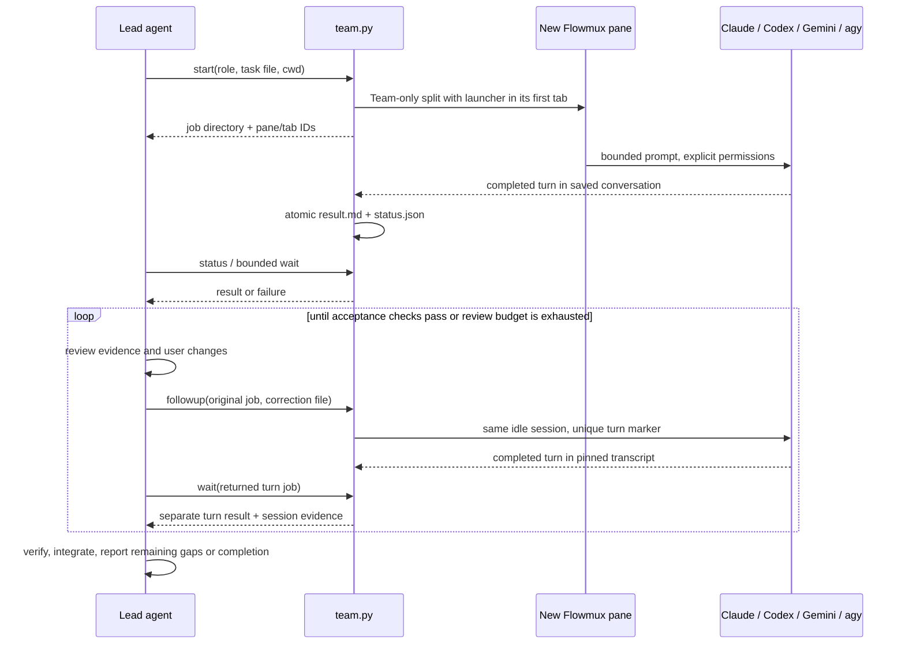

<!-- SPDX-License-Identifier: GPL-3.0-or-later -->

# Flowmux team skill

Claude Code, Codex, Gemini CLI and Antigravity CLI (`agy`) can lead a Team
workspace with this skill. All four providers can also run workers, regardless
of which agent is leading.

`flowmux-team` delegates bounded assignments to workers in visible panes. The lead collects evidence, requests corrections from
the same workers, and verifies the user's acceptance checks. A role describes a
worker's responsibility; each assignment supplies context, file ownership and
acceptance checks. The [communication cookbook](../.agents/skills/flowmux-team/references/cookbook.md)
contains copyable user prompts, expected lead/worker conversations, acceptance
checks and runnable review, clarification and test-driven correction examples.

## Design



The helper first resolves the lead's workspace with `team.py context`. Normal
and SSH workspaces return `inline`: the current agent completes the work itself.
Team workspaces allow `team-spawn`, which creates a split with a single tab
running the normal Claude/Codex interactive interface or Gemini/agy native
structured output. Worker creation and recovery preserve the current workspace,
keyboard focus and another workspace's pane zoom. The provider's
initial prompt carries a task-file reference and a unique job marker. Each worker may use a
different provider; pass the first report into the next worker's task file for
cross-provider review.

The managed Codex shim starts local invocations with `--no-daemon` when supported.
The lead and its workers therefore keep the originating pane's environment and
process ancestry. Explicit `--remote` connections and older clients keep their
original arguments; sandbox, approval and profile settings are unchanged.
`flowmux hooks refresh-shims` refreshes existing managed and legacy PATH wrappers
after a binary-only update, without changing provider settings or hooks. The
Linux/macOS installers run it automatically. Resume paths restore the pane’s
wrapper precedence after login startup and when reusing a provider PATH. Existing
sessions are not restarted or migrated; starting a new chat in an existing TUI
does not change that TUI’s shared-daemon connection.

Codex source resolution validates direct agent/window process ancestry on the
first turn, without waiting for a session hook. Existing shared-daemon sessions
still require a unique reported session binding;
working directory, window focus and tab titles cannot select a launch target.
A worker remains in the lead's workspace even when its working directory differs.
Retrying an unbound shared session cannot establish ownership: the daemon has
already lost the pane-local origin. Keep the session open and report that limit.
The GUI checks the requesting process against its live terminal PIDs as well as
reported agent presence. Source discovery does not depend on the Agent Bar's
periodic process poll and does not synthesize a session or activity event.

Results come from a completed turn in the saved conversation containing the
exact job marker in its user prompt. The final JSON report must declare
`task_status: completed|blocked|failed` and a nonempty `report`. A single surrounding
JSON code block is accepted, but extra prose is rejected. Tool output and
intermediate commentary cannot complete a task. Missing, malformed and ambiguous
reports fail closed. Reports, session/transcript IDs and pane receipts stay in
the private job directory. Workers run in YOLO mode; read-only assignments are
prompt instructions rather than sandbox/tool restrictions.

The interactive agent stays open after completing its turn. `team.py followup
JOB --task-file FILE` sends another assignment to the same idle worker and returns
a separate turn job for `status`/`wait`. The original job records only its initial
turn; subsequent immutable reports live in `turns/0001`, `turns/0002`, etc.
The helper verifies the live session, workspace, pane and active surface before
input, retains paste evidence, and correlates completion with a unique user-prompt
marker after the recorded transcript offset. Concurrent or unresolved assignments
prevent another dispatch. Uncertain delivery is retained, never blindly retried.
Managed follow-ups verify that their supervisor still owns its lock before
dispatch; new jobs additionally verify its process identity and generation.
A live idle provider without its supervisor receives no new assignment.
Managed collection/progress timeouts trigger bounded recovery; verified input
waits pause these deadlines and never approve dialogs. A restored launcher never reruns its task.
With automatic agent restoration enabled, the launcher passes the saved resume
command to a real shell so the conversation reopens in its original pane.
New jobs keep their private launchers, worker code and reports under
`$XDG_STATE_HOME/flowmux/team-jobs` (the platform state directory by default).
These files are needed to restore worker terminals; temporary-file cleanup or
uninstalling the skill must not remove them. Jobs created by older versions
still use their original temporary paths.

New jobs pin the lead's provider configuration roots for execution, transcript
lookup and restoration; quota fallback also uses the CLI resolved on the lead's
PATH. Only paths are stored, not authentication tokens.

The supervisor owns an OS file lock. Status/wait and launcher reentry reconcile
an unfinished job whose owner exited to `failed` / `interrupted`, including
after a forced termination. Completed, blocked, failed and timed-out outcomes
are never rewritten. This does not kill a surviving child or replay partial work.
Older jobs without the lock marker cannot be reconciled this way.

## Use and installation

Read [the skill](../.agents/skills/flowmux-team/SKILL.md), then run
[the researcher → reviewer sample](../.agents/skills/flowmux-team/references/sample.md)
from a trusted local repository in a **Team workspace**. Create one with the
sidebar menu or command palette → **New Team Workspace**, or
`flowmux workspace new --team --root /absolute/project`, then start the lead
agent there. Normal and SSH workspaces reject team worker creation. Each worker
uses the split’s sole tab and displays its native interface or structured output. Python 3.9+ and an authenticated
agent CLI are required. The sample selects a simple-tier model on the configured account.

The lead also needs access to that window's Unix socket and `.ctl` companion.
Codex can deny these connections even when it can read the repository. The CLI
reports socket permission errors separately from an unresolved session. Use
Codex's normal permission approval flow for authorized Flowmux commands; stop
if approval is denied. In Linux verification with Codex 0.162.0, the network
proxy returned `unix sockets unsupported` even with a Unix socket allowlist,
so that setting alone is not a working solution on that build. Installing the
skill does not grant socket access, disable the sandbox, or change hook trust.

Open **Options → Skills → Flowmux Team** to install for Claude Code, Codex,
Gemini CLI or Antigravity CLI (`agy`). **Check Team setup** reports Python 3.9+,
the selected CLI and lifecycle hook availability without changing settings or
signing in. Gemini/agy support both lead and worker roles. Authentication and actual task execution are separate checks.

The CLI equivalent is `flowmux agent install --agent gemini --skill flowmux-team`
(use `--agent agy` for Antigravity). Updates back up local changes; removing Team
preserves the CLI skill, agent settings and wrappers.

Gemini/agy workers use their official `stream-json` per-turn mode inside the
pane. The helper requires a native final result and successful exit; an ordinary
saved answer, step completion or Stop/AfterAgent hook is insufficient. Follow-ups
resume the recorded conversation through native CLI arguments. Existing hooks
remain enabled. Account access and trusted-directory requirements still apply.

Each row checks the complete bundle: `SKILL.md`, `scripts/team.py`,
`scripts/examples.py`, `references/sample.md` and `references/cookbook.md`.
Missing or changed resources offer **Update**, which
backs up changed files before replacement. **Remove** deletes the five
managed files, preserves modified content in backups, and leaves unrelated files
alone. Linked resource directories are user-managed and cannot be changed here.
The instructions preview is read-only; Python and agent CLIs must already be
installed. Start a new agent session if the skill is not discovered immediately.

`flowmux doctor` checks existing team installations and `flowmux fix` repairs
them. The team skill remains opt-in: repair does not create a new installation
or reinstall a fully removed bundle. `flowmux agent install/doctor/uninstall`
continue to target the Flowmux CLI skill.

For manual installation, copy the **whole** `.agents/skills/flowmux-team` directory, including `scripts/` and
`references/`, to the desired agent's skills root:

| Agent | Destination directory |
|---|---|
| Claude Code | `~/.claude/skills/flowmux-team` (`CLAUDE_CONFIG_DIR` overrides the root) |
| Codex | `~/.agents/skills/flowmux-team` |

For example, from this repository, install a new Claude copy without replacing
an existing directory:

```bash
python3 - <<'PY'
import os
from pathlib import Path
import shutil
root = Path(os.environ.get('CLAUDE_CONFIG_DIR', Path.home() / '.claude'))
shutil.copytree('.agents/skills/flowmux-team', root / 'skills/flowmux-team')
PY
```

An existing destination raises an error; inspect and back up local changes
before updating it. Reload the agent at a convenient boundary to discover the
skill. The GUI can manage this copy after installation.
The source is also discoverable by agents that load repository `.agents/skills`.

## Limits and validation

The helper supports local Flowmux panes with Claude, Codex, Gemini and agy. It does not
attach to an existing agent conversation. For existing Claude sessions, use
Claude's `ListAgents`/`SendMessage` contract described in [AGENTS.md](../AGENTS.md).
It does not implement the native Claude Agent Teams shared task list, automatic
merges, persistent scheduling or remote SSH workers.

Team workers launch in YOLO mode. Codex uses
`--no-daemon --dangerously-bypass-approvals-and-sandbox`; Claude uses
`--allow-dangerously-skip-permissions --permission-mode bypassPermissions` with
its normal tools and MCP configuration, including shell checks. The Claude allow
flag alone does not activate bypass mode. Gemini uses `--approval-mode yolo`;
agy uses `--dangerously-skip-permissions`. The same mode applies to replacement
and restored sessions. `--allow-edits` authorizes edits in the task prompt; omitting
it supplies a read-only instruction, not an enforced filesystem restriction.
Keep tasks within the user's authorized scope. Provider configuration files,
hook trust, authentication and the lead's permissions are unchanged. Remaining
authentication, trust or permission failures are still blockers.

Run the account-free regression checks with `python3 scripts/test-agent-team.py`.
After building, run `cargo test -p flowmux-cli --lib codex_shim_first_tool_gui -- --ignored --nocapture`
on Linux to verify first-tool discovery through the generated shim in two
same-directory Team workspaces, without pre-registering session bindings.
After building current binaries, `python3 scripts/test-team-pingpong-gui.py` runs
all three cookbook cases with both provider fixtures in isolated real GUI PTYs.
Append `--real-agent claude` or `--real-agent codex` to test the same examples with
an installed, authenticated native CLI. These live-account checks consume quota
and can stop on trust, permissions, missing hooks or unavailable models. Fixtures
alone do not prove native CLI behavior or model quality.
Run the sample to verify actual pane creation, provider execution and handoff;
mocked agent checks alone do not establish that authentication or a model works.
On Linux, `python3 scripts/test-skills-gui.py` checks the actual Settings controls,
bundle repair/removal, the installed sample's handoff, profile inheritance,
session restoration and interrupted workers with fixture agents in an isolated
GUI. It requires the accessibility and Xvfb dependencies listed in
the script and preserves screenshots and logs in its printed artifact directory.
`python3 scripts/test-team-recovery-gui.py` checks bounded model replacement,
owned process shutdown, failed-pane cleanup and native foreground input in the
same isolated GUI harness. The GTK regression additionally checks the visible
workspace, actual focused widget and zoom during background splits and closes.

## Task routing and prompt size

The lead chooses a provider per assignment: Codex for code investigation and
implementation, Claude for independent review or synthesis; review Claude's
implementation with Codex when useful. Explicit user choices take priority.
This is a workflow default, not a provider capability restriction. Simple work
needs no automatic second reviewer.

`team.py start --complexity simple|standard|complex` chooses a model and effort
for the new worker only. The lead assesses scope, expected work, uncertainty and
consequence rather than prompt length. Defaults are Luna/high, Sol/medium,
Astra/high for Codex; Haiku/low, Sonnet/medium, Opus/high for Claude; Flash Lite,
Flash, Pro for Gemini; Gemini Flash/low, Gemini Argon/medium, Claude Opus/high for
agy. `--agent auto` selects an installed CLI. Explicit `--agent`, `--model` and
`--effort` take priority. `sol`, `terra`, `opus`, `sonnet` and `sonet` aliases are
accepted; Terra is `gpt-5.6-terra`. Gemini uses its model tier instead of an effort
flag. `team.py route` previews the selection and alternatives without launching.

Routing also consumes the existing GUI usage collector's credential-free,
profile-scoped snapshots in the state directory's `team-usage/`. Current
Claude/Codex observations exclude exhausted provider/model routes before pane
creation; model-scoped limits do not block unrelated models, and Claude web-only
limits do not apply to CLI workers. Missing, failed,
expired or more-than-five-minute-old observations are explicitly unknown/stale
and retain native error-based fallback. The helper adds no usage API requests.
Refresh **AI Usage** to renew observations. Gemini/agy have no preflight usage
collector yet. `route` and job receipts retain candidate usage decisions.

When fallback is enabled, known exhaustion can replace an explicit provider before
launch. With `--no-fallback`, it returns a diagnostic without creating a pane.
Native quota errors also create a locked, atomic hold in `team-quota/` shared by
jobs using the same provider configuration root. A known reset ends the hold;
unknown resets use five minutes. A newer available observation releases it early.
These are observations, not quota reservations; simultaneous provider work can
still exhaust an account after selection.

Native quota/capacity errors, unavailable models/clients, unexpected exits,
malformed/failed reports and stalled attempts trigger bounded substitution.
The default is at most four attempts, without repeating provider/model pairs;
quota-exhausted providers are skipped for the rest of the assignment. Current
account limits are enforced by the provider, not inferred from CLI installation.
`--stall-timeout` defaults to 180 seconds without native progress. There is no
total deadline by default (`--timeout 0`). A positive `--timeout` is an explicit
attempt budget: expiry stops and closes the owned worker with `time_budget`,
without automatic replacement or a false `stalled` diagnosis. Verified input waits
pause both deadlines. Increase the stall interval for expected quiet tools or
reasoning. `followup` accepts both limits as overrides for updated-helper jobs;
older jobs retain their copied policy. `--no-fallback` disables substitution,
while retaining failed-worker cleanup.

The supervisor saves evidence, stops its owned process tree and verifies death.
A detached handoff then validates and closes the failed single-terminal pane,
and opens its replacement from the original lead. It preserves user focus and
never closes the lead, another session, or a pane with added tabs. If identity,
shutdown, close or dispatch is uncertain, it stops with a diagnostic. Old launchers
cannot replay assignments. Partial edits remain for the replacement to inspect.

The same policy covers helper follow-ups after confirmed receipt. Manual TUI
turns are not managed. Earlier results remain intact; `status`/`wait` return the
current pane/surface, `attempts`, `closed_panes` and `fallback_used`. Successful
and task-level blocked panes remain open. When no alternative remains, the failed
pane is closed and its artifacts/failure are retained. A substituted review using
the researcher's provider is independent-session review, not cross-provider review.
Jobs created by older helpers retain their copied implementation.

`python3 scripts/test-team-recovery-gui.py` checks quota/capacity, stalled or
crashed processes, malformed reports, descendant shutdown, pane replacement,
Gemini/agy completion and exact-session follow-ups in isolated real PTYs.
`test-skills-gui.py` also types native keys in another workspace across worker
launch/completion; the GTK regression covers background nested splits and cleanup
while the foreground pane is zoomed.
`python3 scripts/test-team-usage-gui.py` exercises the real GUI usage collector,
initial provider exclusion, quota holds across jobs and expiry in isolated panes.

Assignments are copied into private job `task.txt` files. The interactive TUI
receives a short file reference plus the result contract. Give workers relevant
file paths/lines and result paths rather than duplicating full source files.
Reading those files still consumes context; the lead should keep assignments
focused and ask for concise reports. Full assignments are preserved without truncation.

Codex model guidance: https://developers.openai.com/codex/models/ . Claude model
aliases and effort flags follow the installed `claude --help`; specific versions
and account access must be checked in that client.
