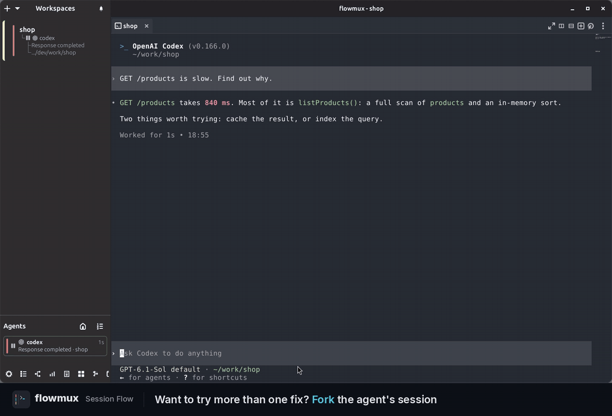

<!-- SPDX-License-Identifier: GPL-3.0-or-later -->

# Flowmux 0.14.0

**대화를 분기하고, 맥락을 이어가고, 모든 경로를 한눈에 확인하세요.**

Flowmux 0.14.0은 **Session Flow**를 소개합니다. 에이전트 대화를 분기해
원본 옆에서 다른 접근을 시도하고, 그래프에서 각 분기를 탐색할 수 있습니다.
브라우저 쿠키 가져오기, 터미널 휠 속도 설정, 새 단축키도 함께 추가했습니다.

[English release notes](https://github.com/flowmux-ai/flowmux/blob/v0.14.0/docs/releases/0.14.0.md)

## 하이라이트

- **Session Flow:** Claude Code·Codex·OpenCode 대화를 오른쪽 분할 pane으로
  분기하고, 그래프에서 다른 분기로 이동하거나 닫힌 세션을 재개합니다.
- **기존 로그인 활용:** 브라우저 도구 모음에서 로컬 브라우저 프로필의
  현재 사이트 쿠키를 가져옵니다.
- **내게 맞는 스크롤 속도:** 터미널 마우스 휠 속도를 0.5×–5×로 조절하고
  열려 있는 터미널에 즉시 적용합니다.
- **더 빠른 기능 접근:** **Ctrl+Alt+B**로 Session Flow를 열고 닫으며,
  **Ctrl+Alt+R**로 현재 워크스페이스 이름을 변경합니다.
- **작업 옆에서 탐색:** 터미널의 웹 링크와 로컬 HTML 파일을 오른쪽 브라우저
  pane에서 열고, 주소창에서 Google로 검색합니다.

## Session Flow — 대화를 이어가며 다른 접근을 시도하세요

대기 중인 **Claude Code**, **Codex**, **OpenCode** 터미널을 우클릭해
**Fork session**을 선택하세요. 같은 대화 이력을 가진 새 네이티브 세션이
오른쪽 분할 pane에 열리고 원본은 왼쪽에 유지됩니다. 새 분기에서 다시
분기해 또 다른 방향을 시도할 수도 있습니다.

**Ctrl+Alt+B**, **Agents** 바 옆의 버튼, 또는 터미널 메뉴의
**View session flow**로 그래프를 열 수 있습니다.

- **분기의 시작점을 확인합니다.** 알려진 조상·형제·자손 세션을 연결하고,
  서로 다른 대화 계보도 한 화면에 표시합니다.
- **원하는 작업으로 바로 이동합니다.** 실행 중인 세션을 클릭하면 해당
  터미널로 이동합니다. 닫힌 분기도 그래프에 남으며, 재개 가능한 세션을
  선택하면 새 분할 pane에서 이어서 작업합니다.
- **그래프를 자유롭게 탐색합니다.** 포인터를 중심으로 확대·축소하고,
  캔버스와 노드를 이동하며, **Fit**으로 전체 그래프를 확인합니다.
  방향키와 Enter로 세션을 선택하고 열 수도 있습니다.
- **대화의 관계를 보존합니다.** Flowmux에서 확인한 분기를 저장하고 명시적인
  Codex 분기 메타데이터를 가져와, 워크스페이스 전환과 재시작 후에도
  계보를 유지합니다.

분기 가능 여부는 설치된 에이전트 버전과 세션 상태에 따라 달라집니다.
대화 분기는 같은 프로젝트 디렉터리를 공유하며 Git 브랜치나 worktree를
생성하지 않습니다. Gemini CLI·Antigravity·Cline은 기존 이력·재개 기능을
유지하지만 Session Flow 분기는 지원하지 않습니다. 원격 Session Flow
실행도 지원하지 않습니다.

[Session Flow 사용 안내](https://github.com/flowmux-ai/flowmux/blob/v0.14.0/docs/agent-sessions.md#session-flow)

## 현재 사이트의 브라우저 쿠키 가져오기

사이트를 연 뒤 주소창 옆의 **Import cookies for this site**를 선택하세요.
로컬 브라우저 프로필과 가져올 대상을 확인하고 승인하면, 해당 쿠키를
적용한 뒤 페이지를 새로고침합니다.

- Chrome·Chromium·Brave·Edge·Firefox와 macOS Arc의 기본 프로필 위치를 찾습니다.
- 접근 권한이 필요하면 운영체제의 keyring 또는 Keychain 승인 창을 사용합니다.
- 원본 브라우저를 닫지 않고 프로필을 읽으며, 접근 거부·취소·일부 가져오기
  실패 시 상태와 복구 방법을 안내합니다.

지원되는 쿠키만 가져옵니다. 비밀번호·로컬 스토리지·기기에 종속된 키는
가져오지 않으며, 일부 사이트는 다시 로그인해야 합니다. 가져오기는
대화형 도구 모음에서 제공하며 CLI에서는 지원하지 않습니다.

[쿠키 가져오기 안내](https://github.com/flowmux-ai/flowmux/blob/v0.14.0/docs/browser-workflow.md#import-an-existing-login)

## 터미널 조작과 일상적인 브라우징

- **터미널 휠 속도:** **Options → General → Terminal mouse wheel speed (×)**에서
  0.5×–5×를 0.25× 단위로 설정합니다. 기본값은 1×이며 정밀 트랙패드 스크롤은
  기존 동작을 유지합니다.
- **워크스페이스 이름 변경:** **Ctrl+Alt+R**은 터미널에 포커스가 있어도
  현재 워크스페이스의 이름 변경을 엽니다. 터미널 앱에서 같은 키를 사용한다면
  **Options → Keybindings**에서 변경하거나 해제할 수 있습니다.
- **터미널 옆에서 링크 열기:** 웹 URL이나 로컬 HTML 경로를 Ctrl+클릭하면
  오른쪽 브라우저 pane에서 열립니다. 이후 링크는 해당 pane의 새 탭으로
  열며, 로컬 HTML을 Ctrl+Shift+클릭하면 소스를 편집합니다.
- **주소창 개선:** `/tmp/page.html`, `~/page.html`, `./page.html` 같은
  로컬 경로를 열거나 기본 검색 엔진인 Google로 검색합니다.
- **테마 개선:** 창과 브라우저 도구 모음은 터미널 테마를, 웹사이트는 시스템의
  밝게·어둡게 설정을 따릅니다. 시작 페이지에는 Flowmux 아이콘의 어두운
  그라데이션을 적용했습니다.

## 안정성과 성능 개선

- Gemini CLI·Cline 세션을 격리된 프로필을 포함한 원래 저장소·재개 정보로 복원합니다.
- 네이티브 에이전트 hook으로 Team 워크스페이스의 작업 위임을 활성화합니다.
- 북마크 변경 후 메뉴를 갱신하고 저장 실패를 알립니다.
- 대체 화면을 사용하는 터미널 앱에서는 표준 스크롤바를 표시하고, 종료하면
  미니맵을 복원합니다. 탐색 가능한 이력은 해당 앱의 동작에 따라 달라집니다.
- 대화 기록 재분석, 에이전트 표시 갱신, CLI 기능 확인의 반복 비용을 줄이고,
  Session Flow 패널이 보일 때 데이터를 불러옵니다.
- 그래프 렌더링 자원을 재사용하고 세션 소유권, 분기 확인, 비정상 종료 후
  복구를 개선했습니다.
- Linux GUI와 macOS 네이티브 회귀 검사를 확대하고 안정화했습니다.

## 업데이트와 배포 파일

- 앱과 CLI를 함께 업데이트하고 편한 시점에 Flowmux를 재시작해 새 런타임을
  사용하세요. 기존 실행 창은 이전 빌드로 계속 동작합니다.
- Linux x86_64는 tarball·Debian 패키지, macOS Apple Silicon은 DMG를 제공합니다.
  DMG의 **Flowmux.app**을 **Applications**로 이동하세요. 바이너리에는
  `.sha256` 체크섬 파일이 함께 제공됩니다.
- macOS 프리뷰에는 `/opt/homebrew`의 Homebrew 런타임 라이브러리가 필요합니다.
  ad-hoc 서명만 적용되며 Developer ID 서명·공증과 Intel macOS 바이너리는
  제공하지 않습니다.
- macOS CI·릴리즈 빌드는 알려진 네이티브 수명주기 오류를 피하기 위해
  GLib 2.88.4·GTK 4.22.3·libadwaita 1.9.3을 사용합니다. DMG는 설치된 Homebrew
  라이브러리를 사용하므로 이 빌드 설정이 사용자 런타임을 교체하지는 않습니다.

[전체 변경 비교](https://github.com/flowmux-ai/flowmux/compare/v0.13.0...v0.14.0)
· [대응 소스](https://github.com/flowmux-ai/flowmux/archive/refs/tags/v0.14.0.tar.gz)
