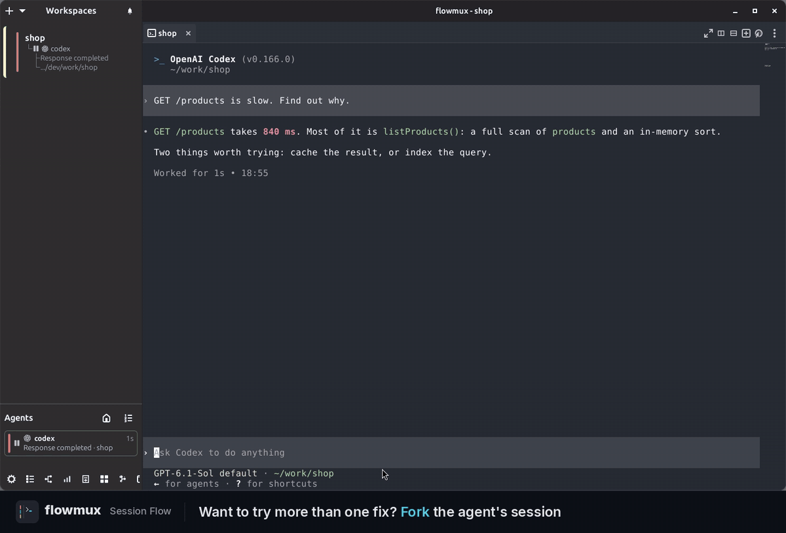

<!-- SPDX-License-Identifier: GPL-3.0-or-later -->

# Flowmux 0.14.0

**Branch the conversation. Keep the context. See every path.**

Flowmux 0.14.0 introduces **Session Flow**: fork an agent conversation, explore
another approach beside the original, and navigate the branches in a visual
graph. This release also brings browser cookie import, adjustable terminal
wheel speed, and new keyboard shortcuts.

[한국어 릴리스 노트](https://github.com/flowmux-ai/flowmux/blob/v0.14.0/docs/releases/0.14.0.ko.md)

## Highlights

- **Session Flow:** fork Claude Code, Codex, and OpenCode conversations into a
  split on the right; follow the graph to switch between branches or resume one.
- **Bring an existing login into Flowmux:** import the current site's cookies
  from a local browser profile through the browser toolbar.
- **Set your scrolling pace:** adjust terminal mouse wheel speed from 0.5× to 5×,
  with changes applied immediately to open terminals.
- **Reach common actions faster:** toggle Session Flow with **Ctrl+Alt+B** and
  rename the active workspace with **Ctrl+Alt+R**.
- **Browse alongside your work:** open terminal web links and local HTML files
  in the browser pane on the right, and search from the address bar with Google.

## Session Flow — explore another approach without losing the conversation

Right-click an idle **Claude Code**, **Codex**, or **OpenCode** terminal and
choose **Fork session**. A new native conversation with the same history opens
in a split on the right, while the original stays on the left. Fork that branch
again to try another direction.

Open **Session Flow** with **Ctrl+Alt+B**, the button next to the **Agents** bar,
or **View session flow** in the terminal menu.

- **See where each branch came from.** The graph connects known ancestors,
  siblings, and descendants, with separate conversation families shown together.
- **Jump back into the work.** Click an open session to focus its terminal.
  Closed branches remain in the graph; select an available one to resume it in
  a new split.
- **Explore the graph.** Zoom around the pointer, pan the canvas, move nodes,
  and use **Fit** to bring the whole graph into view. Arrow keys and Enter also
  let you select and open a session.
- **Keep the relationships.** Flowmux saves verified forks and imports explicit
  Codex fork metadata, preserving the tree across workspace changes and restarts.

Fork support depends on the installed agent version and session state. This is
a conversation fork: branches share the project directory; no Git branch or
worktree is created. Gemini CLI, Antigravity, and Cline retain history/resume
support but cannot fork through Session Flow. Remote Session Flow execution is
not supported.

[Session Flow guide](https://github.com/flowmux-ai/flowmux/blob/v0.14.0/docs/agent-sessions.md#session-flow)

## Import browser cookies for the current site

Open a site and choose **Import cookies for this site** beside the address bar.
Select a local browser profile, review the destination, and approve the import.
Flowmux reloads the page after applying the matching cookies.

- Detects standard Chrome, Chromium, Brave, Edge, Firefox, and macOS Arc profiles.
- Uses the operating system's keyring or Keychain prompts when access is needed.
- Reads the source profile without closing the source browser, and reports
  denied access, cancellation, and partial imports with recovery guidance.

Only supported cookies are transferred; passwords, local storage, and
device-bound keys are not imported. Some sites still require a fresh sign-in.
Import is available through the interactive toolbar, not the CLI.

[Cookie import guide](https://github.com/flowmux-ai/flowmux/blob/v0.14.0/docs/browser-workflow.md#import-an-existing-login)

## Terminal controls and everyday browsing

- **Terminal wheel speed:** **Options → General → Terminal mouse wheel speed (×)**
  offers 0.5×–5× in 0.25× steps. The default remains 1×; precise trackpad scrolling
  keeps its existing behavior.
- **Workspace rename shortcut:** **Ctrl+Alt+R** opens rename for the active
  workspace even with terminal focus. Customize or unbind it in
  **Options → Keybindings** if a terminal application uses that chord.
- **Links beside the terminal:** Ctrl+click a web URL or local HTML path to open
  it in the right browser pane. Further links reuse that pane as new tabs.
  Ctrl+Shift+click a local HTML file to edit its source.
- **Address bar improvements:** open local paths such as `/tmp/page.html`,
  `~/page.html`, and `./page.html`, or enter a search using the Google default.
- **Theme refinements:** window chrome and the browser toolbar follow the
  terminal theme, websites follow the system light/dark preference, and the
  start page uses the Flowmux icon's dark gradient.

## Reliability and performance

- Restore Gemini CLI and Cline sessions with their original storage and resume
  context, including isolated profiles.
- Activate Team workspace delegation through native agent hooks.
- Refresh bookmark menus after changes and report bookmark write failures.
- Show the standard scrollbar for alternate-screen terminal applications,
  restoring the minimap on exit. Available history still depends on the application.
- Reduce repeated transcript parsing, agent display refreshes, and CLI capability
  probes; load Session Flow data when its panel is shown.
- Reuse graph rendering resources and improve session ownership, fork
  confirmation, and crash recovery.
- Expand and stabilize Linux GUI and macOS native regression checks.

## Updating and downloads

- Update the application and CLI together, then restart Flowmux when convenient
  to use the new runtime. Existing windows continue to run their previous build.
- Linux x86_64: tarball and Debian package. macOS Apple Silicon: DMG; drag
  **Flowmux.app** to **Applications**. Binary downloads include `.sha256` files.
- The macOS preview requires Homebrew runtime libraries under `/opt/homebrew`.
  It is ad-hoc signed, not Developer ID signed or notarized; Intel macOS binaries
  are not provided.
- macOS CI and release builds use GLib 2.88.4, GTK 4.22.3, and libadwaita 1.9.3
  to avoid known native lifecycle failures. The DMG uses locally installed
  Homebrew libraries; these build pins do not replace the user's runtime libraries.

[Full changelog](https://github.com/flowmux-ai/flowmux/compare/v0.13.0...v0.14.0)
· [Corresponding source](https://github.com/flowmux-ai/flowmux/archive/refs/tags/v0.14.0.tar.gz)
